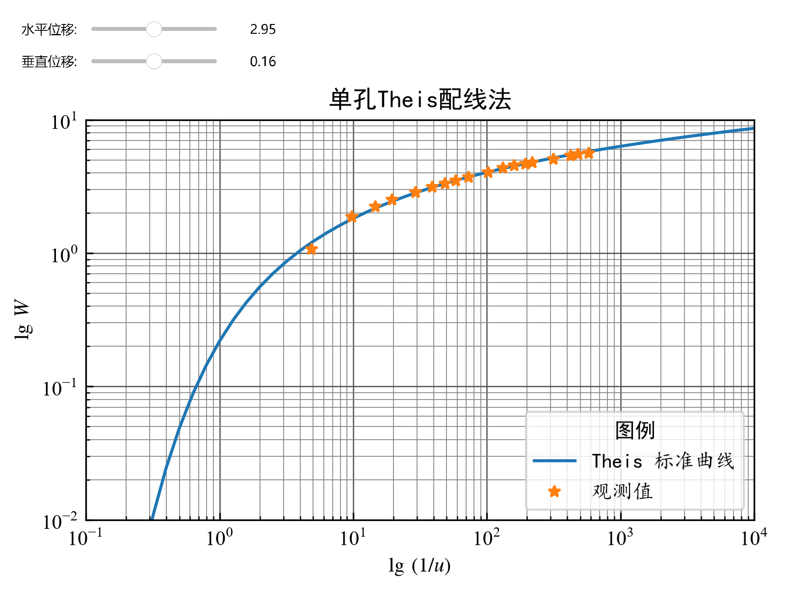
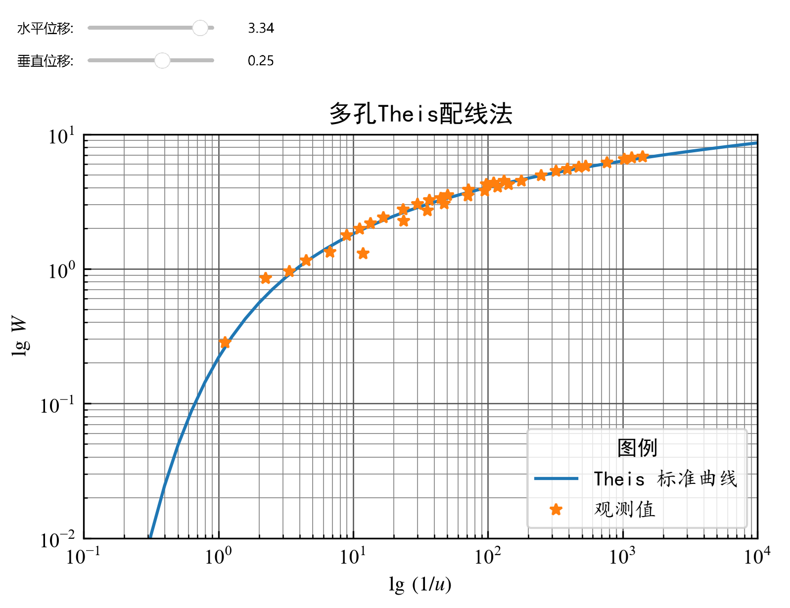
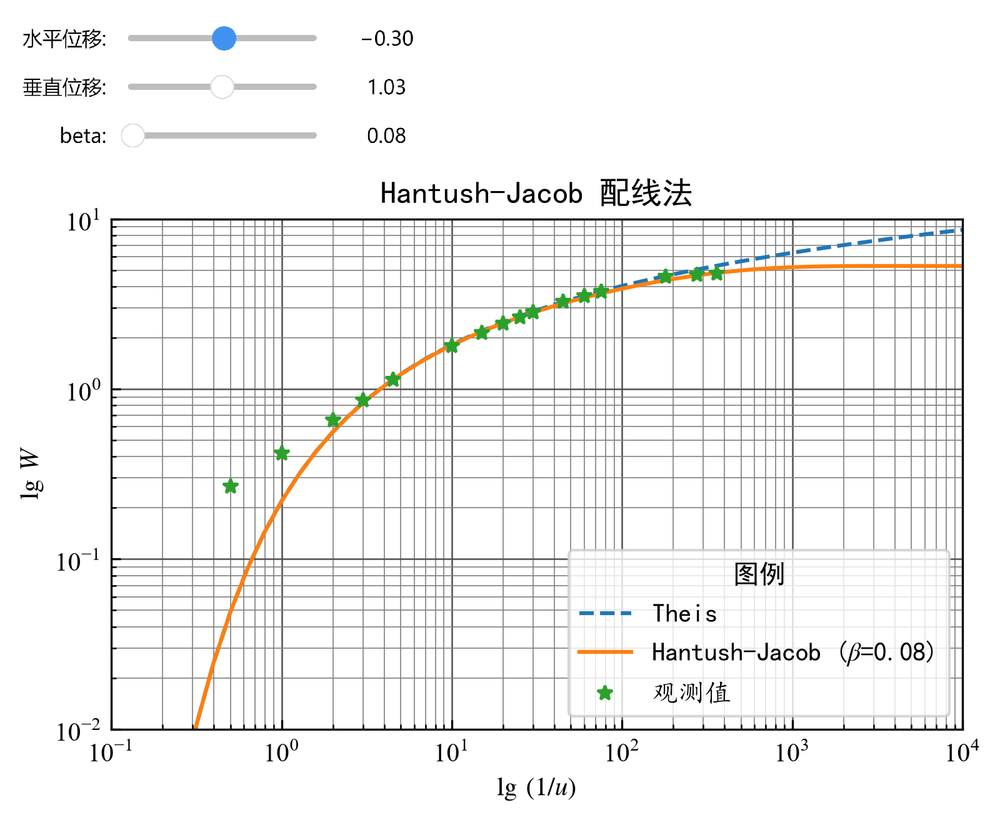

# 实验 2 交互式配线法求参

井流模型的解通常具有如下形式：
$$
\frac{4\pi Ts}{Q}=W(u,\cdots) \tag{2.1}
$$
其中 $W(u,\cdots)$ 为无量纲标准井函数。根据 $s$ 与 $W(u,\cdots)$、$t$ 与 $1/u$ 之间的对应关系，在双对数坐标系下，观测数据 $(s, t)$ 的曲线形态与井函数标准曲线相同，通过匹配后的坐标位移量即可求得相应的水文地质参数。
配线法的基本步骤为：首先绘制标准曲线，然后移动观测数据曲线，根据水平与垂直方向的位移量确定参数 $T$ 和 $S$。

与 Theis 标准曲线不同，Hantush-Jacob 标准曲线为一族曲线，每条曲线对应一个特定的越流因素 $B$。配线时需先选定一条标准曲线以确定 $B$，再移动观测数据曲线使其尽可能贴近该标准曲线，读取位移量后计算 $T$ 和 $S$。
标准曲线可通过教材中的标准函数表绘制，亦可使用本指导书附录提供的 Theis、Hantush-Jacob 井函数程序计算。

## Theis 公式的配线法

对 Theis 公式及其 $u$ 表达式取对数，可得：
$$
\begin{split}
\lg s + \lg\frac{4\pi T}{Q} &= \lg W(u)\\
\lg \frac{t}{r^2}+\lg\frac{4T}{S} &=\lg\frac{1}{u}
\end{split} \tag{2.2}
$$

由此可见，在双对数坐标系中，$s$ - $t/r^2$ 曲线的形状与 $W(u)$ - $1/u$ 标准曲线一致。根据垂直位移可计算 $T$，再结合水平位移可计算 $S$。
记垂直位移为 $\Delta(\lg s)=\lg\frac{4\pi T}{Q}$，水平位移为 $\Delta(\lg\frac{t}{r^2})=\lg\frac{4T}{S}$，则参数计算公式为：
$$
T=\frac{Q}{4\pi}10^{\Delta(\lg s)},\quad S=4T\ 10^{-\Delta(\lg\frac{t}{r^2})} \tag{2.3}
$$

该方法相当于固定标准曲线，移动 $s$ - $t/r^2$ 观测曲线与之匹配。

**例 2**

某承压含水层抽水试验，含水层的顶、底板绝对隔水，抽水时侧向边界尚无影响。抽水井为完整井，抽水量为 60 m$^3$/ h。1 号观测孔距抽水孔 43 m，2 号观测孔距抽水孔 125 m，观测资料如下表。试用 1 号观测孔数据求导水系数和贮水系数。

| t(min) | 1 号孔 s(m) | 2 号孔 s(m) | t(min) | 1 号孔 s(m) | 2 号孔 s(m) |
| :----: | :--------: | :----------: | :----: | :---------: | :---------: |
| 10 | 0.73 | 0.16 | 210 | 2.77 | 1.55 |
| 20 | 1.28 | 0.48 | 270 | 2.99 | 1.70 |
| 30 | 1.53 | 0.54 | 330 | 3.10 | 1.83 |
| 40 | 1.72 | 0.65 | 400 | 3.20 | 1.89 |
| 60 | 1.96 | 0.75 | 450 | 3.26 | 1.98 |
| 80 | 2.14 | 1.00 | 645 | 3.47 | 2.17 |
| 100 | 2.28 | 1.12 | 870 | 3.68 | 2.38 |
| 120 | 2.39 | 1.22 | 990 | 3.77 | 2.46 |
| 150 | 2.54 | 1.36 | 1185 | 3.85 | 2.54 |
: 抽水试验数据

**Python 程序**

```{python}
#| fig-align: center
#| output: false
import numpy as np
from scipy.special import exp1      # 计算 Theis 井函数
from ipywidgets import interact, fixed
import ipywidgets as widgets
import matplotlib.pyplot as plt
plt.rcParams['font.family'] = ['Times New Roman']
plt.rcParams['mathtext.fontset'] = 'stix'  # 显示数学公式（STIX 字体）
plt.rcParams['axes.unicode_minus'] = False  # 解决中文负号不能正确显示的问题
plt.rcParams['xtick.direction'] = 'in'
plt.rcParams['ytick.direction'] = 'in'
# 设置 NumPy 数组的显示格式
np.set_printoptions(precision=4)
# ------------------------------------------------------------
# 函数：绘制 Theis 配线图并计算参数
# dx, dy : 水平、垂直方向的对数位移量
# tr2    : 观测数据中的 t/r^2 值数组
# s      : 降深数组
# Q      : 抽水量 (m^3/min)
# ------------------------------------------------------------
def Theis_fit(dx, dy, tr2, s, Q, title_suffix=""):
    # 创建图形和坐标轴
    fig, ax = plt.subplots( )
    # 设置坐标轴：双对数坐标，范围固定
    ax.set(xscale="log", yscale="log",
           xlim=(1.0e-1, 1.0e4), ylim=(1.0e-2, 10.0),
           xlabel=r"$\lg\,(1/u)$", ylabel=r"$\lg\,W$")
    # 显示网格（主线和次线）
    ax.grid(True, which="major", linestyle="-", linewidth=0.6, color="#505050")
    ax.grid(True, which="minor", linestyle="-", linewidth=0.4, color="#808080")
    # 设置坐标轴刻度比例相同，使网格边长相等
    ax.set_aspect('equal')
    # 生成用于绘制标准曲线的横坐标（1/u 的值）
    x_curve = 10**np.linspace(-1, 4, 51)   # 从 0.1 到 10000 的对数等间距点
    # 计算标准曲线纵坐标：W(u) = exp1(1/u)
    y_curve = exp1(1 / x_curve)
    ax.plot(x_curve, y_curve, label="Theis 标准曲线", linestyle="-")
    # 绘制移动后的观测数据：横坐标乘以 10^dx，纵坐标乘以 10^dy
    ax.plot(tr2 * 10**dx, s * 10**dy, "*", label="观测值")
    # 添加图例（位置右下角）
    plt.legend(
        loc='lower right', prop={"family": "KaiTi"}, title="图例", 
        title_fontproperties={'family': 'SimHei'}
        )
    ax.set_title(f"{title_suffix}", fontfamily='SimHei')
    plt.tight_layout()   # 自动调整布局
    plt.savefig(f"fig_files/{title_suffix}.png",dpi=300,bbox_inches='tight')
    plt.pause(0.01)      # 暂停更新并显示图形    
    # 根据位移量计算参数
    # 由配线原理：T = (Q / (4π)) * 10^(Δlg s)
    T = 10**dy * Q / (4 * np.pi)
    # S = 4T * 10^(-Δlg(t/r^2))
    S = 10**(-dx) * 4 * T
    print(f'导水系数: T = {T:.4f} m^2/min')
    print(f'储水系数: S = {S:.4e}')
# ------------------------------------------------------------
# 准备数据（例2：单孔观测数据）
# ------------------------------------------------------------
Q = 60.0 / 60        # 抽水量，单位转换为 m^3/min
r1 = 43.0            # 观测孔距离，单位 m
t1 = np.array([10, 20, 30, 40, 60, 80, 100, 120, 150, 210,
               270, 330, 400, 450, 645, 870, 990, 1185])   # 时间，分钟
s1 = np.array([0.73, 1.28, 1.53, 1.72, 1.96, 2.14, 2.28, 
               2.39, 2.54, 2.77, 2.99, 3.10, 3.20, 3.26, 
               3.47, 3.68, 3.77, 3.85])   # 降深，米
# 计算 t/r^2 值
tr2 = t1 / r1**2
# 使用公共函数估算初始参数，获得初始位移量
T_est, S_est, _, _ = initial_parameters(t1, s1, Q, r1)
# 位移公式：
#   dx = lg(4T / S)
#   dy = lg(4πT / Q)
dx_init = np.log10(4 * T_est / S_est)
dy_init = np.log10(4 * np.pi * T_est / Q)
# 创建水平位移滑块
dx_slider = widgets.FloatSlider(
    value=dx_init, min=dx_init - 0.5, 
    max=dx_init + 0.5, step=0.01,
    description="水平位移:",
    continuous_update=False, readout_format='.2f'
    )
# 创建垂直位移滑块
dy_slider = widgets.FloatSlider(
    value=dy_init, min=dy_init - 0.5, 
    max=dy_init + 0.5, step=0.01,
    description="垂直位移:",
    continuous_update=False, readout_format='.2f'
    )
# 启动交互：拖动滑块时自动更新图形和参数
interact(
    Theis_fit,
    dx=dx_slider, dy=dy_slider,
    tr2=widgets.fixed(tr2),   # 固定参数
    s=widgets.fixed(s1),
    Q=widgets.fixed(Q),
    title_suffix="单孔Theis配线法"
    );
```



```{python}
#| echo: false
T = 0.1163
S = 5.1645e-4
print(f'导水系数: T = {T:.4f} m^2/min')
print(f'储水系数: S = {S:.4e}')
```

**程序说明：**

上述程序既适用于单观测孔数据，亦可用于多观测孔数据，仅数据准备方式有所不同。子例程 `initial_parameters` 取数据中部的相邻两点，按 Jacob 公式计算初始参数，可使观测数据在初始状态下尽可能靠近标准曲线；`Theis_fit` 函数则负责绘制标准曲线及移动后的观测数据散点图，并计算输出参数。

程序中使用了 `ipywidgets` 库创建交互式控件。该库提供了多种独立控件，如 `IntSlider`、`FloatSlider`、`Text`、`Dropdown`、`Checkbox`、`Button`、`Output` 等。

以 `FloatSlider` 为例，其为 `ipywidgets` 中的浮点数滑块控件，通过滑块位置获取浮点数值。其参数包括 `value`（当前值）、`min`（最小值）、`max`（最大值）、`step`（步长）、`description`（控件左侧的标签文字）、`continuous_update`（拖动时是否实时触发更新，默认为 `True`）、`orientation`（滑块方向）、`readout`（是否显示当前数值，默认为 `True`）、`readout_format`（显示格式，默认为 `'.2f'`，即保留 2 位小数）等。

`interact` 函数可自动为指定函数生成交互控件，其第一个参数为函数，后续参数为控件（对应函数的交互参数）；`interactive` 函数与 `interact` 类似，但返回一个交互对象，需调用 `IPython.display()` 进行显示；`fixed` 函数用于固定某个参数，使其不参与交互。

移动滑块使观测数据与标准曲线达到最佳匹配，即可得到对应的最优参数 $T$ 和 $S$。

**例 3**

根据 **例 2** 的观 1、观 2 数据求含水层水文地质参数。多个数组的拼接可使用 `np.concatenate()` 函数。

```{python}
#| fig-align: center
#| output: false
import numpy as np
from scipy.special import exp1
from ipywidgets import interact, widgets
import matplotlib.pyplot as plt
plt.rcParams['font.family'] = ['Times New Roman']
plt.rcParams['mathtext.fontset'] = 'stix'   # 显示数学公式（STIX 字体）
plt.rcParams['axes.unicode_minus'] = False  # 解决中文负号不能正确显示的问题
plt.rcParams['xtick.direction'] = 'in'
plt.rcParams['ytick.direction'] = 'in'
np.set_printoptions(precision=4)
# 抽水量
Q = 60.0 / 60
# 观测孔1数据
r1 = 43.0
t1 = np.array([10, 20, 30, 40, 60, 80, 100, 120, 150, 210,
               270, 330, 400, 450, 645, 870, 990, 1185])
s1 = np.array([0.73, 1.28, 1.53, 1.72, 1.96, 2.14, 2.28, 2.39, 2.54, 2.77,
               2.99, 3.10, 3.20, 3.26, 3.47, 3.68, 3.77, 3.85])
# 观测孔2数据
r2 = 140.0
t2 = np.array([10, 20, 30, 40, 60, 80, 100, 120, 150, 210,
               270, 330, 400, 450, 645, 870, 990, 1185])
s2 = np.array([0.16, 0.48, 0.54, 0.65, 0.75, 1.00, 1.12, 1.22, 1.36, 1.55,
               1.70, 1.83, 1.89, 1.98, 2.17, 2.38, 2.46, 2.54])
# 将两个孔的 t/r^2 和降深 s 拼接成一个长数组
tr2 = np.concatenate((t1 / r1**2, t2 / r2**2))
s = np.concatenate((s1, s2))
# 估计初始参数（基于第一个孔）
T_est, S_est, _, _ = initial_parameters(t1, s1, Q, r1)
dx_init = np.log10(4 * T_est / S_est)
dy_init = np.log10(4 * np.pi * T_est / Q)
# 创建滑块
dx_slider = widgets.FloatSlider(
    value=3.34, min=dx_init - 0.5, 
    max=dx_init + 0.5, step=0.01,
    description=r"水平位移:",
    continuous_update=False)
dy_slider = widgets.FloatSlider(
    value=0.25, min=dy_init - 0.5, 
    max=dy_init + 0.5, step=0.01,
    description=r"垂直位移:",
    continuous_update=False)
# 交互函数（与单孔相同，直接调用之前定义的 Theis_fit）
interact(
    Theis_fit, dx=dx_slider, dy=dy_slider,
    tr2=widgets.fixed(tr2), s=widgets.fixed(s), Q=widgets.fixed(Q),
    title_suffix="多孔Theis配线法"
    );
```



```{python}
#| echo: false
T = 0.1415
S = 2.5873e-4
print(f'导水系数: T = {T:.4f} m^2/min')
print(f'储水系数: S = {S:.4e}')
```

**练习 2**

根据 **例 2** 的观测数据，用观 2 孔数据求参，并与例 2、例 3 的结果比较，并分析差异的原因。

**思考题**

为何使用多孔数据的配线效果可能不理想？多个求参结果应如何取舍？

## Hantush - Jacob 公式的配线法

Hantush-Jacob 公式的配线法与 Theis 公式配线法原理相同，唯一区别在于需根据特定曲线确定越流因素 $B$。

对公式：
$$
s\cdot\frac{4\pi T}{Q}=W\left(u,\frac{r}{B}\right),\quad t\cdot\frac{4T}{r^2S}=\frac{1}{u} \tag{2.4}
$$
两边取对数，得：
$$
\lg s + \lg\frac{4\pi T}{Q}= \lg W\left(u,\frac{r}{B}
\right),\quad\lg t+\lg\frac{4T}{r^2S}=\lg\frac{1}{u} \tag{2.5}
$$

**程序的设计思路**

在标准曲线坐标系中移动 $s$ - $t$ 散点图，根据位移量计算 $(T, S)$。记坐标位移量为：
$$
\Delta \lg(s)=\lg\frac{4\pi T}{Q},\quad \Delta \lg(t)=\lg\frac{4T}{r^2S} \tag{2.6}
$$
则参数 $T$ 与 $S$ 的计算公式为：
$$
T=\frac{Q}{4\pi}10^{\Delta\lg(s)},\quad S=\frac{4T}{r^2}10^{-\Delta\lg(t)} \tag{2.7}
$$
输入参数 $\beta = r/B$ 并绘制对应的 Hantush-Jacob 标准曲线，以最佳匹配结果确定 $\beta$。

**例 4**

对某承压含水层抽水孔进行 12 小时的定流量非稳定流抽水试验，抽水量为 $528\ m^3/d$，距抽水孔 90 m 处有一观测孔，观测数据如下表所示，试确定该含水层的水文地质参数。

| 序号 | 时间(min) | 降深(cm) | 序号 | 时间(min) | 降深(cm) |
| :--: | :-------: | :------: | :--: | :-------: | :------: |
|  1   |     1     |   2.5    |  9   |    50     |   24.7   |
|  2   |     2     |   3.9    |  10  |    60     |   26.4   |
|  3   |     4     |   6.1    |  11  |    90     |   30.4   |
|  4   |     6     |   8.0    |  12  |    120    |   33.0   |
|  5   |     9     |   10.6   |  13  |    150    |   35.0   |
|  6   |    20     |   16.8   |  14  |    360    |   42.6   |
|  7   |    30     |   20.0   |  15  |    550    |   44.0   |
|  8   |    40     |   22.6   |  16  |    720    |   44.5   |
: 承压含水层抽水试验观测数据

**Python 程序**

```{python}
#| fig-align: center
#| output: false
import numpy as np
import scipy.special as sps
from scipy.special import exp1
import ipywidgets as widgets
from ipywidgets import interact
import matplotlib.pyplot as plt
plt.rcParams['font.family'] = ['Times New Roman']
plt.rcParams['mathtext.fontset'] = 'stix'  # 显示数学公式（STIX 字体）
plt.rcParams['axes.unicode_minus'] = False  # 解决中文负号不能正确显示的问题
np.set_printoptions(precision=4)
# ------------------------------------------------------------
# 函数：计算 Hantush-Jacob 井函数 W(u, beta)
# 输入：
#   u    - 数组，u = r²S/(4Tt)
#   beta - 数组或标量，beta = r/B
# 输出：
#   W    - 井函数值（与 u 形状相同）
# 实现原理：采用级数展开，根据 beta 与 2√u 的大小关系选择不同公式
# ------------------------------------------------------------
def hantush_jacob(u, beta):
    # 定义内部函数，处理单个数值
    def wellfunc(u_val, beta_val):
        if u_val < 0:
            print('错误：u 不能为负数')
            return np.nan
        # 当 u = 0 时，对应稳定流状态，W = 2 K0(beta)
        if u_val == 0.0:
            return 2.0 * sps.k0(beta_val)

        # 根据 beta 与 2√u 的关系选择级数
        if beta_val <= 2 * np.sqrt(u_val):
            # 情况1：beta ≤ 2√u，使用第一类级数
            W_sum = 0.0
            n = 0
            term = sps.expn(n + 1, u_val)   # n=0 时的指数积分
            while np.abs(term) > 1e-10:     # 当项小于1e-10时停止
                W_sum += term
                n += 1
                # 递推系数 r = (-beta²/(4u))^n / n!
                # 这里用累乘方式更新
                if n == 1:
                    r = -beta_val**2 / (4 * u_val)
                else:
                    r = r * (-beta_val**2 / (4 * u_val)) / n
                term = r * sps.expn(n + 1, u_val)
            return W_sum
        else:
            # 情况2：beta > 2√u，使用第二类级数
            W_sum = 2.0 * sps.k0(beta_val)
            n = 0
            term = sps.expn(n + 1, beta_val**2 / (4 * u_val))
            while np.abs(term) > 1e-10:
                W_sum -= term
                n += 1
                if n == 1:
                    r = -u_val
                else:
                    r = r * (-u_val) / n
                term = r * sps.expn(n + 1, beta_val**2 / (4 * u_val))
            return W_sum
    # 将内部函数向量化，使其可以处理数组输入
    vec_wellfunc = np.vectorize(wellfunc)
    return vec_wellfunc(u, beta)
# ------------------------------------------------------------
# 绘图交互函数
# dx, dy : 时间轴和降深轴的对数位移
# beta   : 越流参数 beta = r/B
# t, s, Q, r : 观测数据
# ------------------------------------------------------------
def Hantush_Jacob_fit(dx, dy, beta, t, s, Q, r):
    # 创建图形和坐标轴
    fig, ax = plt.subplots()
    ax.set(xscale="log", yscale="log",
           xlim=(1e-1, 1e4), ylim=(1e-2, 10.0),
           xlabel=r"$\lg\,(1/u)$", ylabel=r"$\lg\,W$")
    ax.grid(True, which="major", linestyle="-", linewidth=0.6, color="#505050")
    ax.grid(True, which="minor", linestyle="-", linewidth=0.4, color="#808080")
    ax.set_aspect('equal')
    # 标准曲线的横坐标（1/u）
    x_curve = 10**np.linspace(-1, 4, 51)
    # Theis 曲线（无越流）
    ax.plot(x_curve, exp1(1/x_curve), label="Theis", linestyle="--")
    # Hantush-Jacob 曲线
    ax.plot(
        x_curve, hantush_jacob(1/x_curve, beta), 
        label=rf"Hantush-Jacob ($\beta$={beta:.2f})", linestyle="-"
        )
    # 移动后的观测数据
    ax.plot(t * 10**dx, s * 10**dy, '*', label="观测值")
    plt.legend(
        loc='lower right', prop={"family": "KaiTi"}, title="图例", 
        title_fontproperties={'family': 'SimHei'}
        )
    ax.set_title("Hantush-Jacob 配线法", fontfamily='SimHei')
    plt.tight_layout()   # 自动调整布局
    plt.savefig('fig_files/Hantush-Jacob配线法.png',dpi=300,bbox_inches='tight')
    plt.pause(0.01)      # 暂停更新并显示图形
    # 根据位移量计算参数
    T = Q / (4 * np.pi) * 10**dy
    S = 4 * T / r**2 * 10**(-dx)
    print(f'导水系数 T = {T:.4f} m^2/min')
    print(f'储水系数 S = {S:.4e}')
    if beta > 0:
        B = r / beta
        print(f'越流因素 B = {B:.2f} m')
    # 计算拟合残差平方和
    u = r**2 * S / (4 * T * t)
    s_calc = Q / (4 * np.pi * T) * hantush_jacob(u, beta)
    RSS = np.sum((s_calc - s)**2)
    print(f'残差平方和 RSS = {RSS:.4e}')
# ------------------------------------------------------------
# 准备数据（例4）
# ------------------------------------------------------------
Q = 528 / 1440      # 抽水量，m^3/min
r = 90.0            # 观测孔距离，m
t = np.array([1, 2, 4, 6, 9, 20, 30, 40, 50, 60,
              90, 120, 150, 360, 550, 720])          # 时间，min
s = np.array([2.5, 3.9, 6.1, 8.0, 10.6, 16.8, 20.0, 22.6, 24.7, 26.4,
              30.4, 33.0, 35.0, 42.6, 44.0, 44.5]) / 100   # 降深，米
# 用公共函数估算初始参数
T_est, S_est, _, _ = initial_parameters(t, s, Q, r)
dx_init = np.log10(4 * T_est / S_est / r**2)
dy_init = np.log10(4 * np.pi * T_est / Q)
# 创建交互控件
dx_slider = widgets.FloatSlider(
    value=-0.3, min=dx_init - 0.5, max=dx_init + 0.5, step=0.01,
    description="水平位移:", continuous_update=False)
dy_slider = widgets.FloatSlider(
    value=1.03, min=dy_init - 0.5, max=dy_init + 0.5, step=0.01,
    description="垂直位移:", continuous_update=False)
beta_slider = widgets.FloatSlider(
    value=0.08, min=0.0, max=3.0, step=0.01,
    description="beta:", continuous_update=False)
# 启动交互
interact(
    Hantush_Jacob_fit,
    dx=dx_slider, dy=dy_slider, beta=beta_slider,
    t=widgets.fixed(t), s=widgets.fixed(s),
    Q=widgets.fixed(Q), r=widgets.fixed(r)
    );
```



```{python}
#| echo: false
T = 0.3127
S = 3.0806e-4
B = 1125.08
RSS = 1.4630e-03
print(f'导水系数: T = {T:.4f} m^2/min')
print(f'储水系数: S = {S:.4e}')
print(f'越流因素 B = {B:.2f} m')
print(f'残差平方和 RSS = {RSS:.4e}')
```

**程序说明**

- `hantush_jacob(u, beta)` 函数采用级数展开计算 Hantush-Jacob 井函数。
- 通过滑块 `beta_slider` 选择不同的 $\beta$ 值，实现标准曲线的切换。
- 输出残差平方和（RSS）用于辅助判断匹配质量。

**练习 3**

某河阶地上部为潜水层，其下为 2 m 厚弱透水的亚砂土，再下为 1.5 m 厚的中、粗砂层（承压含水层）。水源地抽取承压水，以 T32 号孔进行非稳定抽水试验，距其 197 m 处有 T31 孔观测，抽水量为 $Q=69.1\ m^3/h$，观测孔水位降深值如下表所示，试用配线法求取水文地质参数。

| t (min) | 降深 s(m) | t (min) | 孔降深 s(m) | t (min) | 孔降深 s(m) |
| :-----: | :------: | :-----: | :--------: | :-----: | :--------: |
| 1 | 0.05 | 60 | 0.575 | 300 | 0.763 |
| 4 | 0.054 | 75 | 0.62 | 330 | 0.77 |
| 7 | 0.12 | 90 | 0.64 | 360 | 0.77 |
| 10 | 0.175 | 120 | 0.685 | 390 | 0.785 |
| 15 | 0.26 | 150 | 0.725 | 420 | 0.79 |
| 20 | 0.33 | 180 | 0.735 | 450 | 0.792 |
| 25 | 0.383 | 210 | 0.755 | 480 | 0.794 |
| 30 | 0.425 | 240 | 0.76 | 510 | 0.795 |
| 45 | 0.52 | 270 | 0.76 | 540 | 0.796 |
: 某越流含水层抽水试验 T31 观测孔降深资料
