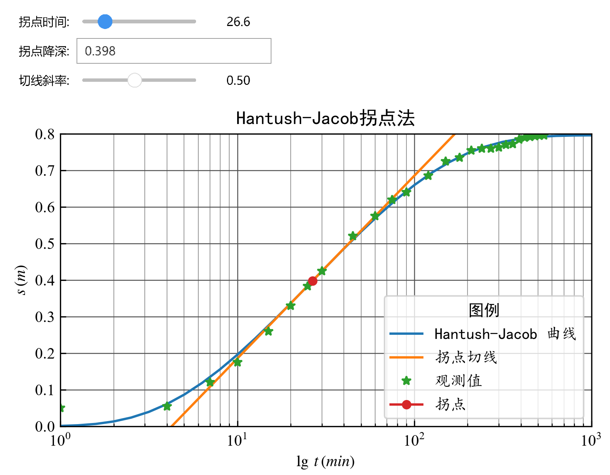

# 实验 3 交互式拐点法求参

Hantush-Jacob 公式表达式为：
$$
s=\frac{Q}{4\pi T}\int_{u}^{\infty}\frac{1}{y}e^{-y-\frac{\beta^2}{4y}}\,dy=\frac{Q}{4\pi T} W(u,\beta) \tag{3.1}
$$
式中，$u=\frac{r^2S}{4Tt},\ \beta=\frac{r}{B}$。

在单对数坐标系下，$s$ - $\lg t$ 曲线存在拐点，且拐点处具有如下性质：

**拐点 $P$ 的性质**

- **坐标与降深**
   $$
   t_p=\frac{SBr}{2T},\quad s_p=\frac{1}{2}s_{max}=\frac{Q}{4\pi T}K_0\left(\frac{r}{B}\right) \tag{3.2}
   $$
- **切线斜率**
   $$
   i_p=\frac{2.3Q}{4\pi T}e^{-\frac{r}{B}} \tag{3.3}
   $$
- **$s_p$、$i_p$ 的关系**
   $$
   2.3\frac{s_p}{i_p}=e^{\frac{r}{B}}K_0\left(\frac{r}{B} \right) \tag{3.4}
   $$

利用上述拐点性质可求取水文地质参数。

**设计思路**

1. 调整参数确定拐点坐标与降深 $(t_p, s_p)$，最大降深 $s_{\max}$ 可采用外推法确定。
2. 调整参数确定拐点切线斜率 $i_p$。
3. 使用二分法求解方程 $e^{\frac{r}{B}}K_0\left(\frac{r}{B}\right)-2.3\frac{s_p}{i_p}=0$ 得到 $\frac{r}{B}$ 的值。由于函数 $f(x)=e^{x}K_0(x)$ 在区间 $[0.01, 5]$ 上单调递减（$f'(x)=e^{x}(K_0(x)-K_1(x))<0$），二分法求解有效。
4. 计算参数：
   $$
   B=\frac{r}{\left[\frac{r}{B}\right]},\quad T=\frac{2.3Q}{4\pi i_p}e^{-\frac{r}{B}},\quad S=\frac{2Tt_p}{Br}
   $$
5. 验证：为避免确定 $s_{\max}$ 的主观性，可采用 Hantush-Jacob 公式进行理论验证。

与交互式配线法类似，本实验采用 `widgets.FloatSlider` 控件交互式调整拐点位置与切线斜率，拐点降深可通过输入框设定。程序中所需的 Hantush-Jacob 井函数计算可复用已有程序。

**例 5**

根据 **例 4** 的数据，采用拐点法求取水文地质参数。

**Python 程序**

```{python}
#| fig-align: center
#| output: false
import math
import numpy as np
import scipy.special as sps
from scipy.optimize import bisect
import ipywidgets as widgets
from ipywidgets import interact
import matplotlib.pyplot as plt
plt.rcParams['font.family'] = ['Times New Roman']
plt.rcParams['mathtext.fontset'] = 'stix'  # 显示数学公式（STIX 字体）
plt.rcParams['axes.unicode_minus'] = False  # 解决中文负号不能正确显示的问题
np.set_printoptions(precision=4)
# 复用前面的 hantush_jacob 函数
# 为了完整性，这里再次给出简单版本（实际运行时需确保函数存在）
def hantush_jacob(u, beta):
    def wellfunc(u_val, beta_val):
        if u_val < 0:
            return np.nan
        if u_val == 0:
            return 2.0 * sps.k0(beta_val)
        if beta_val <= 2 * np.sqrt(u_val):
            W = 0.0
            n = 0
            term = sps.expn(1, u_val)
            while np.abs(term) > 1e-10:
                W += term
                n += 1
                if n == 1:
                    r = -beta_val**2 / (4 * u_val)
                else:
                    r *= -beta_val**2 / (4 * u_val) / n
                term = r * sps.expn(n+1, u_val)
            return W
        else:
            W = 2.0 * sps.k0(beta_val)
            n = 0
            term = sps.expn(1, beta_val**2/(4*u_val))
            while np.abs(term) > 1e-10:
                W -= term
                n += 1
                if n == 1:
                    r = -u_val
                else:
                    r *= -u_val / n
                term = r * sps.expn(n+1, beta_val**2/(4*u_val))
            return W
    return np.vectorize(wellfunc)(u, beta)
# ------------------------------------------------------------
# 拐点法绘图与计算函数
# tp, sp  : 拐点的时间和降深
# slope   : 拐点处的切线斜率 (s / log10(t))
# t, s, Q, r : 观测数据
# ------------------------------------------------------------
def inflection_point_fit(tp, sp, slope, t, s, Q, r):
    fig, ax = plt.subplots()
    # 计算坐标范围
    imin = math.floor(math.log10(min(t)))
    imax = math.ceil(math.log10(max(t)))
    xmin = 10**imin
    xmax = 10**imax
    ymin = 0.0
    ymax = math.ceil(max(s * 10)) / 10
    ax.set(xscale="log", xlim=(xmin, xmax), ylim=(ymin, ymax),
           xlabel=r'$\lg\,t\,(min)$', ylabel=r'$s\,(m)$')
    ax.grid(True, which="major", linestyle="-", linewidth=0.6, color="#505050")
    ax.grid(True, which="minor", linestyle="-", linewidth=0.4, color="#808080")
    # 用二分法求解方程：exp(beta)*K0(beta) = 2.3 * sp / slope
    # 定义需要求解的函数 f(beta)
    def f(beta):
        return np.exp(beta) * sps.k0(beta) - 2.3 * sp / slope
    beta = bisect(f, 0.01, 5)   # 在区间 [0.01, 5] 上求根
    # 生成用于绘制理论曲线的时间点
    t_plot = 10**np.linspace(imin, imax, (imax - imin)*10 + 1)
    # 计算参数
    T = 2.3 * Q * np.exp(-beta) / (4 * np.pi * slope)
    S = 2 * T * tp * beta / r**2
    B = r / beta
    # 计算 Hantush-Jacob 理论降深（用于对比）
    u = 0.25 * r**2 * S / (T * t_plot)
    s_theory = 0.25 * Q * hantush_jacob(u, beta) / (np.pi * T)
    ax.plot(t_plot, s_theory, label="Hantush-Jacob 曲线")
    # 绘制拐点切线（点斜式）
    ax.plot(t_plot, sp + slope * np.log10(t_plot / tp), label="拐点切线")
    # 绘制观测数据
    ax.plot(t, s, '*', label="观测值")
    # 标记拐点位置
    ax.plot(
        tp, sp, marker="o", markersize=5, 
        label=f"拐点"
        )
    plt.legend(
        loc='lower right', prop={"family": "KaiTi"}, title="图例", 
        title_fontproperties={'family': 'SimHei'}
        )
    ax.set_title("Hantush-Jacob拐点法", fontfamily='SimHei')
    plt.tight_layout()   # 自动调整布局
    plt.savefig('fig_files/拐点法.png',dpi=300,bbox_inches='tight')
    plt.pause(0.01)      # 暂停更新并显示图形   
    # 输出计算结果
    print(f'导水系数 T = {T:.4f} m^2/min')
    print(f'储水系数 S = {S:.4e}')
    print(f'越流因素 B = {B:.4f} m')
    plt.close(fig)   # 关闭当前图形
# ------------------------------------------------------------
# 准备数据（例5，即前面练习3的数据）
# ------------------------------------------------------------
Q = 69.1 / 60      # 抽水量 m^3/min（69.1 m^3/h ÷ 60）
r = 197.0          # 观测孔距离 m
t = np.array(
    [1, 4, 7, 10, 15, 20, 25, 30, 45, 60, 75, 90, 120, 150, 180, 210,
    240, 270, 300, 330, 360, 390, 420, 450, 480, 510, 540])   # min
s = np.array(
    [0.05, 0.054, 0.12, 0.175, 0.26, 0.33, 0.383, 0.425, 0.52, 0.575,
    0.62, 0.64, 0.685, 0.725, 0.735, 0.755, 0.76, 0.76, 0.763, 0.77,
    0.772, 0.785, 0.79, 0.792, 0.794, 0.795, 0.796])   # m
# 初始拐点估计：取最大降深的一半处
sp_initial = 0.5 * s[-1]
# 找到第一个大于 sp_initial 的索引
idx = np.where(s > sp_initial)[0][0]
tp_initial = t[idx]
# 计算该点附近的斜率（与下一个点）
slope_initial = (s[idx] - s[idx+1]) / np.log10(t[idx] / t[idx+1])
# 创建交互控件
tp_min = tp_initial * 10**(-0.5)
tp_max = tp_initial * 10**(0.5)
tp_step = (tp_max - tp_min) / 50
tp_slider = widgets.FloatSlider(
    value=26.6, min=tp_min, max=tp_max, 
    step=tp_step, description='拐点时间:',
    continuous_update=False, readout_format='.1f'
    )
sp_text = widgets.FloatText(
    value=0.398, description='拐点降深:', 
    step=0.001, continuous_update=False
    )
slope_slider = widgets.FloatSlider(
    value=0.5, min=slope_initial-0.5, 
    max=slope_initial+0.5, step=0.01,
    description='切线斜率:', continuous_update=False, 
    readout_format='.2f'
    )
interact(
    inflection_point_fit,
    tp=tp_slider, sp=sp_text, slope=slope_slider,
    t=widgets.fixed(t), s=widgets.fixed(s),
    Q=widgets.fixed(Q), r=widgets.fixed(r)
    );
```



```{python}
#| echo: false
T = 0.3093
S = 1.3134e-4
B = 635.9049
print(f'导水系数: T = {T:.4f} m^2/min')
print(f'储水系数: S = {S:.4e}')
print(f'越流因素 B = {B:.2f} m')
```

**程序说明**

- `bisect` 函数用于求解方程以得到 $\beta$ 值。
- 拐点切线斜率和位置可通过滑块交互调整，程序将自动更新参数计算。
  
**练习 4**

根据 **例 4** 的数据，采用拐点法求取水文地质参数。
