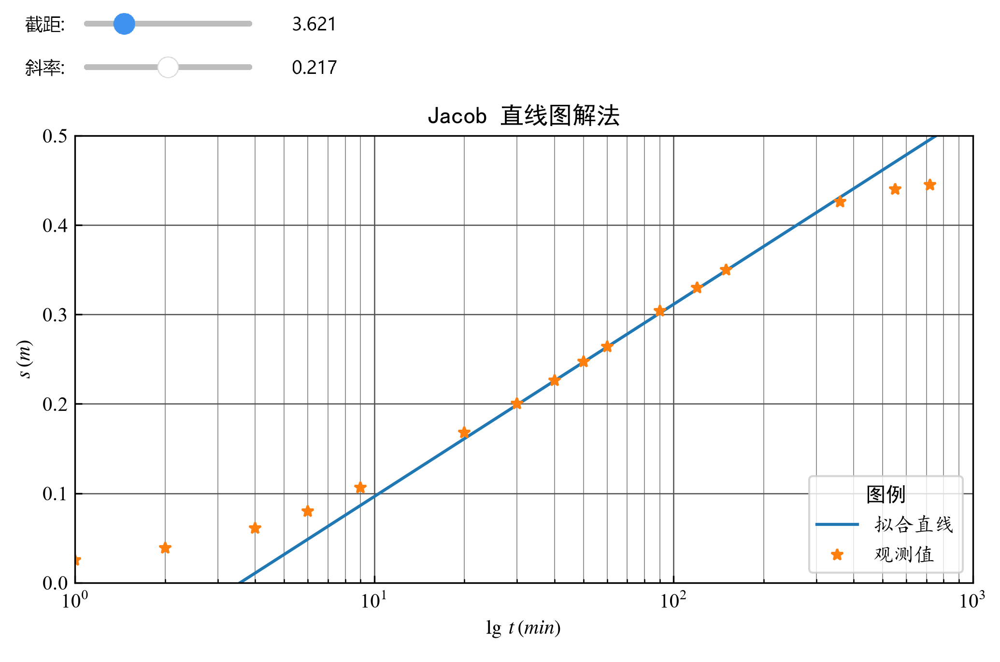

# 实验 4 交互式直线图解法求参

以 $s$ - $\lg t$ 关系为例，Jacob 近似公式可表示为：
$$
s\sim\frac{0.183Q}{T} \lg t +\frac{0.183Q}{T}\lg\frac{2.25T}{r^2S} \tag{4.1}
$$
将其改写为点斜式：
$$
s\sim i\lg x - i\lg x_0 \tag{4.2}
$$
式中，$i=\frac{0.183Q}{T}$ 为直线斜率，$x=t$ 为时间变量，$x_0=\frac{r^2S}{2.25T}$ 为时间轴上的截距（即降深为零时对应的时间 $t_0$）。

通过调整截距 $x_0$ 与斜率 $i$ 使直线与观测数据达到最佳拟合，即可根据以下公式计算参数：
$$
T=\frac{0.183Q}{i},\quad  S= \frac{2.25T x_0}{r^2} \tag{4.3}
$$

**例 6** 

根据 **例 4** 的数据用直线图解法求水文地质参数。

**Python 程序**

```{python}
#| fig-align: center
#| output: false
import numpy as np
import math
import ipywidgets as widgets
from ipywidgets import interact
import matplotlib.pyplot as plt
plt.rcParams['font.family'] = ['Times New Roman']
plt.rcParams['mathtext.fontset'] = 'stix'  # 显示数学公式（STIX 字体）
plt.rcParams['axes.unicode_minus'] = False  # 解决中文负号不能正确显示的问题
np.set_printoptions(precision=4)
# ------------------------------------------------------------
# 直线图解法绘图函数
# x0 : 直线在时间轴上的截距（即 s=0 对应的 t0）
# slope : 直线的斜率 (s / log10(t))
# t, s : 观测数据
# Q, r : 抽水量和观测距离
# ------------------------------------------------------------
def line_fit(x0, slope, t, s, Q, r):
    fig, ax = plt.subplots()
    # 确定坐标范围
    ymin = 0.0
    ymax = math.ceil(max(s * 10 + 0.5)) / 10
    imin = math.floor(math.log10(min(t)))
    imax = math.ceil(math.log10(max(t)))
    xmin = 10**imin
    xmax = 10**imax
    ax.set(xscale="log", xlim=(xmin, xmax), ylim=(ymin, ymax),
           xlabel=r'$\lg\,t\,(min)$', ylabel=r'$s\,(m)$')
    ax.grid(True, which="major", linestyle="-", linewidth=0.6, color="#505050")
    ax.grid(True, which="minor", linestyle="-", linewidth=0.4, color="#808080")
    # 生成绘制直线用的时间点
    t_line = np.linspace(xmin, xmax, 50)
    # 直线方程：s = slope * (log10(t) - log10(x0))
    s_line = slope * np.log10(t_line / x0)
    ax.plot(t_line, s_line, label="拟合直线")
    ax.plot(t, s, '*', label="观测值")
    plt.legend(
        loc='lower right', prop={"family": "KaiTi"}, title="图例", 
        title_fontproperties={'family': 'SimHei'}
        )
    ax.set_title("Jacob 直线图解法", fontfamily='SimHei')
    plt.tight_layout()   # 自动调整布局
    plt.savefig('fig_files/Jacob交互直线图解法.png',dpi=300,bbox_inches='tight')
    plt.pause(0.01)      # 暂停更新并显示图形
    # 计算参数
    T = 0.183 * Q / slope
    S = 2.25 * T * x0 / r**2
    print(f'导水系数 T = {T:.4f} m^2/min')
    print(f'储水系数 S = {S:.4e}')
    plt.close(fig)
# ------------------------------------------------------------
# 准备数据（例4 数据）
# ------------------------------------------------------------
Q = 528 / 1440      # m^3/min
r = 90.0            # m
t = np.array([1, 2, 4, 6, 9, 20, 30, 40, 50, 60,
              90, 120, 150, 360, 550, 720])      # min
s = np.array([2.5, 3.9, 6.1, 8.0, 10.6, 16.8, 20.0, 
              22.6, 24.7, 26.4, 30.4, 33.0, 35.0, 
              42.6, 44.0, 44.5]) / 100   # m
# 用公共函数估算初始参数
T_est, S_est, x0_est, slope_est = initial_parameters(t, s, Q, r)
# 创建滑块控件
x0_min = x0_est * 10**(-0.5)
x0_max = x0_est * 10**(0.5)
x0_step = (x0_max - x0_min) / 50
x0_slider = widgets.FloatSlider(
    value=3.564, min=x0_min, max=x0_max, step=x0_step,
    description='截距:', continuous_update=False,
    readout_format='.3f'
    )
slope_slider = widgets.FloatSlider(
    value=0.215, min=slope_est-0.5, max=slope_est+0.5, step=0.01,
    description='斜率:', continuous_update=False, readout_format='.3f'
    )
interact(
    line_fit, 
    x0=x0_slider, slope=slope_slider,
    t=widgets.fixed(t), s=widgets.fixed(s),
    Q=widgets.fixed(Q), r=widgets.fixed(r)
    );
```



```{python}
#| echo: false
T = 0.3121
S = 3.0897e-4
print(f'导水系数: T = {T:.4f} m^2/min')
print(f'储水系数: S = {S:.4e}')
```

**程序说明**

- `line_fit` 函数通过滑块交互式调整截距 $x_0$ 与斜率 $i$，实现直线与观测数据点的最佳拟合。
- 初始参数由 `initial_parameters` 函数估算，确保拟合直线大致经过数据点。
- 要注意数据是否满足 Jacob 近似公式的要求，即 $u<0.1$ 或 $u <0.01$。

**练习 5** 

根据 **例 2** 的观 1、观 2 数据采用直线图解法求取水文地质参数，并与配线法结果进行对比。

**思考题**

1. 对比 Theis 配线法与 Jacob 直线图解法的求参结果，分析二者差异及其原因。
2. 选择用于拟合直线的数据点时，应考虑哪些因素？
3. 尝试分别采用单观测孔数据与多观测孔数据（可使用 `np.concatenate()` 函数拼接数组）进行求参，并对结果进行比较。
