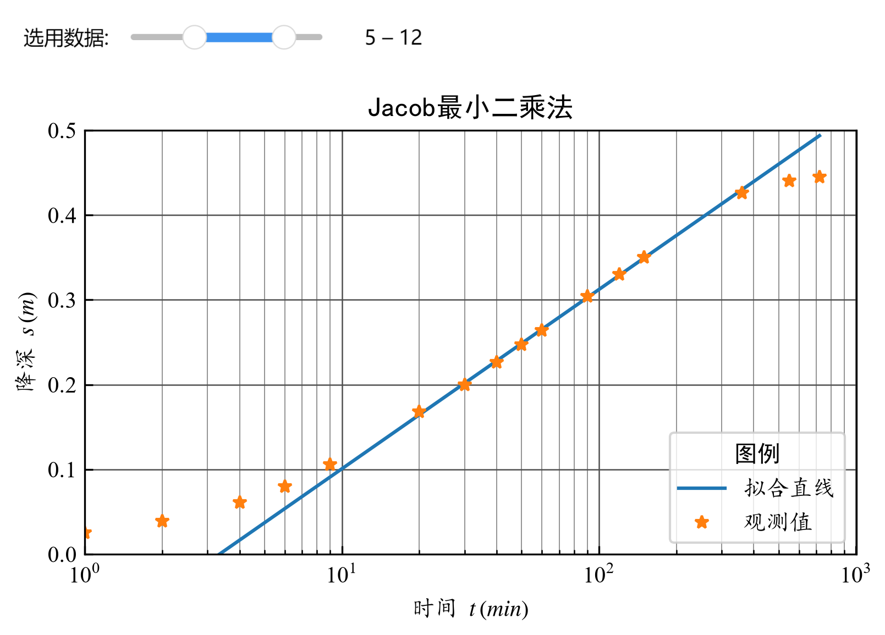

# 实验 5 最小二乘法应用

## 最小二乘法原理

根据观测数据 $\{(x_i,y_i),\,i=1,\cdots m\}$，求拟合直线 $y=\beta_1+\beta_2 x$，使得误差平方和 $E(\beta_1, \beta_2)=\sum_{i=1}^m(y_i-\beta_1-\beta_2 x_i)^2$ 取最小值。
该问题亦可视为求解超定方程组，即确定系数 $\beta$，使 $X\beta=Y$ 在最小二乘意义下成立。
式中，$X=\begin{bmatrix}1 & \cdots & 1 \\ x_1 & \cdots & x_m\end{bmatrix}^T$，$Y=\begin{bmatrix}y_1  & \cdots & y_m\end{bmatrix}^T$，$\beta=\begin{bmatrix}\beta_1 & \beta_2\end{bmatrix}^T$。

**一般形式**

考虑超定方程组（方程个数 $m$ 大于未知数个数 $n$）：
$$
\sum_{j=1}^n x_{ij}\beta_j=y_i,\quad i=1,\cdots m \tag{5.1}
$$
其中，$m$ 为样本数，$n$ 为参数维度。其矩阵形式为：
$$
X\beta=Y \tag{5.2}
$$
式中，
$$
X=\begin{bmatrix}
x_{11} & \cdots & x_{1n}\\
\vdots &   & \vdots \\
x_{m1} & \cdots & x_{mn}
\end{bmatrix},\quad \beta=\begin{bmatrix}\beta_1\\ \vdots\\\beta_n\end{bmatrix},\quad Y=\begin{bmatrix}y_1\\ \vdots\\ y_m\end{bmatrix}
$$

为得到 $\beta$ 的最佳估计 $\hat{\beta}$，将问题转化为如下最优化问题：
$$
\min E(\beta)=\min \|X\beta-Y\|^2
$$

通过微分求极值，可得正规方程：
$$
(X^TX)\beta=(X^TY) 
$$

若 $X^TX$ 为非奇异矩阵，则 $\beta$ 有唯一解：
$$
\hat{\beta}=(X^TX)^{-1}X^TY \tag{5.3} 
$$

由此可见，求解最小二乘问题的关键在于构造相应的方程组。

`numpy` 库中的 `numpy.linalg.solve` 函数可用于求解形如 (6.2) 的方程组；`numpy.linalg.lstsq` 函数则直接实现了最小二乘法，可用于求解形如 (6.1) 的超定方程组。此外，`scipy` 库的 `scipy.linalg.lstsq` 函数亦提供最小二乘求解功能。

**例 7** 

在一次模拟实验中，自变量 $x$ 的取值为 `[0.00, 0.30, 0.60, 0.90, 1.08, 1.20, 1.30, 1.48, 1.60, 1.70, 1.78, 1.85, 1.90, 1.95, 2.00]`，观测到的因变量 $y$ 为 `[1.78, 1.91, 2.01, 2.12, 2.20, 2.22, 2.25, 2.32, 2.38, 2.41, 2.43, 2.47, 2.49, 2.48, 2.51]`。根据实验分析，$y$ 与 $x$ 呈线性关系，试确定其关系表达式。

**Python 程序**

**方法1：** 构造形如 (6.2) 的正规方程组，使用 `numpy.linalg.solve` 求解。

```{python}
#| fig-align: center
import numpy as np
import matplotlib.pyplot as plt
plt.rcParams['font.family'] = ['Times New Roman']
plt.rcParams['mathtext.fontset'] = 'stix'  # 显示数学公式（STIX 字体）
plt.rcParams['axes.unicode_minus'] = False  # 解决中文负号不能正确显示的问题
np.set_printoptions(precision=4)
# 观测数据
x = np.array([0.00, 0.30, 0.60, 0.90, 1.08, 1.20, 1.30, 1.48, 1.60, 1.70,
              1.78, 1.85, 1.90, 1.95, 2.00])
y = np.array([1.78, 1.91, 2.01, 2.12, 2.20, 2.22, 2.25, 2.32, 2.38, 2.41,
              2.43, 2.47, 2.49, 2.48, 2.51])
# 构造系数矩阵 X：第一列全1，第二列为 x
X = np.vstack([np.ones(len(x)), x]).T   # 形状 (15,2)
# 求解正规方程 (X^T X) beta = X^T y
beta = np.linalg.solve(X.T @ X, X.T @ y)   # @ 表示矩阵乘法
# 计算拟合值
x_val = np.linspace(0.25, 2.25, 100)
y_fit = beta[0] + beta[1] * x
y_val = beta[0] + beta[1] * x_val
# 计算残差平方和
residuals = np.sum((y - y_fit)**2)
# 绘图
fig, ax = plt.subplots()
ax.grid(True, which="major", linestyle="-", linewidth=0.6, color="#505050")
ax.set(xlim=(0.25, 2.25), ylim=(1.6, 2.6))
ax.plot(x_val, y_val, '-', label='最小二乘拟合直线')
ax.plot(x, y, '*', label='观测值')
ax.set(xlabel='x', ylabel='y')
plt.legend(
        loc='lower right', prop={"family": "KaiTi"}, title="图例", 
        title_fontproperties={'family': 'SimHei'}
        )
ax.set_title('线性最小二乘拟合', fontfamily='SimHei')
plt.tight_layout()
plt.savefig('fig_files/最小二乘法原理.png',dpi=300,bbox_inches='tight')
plt.show()
print(f'拟合参数: 截距 beta0 = {beta[0]:.4f}, 斜率 beta1 = {beta[1]:.4f}')
print(f'残差平方和: {residuals:.4e}');
```

**方法2.** 直接使用 `np.linalg.lstsq` 求解。

```{python}
# 使用 lstsq 方法（更简洁）
np.set_printoptions(precision=4)
beta, residuals, rank, s = np.linalg.lstsq(X, y, rcond=None)
print(f'拟合参数: 截距 beta0 = {beta[0]:.4f}, 斜率 beta1 = {beta[1]:.4f}')
print(f'残差平方和: {residuals[0]:.4e}');
```

## 确定 Q - s 曲线类型

常见的 $Q$ - $s_w$ 曲线类型包括：

- **直线型：**   
  $Q = q\ s_w$ 
- **抛物线型：**  
  $s_w = a\ Q + b\ Q^2$ 
- **幂函数型：**  
  $Q = q_0\ s_w^\frac{1}{m}$ 
- **对数型：**  
  $Q = a + b\ \lg s_w$

为便于线性化处理，将上述类型进行变换：

- **直线型：**  
  $Q = b\ s_w$ (不变，要求通过原点）($b>0$)
- **抛物线型：**  
  $\frac{s_w}{Q}=a+b\ Q$，($a>0,\ b>0$)
- **幂函数型：**  
  $\lg Q=a+b\ \lg{s_w}$，（$b>0$）
- **对数型：**  
  $Q=a+b\ \lg s_w$ (不变)，（$a>0,\ b>0$ ）

根据最小二乘法原理，构造超定方程组 $X\beta = Y$，进而形成正规方程组 $A\beta = b$，其中 $A = X^T X, b = X^T Y$，使用 `numpy.linalg.solve` 求解（方法一）。

分别计算各模型预测降深与观测降深的残差平方和 $\sum(s - \hat{s})^2$，残差平方和最小者通常为最优曲线类型。

> **注意：** 由于以天或小时为单位的流量数值较大，建议将流量单位转换为分钟（min）进行计算。

**例 8**

在厚度为 16.50 m 的承压含水层中进行了 3 次降深的抽水试验，结果记录于下表。试确定 $Q$ - $s$ 曲线类型。

|$r_w(m)$ | $s_1(m)$ | $Q_1(m^3/d)$ | $s_2(m)$ | $Q_2(m^3/d)$ | $s_3(m)$ | $Q_3(m^3/d)$|
| :---: | :---: | :---: | :---: | :---: | :---: | :---: |
| 0.40 | 1.16 | 320.54 | 1.60 | 421.63 | 1.90 | 536.54 |
: 稳定流抽水试验数据

**Python 程序**

```{python}
#| fig-align: center
import numpy as np
import matplotlib.pyplot as plt
plt.rcParams['font.family'] = ['Times New Roman']
plt.rcParams['mathtext.fontset'] = 'stix'  # 显示数学公式（STIX 字体）
plt.rcParams['axes.unicode_minus'] = False  # 解决中文负号不能正确显示的问题
np.set_printoptions(precision=4)
# ------------------------------------------------------------
# 绘制 Q-s 曲线对比图
# ------------------------------------------------------------
def plot_Qs(s, Q, beta1, beta2, beta3, beta4):
    fig, ax = plt.subplots()
    # 确定坐标范围
    xmax = np.ceil(max(s * 10 + 1)) / 10
    ymax = np.ceil(max(Q * 10)) / 10
    ax.set(
        xlim=(0, xmax), ylim=(0, ymax), 
        xlabel=r'$s_w\,(m)$', ylabel=r'$Q\,(m^3/min$)'
        )
    ax.grid(True, which="major", linestyle="-", linewidth=0.6, color="#505050")    
    # 生成用于绘制理论曲线的降深点
    s_curve = np.linspace(1e-4, xmax, 100)
    # 直线型：Q = beta1 * s
    ax.plot(s_curve, beta1 * s_curve, label='直线型')
    # 抛物线型：s = beta2[0] Q + beta2[1] Q²  => 解出 Q (取正根)
    # 方程 beta2[1] Q² + beta2[0] Q - s = 0
    Q_para = (
        -beta2[0] + np.sqrt(beta2[0]**2 + 4 * beta2[1] * s_curve)
        ) / (2 * beta2[1])
    ax.plot(s_curve, Q_para, label='抛物线型')
    # 幂函数型：Q = 10^{beta3[0]} * s^{beta3[1]}
    Q_power = 10**beta3[0] * s_curve**beta3[1]
    ax.plot(s_curve, Q_power, label='幂函数型')
    # 对数型：Q = beta4[0] + beta4[1] * lg(s)
    Q_log = beta4[0] + beta4[1] * np.log10(s_curve)
    ax.plot(s_curve, Q_log, label='对数型')
    # 原始观测点
    ax.plot(s, Q, '*', label='观测值', markersize=10)
    plt.legend(
        loc='lower right', prop={"family": "KaiTi"}, title="图例", 
        title_fontproperties={'family': 'SimHei'}
        )
    ax.set_title(r"Q - s 曲线类型对比", fontfamily='SimHei')
    return fig
# ------------------------------------------------------------
# 数据准备（例8）
# ------------------------------------------------------------
Q_raw = np.array([320.54, 421.63, 536.54])   # m^3/d
s = np.array([1.16, 1.60, 1.90])             # m
Q = Q_raw / 1440    # 转换为 m^3/min
# 1. 直线型（过原点）：Q = beta1 * s, 最小二乘解 beta1 = (s·Q)/(s·s)
beta1 = np.dot(s, Q) / np.dot(s, s)
# 2. 抛物线型：变换为 s/Q = a + b Q
# 构造 X = [1, Q], Y = s/Q
X_para = np.vstack([np.ones(len(Q)), Q]).T
Y_para = s / Q
beta2 = np.linalg.solve(X_para.T @ X_para, X_para.T @ Y_para)   # beta2 = [a, b]
# 3. 幂函数型：lg Q = a + b lg s
X_power = np.vstack([np.ones(len(s)), np.log10(s)]).T
Y_power = np.log10(Q)
beta3 = np.linalg.solve(X_power.T @ X_power, X_power.T @ Y_power) 
# 4. 对数型：Q = a + b lg s
X_log = np.vstack([np.ones(len(s)), np.log10(s)]).T
Y_log = Q
beta4 = np.linalg.solve(X_log.T @ X_log, X_log.T @ Y_log) 
# 绘图
fig = plot_Qs(s, Q, beta1, beta2, beta3, beta4)
plt.tight_layout()
plt.savefig('fig_files/最小二乘法Qs经验曲线.png',dpi=300,bbox_inches='tight')
plt.show()
# 计算各模型预测降深的残差平方和（以原始降深 s 为基准）
print('各模型预测降深 s 的残差平方和：')
# 直线型：由 Q = beta1 s 得 s_pred = Q / beta1
s_pred_linear = Q / beta1
rss_linear = np.sum((s - s_pred_linear)**2)
print(f'  直线型: RSS = {rss_linear:.4e}，beta1 = {beta1:.4f}')
# 抛物线型：s_pred = a Q + b Q²
s_pred_para = beta2[0] * Q + beta2[1] * Q**2
rss_para = np.sum((s - s_pred_para)**2)
print(f'抛物线型: RSS = {rss_para:.4e}，beta2 = {beta2}')
# 幂函数型：由 lgQ = a + b lg s 得 s_pred = (Q / 10^a)^{1/b}
s_pred_power = (Q / 10**beta3[0]) ** (1 / beta3[1])
rss_power = np.sum((s - s_pred_power)**2)
print(f'幂函数型: RSS = {rss_power:.4e}，beta3 = {beta3}')
# 对数型：s_pred = 10^{(Q - a)/b}
s_pred_log = 10**((Q - beta4[0]) / beta4[1])
rss_log = np.sum((s - s_pred_log)**2)
print(f'  对数型: RSS = {rss_log:.4e}，beta4 = {beta4}')
```

**练习 6**

某煤矿对太原组含水层四、五灰进行了简易稳定流抽水试验，抽水量 $Q$、抽水井降深 $s_w$、抽水井半径 $r_w$、含水层厚度 $M$ 如下表所示。试确定抽水孔的 $Q$ - $s$ 曲线类型，并计算含水层水文地质参数（可参考实验 1）。

| 孔号  | $Q(m^3/d)$ | $s_w(m)$ | $r_w(m)$ | $M(m)$ |
| :---: | :-------: | :-------: | :------: | :-----:|
| 东102 | 133.92     |  54.21  |  0.054  | 26.80 |
|  | 125.28     |  44.51  |  0.054  | 26.80 |
|  | 116.64     |  35.90  |  0.054  | 26.80 |
| 西 43 | 429.12     |  33.50  |  0.0445 | 34.90 |
|  | 495.36     |  40.40  |  0.0445 | 34.90 |
|  | 567.36     |  48.50  |  0.0445 | 34.90 |
: 简易稳定流抽水数据表

**思考题**

1.  通过比较，抛物线型的降深残差平方和最小，问将该井的 $Q$ - $s$ 曲线确定为抛物线型是否合适？为什么？
2.  对比抛物线型的 $Q$ - $s$ 关系式与 C. E. Jacob 井损表达式可以看出，二者形式相同。若按上述示例数据计算发现井损系数 $C$ 为负值，试分析其原因。
3.  若已知含水层某钻孔的 $Q$ - $s$ 曲线类型，该类型及相关数据能否用于预测同含水层其他钻孔的降深？
4.  对于不同的 $Q$ - $s$ 曲线类型，应如何根据计算结果分析其合理性？

## Jacob 公式线性拟合

在单对数坐标系中，抽水一定时间后，实测数据点呈直线分布：
$$
s=\frac{0.183Q}{T}\lg\frac{2.25T}{r^2S} + \frac{0.183Q}{T} \lg t \tag{5.4}
$$
可将其改写为线性形式：
$$
s= s_0 + i \lg t \tag{5.5}
$$
拟合得到直线斜率 $i$ 与降深轴截距 $s_0$ 后，即可用下式计算参数：
$$
T=\frac{0.183Q}{i},\quad  S=\frac{2.25T}{r^2}10^{-\tfrac{s_0}{i}} \tag{5.6} 
$$
使用最小二乘法可方便地计算出直线方程的参数。

**例 9** 

根据 **例 4** 的数据，采用 Jacob 公式的最小二乘法线性拟合求取水文地质参数。

根据数据点的形态可知，前面几组观测值不满足 Jacob 公式的近似条件，后面几组数偏离直线，可能是边界条件的影响，不满足 Theis 模型的无限含水层假设。因此需要筛选数据，前 5 组与后 3 组 数据不参与拟合。

**Python 程序**

```{python}
#| fig-align: center
import numpy as np
import matplotlib.pyplot as plt
plt.rcParams['font.family'] = ['Times New Roman']
plt.rcParams['mathtext.fontset'] = 'stix'  # 显示数学公式（STIX 字体）
plt.rcParams['axes.unicode_minus'] = False  # 解决中文负号不能正确显示的问题
np.set_printoptions(precision=4)
# ------------------------------------------------------------
# 绘制 Jacob 直线拟合结果
# ------------------------------------------------------------
def plot_jacob(t, s, beta, title_suffix=""):
    fig, ax = plt.subplots()
    ymax = np.ceil(max(s * 10)) / 10
    imin = np.floor(np.log10(min(t)))
    imax = np.ceil(np.log10(max(t)))
    xmin = 10**imin
    xmax = 10**imax
    ax.set(xscale="log", xlim=(xmin, xmax), ylim=(0, ymax))
    ax.set_xlabel(r'时间 $t\,(min)$', fontfamily="KaiTi")
    ax.set_ylabel(r'降深 $s\,(m)$', fontfamily="KaiTi")
    ax.grid(True, which="major", linestyle="-", linewidth=0.6, color="#505050")
    ax.grid(True, which="minor", linestyle="-", linewidth=0.4, color="#808080")
    # 绘制拟合直线
    t_line = np.logspace(imin, imax, 50)
    s_line = beta[0] + beta[1] * np.log10(t_line)
    ax.plot(t_line, s_line, label='Jacob 拟合直线')
    ax.plot(t, s, '*', label='观测值')
    plt.legend(
        loc='lower right', prop={"family": "KaiTi"}, title="图例", 
        title_fontproperties={'family': 'SimHei'}
        )
    ax.set_title(f"最小二乘法 - Jacob 直线{title_suffix}", fontfamily='SimHei')
    plt.savefig(f"fig_files/最小二乘法Jacob{title_suffix}.png", dpi=300)
    return fig
# 使用例4数据
Q = 528 / 1440      # m^3/min
r = 90.0
t = np.array([1, 2, 4, 6, 9, 20, 30, 40, 50, 60,
              90, 120, 150, 360, 550, 720])
s = np.array([2.5, 3.9, 6.1, 8.0, 10.6, 16.8, 20.0, 22.6, 24.7, 26.4,
              30.4, 33.0, 35.0, 42.6, 44.0, 44.5]) / 100
# 使用全部数据拟合
X_all = np.vstack([np.ones(len(t)), np.log10(t)]).T
beta_all = np.linalg.lstsq(X_all, s, rcond=None)[0]
fig1 = plot_jacob(t, s, beta_all, "（全部数据）")
plt.show()
# 计算参数
T_all = 0.183 * Q / beta_all[1]
S_all = 2.25 * T_all / r**2 * 10**(-beta_all[0] / beta_all[1])
print(f'全部数据：T = {T_all:.4f} m^2/min, S = {S_all:.4e}')
# 计算每个时间点的 u 值，检查是否满足 u<0.1
u_all = r**2 * S_all / (4 * T_all * t)
print('全部数据对应的 u 值：')
print(u_all)
# 筛选数据：去掉前5个和后3个（通常 u 太小或受边界影响）
idx_selected = slice(5, -3)   # 索引从5到倒数第3个（不包括最后3个）
t_sel = t[idx_selected]
s_sel = s[idx_selected]
X_sel = np.vstack([np.ones(len(t_sel)), np.log10(t_sel)]).T
beta_sel = np.linalg.lstsq(X_sel, s_sel, rcond=None)[0]
fig2 = plot_jacob(t, s, beta_sel, "（筛选数据）")
plt.show()
# 计算参数
T_sel = 0.183 * Q / beta_sel[1]
S_sel = 2.25 * T_sel / r**2 * 10**(-beta_sel[0] / beta_sel[1])
print(f'筛选后数据：T = {T_sel:.4f} m^2/min, S = {S_sel:.4e}')
# 计算每个时间点的 u 值，检查是否满足 u<0.1
u_all = r**2 * S_sel / (4 * T_sel * t)
print('全部数据对应的 u 值：')
print(u_all)
```

以下为交互式筛选数据的代码，更方便地筛选出符合要求的数据。

```{python}
#| fig-align: center
#| output: false
import numpy as np
import ipywidgets as widgets
from ipywidgets import interact
import matplotlib.pyplot as plt
plt.rcParams['font.family'] = ['Times New Roman']
plt.rcParams['mathtext.fontset'] = 'stix'  # 显示数学公式（STIX 字体）
plt.rcParams['axes.unicode_minus'] = False  # 解决中文负号不能正确显示的问题
np.set_printoptions(precision=4)
def fit(data_lims, t, s, Q, r):
    """创建并设置绘图区域"""
    fig, ax = plt.subplots()
    ymax = np.ceil(max(s * 10)) / 10
    imin = np.floor(np.log10(min(t)))
    imax = np.ceil(np.log10(max(t)))
    xmin = 10**imin
    xmax = 10**imax
    ax.set(xscale="log", xlim=(xmin, xmax), ylim=(0, ymax))
    ax.set_xlabel(r'时间 $t\,(min)$', fontfamily="KaiTi")
    ax.set_ylabel(r'降深 $s\,(m)$', fontfamily="KaiTi")
    ax.grid(True, which="major", linestyle="-", linewidth=0.6, color="#505050")
    ax.grid(True, which="minor", linestyle="-", linewidth=0.4, color="#808080")
    ax.set_title("Jacob最小二乘法", fontfamily='SimHei')
    """更新拟合曲线并计算结果"""
    i, j = data_lims
    j += 1
    X = np.vstack([np.ones(j - i), np.log10(t[i:j])]).T
    slove = np.linalg.lstsq(X, s[i:j], rcond=None)
    beta = slove[0]
    rss = slove[1][0]
    # 绘制拟合直线
    ax.plot(t, beta[0] + beta[1] * np.log10(t), label="拟合直线")
    # 绘制观测值和拟合直线
    ax.plot(t, s, "*", label="观测值")    
    plt.legend(
        loc='lower right', prop={"family": "KaiTi"}, title="图例", 
        title_fontproperties={'family': 'SimHei'}
        )
    plt.tight_layout()   # 自动调整布局
    plt.savefig('fig_files/最小二乘法Jacob（交互筛选）.png', dpi=300,bbox_inches='tight')
    plt.pause(0.01)      # 暂停更新并显示图形
    # 计算参数
    T = 0.183 * Q / beta[1]
    S = 2.25 * T / r**2 / 10**(beta[0]/beta[1])
    print(f'T = {T:.4f}, S = {S:.4e}')
    u = r**2 * S/(4 * t * T)
    print('全部数据对应的 u 值：')
    print(u)
Q = 528 / 1440       # 抽水量 m³/min
r = 90     # 观测孔距 m
t = np.array([1, 2, 4, 6, 9, 20, 30, 40, 50, 60, 90, 120, 150,
                360, 550, 720])
s = np.array([2.5, 3.9, 6.1, 8.0, 10.6, 16.8, 20.0, 22.6, 24.7, 
                26.4, 30.4, 33.0, 35.0, 42.6, 44.0, 44.5]) / 100
# 交互控件
Range_slider = widgets.IntRangeSlider(
    value=[5, 12], min=0, max=len(t)-1, step=1,
    description='选用数据:', continuous_update=False)
widgets.interact(
    fit,
    data_lims=Range_slider,
    t=widgets.fixed(t),
    s=widgets.fixed(s),
    Q=widgets.fixed(Q),
    r=widgets.fixed(r)
    );
```



```{python}
#| echo: false
import numpy as np
np.set_printoptions(precision=4)
T = 0.3172
S = 2.9447e-04
print(f'T = {T:.4f}, S = {S:.4e}')
u = np.array([1.8801, 0.94, 0.47, 0.3133, 0.2089, 0.094, 0.0627, 0.047, 0.0376, 0.0313,\
 0.0209, 0.0157, 0.0125, 0.0052, 0.0034, 0.0026])
print('全部数据对应的 u 值：')
print(u)
```

**练习 7**

根据 **例 2** 中观 1、观 2 孔数据，用 Jacob 公式最小二乘法求取水文地质参数。

**思考题**

1.  选择用于拟合直线的数据时，应考虑哪些问题？
2.  尝试使用观1、观2 全部数据进行求参，并对结果进行比较。

> **提示：**  
> 
> - 数组拼接可使用 `np.concatenate()` 函数（可参考 实验 2 中 Theis 公式配线法的处理方式）。
> - 筛选数据时需对数组排序，`np.argsort()` 函数返回排序后的索引，按此索引提取数组元素可保持原有的对应关系不变。

## Theis 公式非线性拟合

Theis 公式为：
$$
s= \frac{Q}{4\pi T}\int_u^\infty\frac{1}{y}e^{-y}dy=\frac{Q}{4\pi T}W(u) \tag{5.7}
$$
取初始参数 $(T_0,\ S_0)$，将降深 $s$ 在 $(T_0,\ S_0)$ 处进行泰勒级数展开：
$$
s(T,S)=s(T_0,S_0)+\left.\frac{\partial{s}}{\partial{S}}\right|_{S=S_0}\Delta{S}+\left.\frac{\partial{s}}{\partial{T}}\right|_{T=T_0}\Delta{T}+O(\Delta{T}^2+\Delta{S}^2) \tag{5.8}
$$
式中，$\Delta{T} = T-T_0,\ \Delta{S}=S-S_0$。由于 $\dfrac{\partial{u}}{\partial{S}}=\dfrac{u}{S},\ \dfrac{\partial{u}}{\partial{T}}=-\dfrac{u}{T}$，可得：
$$
\frac{\partial{s}}{\partial{S}} = -\frac{Q}{4{\pi}T}\frac{e^{-u}}{S},\quad
\frac{\partial{s}}{\partial{T}} = \frac{Q}{4{\pi}T^2}\left[-W(u)+e^{-u}
\right] 
$$
记：
$$
a=s(T_0,S_0),\quad b=\left.\frac{\partial{s}}{\partial{S}}
\right|_{S=S_0},\quad
c=\left.\frac{\partial{s}}{\partial{T}}\right|_{T=T_0}
$$
忽略高阶无穷小项，式 (6.4) 可近似为：
$$
\hat s =a +b\cdot\Delta S + c\cdot \Delta T \tag{5.9}
$$
式中，$\hat s$ 为 $s$ 的预测值，$(\Delta T,\ \Delta S)$ 为搜索最优参数的步长，由 (6.6) 式可构造最小二乘问题。

以 $(\Delta T,\ \Delta S)$ 为未知系数，写成超定方程组的形式：
$$
X\beta=Y \tag{5.10}
$$
式中，
$$
X=\begin{bmatrix}
b_{1} & c_{1}\\
\vdots & \vdots \\
b_{n} & c_{n}
\end{bmatrix},\quad \beta=\begin{bmatrix}\Delta S\\\Delta T\end{bmatrix},\quad Y=\begin{bmatrix} s_1-a_1\\
\vdots\\
s_n-a_n
\end{bmatrix} 
$$
其中，$s_i(i=1,\cdots n)$ 为降深观测值序列，$(a_i,\ b_i,\ c_i)\ (i = 1,\cdots,n)$ 为用当前的 $(T,\ S)$ 与 $(t_i,\ r)$ 计算得出的序列。
因此
$$
\hat\beta=\begin{bmatrix} \Delta \hat S\\
\Delta \hat T\\
\end{bmatrix}=(X^T X)^{-1} X^T Y \tag{5.11}
$$

由此得出一步参数优化的参数修正量。

**例 10** 

根据 **例 2** 中观 2 孔数据，用 Theis 公式最小二乘法求取水文地质参数。

**Python 程序**

```{python}
#| fig-align: center
import numpy as np
import math
from scipy.special import exp1
import matplotlib.pyplot as plt
plt.rcParams['font.family'] = ['Times New Roman']
plt.rcParams['mathtext.fontset'] = 'stix'  # 显示数学公式（STIX 字体）
plt.rcParams['axes.unicode_minus'] = False  # 解决中文负号不能正确显示的问题
np.set_printoptions(precision=4)
def initial_parameters(t, s, Q, r):
    """基于 Cooper-Jacob 近似法估算 Theis 模型的初始参数 T 和 S"""
    idx = len(t) // 2 - 1
    slope = (s[idx+1] - s[idx]) / np.log10(t[idx+1] / t[idx])
    T = 0.183 * Q / slope
    t0 = t[idx] * 10**(-s[idx] / slope)
    S = 2.25 * T * t0 / r**2
    return T, S
def theis_drawdown(S, T, t, Q, r):
    """计算 Theis 降深 s = (Q / 4πT) * W(u)，其中 W(u) 为指数积分 E1(u)"""
    u = r**2 * S / (4 * T * t)
    return Q / (4 * np.pi * T) * exp1(u)
def theis_gradient(S, T, t, Q, r):
    """计算降深对 S 和 T 的偏导数 (ds/dS, ds/dT)"""
    u = r**2 * S / (4 * T * t)
    exp_neg_u = np.exp(-u)
    dsdS = -Q / (4 * np.pi * T * S) * exp_neg_u
    dsdT = Q / (4 * np.pi * T**2) * (-exp1(u) + exp_neg_u)
    return np.array([dsdS, dsdT]).T
def theis_residual(S, T, t, s, Q, r):
    """计算降深残差平方和 (RSS)"""
    return np.sum((s - theis_drawdown(S, T, t, Q, r))**2)
def theis_model_fit(t, s, Q, r, max_iter=1000, tol_S=1e-8, tol_T=1e-6):
    """使用高斯-牛顿法拟合 Theis 模型参数"""
    T, S = initial_parameters(t, s, Q, r)
    print(f'初始参数: S={S:.6e}, T={T:.6f}')
    iteration = 0
    for iteration in range(max_iter):
        Y = s - theis_drawdown(S, T, t, Q, r)
        X = theis_gradient(S, T, t, Q, r)
        beta = np.linalg.solve(X.T @ X, X.T @ Y)
        dS, dT = beta
        while S + dS < 0:
            dS /= 2
        while T + dT < 0:
            dT /= 2
        S += dS
        T += dT
        if abs(dS) < tol_S and abs(dT) < tol_T:
            break
    else:
        print('警告: 循环超过最大迭代次数，请检查程序！')
    return S, T, iteration
def theis_model_plot(t, s, Q, r, S, T):
    """绘制 Theis 模型拟合的双对数图"""
    # 动态计算绘图边界
    xmin = 10**math.floor(math.log10(min(t)))
    xmax = 10**math.ceil(math.log10(max(t)))
    ymin = 10**math.floor(math.log10(min(s)))
    ymax = 10**math.ceil(math.log10(max(s)))
    # 绘制双对数图
    fig, ax = plt.subplots()
    ax.set(xscale="log", yscale="log", xlim=(xmin, xmax), ylim=(ymin, ymax))
    ax.set_xlabel(r'$\lg\,t$', fontfamily="KaiTi")
    ax.set_ylabel(r'$\lg\,s$', fontfamily="KaiTi")
    ax.set_title("最小二乘法-Theis公式拟合",fontfamily='SimHei')
    ax.grid(True, which="major", linestyle="-", linewidth=0.6, color="#505050")
    ax.grid(True, which="minor", linestyle="-", linewidth=0.4, color="#808080")
    ax.set_aspect('equal')
    # 生成平滑的拟合曲线
    x_log = np.arange(np.log10(xmin), np.log10(xmax), 0.01)
    x = np.power(10, x_log)
    y = theis_drawdown(S, T, x, Q, r)
    ax.plot(x, y, label='拟合曲线')
    ax.plot(t, s, '*', label='观测值')  
    plt.legend(
        loc='lower right', prop={"family": "KaiTi"}, title="图例", 
        title_fontproperties={'family': 'SimHei'}
        )
    plt.tight_layout()   # 自动调整布局
    plt.savefig('fig_files/最小二乘法Theis.png',dpi=300,bbox_inches='tight')
    plt.show()      # 暂停更新并显示图形
# 原始数据
def single_data():
    r, Q = 140.0, 1440  # m, m³/d
    t = np.array([10, 20, 30, 40, 60, 80, 100, 120, 150, 210, 270, 
                  330, 400, 450, 645, 870, 990, 1185])
    # 单位天转分钟
    Q = Q / 1440.0
    s = np.array([0.16, 0.48, 0.54, 0.65, 0.75, 1.0, 1.12, 1.22, 
                  1.36, 1.55, 1.7, 1.83, 1.89, 1.98, 2.17, 2.38, 
                  2.46, 2.54])
    return t, s, Q, r
# 主程序
if __name__ == "__main__":
    # 1. 获取数据
    t, s, Q, r = single_data()
    # 2. 拟合模型
    S, T, iterations = theis_model_fit(t, s, Q, r)
    # 3. 绘制拟合结果
    theis_model_plot(t, s, Q, r, S, T)
    # 4. 输出最终结果
    print(f'循环次数 = {iterations}')
    print(f'T = {T:.2f} m²/d, S = {S:.4e}')
    print(f'RSS = {theis_residual(S, T, t, s, Q, r):.4e}')
```

> **注意：**
> 
> - 最小二乘法得出的参数修正量可能导致参数为负值，需采用步长折半等策略确保参数的合理性。
> - 初值对结果有重要影响，建议采用 Jacob 公式计算合理的初始值。
> - 可进行多次迭代直至满足收敛条件。

