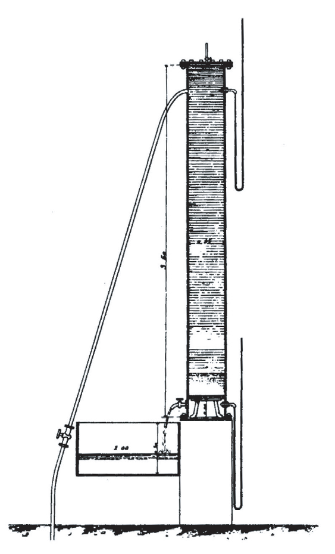
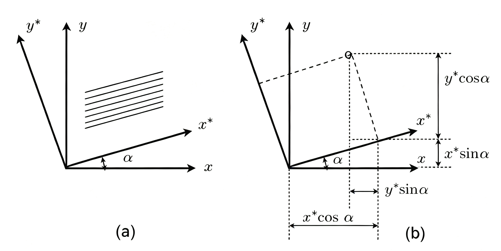
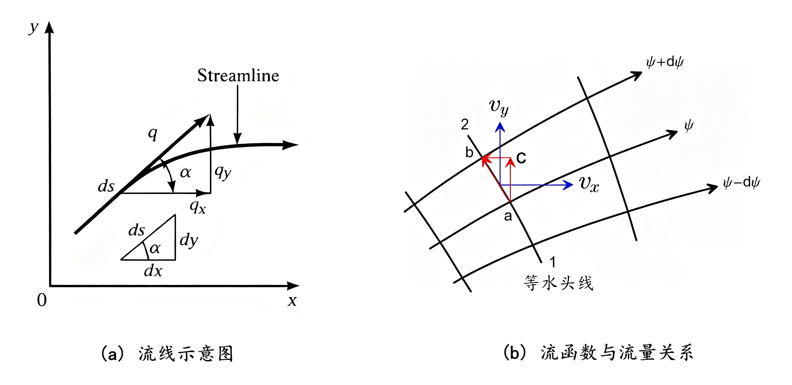
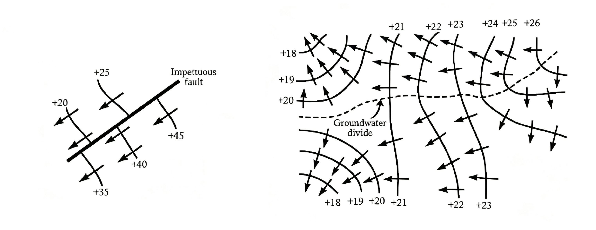
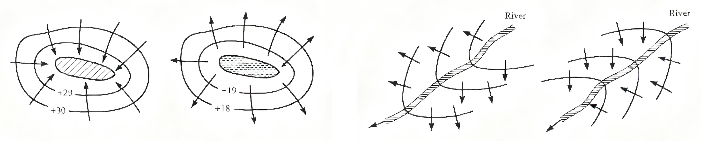
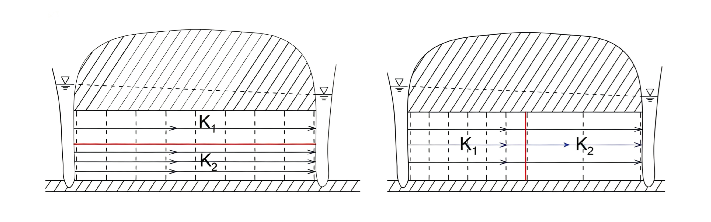

# 1 地下水运动的基本概念与基本定律

**本章导引**：

地下水动力学研究水在多孔介质中的运动规律。要理解这门学科，我们先从水和岩石的基本性质开始。多孔介质中的孔隙为地下水提供了储存空间和流动通道。水头差驱动地下水从高能量点向低能量点运动。运动过程中，水流受到孔隙壁面的摩擦阻力。达西定律用数学语言描述了驱动力与阻力之间的平衡关系。本章将为后续所有数学模型和工程计算奠定理论基础。

## 1.1 基本概念

### 1.1.1 岩层中地下水运动的研究方法

地下水的物理性质、含水层结构都会影响地下水的运动。一般地，对于流体（水）在多孔介质（含水层）中的运动，需要从流体与多孔介质两方面进行研究。本课程以多孔介质的渗流力学方法研究地下水流的动力学问题。

**多孔介质**：在地下水动力学中，将具有孔隙的岩石称为多孔介质。我们的生产、生活中，很多东西都可认为是多孔介质。水文地质中将含水层当成多孔介质，如：

- 孔隙介质：砂层、疏松砂岩等；
- 裂隙介质：裂隙发育的石英岩、花岗岩等；
- 岩溶介质：岩溶不十分发育的石灰岩与白云岩等。

上述三类介质的区别在于储水空间和导水通道的几何形态不同。孔隙介质中水流通道是三维随机分布的粒间空隙，水流运动相对均匀，可用达西定律较好地描述；裂隙介质中水流主要沿结构面（节理、层理、断层）运移，具有明显的各向异性和尺度效应；岩溶介质中水流通道是经溶蚀作用改造的管道系统，往往存在管道流和裂隙流的双重介质行为。理解这三类介质的差异，是选择正确数学模型的前提。

多孔介质中可能存在固、液、气等多种成分，因此具有多相性：

- 固相：构成多孔介质的固体骨架，是孔隙空间的几何载体；；
- 液相：存在于孔隙中的水，按其受力状态与存在形式可细分为吸附水（强结合水）、薄膜水（弱结合水）、毛管水（受毛细力控制）和重力水（受重力控制，可自由运动）；
- 气相：非饱和带中充填于孔隙内的空气及其他气体，其存在会显著降低介质的有效渗透性。

### 1.1.2 流体性质

流体的性质主要指如下的几项，其它如温度等仅在研究水流热传导性时予以考虑。

**密度、容重**：密度（$\rho$）定义为单位体积流体的质量，量纲为 $[\mathrm{ML^{-3}}]$；容重（$\gamma$）定义为单位体积流体的重量，与密度的关系为 $\gamma = \rho g$，其中 $g$ 为重力加速度。地下水的密度随温度、压力和溶解质浓度而变化，但在多数常温常压条件下的浅层地下水流问题中，可视为常数。

**粘滞性**：粘滞性是流体抵抗剪切变形的能力。运动粘滞系数 $\nu$（$\mathrm{L^2T^{-1}}$），动力粘滞系数 $\mu=\rho\nu$ 是描述这种能力的参数。粘滞性源于分子间的吸引力和分子热运动的动量交换。**动力粘滞系数 $\mu$** 反映了单位速度梯度下流体内部产生的切应力大小（牛顿内摩擦定律：$\tau=\mu\frac{\mathrm{d}u}{\mathrm{d}y}$）。温度升高时，液体分子间距增大、分子引力减小，$\mu$ 降低；气体则相反，温度升高时分子热运动加剧，$\mu$ 增大。 这一温度依赖性在实际工程中需予以考虑——例如，热水回灌时水的粘滞性降低，渗透系数会相应增大。

**表面张力**：表面张力系数（$\sigma$）描述液体表面收缩的趋势，在非饱和带水流及毛管上升问题中具有重要影响。当水-气界面通过细小孔隙时，表面张力会产生附加的毛管压力，控制着非饱和带的持水和运动特征。

**可压缩性**：尽管水常被视为不可压缩流体，但在涉及承压含水层弹性释水、水击现象或深层地下水问题时，水的压缩性不可忽略。

根据胡克定律，可用压缩系数描述流体的可压缩性：

**流体的压缩系数 $\beta$**：等温条件下，对体积为 $V$ 的水施加 $\mathrm{d}p$ 压强，体积压缩量为 $\mathrm{d}V$，压缩系数定义为
$$
\beta= - \frac{1}{V}\frac{\mathrm{d}V}{\mathrm{d}p}=\frac{1}{E}
$$
其量纲为 $[\mathrm{M^{-1}LT^2}]$。该定义表明，压缩系数为单位压力增量引起的流体体积相对减小量。常温常压下，水的体积压缩系数约为 $4.4 \times 10^{-10}\ \mathrm{Pa^{-1}}$。

**地下水状态方程**是指地下水体积和密度随压力变化的方程。设初始压强 $p_0$，水的密度 $\rho_0$，体积 $V_0$，压强变化 $\mathrm{d}p$ 时体积变化 $\mathrm{d}V$，对
$$
\frac{\mathrm{d}V}{V}=-\beta\mathrm{d}p
$$
两边积分，得
$$
V = V_0e^{-\beta(p-p_0)},\quad \rho = \rho_0e^{\beta(p-p_0)}
$$
Taylor级数展开，忽略高阶无穷小：
$$
V = V_0\left[1-\beta(p-p_0)\right],\quad
\rho = \rho_0\left[1+\beta(p-p_0)\right]
$$
这就是地下水的**体积状态方程**与**密度状态方程**。密度与压强变化有如下关系：
$$
\mathrm{d}\rho = \rho\beta\mathrm{d}p
$$

**水的可压缩性对地下水在含水层储存、释放的作用**： 水的压缩系数 $\beta \approx 4.4\times10^{-10}\ \mathrm{Pa^{-1}}$（20°C时），数值很小，在常压条件下水的体积变化可以忽略。但在承压含水层中，即使微小的体积变化，乘以巨大的含水层体积后，也能释放可观的水量——这正是承压含水层弹性释水的物理意义。因此，在承压水运动中水的压缩性不可忽略。

### 1.1.3 多孔介质性质

孔隙性、连通性与可压缩性是多孔介质的三个基本特征。孔隙的多少决定了多孔介质的储水能力，根据孔隙对地下水运动的影响，可分为有效孔隙与死端孔隙：

- 有效孔隙：相互连通且不为结合水所占据的孔隙空间，地下水可在其中发生宏观意义上的运移，是地下水运动的主要通道；
- 死端孔隙：一端与有效孔隙连通而另一端封闭的孔隙，其内部地下水相对停滞，虽不参与宏观渗流，但在溶质运移问题中可作为“溶质储库”通过分子扩散与主流区发生物质交换。

孔隙性以孔隙度($n$)为度量指标：

- 孔隙度($n$)：孔隙体积与多孔介质总体积的比值，即 $n = V_v / V_b$，无量纲，通常以小数或百分数表示；
- 有效孔隙度($n_e$)：有有效孔隙体积与多孔介质总体积的比值，$n_e \leq n$。

**不同孔隙对供水、工程排水的意义**：

- 供水工程：含水层的供水能力取决于可动用的重力水储量，应采用有效孔隙度进行资源量评价。有效孔隙度是计算地下水允许开采量、设计取水建筑物的重要参数。
- 排水工程：在重力疏干类工程（如基坑降水、矿山排水）中，主要考虑有效孔隙度，因为死端孔隙中的水不易在短期内靠重力排出。然而，在承压含水层中进行疏干降压时，死端孔隙的作用不容忽视——其与外界连通端的压力降低会引发两个效应：一是弹性释水效应，二是因孔隙内滞留水体膨胀或气体析出产生的顶托作用，这需要采取特殊的工程措施予以处理。因此，排水设计时应根据含水层类型（潜水或承压）和水位降深要求，综合评估死端孔隙的工程影响。

**多孔介质物理量的测量（以孔隙度为例）**：

渗流研究依托连续介质假设：将岩土、流体空间近似为无空隙的连续质点空间，空间内任意位置、任意时刻的物理量均为坐标与时间的连续函数。

多孔介质由固体骨架与孔隙空间共同组成，其物理性质在微观尺度上呈现强烈的空间变异性和不连续性。为使连续介质力学方法能够适用，我们将描述含水层性质与地下水状态的几何量与物理量均定义为特定尺度下的统计平均值。由此引入典型单元体的概念。

- **典型单元体(REV)**： 在 $V_{min}$ 与 $V_{max}$ 范围内的体积 $V_0$，以中心 $P$ 点为基准，将典型单元体内部物理量的平均值，定义为该点的物理量数值。

REV的选取需满足两个条件：一是体积足够大，能包含足够数量的孔隙和颗粒，使得统计平均值具有代表性且不随体积的微小增加而剧烈波动；二是体积足够小，相对于整个研究区域可视为一个点，从而保证物理量在空间上的连续变化。REV概念为多孔介质的连续介质处理提供了基础——在REV尺度上，孔隙度、渗透系数等物理量可以视为空间坐标的连续函数。

多孔介质具有可压缩性，其体积变化会直接改变含水层储水量。天然条件下，一定深度的含水层承受上覆岩层荷重，荷重增加将导致含水层压缩，反之则引起卸荷回弹。设介质表面压强增量为 $\mathrm{d}\delta$，$V_b$ 为多孔介质总体积。

**多孔介质压缩系数 $\alpha$** 定义为
$$
\alpha=-\frac{1}{V_b}\frac{\mathrm{d}V_b}{\mathrm{d}\delta}
$$

可以看出，$\alpha$ 为“有效应力增加一个单位时，多孔介质总体积的相对减小量”。记 $V_s=(1-n)V_b$ 为骨架体积，$V_v=nV_b$ 为孔隙体积，同样可以定义骨架、孔隙压缩系数为
$$
\alpha_s=-\frac{1}{V_s}\frac{\mathrm{d}V_s}{\mathrm{d}\delta},\quad
\alpha_p=-\frac{1}{V_v}\frac{\mathrm{d}V_v}{\mathrm{d}\delta}
$$
式中，$\alpha_s$ — 骨架压缩系数；$\alpha_p$ — 孔隙压缩系数。

压缩系数间有 $\alpha=(1-n)\alpha_s+n\alpha_p$。由于骨架压缩性远小于孔隙压缩性，可近似认为 $\alpha \approx n\alpha_p$。

**压缩系数的量级**： 松散砂层的 $\alpha$ 约为 $10^{-7}\sim10^{-8}\ \mathrm{Pa^{-1}}$，坚硬砂岩约为 $10^{-9}\sim10^{-10}\ \mathrm{Pa^{-1}}$。相比水的压缩系数 $\beta\approx4.4\times10^{-10}\ \mathrm{Pa^{-1}}$，在松散含水层中骨架压缩性比水的压缩性大1-2个数量级，因此承压含水层的弹性释水主要来自骨架压缩而非水的膨胀。这一认识对于理解承压含水层的水文地质参数有重要意义。

### 1.1.4 弹性释水与重力排水

含水层存在两种释水现象：

- **弹性释水**：水头降低导致孔隙水压力减小、有效应力增大，含水层骨架被压缩、水体发生膨胀，从而释放出部分地下水。该过程类似于承压含水层的“弹性卸载”；
- **重力排水**：潜水面下降时，原先饱水的孔隙空间在重力作用下排出水分，代之以空气充填，这是潜水含水层最主要的释水方式。

可通过 **太沙基有效应力原理(K.Terzaghi,1943)** 计算含水层弹性释水量。太沙基有效应力原理的经典形式为
$$
\sigma=\sigma'+p
$$
式中，$\sigma$ — 上覆荷重总应力，$\sigma'$ — 有效应力，$p$ — 水压强。

**有效应力原理的物理含义**： 上覆荷重总应力 $\sigma$ 由骨架承担的有效应力 $\sigma'$ 和孔隙水压力 $p$ 两部分共同承担。抽水引发水头变化 $\mathrm{d}H(\mathrm{d}H<0)$，水浮力随之变化 $\mathrm{d}p=\rho g\mathrm{d}H(\mathrm{d}p<0)$；上覆荷重恒定($\mathrm{d}\sigma=0$)，因此 $\mathrm{d}\sigma'=-\mathrm{d}p$。有效应力增大，骨架颗粒间的接触力增大，导致含水层压缩，这正是弹性释水的驱动力来源。太沙基有效应力原理是土力学和地下水动力学的基本原理。

**计算承压含水层释水量**

天然状态下，含水层上覆荷重、骨架反作用力与水压力保持平衡。抽水后，骨架受力增大引发含水层压缩，水体浮力减小产生膨胀，最终从含水层释放地下水。

记 $\mathrm{d}V_b$ 为含水层体积的变化量，$\mathrm{d}V_1$ 为含水层压缩释放的地下水体积，$\mathrm{d}V_2$ 为水体浮力减小引起膨胀的地下水体积，$\mathrm{d}V$ 为含水层释放的地下水总体积。则有
$$
\begin{align*}
\text{有效应力导致含水层体积变化：}\quad \mathrm{d}V_b &=-\alpha V_b\mathrm{d}\sigma'=\alpha V_b\mathrm{d}p=\alpha V_b\rho g\mathrm{d}H\\
\text{含水层压缩释放的水量：}\quad\mathrm{d}V_1 &=-\alpha V_b\rho g\mathrm{d}H\\
\text{浮力减小膨胀的水量：}\quad\mathrm{d}V_2 &=-\beta nV_b\rho g \mathrm{d}H\\
\text{含水层总释水量：}\quad \mathrm{d}V &=\mathrm{d}V_1+\mathrm{d}V_2=-(\alpha+n\beta)\rho g V_b\mathrm{d}H
\end{align*}
$$

由此定义贮水率与贮水系数如下：

- 贮水率：单位面积、单位厚度含水层，水头变化1个单位时，弹性释放或储存的水量，$S_s=(\alpha+n\beta)\rho g$，量纲$L^{-1}$；
- 贮水系数：单位面积、厚度为含水层厚度 $M$ 的柱体，水头变化1个单位时的弹性释水量，$S=S_sM$。

贮水率 $S_s$ 清晰地说明了弹性释水的两个来源**：$\alpha\rho g$** 项来自骨架压缩（含水层体积减小所排出的水量），**$n\beta\rho g$** 项来自水的膨胀（水头降低时水体积增大所“释放”出的水量，实际是水压力降低后水的体积膨胀，占用了更小的孔隙空间，相当于排出了等体积的水）。这一分解有助于理解不同岩性含水层中弹性释水的机理。需要强调的是，所有饱水岩层（包括承压含水层和潜水含水层的饱水部分）均存在弹性释水现象，只是潜水含水层中弹性释水量相对于重力排水量常可忽略不计。

对于潜水含水层，重力排水是其重要的释水特征，可用给水度($\mu$)描述：

- 给水度($\mu$)：水头下降1个单位时，潜水含水层单位水平面积岩柱在重力作用下的释水体积，数值上等于容水度($\theta$)减去持水度($\theta_r$)，常规取值0.01～0.40，常见于0.05～0.30。粗砂砾石层可达0.35以上，粘土可低至0.01。

含水层的贮水系数 $S$（量级 $10^{-5} \sim 10^{-3}$）远小于给水度 $\mu$（量级 $10^{-1}$），两者相差数个数量级。因此，在研究潜水含水层的水量变化问题时，通常可忽略弹性释水的贡献，仅考虑重力排水作用。

**弹性释水与重力排水差异**：

- 承压含水层：减压产生弹性释水，释水过程瞬时完成，贮水系数不随时间变化；
- 潜水含水层：重力排水存在滞后疏干现象，给水度为时间的函数；排水时间越长，给水度越大，最终趋近于固定定值。

潜水含水层降深形成的非饱和带中，孔隙水的排出需要克服毛管力和薄膜水的吸附力，流速随饱和度的降低而非线性衰减，因此重力排水并非瞬时完成，而是表现为一个逐渐趋近于完全排干的渐进过程。这一特性使得潜水含水层的给水度在抽水初期小于其最终值，需通过Boulton模型或Neuman模型加以刻画。

### 1.1.5 地下水运动的渗流模型

天然含水层中的地下水运动具有如下微观特征，使得直接进行精确的力学描述异常困难：

- 水流仅存在于相互连通的孔隙空间内，在多孔介质整体尺度上是不连续的，不能简单套用经典流体力学的方法；
- 水流沿大小、形状各异的连通孔隙通道蜿蜒流动，单条通道内的实际流速和方向与宏观流向存在显著差异；
- 微观层面逐一追踪单个孔隙、裂隙内的水流运动，不仅计算量庞大到不切实际，而且缺乏普遍的理论意义；
- 单个水质点的运动轨迹受孔隙结构控制表现为随机游走特征，无统一的运动规律可循，无法用以推求宏观水流场的性质。

面对上述困境，科学工作者选择了“舍微观而就宏观”的研究路径：摒弃对单个孔隙内质点运动的精细描述，转而从宏观统计视角建立一种假想的等效水流模型，用以替代岩层中的真实水流，这就是渗流模型产生的渊源。

**渗流**： 是一种满足以下四个假设的等效假想水流：

- 假想水流的物理性质（密度、粘滞性等）与天然地下水完全相同；
- 假想水流充满含水层的全部空间（包括固体骨架所占据的区域），形成一个连续的介质场；
- 在任意给定的岩层体积内，假想水流运动所受到的阻力与真实地下水流相等；
- 通过任意断面的渗流量、任意空间点处的压力与水头均与真实水流保持一致。

渗流的等效性保证了这种假想模型可以用于实际研究，体现在两个层面：

- **质量等效**：渗流过水断面（含骨架面积的假想断面）的流量等于真实水流通过孔隙断面的流量，即 $Q_{\text{渗流}} = Q_{\text{真实}}$；
- **能量等效**：渗流流经单位长度岩层所损失的水头（或克服的阻力）与真实水流的相应损失相等，从而保证水头场的一致性。

渗流模型的建立依托于**连续介质假设**：将岩土骨架与孔隙流体组成的多相系统抽象为无空隙的连续质点空间，认为该空间内任意位置、任意时刻的物理量（如密度、速度、压力、水头等）均为空间坐标与时间的连续可微函数。连续介质假设的成立有赖于REV的存在，它使得在宏观尺度上用微积分等数学工具描述渗流场成为可能。

**渗流模型的优势**可归纳如下：

- 将实际不连续的孔隙尺度水流转化为数学上连续可微的宏观渗流，为后续建立偏微分方程奠定了理论基础；
- 渗流场是一个连续介质场，其中的孔隙度、压力、水头等物理量均可用空间坐标的连续函数加以统一描述，便于引入场论和张量分析等高级数学工具。

流体运动学的研究存在两种经典视角**：拉格朗日法**追踪单个流体质点的运动历史轨迹，**欧拉法**则着眼于流场各空间点上物理量随时间的演变。渗流场研究以空间中水流特征的分布规律为重点，因此普遍采用欧拉方法，仅在某些需要追溯水质点来源或运移路径的特定问题（如溶质运移、同位素示踪）中才会用到拉格朗日法。

**渗流场**定义为假想渗流所占据的含水层空间区域，它是渗流模型的载体。

**渗流模型的基本参数**：

- **过水断面（$A$）**：垂直于渗流方向截取的岩土截面，包含骨架面积与孔隙面积两部分。这是与经典流体力学过水断面的关键区别。
- **渗流量（$Q$）**：单位时间内通过过水断面的渗流水量，量纲为 $[\mathrm{L^3T^{-1}}]$。
- **渗流速度（$v$）**：单位时间内垂直于过水断面方向通过单位面积的水量，$v = Q / A$，量纲为 $[\mathrm{LT^{-1}}]$。

需要特别注意，这里的 $A$ 是包含骨架面积的岩土总截面，而非纯孔隙面积，因此渗流速度 $v$ 是宏观名义速度，远小于微观孔道中水质点的真实平均流速。

记通过面积为 $A$ 的过水断面中实际孔隙面积为 $nA$（均匀介质假设），流量 $Q$ 均通过孔隙空间，因此水质点的真实平均流速（或称为孔隙流速）为：
$$
\bar{u} = \frac{Q}{nA} = \frac{v}{n}
$$

渗流速度是用岩土总截面计算的“表观速度”，而实际水流只通过孔隙面积 $A_n = nA$。由于孔隙度 $n<1$，总有 $\bar{u} > v$，即水质点的实际运动速度大于渗流速度。溶质运移分析中需采用 $\bar{u}$ 计算对流项。

渗流速度反映渗流场的质量通量；水头则是表征渗流场能量状态的指标。地下水动力学沿用了流体力学的若干水头概念。

**测压高度**： 测点 $A$ 至测压管水面的垂直距离，反映该点的压力状态：
$$
h_n=\frac{p}{\rho g}
$$
式中，$p$ 为渗流相对压强。

**位置水头**： 测点 $A$ 至基准面的垂直距离 $z$，代表单位重量水体所具有的位能。

**测压管水头**： 以 $0-0$ 为基准面，测压管水面至基准面的垂直距离，反映压能与位能之和：
$$
H_n=z+h_n=z+\frac{p}{\rho g}
$$

**流速水头**：单位重量水体所具有的动能：
$$
h_u=\frac{u^2}{2g}
$$

**总水头**： 单位重量水体所具有的总机械能，为测压管水头与流速水头之和：
$$
H = H_n+h_u=z+\frac{p}{\rho g}+\frac{u^2}{2g}
$$

天然地下水的实际流速极为缓慢（通常数量级为 $10^{-6} \sim 10^{-1}\ \mathrm{m/d}$），流速水头 $h_u$ 相对于测压管水头可完全忽略（$h_u \ll H_n$）。因此，在地下水动力学中，总水头可简化为：
$$
H \approx z + \frac{p}{\rho g}
$$

这意味着地下水运动的驱动力实质上来自位能与压能的空间梯度，动能项可忽略是地下水动力学与明渠水力学的重要区别。

**其他相关的概念**：

- **水位**：以海平面（或国家高程基准）为基准面所量测的测压管水头值，是水文地质实践中最为常用的水头表达方式；
- **等水头面**：渗流场内水头值相等的各空间点构成的曲面，三维空间中为曲面，可作为划分流场水力特征的分界面；
- **等水头线**：等水头面与某一平面（如水平面或垂直剖面）的交线，在二维问题中用以直观展示水头分布格局；

- **水力坡度（$\mathbf{J}$）**：定义为沿等水头面法线方向、指向水头降低一侧的梯度矢量，表征单位流程上水头的下降速率。其数学表达式为：
$$
\mathbf{J} = -\frac{\mathrm{d}H}{\mathrm{d}n}\mathbf{n}
$$
式中，$\mathbf{n}$ 为等水头面的单位法向量，指向水头增加方向；负号使 $\mathbf{J}$ 指向水头降低方向。

水力坡度是驱动地下水运动的“力”，代表单位渗流路径长度上的水头损失率。在自然条件下，水力坡度通常很小（$10^{-4}\sim10^{-2}$），但在抽水井附近可达 $10^{-1}$ 甚至更大。

水力坡度空间分量：
$$
J_x=-\frac{\partial H}{\partial x};\;J_y=-\frac{\partial H}{\partial y};\;J_z=-\frac{\partial H}{\partial z}
$$

在渗流场的基本物理量中，渗流量 $Q$ 和水头 $H$ 为标量；渗流速度 $\mathbf{v}$ 和水力坡度 $\mathbf{J}$ 为矢量，可分解为正交三轴的分量进行代数运算。

### 1.1.6 地下水运动特征分类

**运动要素**定义为表征渗流运动特征的各物理量，包括渗流量 $Q$、渗流速度 $\mathbf{v}$、压强 $p$、水头 $H$ 等。依据运动要素的时空变化特征，可从两个维度对地下水运动进行分类。

**按时间变化特征分类**：

- **稳定流**：渗流场内所有运动要素均不随时间而变化（$\partial / \partial t \equiv 0$），即流场的空间分布格局是恒定不变的。严格意义上的稳定流需要边界条件和源汇项长期保持恒定，自然界中仅为相对近似。
- **非稳定流**：渗流场内一个或多个运动要素随时间发生动态变化（$\partial / \partial t \neq 0$）。自然界中大多数地下水运动属于此类，如季节性补给变化、抽水引发的水位降深扩展等。

**按空间维度特征分类**：

- **一维流**：渗流速度仅沿单一坐标方向有分量，其余两方向的分量为零，如水在等厚均质承压含水层中的单向均匀流动。
- **二维流**：渗流速度在某一个坐标方向的分量为零，另两个方向有分量。平面二维流是最常见的简化模型，适用于水平尺度远大于垂向尺度的含水层。
- **三维流**：渗流速度的三个坐标分量均不为零，需全面刻画流场的空间结构。完整井附近的地下水运动即为典型三维流。

对于具有轴对称性的问题（如完整井向均质等厚含水层抽水），采用柱坐标可将三维问题简化为二维甚至一维问题，大幅降低求解难度。

严格来说，自然界中不存在绝对的稳定流——任何含水层的水位都在缓慢变化（受补给、排泄、气候等因素影响）。工程中的“稳定流”是指变化幅度小到可以忽略、在工程设计时间尺度内可视为常数的情况。例如，在长期开采条件下，若补给与开采达到动态平衡，水位年际变化很小时，可近似为稳定流处理。在数值模拟中，通常用水头变化率 $|\partial H/\partial t| < \epsilon$（$\epsilon$ 为设定的容差）作为达到“稳定”状态的判据。

### 1.1.7 地下水流态

与管流和明渠水流类似，地下水按其流动形态可分为层流与紊流两种基本流态：

- **层流**：流体各层流束互不掺混，水质点迹线近似相互平行且光滑有序，粘滞力对流场起主导控制作用，能量损失以粘性耗散为主。
- **紊流**：流束之间发生强烈的掺混和涡旋运动，水质点迹线杂乱无章，惯性力对流场的影响已不可忽略，能量损失除粘性耗散外还包含涡旋耗散。

**雷诺数（$Re$）** 是无量纲判据，用于判定流态的转变：
$$
Re = \frac{vd}{\nu}
$$
式中，$v$ 为渗流速度；$d$ 为多孔介质的特征长度（对于粒状介质取颗粒平均粒径）；$\nu$ 为流体的运动黏滞系数。雷诺数本质上是惯性力与粘滞力之比。

判别地下水流态的常用指标有：

- **临界雷诺数（$Re_c$）**：当 $Re < Re_c$ 时保持层流，$Re > Re_c$ 时转变为紊流。对于粒状多孔介质，$Re_c$ 的取值通常为 $150 \sim 300$，具体取值取决于颗粒形状、级配和排列方式。
- **临界水力坡度（$J_c$）**：对于裂隙介质，由于裂隙开度分布范围很大且几何形态复杂，单一雷诺数准则不够灵敏，常以临界水力坡度作为辅助判别指标。

实际自然界中的地下水，因流速极为缓慢且孔隙尺寸细微，其 $Re$ 和 $J$ 均远小于临界值。绝大多数天然条件下的地下水运动属于层流范畴，这是Darcy定律得以广泛应用的前提。紊流仅出现在少数特殊情形，如岩溶管道、大裂隙、抽水井附近的高流速区或人工回灌井的注入区。

## 1.2 Darcy 定律

### 1.2.1 Darcy 实验与 Darcy 定律

**亨利·达西（Henri Darcy，1803—1858）** 是法国杰出的水力工程师，他在第戎市（Dijon）负责城市喷泉供水系统设计期间，为探明砂层中水流的运动规律，于1856年发表了著名的砂柱渗流实验成果，由此建立了渗流力学的基本定律——Darcy定律。

**Darcy 实验装置**如[@fig-fig01-01]所示：

{#fig-fig01-01 height=8cm fig-align=center}

实验采用均匀砂柱，在不同水力梯度下测定通过砂柱的流量。大量实验数据揭示出如下规律：流量 $Q$ 与过水断面面积 $A$ 及上下游水位差 $H_1 - H_2$ 成正比，与渗流路径长度 $L$ 成反比，比例系数为 $K$。这一经验关系即 Darcy 定律，数学表述为：
$$
Q = KA\frac{H_1 - H_2}{L}, \quad
v = \frac{Q}{A} = KJ
$$
式中，$K$ 为系数；$J = (H_1 - H_2)/L$ 为平均水力坡度。Darcy定律表明渗流速度与水力坡度呈线性关系，粘滞力主导条件下的多孔介质渗流服从“水力学的欧姆定律”。

**水头损失形式**：将Darcy定律改写为水头沿程衰减的形式：
$$
H_1 = H_2 + \frac{L}{K}v
$$
式中，$(L/K)v$ 即为沿程水头损失项，表征单位流程上因粘性摩擦而耗散的水头。渗透系数越小、流速越大，沿程水头损失愈显著。

**Darcy 定律的微分形式**： 将实验获得的积分平均关系推广至渗流场中的任意微元段。设 $s$ 为沿流向增加方向的弧长坐标，Darcy定律的微分形式为：
$$
v = -K\frac{\mathrm{d}H}{\mathrm{d}s}
$$
式中，负号表示渗流方向指向水头降低的方向。

在三维空间中，将渗流速度分解为正交三轴分量，Darcy定律的表达形式为：
$$
v_x = -K\frac{\partial H}{\partial x}, \quad v_y = -K\frac{\partial H}{\partial y}, \quad v_z = -K\frac{\partial H}{\partial z}
$$

矢量形式表示为：
$$
\mathbf{v} = v_x\mathbf{i} + v_y\mathbf{j} + v_z\mathbf{k} = -K\nabla H
$$
式中，$\mathbf{i}$、$\mathbf{j}$、$\mathbf{k}$ 为正交三轴单位矢量；$\nabla H$ 为水头梯度矢量。

**如何理解Darcy定律？**

Darcy定律虽来源于沙柱渗流实验的经验总结，但具有深刻的物理内涵。它揭示出：地下水从水头高处流向水头低处，渗流速度与驱动力（水头梯度）呈正比例关系。从力学的视角审视：水头梯度是驱动地下水运动的“推力”；运动的阻力则来源于水流经过蜿蜒曲折的孔隙通道时与固体壁面产生的粘性摩擦——介质越致密、孔隙越细微、通道越曲折，阻力就越大。地下水运动极其缓慢，惯性力相对于粘滞力完全可以忽略不计，因此在任一瞬时，驱动力与摩擦阻力均可近似认为处于平衡状态。正因为没有明显的惯性加速过程，推力多大，流速便随之多大。这意味着地下水运动方程中不含惯性项（与Navier-Stokes方程不同），是渗流力学与流体力学最根本的区别。Darcy定律的适用范围限定于低雷诺数层流状态。

### 1.2.2 渗透系数与渗透率

Darcy定律中的系数 $K$ 不是仅依赖于多孔介质本身性质的单一指标，它同时受到介质几何特征和流体物性两类因素的共同控制：$K = f(\text{介质性质}, \text{流体性质})$。

- **介质因素**：颗粒的粒度大小与级配、颗粒的排列方式和圆度、裂隙的发育密度与张开度、孔隙连通性及迂曲度等；
- **流体因素**：$K$ 与流体的容重 $\rho g$ 成正比，与动力粘滞系数 $\mu$ 成反比。温度升高使 $\mu$ 降低，$K$ 增大；含盐量增高使 $\rho$ 略增，但对 $\mu$ 的影响更为复杂。

因此，系数 $K$ 又称为**渗透系数**，为表征岩层透水能力的水文地质参数，数值上等于水力坡度为1时的渗流速度，量纲为 $[\mathrm{LT^{-1}}]$，常用单位为 $\mathrm{m/d}$ 或 $\mathrm{cm/s}$。将渗透系数分解为介质属性与流体属性的乘积：
$$
K = k\frac{\rho g}{\mu}
$$
式中，$k$ 为**渗透率**（亦称内在渗透率，intrinsic permeability），仅取决于多孔介质的几何结构（孔隙大小、形状、连通性），与流体性质无关，量纲为 $[\mathrm{L^2}]$，常用单位为 $\mathrm{m^2}$ 或达西（Darcy，$1\ \mathrm{Darcy} \approx 9.87 \times 10^{-13}\ \mathrm{m^2}$）。

渗透率 $k$ 并非绝对的几何常数，而存在**尺度效应**：室内小样品测得的渗透率可能因无法包含较大尺度的裂隙或非均质结构而与现场抽水试验反演的数值存在差异，应用中应予以注意。

渗透系数 $K$ 是“综合指标”，同时反映介质特性和流体特性；渗透率 $k$ 是“纯介质指标”，只反映孔隙几何特征。在不同温度下，水的 $\rho/\mu$ 变化可达数倍，因此同一岩层的 $K$ 值在不同温度下不同，但 $k$ 值不变。在石油工程中常用渗透率（单位达西D），在水文地质中更常用渗透系数（单位m/d），两者之间通过水的物理性质换算。

**典型介质模型的渗透率**：

对于孔隙介质，采用毛细管束模型，将孔隙空间理想化为一束等径平行毛细管，可导出渗透率与孔隙度和粒径的理论关系：
$$
k = \frac{n d^2}{32}, \quad K = \frac{n d^2}{32}\frac{\rho g}{\mu}
$$

对于裂隙介质，将裂隙近似为一组等开度的平行板，可导出：
$$
k = \frac{n B^2}{12}, \quad K = \frac{n B^2}{12}\frac{\rho g}{\mu}
$$
式中，$B$ 为裂隙宽度（开度）。上述模型表明，渗透率对特征尺寸（$d$ 或 $B$）高度敏感——粗粒介质或宽裂隙岩体的透水能力远远强于细粒或微裂隙介质。

**二维渗流与导水系数**：

对于平面二维问题（如大区域地下水流场的模拟），含水层厚度 $M$ 可归并入系数中。引入两个实用参数：

- **单宽流量（$q$）**：单位宽度含水层过水断面的流量，$q = Q/B = MKJ$，量纲为 $[\mathrm{L^2T^{-1}}]$。
- **导水系数（$T$）**：$T = KM$，量纲为 $[\mathrm{L^2T^{-1}}]$，表示单位宽度含水层的全厚度输水能力。

导水系数综合了含水层厚度和渗透系数的影响：厚度越大、渗透系数越高，含水层富水性和导水能力越强。$T$ 是区域性地下水流数值模拟中重要水文地质参数之一。

### 1.2.3 Darcy定律适用范围

根据渗流速度由低到高，地下水的流动状态可划分为三个区段：

- **$Re = 1 \sim 10$**：粘滞力主导的层流区，Darcy定律严格成立，此为绝大多数天然地下水的赋存范围；
- **$Re = 10 \sim 100$**：过渡区，粘滞力向惯性力过渡，渗流速度与水力坡度间的关系逐渐偏离线性，但尚非完全紊流；
- **$Re > 100$**：紊流区，惯性力作用凸显，Darcy定律失效，需采用非线性渗流定律（如Forchheimer公式 $J = av + bv^2$）。

因此，Darcy定律仅在粘滞力占绝对优势的层流条件下严格成立。

对于粘性土等极细粒介质，颗粒表面结合水的粘滞效应使得水流存在**起始水力坡度（$J_0$）**——只有当实际水力坡度超过该阈值时，地下水才能发生宏观运移。Darcy定律的修正形式为：
$$
v = K(J - J_0), \quad (J > J_0)
$$

例：粗砂含水层，颗粒平均粒径 $d = 0.5\ \mathrm{mm}$，运动黏滞系数 $\nu = 0.1\ \mathrm{m^2/d}$，取临界雷诺数 $Re_c = 1$。满足Darcy定律的最大渗流速度为：
$$
v_{\max} = \frac{Re_c \cdot \nu}{d} = \frac{1 \times 0.1}{0.0005} = 200\ \mathrm{m/d}
$$

而粗砂含水层中天然地下水的实际渗流速度通常约为 $0.2\ \mathrm{m/d}$，远小于 $200\ \mathrm{m/d}$ 的临界值，两者相差三个数量级。即便考虑抽水井附近流速可能升高等不利情形，Darcy定律的适用性在绝大多数天然和人工流场中仍然能够得到满足。这正是Darcy定律能够作为地下水动力学基本定律并得到广泛应用的物理基础。

## 1.3 渗透系数张量与岩层渗透特征

### 1.3.1 渗透系数的张量表示

前述Darcy定律均假定介质为各向同性，即同一点处各方向的渗透系数相等。然而，大多数天然岩层在沉积、成岩和构造作用下表现出显著的各向异性——同一空间点处平行于层面方向的渗透系数显著大于垂直层面方向的渗透系数。对于此类介质，渗透系数需用二阶张量加以刻画。

{#fig-Anisotropic width=8cm fig-align=center}

建立两个坐标系（参见[@fig-Anisotropic]）：坐标系 $xoy$（以水平向为 $x$ 轴，称为常规坐标系），以及由其逆时针旋转角度 $\alpha$ 获得的坐标系 $x^\ast o y^\ast$（称为主坐标系）。在主坐标系中，$x^\ast$ 方向平行于地层界面，此时的坐标轴与介质的渗透主方向重合，主渗透系数记为 $K_1$ 和 $K_2$。在主坐标系中，Darcy定律具有最为简洁的形式：
$$
v_x^\ast = -K_1\frac{\partial H}{\partial x^\ast}, \quad v_y^\ast = -K_2\frac{\partial H}{\partial y^\ast}
$$

为获得常规坐标系中的渗流速度表达形式，需要对渗透速度、水头梯度进行坐标变换。

**坐标转换关系**：
$$
\begin{align*}
x &= x^\ast \cos\alpha - y^\ast \sin\alpha \\
y &= x^\ast \sin\alpha + y^\ast \cos\alpha
\end{align*}
$$

**渗流速度的矢量变换**（满足旋转矩阵的变换规则）：
$$
\begin{align*}
v_x &= v_x^\ast \cos\alpha - v_y^\ast \sin\alpha \\
v_y &= v_x^\ast \sin\alpha + v_y^\ast \cos\alpha
\end{align*}
$$

**水头梯度的变换**（利用链式法则）：
$$
\begin{align*}
\frac{\partial H}{\partial x^\ast} &= \frac{\partial H}{\partial x}\cos\alpha + \frac{\partial H}{\partial y}\sin\alpha \\
\frac{\partial H}{\partial y^\ast} &= -\frac{\partial H}{\partial x}\sin\alpha + \frac{\partial H}{\partial y}\cos\alpha
\end{align*}
$$
由此得出主坐标系中的渗透速度表达式：
$$
\begin{align*}
v_x &= -K_{xx}\frac{\partial H}{\partial x} - K_{xy}\frac{\partial H}{\partial y} \\
v_y &= -K_{yx}\frac{\partial H}{\partial x} - K_{yy}\frac{\partial H}{\partial y}
\end{align*}
$$
式中的系数为：
$$
\begin{align*}
K_{xx} &= K_1\cos^2\alpha + K_2\sin^2\alpha \\
K_{xy} &= (K_1 - K_2)\sin\alpha\cos\alpha \\
K_{yx} &= K_{xy} \\
K_{yy} &= K_1\sin^2\alpha + K_2\cos^2\alpha
\end{align*}
$$

上述表达式具有重要的物理意义：在常规坐标系中，$x$ 方向的渗流速度不仅取决于 $x$ 方向的水力坡度（通过 $K_{xx}$），还受到 $y$ 方向水力坡度的“交叉影响”（通过 $K_{xy}$）。非对角项 $K_{xy}$ 的存在，使得渗流速度矢量 $\mathbf{v}$ 与水力坡度矢量 $\mathbf{J}$ 一般不共线——这是各向异性渗流与各向同性渗流的根本区别。

**由张量分量反算主渗透系数与主方向**：

在地下水数值计算中，数据准备通常选用常规坐标系，而为简化算法设计编程往往又是采用主坐标系，因此需要主渗透方向与 $x$ 轴的夹角，以此来建立两个坐标系渗透速度的关系。

已知 $K_{xx}$、$K_{yy}$、$K_{xy}$，推算主渗透系数 $K_1$、$K_2$ 及主方向角 $\alpha$ 公式为：
$$
\begin{align*}
\begin{pmatrix} K_1 \\ K_2 \end{pmatrix}
&= \frac{K_{xx} + K_{yy}}{2} \pm \sqrt{\left(\frac{K_{xx} - K_{yy}}{2}\right)^2 + K_{xy}^2} \\
\alpha &= \frac{1}{2}\arctan\frac{2K_{xy}}{K_{xx} - K_{yy}}
\end{align*}
$$

需注意，$\alpha$ 的计算需结合 $K_{xx}$ 与 $K_{yy}$ 的相对大小判断象限。实际编程时建议使用 `atan2` 函数，以避免分母为零或象限错误。

渗透速度的二维矩阵表示：
$$
\begin{pmatrix}
v_x\\
v_y
\end{pmatrix}
=-\begin{pmatrix}
K_{xx} & K_{xy} \\
K_{yx} & K_{yy}
\end{pmatrix}
\begin{pmatrix}
\frac{\partial H}{\partial x}\\
\frac{\partial H}{\partial y}
\end{pmatrix}
$$

渗透速度的三维矩阵表示：
$$
\begin{pmatrix}
v_x\\
v_y\\
v_z
\end{pmatrix}
=-\begin{pmatrix}
K_{xx} & K_{xy} & K_{xz} \\
K_{yx} & K_{yy} & K_{yz} \\
K_{zx} & K_{zy} & K_{zz}
\end{pmatrix}
\begin{pmatrix}
\frac{\partial H}{\partial x}\\
\frac{\partial H}{\partial y}\\
\frac{\partial H}{\partial z}
\end{pmatrix}
$$

渗透速度矢量的统一形式：
$$
\mathbf{v}=\mathbf{K}\cdot\mathbf{J}
$$

将矩阵 $\mathbf{K}$ 称为渗透系数张量，表示渗透速度向量与水头梯度向量的线性关系。二维时渗透系数张量为 $2 \times 2$ 对称矩阵，三维时为 $3 \times 3$ 对称矩阵。从上面的推导过程可以看出，渗透系数张量与坐标系有关，特殊的坐标系可以使 $\mathbf{K}$ 简化。如前述的主坐标系 $x^\ast o y^\ast$，主方向与坐标轴重合，$\mathbf{K}$ 为主对角阵：
$$
\mathbf{K}= \begin{pmatrix} K_{xx} & 0 & 0 \\ 0 & K_{yy} & 0 \\ 0 & 0 & K_{zz} \end{pmatrix}
$$
此时Darcy定律简化为主轴方向上的独立形式：
$$
v_x=-K_{xx}\frac{\partial H}{\partial x},\;v_y=-K_{yy}\frac{\partial H}{\partial y},\;v_z=-K_{zz}\frac{\partial H}{\partial z}
$$

主方向渗透系数称为主渗透系数。

**总结**：为什么渗透系数必须是张量？因为：（1）**方向性** —— 在裂隙岩体或层状地层中，不同方向的渗透能力不同；（2）**坐标变换无关性**——物理事实不依赖于我们选择的坐标系。张量恰好满足这两个要求：它在不同坐标系下有不同分量，但描述的是同一个物理事实。在数值模拟中，若模型网格与主渗透方向不重合，就必须使用完整的渗透系数张量，而非简单的标量 $K$。

### 1.3.2 透水特征分类

岩层的透水特性可从均质性和异向性两个方面进行分类。

**按均质性分类**：

- **均质**：渗透系数在全场各处相同，$K(x,y,z) = \mathrm{const}$，是最简单的理想情形；
- **非均质**：不同空间位置的渗透系数存在差异，$K = K(x,y,z)$，是由沉积相变、构造作用等造成的地层不均一性的客观反映。

**按各向异性分类**：

- **各向同性**：同一点处各方向的渗透系数相等，$\mathbf{K}$ 退化为标量 $K$；
- **各向异性**：同一点处不同方向的渗透系数不等，$\mathbf{K}$ 必须以二阶或三阶张量表示。

**天然岩层中几种典型的透水性模式**：

- **渐变非均质**：多见于山前洪积扇地带。自扇顶至扇缘，沉积物粒径由粗变细，渗透系数呈现空间渐变的规律，可近似以连续函数描述。
- **突变非均质**：以砂层中夹有粘土透镜体为代表，高渗透性与低渗透性介质交错分布，渗透系数在相界面处发生量级上的突变，流线在此类界面发生剧烈折射。
- **细粒沉积**：如湖相或深海相沉积的页岩、粉砂质粘土，受压实作用和层理构造控制，水平方向的渗透系数常远大于垂直方向（$K_h \gg K_v$），$K_h/K_v$ 可达 $10 \sim 100$ 甚至更大。
- **断裂裂隙**：沿断裂带或优势裂隙组走向，渗透系数较其他方向显著增大，形成强烈各向异性的渗透结构，需用裂隙渗流理论或离散裂隙网络模型加以描述。

均质性与各向异性的四类组合涵盖自然界主要的含水层类型：均质各向同性（最简单，理想情况）、均质各向异性（如层状岩层，水平$K\neq$垂直$K$）、非均质各向同性（如透镜体含水层，各处$K$不同但局部各向同性）、非均质各向异性（最复杂，如褶皱岩层）。应用中通常通过水文地质分区将非均质简化为分片均质来处理。

根据用张量表示的渗透速度与水力坡度的关系可知，在各向同性介质中，水力坡度矢量 $\mathbf{J}$ 与渗流速度矢量 $\mathbf{v}$ 始终共线且方向相反（$\mathbf{v} = -K\mathbf{J}$）；在各向异性介质中，两者一般不共线，渗流方向偏离水力坡度最大下降方向，偏向渗透主值较大的方向。这一差异对正确布置地下水监测网和解释抽水试验数据具有重要的指导意义。
 
**方向渗透系数的椭圆表示**：

对于二维各向异性介质，坐标轴方向及与 $x$ 轴夹角为 $\theta$ 方向上的渗透速度可表达为：
$$
\begin{align*}
v_x &= -K_{xx}\frac{\partial H}{\partial x} = v_\theta\cos\theta \\
v_y &= -K_{yy}\frac{\partial H}{\partial y} = v_\theta\sin\theta \\
v_\theta &= -K_\theta\frac{\partial H}{\partial \theta}
\end{align*}
$$
消去速度分量和水头梯度后，可得 $\theta$ 方向渗透系数 $K_\theta$ 与主值的关系：
$$
\frac{1}{K_\theta} = \frac{\cos^2\theta}{K_{xx}} + \frac{\sin^2\theta}{K_{yy}}
$$
若在极坐标中按半径 $r = \sqrt{K_\theta}$ 绘制轨迹，则其轨迹满足椭圆方程：
$$
\frac{r^2}{K_\theta} = \frac{x^2}{K_{xx}} + \frac{y^2}{K_{yy}}
$$
将该关系推广至三维，有**渗透系数椭球**方程：
$$
\frac{r^2}{K_\theta} = \frac{x^2}{K_{xx}} + \frac{y^2}{K_{yy}} + \frac{z^2}{K_{zz}}
$$

上述两式给出的是**方向渗透系数平方根的轨迹**，称为渗透系数椭圆（球）。使用时应特别注意：椭圆的径向长度表示 $(K_\theta)^{1/2}$ 的大小，而非渗透系数本身。长轴方向对应最大渗透系数（通常是层理方向或裂隙优势方向），短轴方向对应最小渗透系数（通常是垂直层面方向）。根据椭圆（球）的形状，可直观判断介质的各向异性程度：圆球形代表各向同性，偏心率越大则各向异性越显著。

## 1.4 等效渗透系数

### 1.4.1 水流折射定律

当渗流跨越渗透系数发生突变的两种介质界面时，为同时满足法向流量的连续性和切向水头的连续性条件，流线将发生弯折——这一现象完全类似于光学中的折射定律。

在层状非均质含水层中，取界面方向为 $x$ 轴，界面法向为 $y$ 轴。介质1和介质2的渗透系数分别为 $K_1$ 和 $K_2$。界面处必须满足的基本连续条件为：

- **质量守恒——法向流量连续**：$v_{1n} = v_{2n}$，即垂直于界面的渗流速度分量连续；
- **能量连续——界面无附加水头损失**：在界面上 $H_1 = H_2$，因此沿界面的切向水头梯度连续，$\partial H_1/\partial x = \partial H_2/\partial x$。

沿层面切向的渗流速度分量可分别写为：
$$
v_{1\tau} = -K_1\frac{\partial H}{\partial x}, \quad v_{2\tau} = -K_2\frac{\partial H}{\partial x}
$$

设流线与界面法线的夹角分别为 $\theta_1$（介质1侧）和 $\theta_2$（介质2侧），由速度的几何关系：
$$
\tan\theta_1 = \frac{v_{1\tau}}{v_{1n}}, \quad \tan\theta_2 = \frac{v_{2\tau}}{v_{2n}}
$$
联立上述诸式，消去速度分量，得到**地下水渗流的折射定律**：
$$
\frac{\tan\theta_1}{\tan\theta_2} = \frac{K_1}{K_2}
$$

**折射定律推论**：

- 当 $K_1 = K_2$（均质介质）或流向垂直/平行于界面时，不发生折射；
- 当渗流由低渗透介质进入高渗透介质（$K_1 < K_2$）时，$\theta_2 > \theta_1$，流线偏离界面法线、趋向于沿高渗透层快速传输；当渗流由高渗透介质进入低渗透介质（$K_1 > K_2$）时，$\theta_2 < \theta_1$，流线向界面法线靠拢、近乎垂直穿过低渗透层。
- 折射仅为局部现象，仅在界面附近发生流线偏转，区域流场的总体流向仍受边界条件和源汇项控制。

### 1.4.2 等效渗透系数

对于由多个不同渗透系数的单层平行叠置而成的层状非均质含水层系统，当各层内部渗透系数为各向同性时，其宏观渗流行为可等效为一个均质各向异性含水层。等效渗透系数因流向与层面关系不同而有相异的取值。

**水流平行于层面（沿层理方向流动）**：

此情形下，各层的水力坡度 $J$ 相同（等水头线近似垂直于层面），但各层的单宽流量因其厚度和渗透系数的差异而不同。取垂直于流向的单位宽度，总单宽流量为各层单宽流量之和：
$$
q = \sum_{i=1}^{n} K_i M_i J = K_p M J
$$
由此得平行层面的等效渗透系数：
$$
K_p = \frac{\sum_{i=1}^{n} K_i M_i}{\sum_{i=1}^{n} M_i}
$$
式中的 $K_p$ 为各层渗透系数以厚度为权的加权算术平均值。

**水流垂直于层面（穿层流动）**：

此情形下，穿越各层的单宽流量 $q$ 相同（质量守恒），但各层消耗的水头差因其渗透系数和厚度的差异而异，总水头差为各层水头差之和：
$$
q = K_i b \frac{\Delta H_i}{M_i}, \quad q = K_v b \frac{\Delta H}{M}
$$
由 $\Delta H = \sum \Delta H_i$ 和 $M = \sum M_i$，导出垂直层面的等效渗透系数：
$$
K_v = \frac{\sum_{i=1}^{n} M_i}{\sum_{i=1}^{n} \frac{M_i}{K_i}}
$$
式中的 $K_v$ 为各层渗透系数以厚度为权的调和平均值。

对于同一套层状地层，恒有 $K_p \geq K_v$，即平行层面的等效渗透系数不小于垂直层面的等效渗透系数。可利用柯西-施瓦茨不等式加以证明。设 $a_i = \sqrt{K_i M_i}$，$b_i = \sqrt{M_i/K_i}$，则：
$$
K_p = \frac{\sum a_i^2}{\sum M_i}, \quad \frac{1}{K_v} = \frac{\sum b_i^2}{\sum M_i}
$$

柯西不等式给出 $(\sum a_i b_i)^2 \leq (\sum a_i^2)(\sum b_i^2)$，而 $\sum a_i b_i = \sum M_i$，代入即得 $K_p \geq K_v$，等号仅在 $K_1 = K_2 = \cdots = K_n$ 时成立。

这一结论具有重要的实践意义：水流平行于层面时，各层并联“合作”，高渗透层贡献大，等效渗透系数由算术平均主导（偏向高值）；水流垂直于层面时，各层串联“竞争”，低渗透层成为瓶颈（水头损失主要发生在低渗透层），等效渗透系数由调和平均主导（偏向低值）。层状沉积含水层的水平导水能力通常优于垂向导水能力，在评价含水层系统的补给和排泄条件时，必须关注各向异性的影响。

## 1.5 渗流场的研究方法——流网

### 1.5.1 流函数

在二维稳定渗流问题中，除用水头 $H$ 描述渗流场外，常引入流函数 $\psi$ 作为辅助分析工具，尤其适用于直观展示流场结构和计算断面流量。

**迹线与流线**：

- **迹线**：某一水质点随时间运动的轨迹，是拉格朗日视角下的概念，如[@fig-fig01-02] (a)；
- **流线**：某一固定时刻，处处与渗流速度矢量相切的曲线，是欧拉视角下的概念，反映该瞬时流场的速度方向分布如[@fig-fig01-02] (b)。

{#fig-fig01-02 height=6cm fig-align="center"}

**流线方程**： 设流线上任一点处的切线方向与渗流速度方向一致，故有：
$$
\frac{\mathrm{d}x}{v_x} = \frac{\mathrm{d}y}{v_y} \quad \Rightarrow \quad v_x\mathrm{d}y - v_y\mathrm{d}x = 0
$$

**流函数（$\psi$）** 为满足如下定义式的函数：
$$
\frac{\partial\psi}{\partial x} = -v_y, \quad \frac{\partial\psi}{\partial y} = v_x
$$

**流函数的全微分**：
$$
\mathrm{d}\psi = \frac{\partial\psi}{\partial x}\mathrm{d}x + \frac{\partial\psi}{\partial y}\mathrm{d}y = -v_y\mathrm{d}x + v_x\mathrm{d}y
$$

将流线方程代入，得 $\mathrm{d}\psi = 0$，因此沿同一流线 $\psi$ 保持为常数。不同的流线对应不同的 $\psi$ 值，流线族为流函数的等值线族。

**两流线间的单宽流量**： 参见[@fig-fig01-02]，取等水头线上与流线交点 $a(x,y)$ 和 $b(x+\mathrm{d}x, y+\mathrm{d}y)$，计算两条流线 $\psi$ 与 $\psi + \mathrm{d}\psi$ 间的单宽流量：
$$
\mathrm{d}q = v_x\mathrm{d}y - v_y\mathrm{d}x = \mathrm{d}\psi
$$

积分可得任意两流线 $\psi_1$ 和 $\psi_2$ 间的单宽流量：
$$
q = \int_{\psi_1}^{\psi_2} \mathrm{d}\psi = \psi_2 - \psi_1
$$

**流函数的性质**：

- 同一流线上 $\psi$ 为定值；不同流线间的 $\psi$ 差值等于其间通过的单宽流量；
- 对于均质各向同性的稳定渗流场，流函数与势函数（水头函数乘以导水系数）共同满足Laplace方程，构成共轭调和函数对，是流网理论解析的数学基础；对于非均质介质或各向异性介质（若不进行坐标变换），流函数一般不满足Laplace方程，其应用受到限制；
- 非稳定流的流线随时间动态变化，流函数的概念难以直接应用于非稳定流分析。只有稳定不可压缩流体，流线才具有确定的时间不变性与工程实用价值。

**流函数与势函数的对偶性**： 在均质各向同性介质中，流函数 $\psi$ 和势函数 $H$（水头）满足Cauchy-Riemann条件，构成一个共轭调和函数对。这意味着流线和等水头线在平面上正交（，这一正交性是绘制流网的数学基础。

### 1.5.2 流网及其性质

**流网**是由等差值的流线族与等差值的等水头线族正交（各向同性介质）或斜交（各向异性介质）构成的曲线网格，是渗流场可视化与定量分析的有力工具。

流网能够直观地揭示渗流场的流量分配与水力坡度分布规律：流线越密集的区域单宽流量越大；等水头线越密集的区域水力坡度越大、流速越高。

**流网性质**：

- 在各向同性介质中，流线与等水头线处处正交；在各向异性介质中，二者一般不保持正交关系；
- 对于均质各向同性介质，若取等水头差 $\Delta H$ 与等流函数差 $\Delta\psi$ 为定值，则网格曲边四边形单元的边长比保持恒定（通常选取 $\Delta H$ 和 $\Delta\psi$ 使网格趋于曲边正方形）；
- 以等流函数差和等水头差划分的网格，每一网格单元通过的流量彼此相等，便于分区统计和总量估算；
- 渗流跨越渗透系数突变的介质界面时，流网将发生畸变：由低渗透介质进入高渗透介质时，网格趋于扁平；反之则网格拉伸。

### 1.5.3 流网的应用

**分析水文地质条件**：

- 判读河流与地下水的补排关系：根据等水头线的弯曲方向和流线的走向，可清晰辨识地下水补给河水抑或河水补给地下水的关系；
- 评价含水层导水与透水能力：流网密度和等水头线梯度的空间变化直观反映介质非均质性；
- 解释水文地质现象：如泉水出露位置往往对应于流线汇集上涌区，湿地形成则与区域排泄区流线密集、水位浅埋有关；
- 分析补给、径流、排泄规律：追踪流线可辨识区域地下水的补给来源、径流路径和最终排泄去向。

**进行水文地质计算**：

- **水头与压强**：任一点的压强可由水头与位置水头反算，$p = \rho g(H - z)$；
- **水力坡度与渗流速度**：量取等水头线间距 $\Delta s$，水力坡度 $J = \Delta H / \Delta s$，渗流速度 $v = KJ$；
- **断面总流量**：沿某一过水断面统计所有流管，断面总流量为：
$$
Q = MK \Delta H \sum_{i=1}^{n} \frac{\Delta l_i}{\Delta s_i}
$$

**流网的绘制方法**： 数学解析法（仅适用于简单边界条件）、水电比拟法、现场实测和徒手绘制。其中，徒手绘制法因其简便直观，在实践中仍被广泛采用。

**徒手绘制流网的要领**：

- 全面梳理研究区的边界条件，明确补给区、排泄区及各类源汇的位置与性质；
- 确认固定边界：隔水边界、无入渗与蒸发的稳定潜水面均可视为流线；河、湖等定水头边界一般为等水头线；
- 当存在多个排泄点（如抽水井、排水沟）时，需首先确定各排泄区之间的地下水分水线（即分隔不同汇流区域的流线）；
- 由已知边界出发，依次勾勒流线和等水头线，反复修正以保证正交性（各向同性介质）和网格单元边长比一致性。

流网是渗流场最直观的可视化工具，即使在数值模拟盛行的今天，手绘流网仍然是水文地质工作者训练“工作直觉”的重要手段。一个经验丰富的水文地质工作者可以在几分钟内通过手绘流网判断含水层的补给排泄关系、估算渗流量、识别异常渗流路径——这是数值模拟无法替代的。

### 1.5.4 典型的流网

以下展示几种典型水文地质条件下的流网形态，分别对应于均质各向同性介质中坝基渗流、井流以及河-地下水相互作用等，供绘制、分析流网时参考。

{#fig-fig01-04 width=15cm}

{#fig-fig-fig01-03 width=15cm}

{#fig-fig-fig01-05 width=15cm}

**本章小结**：

多孔介质中地下水运动的本质是水头驱动下的渗流。达西定律将渗流速度与水力坡度联系起来，是整个学科的基石。渗透系数综合反映了介质和流体对水流的导通能力。我们通过引入渗流模型，把孔隙尺度的复杂流动简化为宏观连续运动。流网则提供了一种直观刻画流场分布的工具。
这些基本概念和定律将贯穿后续全部章节。

