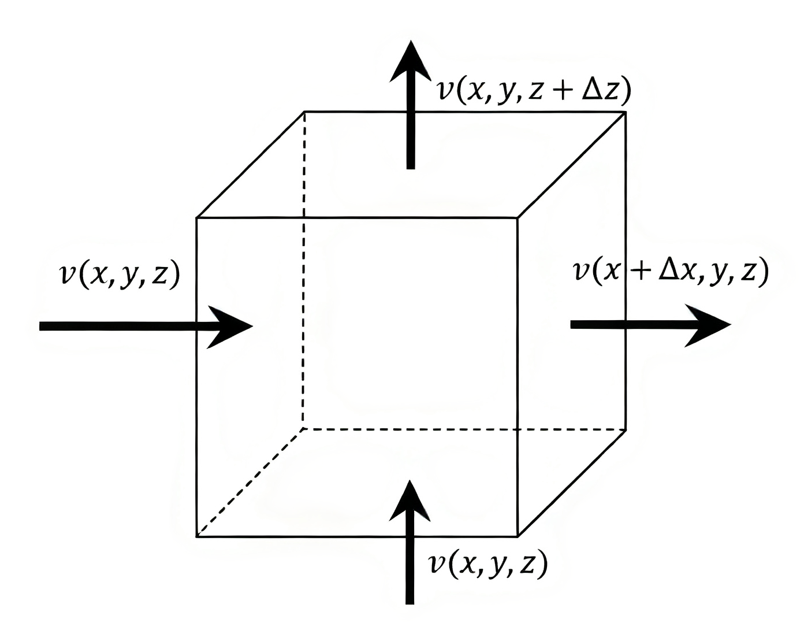
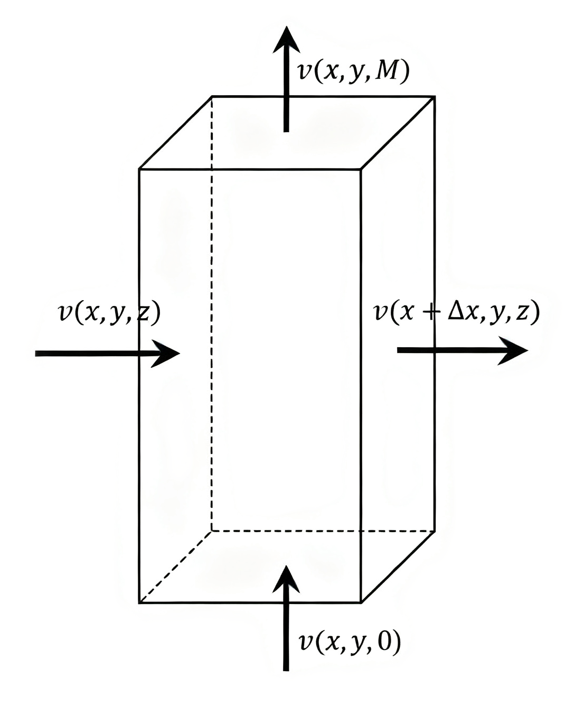
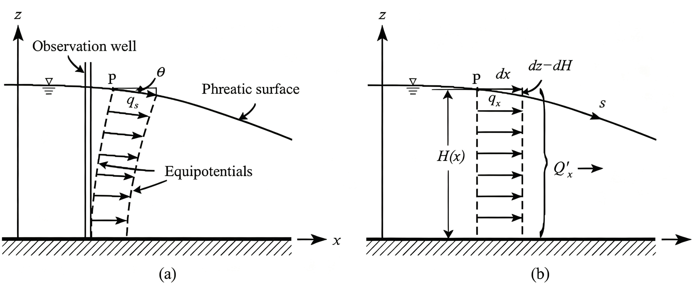
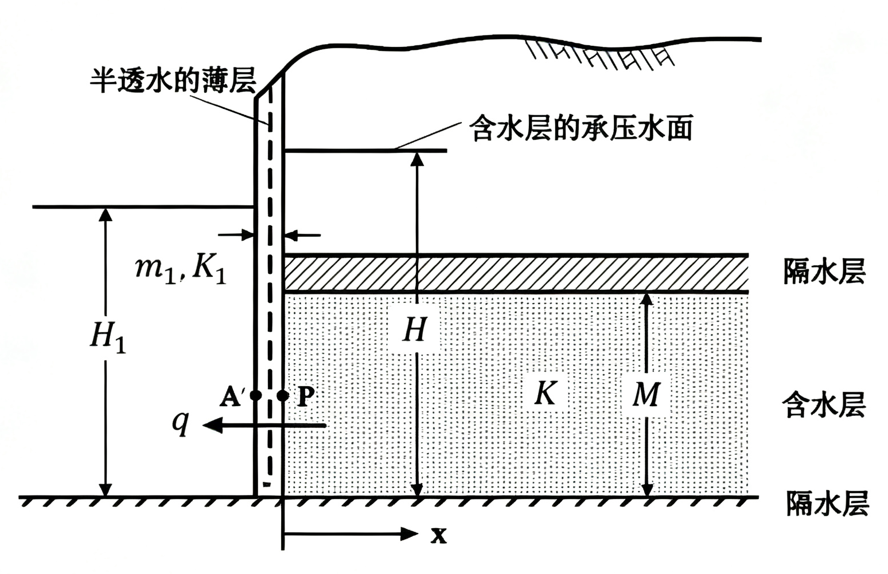
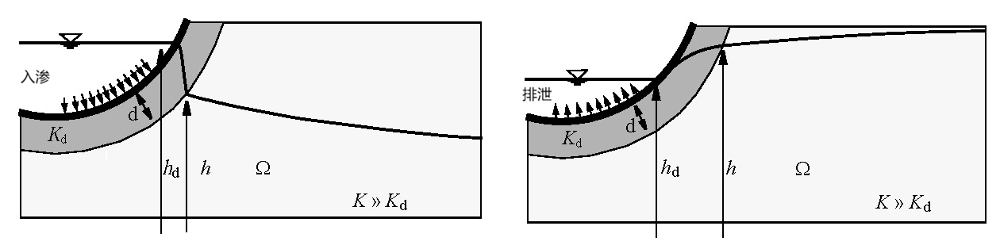
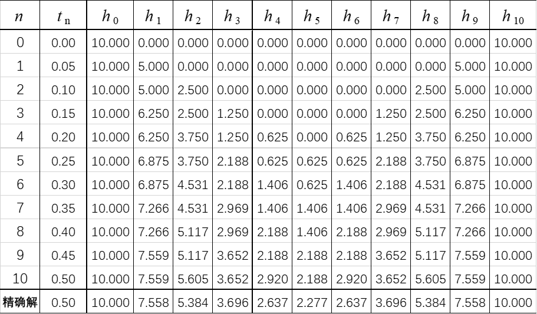
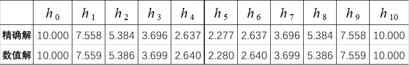

# 2 地下水运动的数学模型及定解条件

**本章导引**：

上一章我们学习了达西定律，知道了地下水“怎么流”。这一章我们要回答地下水“流成什么样”——建立描述流场的数学方程。质量守恒定律是我们推导方程的出发点。我们将质量守恒与达西定律结合起来，导出地下水运动的基本微分方程。承压含水层、越流系统和潜水含水层各有不同的方程形式。要获得唯一确定的解，我们还必须补充初始条件和边界条件。方程加上定解条件，就构成一个完整的数学模型。

## 2.1 渗流连续性方程

对于任一给定的渗流研究区，其**水均衡方程**可表述为：
$$
\Delta^{\mathrm{in}} - \Delta^{\mathrm{out}} = \Delta V_p \tag{2-1}
$$
式中，$\Delta^{\mathrm{in}}$ 为流入研究区的水量；$\Delta^{\mathrm{out}}$ 为流出研究区的水量；$\Delta V_p$ 为研究区内贮水量的变化量。

水均衡方程是地下水定量研究最基本的工具，其在不同的空间尺度上具有不同的应用形式：

- 在大区域尺度上，水均衡方程以积分形式直接用于区域水资源总量评价，通过统计各补给项（降水入渗、侧向径流补给、河流渗漏、灌溉回归等）与排泄项（蒸发蒸腾、向地表水体排泄、人工开采、侧向径流流出等），评估区域地下水资源的盈亏状态；
- 在微分单元体尺度上，水均衡方程经极限过程可推导出渗流连续性方程——地下水运动偏微分方程的物理基础。

**渗流连续性方程**，又称为质量守恒方程或水均衡方程，是将渗流场中任意微元体的质量守恒用数学式表达出来。该方程是分析地下水补给、径流与排泄（即“补、径、排”）关系、建立各类地下水运动方程的理论出发点。

设液体密度为 $\rho$，渗流速度分量为 $v_x, v_y, v_z$。在渗流场中任取一无限小单元体，其边长分别为 $\Delta x, \Delta y, \Delta z$（见[@fig-fig02-01]），研究在 $\Delta t$ 时段内沿各方向流入与流出单元体的质量变化。

{#fig-fig02-01 width=5cm}

分析 $x$ 方向净流入的质量。单位时间内通过垂直于 $x$ 轴的左侧面流入单元体的水质量为 $\rho v_x(x,y,z)\,\Delta y\Delta z$；通过右侧面流出的水质量为 $\rho v_x(x+\Delta x,y,z)\,\Delta y\Delta z$。则 $x$ 方向 $\Delta t$ 时段内的净流入量为：
$$
\Delta_x^{\mathrm{in}} - \Delta_x^{\mathrm{out}} =
\overbrace{\left[\rho v_x(x,y,z) - \rho v_x(x+\Delta x,y,z)\right]}^{\Delta v}
\cdot
\overbrace{\Delta y \Delta z}^{A} \cdot \Delta t
$$
利用微分中值定理，将上述增量形式写为微分形式：
$$
\Delta_x^{\mathrm{in}} - \Delta_x^{\mathrm{out}} = -\frac{\partial(\rho v_x)}{\partial x}\Delta x\Delta y\Delta z\Delta t
$$

同理可得 $y$ 方向和 $z$ 方向的净流入量。$x, y, z$ 三个方向净流入的总质量为：
$$
\Delta^{\mathrm{in}} - \Delta^{\mathrm{out}} = -\left[\frac{\partial(\rho v_x)}{\partial x} +
\frac{\partial(\rho v_y)}{\partial y} + \frac{\partial(\rho v_z)}{\partial z} \right]
\Delta x\Delta y\Delta z\Delta t 
$$

单元体内贮存的液态水质量等于 $\rho n\Delta x\Delta y\Delta z$。在 $\Delta t$ 时段内，该贮存量因水头或压力变化而产生的增量为：
$$
\Delta V_p = \frac{\partial}{\partial t}\big(\rho n\Delta x\Delta y\Delta z\big)\Delta t
$$
将上述两项代入水均衡方程，两端同除 $\Delta t$，得：
$$
-\left[\frac{\partial(\rho v_x)}{\partial x} + \frac{\partial(\rho v_y)}{\partial y} + \frac{\partial(\rho v_z)}{\partial z} \right]\Delta x\Delta y\Delta z
= \frac{\partial}{\partial t}\big(\rho n\Delta x\Delta y\Delta z\big) 
\tag{2-2}
$$
式 (2-2) 即为**渗流连续性方程**的基本形式。该式表明：单位时间内流入微元体的净质量流量，等于微元体内贮水质量的时间变化率。这一方程适用于任何流体和多孔介质组合，与是否服从达西定律无关。

## 2.2 承压水运动方程

### 2.2.1 承压水运动方程的一般形式

考虑承压含水层，假设：

- 水流服从 Darcy 定律；
- $K$、$S_s$ 不受 $\rho$、$n$ 变化影响；
- 忽略地下水的密度在空间分布上的差异（$\nabla\rho\approx0$）；
- 含水层侧向无压缩（$\Delta x,\Delta y$为常量），只有垂向 $\Delta z$ 的压缩。

在上述假设下，水体膨胀与介质压缩对释水量的贡献全部归入贮水率 $S_s = (\alpha + n\beta)\rho g$。

若以水头 $H$ 为因变量，需建立贮存量变化与水头变化之间的联系。记单元体总体积 $V_b = \Delta x\Delta y\Delta z$。假设上覆总荷重保持恒定，依据太沙基有效应力原理，有效应力的增量等于孔隙水压力的增量，即 $\mathrm{d}\sigma' = \mathrm{d}p$。由此可建立以下三个基本关系：

- 介质总体积随压力的变化：$\mathrm{d}V_b = \alpha V_b\mathrm{d}p$
- 流体密度随压力的变化：$\mathrm{d}\rho = \rho\beta\mathrm{d}p$
- 若假设固体颗粒体积不可压缩，即 $\mathrm{d}[(1-n)V_b] = 0$，孔隙度的变化为 $\mathrm{d}n = (1-n)\mathrm{d}V_b/V_b = (1-n)\alpha\mathrm{d}p$

利用上述关系，计算式 (2-2) 的右端项：
$$
\begin{split}
\frac{\partial(\rho nV_b)}{\partial t}
&= \frac{\mathrm{d}}{\mathrm{d}p}\big(\rho nV_b\big)\frac{\partial p}{\partial t} \\
&= \left(nV_b\frac{\mathrm{d}\rho}{\mathrm{d}p} + \rho V_b\frac{\mathrm{d}n}{\mathrm{d}p}
+ \rho n\frac{\mathrm{d}V_b}{\mathrm{d}p}
\right)\frac{\partial p}{\partial t} \\
&= \big[nV_b\rho\beta + \rho V_b(1-n)\alpha + \rho n \alpha V_b\big]\frac{\partial p}{\partial t} \\
&= \rho(n\beta + \alpha)V_b\frac{\partial p}{\partial t}
\end{split}
$$

这一推导过程表明，贮水质量的变化由两部分组成：$n\beta\rho V_b\mathrm{d}p/\mathrm{d}t$ 项代表水的膨胀效应，$\alpha\rho V_b\mathrm{d}p/\mathrm{d}t$ 项代表介质的压缩效应，两者之和构成含水层的总贮释水能力。值得注意的是，即使仅在垂向存在压缩（承压含水层的典型变形模式），即 $\mathrm{d}(\Delta z)/\Delta z = \alpha\mathrm{d}p$ 而 $\Delta x$、$\Delta y$ 保持不变，重复上述推导仍可得完全相同的结果。这说明对承压含水层而言，侧向受限的假设并不影响连续性方程右端项的最终形式。

由于 $H = z + p/(\rho g)$，$\frac{\partial p}{\partial t} = \rho g \frac{\partial H}{\partial t}$（忽略 $\rho$ 随时间的变化），可得 $\frac{\partial(\rho nV_b)}{\partial t} = \rho S_s V_b \frac{\partial H}{\partial t}$。

根据Darcy定律，（2-2）左端项中的渗透速度用水头梯度表示：
$$
\left(
\begin{array}{l}
v_x \\
v_y \\
v_z
\end{array}
\right)
= - 
\left(
\begin{array}{ccc} 
K_{xx} & K_{xy} & K_{xz} \\ 
K_{yx} & K_{yy} & K_{yz} \\ 
K_{zx} & K_{zy} & K_{zz}
\end{array} 
\right) 
\left( 
\begin{array}{l}
\frac{\partial H}{\partial x} \\
\frac{\partial H}{\partial y} \\
\frac{\partial H}{\partial z}
\end{array}
\right)
$$
代入连续性方程，有
$$
-\rho\left[\frac{\partial v_x}{\partial x} + \frac{\partial v_y}{\partial y} + \frac{\partial v_z}{\partial z}\right]V_b\Delta t
= \rho S_s\frac{\partial H}{\partial t}V_b\Delta t
\tag{2-3}
$$
消去 $\rho V_b\Delta t$ 得到以 $H$ 为因变量的微分方程：
$$
-\left(\frac{\partial v_x}{\partial x} + \frac{\partial v_y}{\partial y}+ \frac{\partial v_z}{\partial z} \right)=S_s\frac{\partial H}{\partial t}
\tag{2-4}
$$

该方程是承压水运动方程的一般形式：左端为单位体积含水层的净流入量（流入减流出的体积通量散度），右端为单位体积含水层因水头变化而产生的释（贮）水量，两者相等保证了质量守恒在微元体中的严格成立。

### 2.2.2 主渗透方向与坐标轴重合时的承压水运动方程

根据渗透系数张量概念，主渗透方向与坐标轴重合时渗透系数张量为主对角阵，Darcy定律简化为：
$$
v_x = -K_{xx}\frac{\partial H}{\partial x},\quad
v_y = -K_{yy}\frac{\partial H}{\partial y},\quad
v_z = -K_{zz}\frac{\partial H}{\partial z}
$$

在此统一约定：各向异性用有下标的渗透系数表示，非均质性用无下标的渗透系数表示（$K$ 在微分运算符内），均质各向同性时 $K$ 为常数($K$ 在微分运算符外）。由此可以写出主渗透方向与坐标轴重合时承压水运动方程的各种形式：

**三维**：

- 非均质各向异性
$$
\frac{\partial}{\partial x}\left(K_{xx}\frac{\partial H}{\partial x}\right)+
\frac{\partial}{\partial y}\left(K_{yy}\frac{\partial H}{\partial y}\right)+
\frac{\partial}{\partial z}\left(K_{zz}\frac{\partial H}{\partial z}\right)
= S_s\frac{\partial H}{\partial t}
$$

- 非均质各向同性
$$
\frac{\partial}{\partial x}\left(K\frac{\partial H}{\partial x}\right)+
\frac{\partial}{\partial y}\left(K\frac{\partial H}{\partial y}\right)+
\frac{\partial}{\partial z}\left(K\frac{\partial H}{\partial z}\right)
= S_s\frac{\partial H}{\partial t}
$$

- 均质各向同性
$$
\frac{\partial^2 H}{\partial x^2}+
\frac{\partial^2 H}{\partial y^2}+
\frac{\partial^2 H}{\partial z^2}
= \frac{S_s}{K}\frac{\partial H}{\partial t}
$$

- 稳定流：水头 $H$ 不随时间 $t$ 变化，方程右端 $\frac{\partial H}{\partial t}=0$，方程退化为三维Laplace方程 $\nabla^2 H = 0$

上式中，$K$ 为渗透系数，$S_s$ 为贮水率。

上述方程实际上是同一个物理定律在不同简化条件下的具体表达。**非均质各向异性形式最为一般，适用于大多数实际含水层；当渗透性在不同方向差异不大时可简化为各向同性；当渗透性在空间上变化不大时可简化为均质；当抽水达到平衡或边界补给充足时为稳定流**。每一种简化都有对应的假设条件，在实际应用中不可随意简化而不加验证。

**二维**：

当含水层的水平尺度远大于垂向尺度，且上下边界为隔水层时，垂向流速分量 $v_z$ 可近似忽略，水头在垂向上视为均匀分布。此时，可将三维方程沿含水层厚度方向积分，得到二维平面渗流方程。二维方程的导出可采用两种等效方法：一是从三维方程出发，沿 $z$ 方向自底板至顶板积分，利用上下隔水边界条件消去含 $z$ 的项；二是以单位面积含水层全厚度的柱体为均衡单元，直接建立水均衡关系。

研究二维运动常用导水系数 $T$ 与贮水系数 $S$ 为参数，运动方程有以下形式：

- 非均质各向异性
$$
\frac{\partial}{\partial x}\left(T_{xx}\frac{\partial H}{\partial x}\right) +
\frac{\partial}{\partial y}\left(T_{yy}\frac{\partial H}{\partial y}\right) = 
S\frac{\partial H}{\partial t}
$$

- 非均质各向同性
$$
\frac{\partial}{\partial x}\left(T\frac{\partial H}{\partial x}\right)+
\frac{\partial}{\partial y}\left(T\frac{\partial H}{\partial y}\right)
= S\frac{\partial H}{\partial t}
$$

- 均质各向同性
$$
\frac{\partial^2 H}{\partial x^2} + \frac{\partial^2 H}{\partial y^2} = \frac{S}{T}\frac{\partial H}{\partial t}
$$

- 稳定流：$\frac{\partial H}{\partial t}=0$，方程退化为二维Laplace方程 $\nabla^2 H = 0$。

**一维**：

采用导水系数 $T$ 与贮水系数 $S$ 为参数，运动方程有如下形式：

- 非均质各向同性
$$
\frac{\partial}{\partial x}\left(T\frac{\partial H}{\partial x}\right)
= S\frac{\partial H}{\partial t}
$$

- 均质各向同性
$$
\frac{\partial^2 H}{\partial x^2} = \frac{S}{T}\frac{\partial H}{\partial t}
$$

- 稳定流：$\frac{\partial H}{\partial t}=0$，方程退化为 $\frac{\partial^2 H}{\partial x^2} = 0$

上式中，$T=KM$ 为导水系数；$S = S_s M$ 为贮水系数。

引入**压力传导系数**（也称导压系数）$a = T/S$（量纲 $[\mathrm{L^2T^{-1}}]$）。$a$ 的物理意义是：表征含水层传递水头变化快慢能力的综合参数。$a$ 值越大，含水层内水头扰动向外传播的速度越快；反之，水头响应越迟缓。导水性好而贮水性差的含水层（如裂隙发育的坚硬岩层）$a$ 值较大；导水性差而贮水性好的含水层（如厚层粘土夹层）$a$ 值较小。例如，砂砾石含水层的 $a$ 可达 $10^3 \sim 10^5\ \mathrm{m^2/d}$，水头扰动可在数小时内传播数公里；而黏土质含水层的 $a$ 可能低至 $10^{-2}\ \mathrm{m^2/d}$，扰动传播极慢。

均质各向同性含水层中，抽水井抽水时，井周围的地下水运动可看作是轴向对称的，此时取柱坐标可以简化计算。由高等数学知识
$$
\begin{aligned}
\frac{\partial^2H}{\partial x^2}+\frac{\partial^2H}{\partial y^2}
&=\frac{\partial^2H}{\partial r^2}+\frac{1}{r}\frac{\partial H}{\partial r}+\frac{1}{r^2}\frac{\partial^2 H}{\partial \theta^2} \\
&= \frac{1}{r^2}\left[r\frac{\partial}{\partial r}\left(r\frac{\partial H}{\partial r}\right)+\frac{\partial^2H}{\partial \theta^2}\right]
\end{aligned}
$$
由对称性，$\frac{\partial^2H}{\partial \theta^2}=0$。此时的运动方程为
$$
\frac{1}{r}\frac{\partial}{\partial r}\left(r\frac{\partial H}{\partial r}\right)
= \frac{S_s}{K}\frac{\partial H}{\partial t}
$$

柱坐标形式是研究井流解析解的基础。**Theis公式、Hantush-Jacob公式等全部是在柱坐标下求解的——因为抽水井周围的流场天然具有轴对称性，柱坐标使方程大大简化。** 

### 2.2.3 含源、汇项的承压水运动方程

在实际水文地质条件下，含水层除通过侧向边界与外界发生水力联系外，还常存在垂向上的水量交换，如降水入渗补给、潜水蒸发、越流补给、人工回灌和开采等。这些在含水层内部或顶底界面上发生的、相对于侧向渗流而言可视为“外来”的水量输入或输出，统称为**源**与**汇**。

- **源**：有水量自外部进入含水层，取正值，如降水入渗、灌溉回归、越流补给、人工回灌等；
- **汇**：有水量自含水层排出至外部，取负值，如蒸发排泄、泉排泄、越流流失、人工开采等。

源汇项的引入方式取决于所采用的方程维度。三维时 $W$ 为单位时间、单位体积含水层的垂向交换水量（量纲 $[\mathrm{T^{-1}}]$）；二维时 $W$ 为单位时间、单位面积含水层的垂向交换水量（$[\mathrm{LT^{-1}}]$）；一维时 $W$ 为单位时间、单位长单位宽含水层的垂向交换水量（$[\mathrm{LT^{-1}}]$），不同的维度 $W$ 量纲不一样。

以非均质各向同性为例：

**三维**：

$$
\frac{\partial}{\partial x}\left(K\frac{\partial H}{\partial x}\right) +\frac{\partial}{\partial y}\left(K\frac{\partial H}{\partial y}\right) +\frac{\partial}{\partial z}\left(K\frac{\partial H}{\partial z}\right)+W=S_s\frac{\partial H}{\partial t}
$$

**二维**：
$$
\frac{\partial}{\partial x}\left(T\frac{\partial H}{\partial x}\right) + \frac{\partial}{\partial y}\left(T\frac{\partial H}{\partial y}\right)+W=S\frac{\partial H}{\partial t}
$$

**一维**：
$$
\frac{\partial}{\partial x}\left(T\frac{\partial H}{\partial x}\right)+W=S\frac{\partial H}{\partial t}
$$

## 2.3 有越流承压水运动方程

**越流**是自然界多层含水层系统中普遍存在的水力联系形式。当承压含水层与相邻含水层之间存在水头差时，地下水将自高水头含水层经由中间弱透水层向低水头含水层缓慢迁移，这一现象称为**越流**。

**越流含水层**（亦称半承压含水层）是指上覆和/或下伏岩层为弱透水层的承压含水层。此类含水层并非完全封闭，而是通过弱透水层与相邻含水层发生水力联系——上覆或下伏的弱透水层虽渗透系数远小于主含水层，但其厚度有限且面积巨大，在长期的水头差作用下可传递显著的水量。越流含水层的存在使得多层含水系统的水力响应相互关联。

建立有越流承压水运动方程时，采用以下基本假设：

- 含水层产状水平，厚度 $M$ 在空间上均匀（或缓变）；
- 水流服从Darcy定律；
- $K$、$S_s$ 不受 $\rho$、$n$ 微小变化的影响；
- 含水层仅发生垂向压缩（侧向无变形，$\Delta x$、$\Delta y$ 恒定）；
- 忽略弱透水层的弹性释水效应。此假设在弱透水层厚度不大、抽水历时不很长时基本成立；当弱透水层较厚或抽水历时甚长时，弱透水层的弹性释水不可忽略（将引入Hantush越流理论中的延迟因子），但本章先以简化情况加以处理；
- 弱透水层的渗透系数 $K_1$、$K_2$ 远小于主含水层的渗透系数 $K$。因此，地下水在弱透水层中以近于垂直的方向流动，进入主含水层后发生约 90° 折射，转变为主含水层中的水平流动。这一假设使得越流量可以用弱透水层中的垂直一维Darcy公式计算。

取坐标原点位于含水层底板，记 $v(x,y,z)$ 为点 $(x,y,z)$ 处的渗流速度。针对厚度为 $M$ 的非均质各向同性含水层，取单位水平面积的含水层全厚柱体，进行 $\Delta t$ 时段的水量均衡分析（见[@fig-fig02-02]）。

{#fig-fig02-02 width=5cm}

总水均衡方程为：
$$
\Delta V_{\mathrm{in}} - \Delta V_{\mathrm{out}} = \Delta V_t
$$

**侧向净流入量**：$x$ 方向上，通过柱体两侧面的地下水体积净变化量为：
$$
\begin{split}
&\{v(x,y,z) - v(x+\Delta x, y, z)\}\overbrace{M\Delta y}^{A}\Delta t \\
&= -\frac{\partial v_x}{\partial x}\Delta x M\Delta y \Delta t 
\end{split}
$$

在各向同性假设下，由Darcy定律 $v_x = -K\,\partial H/\partial x$，定义导水系数 $T = MK$，$x$ 方向的净流入量可表示为：
$$
\frac{\partial}{\partial x}\Big(\overbrace{MK}^{T}\frac{\partial H}{\partial x}\Big)
\Delta x\Delta y\Delta t
$$
同理，可得 $y$ 方向的净流入量。故 $x$、$y$ 方向侧向净流入总量为：
$$
\left\{\frac{\partial}{\partial x}\left(T\frac{\partial H}{\partial x}\right) +
\frac{\partial}{\partial y}\left(T\frac{\partial H}{\partial y}\right)\right\}
\Delta x\Delta y\Delta t
$$

**垂向越流净补给量**：$z$ 方向上，通过柱体底板和顶板进出的水量为：
$$
\left[v(x,y,0) - v(x,y,M)\right]\Delta x \Delta y \Delta t
$$
底板和顶板处的垂向渗流速度，由弱透水层中的垂直Darcy定律给出：
$$
\begin{split}
v(x,y,M) &= -K_1\frac{H_1 - H}{m_1} \quad\text{（通过上覆弱透水层）}\\
v(x,y,0) &= -K_2\frac{H - H_2}{m_2} \quad\text{（通过下伏弱透水层）}
\end{split}
$$
式中，$K_1$、$m_1$ 和 $K_2$、$m_2$ 分别为上、下弱透水层的渗透系数与厚度；$H_1$、$H_2$ 为上、下相邻含水层的水头；$H$ 为主含水层的水头。注意上述速度符号的约定：此处取 $z$ 轴向上为正，水流进入主含水层为正。由此可得垂向越流净补给量为：
$$
\left(K_2\frac{H_2 - H}{m_2}+K_1\frac{H_1 - H}{m_1}\right)\Delta x \Delta y\Delta t
$$

**柱体内部贮水量变化**：由贮水系数的定义，该柱体在水头变化下的贮水量为：
$$
\Delta V_p = S\frac{\partial H}{\partial t}\Delta x\Delta y\Delta t
$$
将上述各项代入水均衡方程，消去公共因子 $\Delta x\Delta y\Delta t$，即得**有越流承压水运动方程**：
$$
\frac{\partial}{\partial x}\left(T\frac{\partial H}{\partial x}\right) +
\frac{\partial}{\partial y}\left(T\frac{\partial H}{\partial y}\right) +
K_1\frac{H_1 - H}{m_1} + K_2\frac{H_2 - H}{m_2} = S\frac{\partial H}{\partial t}
$$

对于**非均质各向异性**介质（坐标方向与主渗透方向一致），方程为：
$$
\frac{\partial}{\partial x}\left(T_{xx}\frac{\partial H}{\partial x}\right) +
\frac{\partial}{\partial y}\left(T_{yy}\frac{\partial H}{\partial y}\right) +
K_1\frac{H_1 - H}{m_1} + K_2\frac{H_2 - H}{m_2} = S\frac{\partial H}{\partial t}
$$

对于**均质各向同性**介质，$T$ 为常数，可提出微分号外，方程简化为：
$$
\frac{\partial^2 H}{\partial x^2} + \frac{\partial^2 H}{\partial y^2} +
\frac{H_1 - H}{B_1^2} + \frac{H_2 - H}{B_2^2} = \frac{S}{T}\frac{\partial H}{\partial t}
$$
式中，$B_1 = \sqrt{\frac{Tm_1}{K_1}}, \quad B_2 = \sqrt{\frac{Tm_2}{K_2}}$。

- **越流因素** $B_1$、$B_2$ 分别为上、下弱透水层的越流因素，量纲为 $[\mathrm{L}]$。

越流因素综合反映了弱透水层对越流传递的阻滞能力。$B$ 越大，表示越流补给越弱——这是因为越流因素实际上是越流阻力的平方根：弱透水层越厚（$m'$ 越大）、渗透性越差（$K'$ 越小），$B$ 越大，越流越困难。反之，$B$ 越小，越流补给越强。松散沉积层中，$B$ 通常在 $10 \sim 1000\ \mathrm{m}$ 量级；当 $B > 1000\ \mathrm{m}$ 时，越流影响通常可忽略，方程退化为无越流承压水方程。

- **越流系数** $\sigma'$ 为弱透水层的渗漏强度参数，量纲为 $[\mathrm{T^{-1}}]$，定义为当主含水层与相邻供给越流的含水层之间水头差为一个单位时，通过二者间单位面积界面的越流量：
$$
\sigma' = \frac{K_1}{m_1}
$$

越流系数表征弱透水层的水力传导能力；而越流因素则综合了主含水层的导水能力和弱透水层的阻力。**越流因素 $B$** 作为第5章越流井函数中的参数，也指示了越流补给影响的有效距离。在 $r > 4B$ 处，越流补给已经提供了抽水量的绝大部分（约95%）。

**有源、汇项**：

若除越流之外，含水层顶板还存在直接垂向水量交换（如通过弱透水“天窗”的集中渗漏、人工回灌或降水入渗等），则需增添源汇项 $W$：

- 非均质各向异性（坐标方向与主渗透方向一致）：
$$
\frac{\partial}{\partial x}\left(T_{xx}\frac{\partial H}{\partial x}\right) +
\frac{\partial}{\partial y}\left(T_{yy}\frac{\partial H}{\partial y}\right) +
K_1\frac{H_1 - H}{m_1} + K_2\frac{H_2 - H}{m_2} + W = S\frac{\partial H}{\partial t}
$$

- 非均质各向同性：
$$
\frac{\partial}{\partial x}\left(T\frac{\partial H}{\partial x}\right) +
\frac{\partial}{\partial y}\left(T\frac{\partial H}{\partial y}\right) +
K_1\frac{H_1 - H}{m_1} + K_2\frac{H_2 - H}{m_2} + W = S\frac{\partial H}{\partial t}
$$

- 均质各向同性：
$$
\frac{\partial^2 H}{\partial x^2} + \frac{\partial^2 H}{\partial y^2} +
\frac{H_1 - H}{B_1^2} + \frac{H_2 - H}{B_2^2} + W =
\frac{S}{T}\frac{\partial H}{\partial t}
$$

- 均质各向同性轴对称形式： 

$$
\frac{\partial^2 H}{\partial r^2} + \frac{1}{r}\frac{\partial H}{\partial r}
+ \frac{H_1 - H}{B_1^2} + \frac{H_2 - H}{B_2^2} + W =
\frac{S}{T}\frac{\partial H}{\partial t}
$$

## 2.4 潜水运动方程

### 2.4.1 Dupuit 假设

天然条件下，潜水含水层中的地下水流并非严格的水平运动。潜水面通常为起伏曲面，等水头面亦呈弯曲形态。然而，对于大多数缓变流场，潜水面的坡度角 $\theta$ 相当平缓（通常小于几度）（[@fig-fig02-03]）。Dupuit 根据这些特征提出了著名的 Dupuit 假设。

Dupuit Assumption (1863)：大多数情况下可以假设潜水流近似水平运动。

- 当潜水面坡度角很小（$\theta \ll 1$）时，垂直方向上的渗透速度分量可以忽略不计，渗流可近似视为水平运动；
- 在上述条件下，等水头面可视为铅直面，同一铅直线上各点的水头近似相等；
- 含水层中的水压分布近似遵循静水压力规律，即测压管水头在垂向上近似为常数。

{#fig-fig02-03 width=12cm}

参见[@fig-fig02-03]，潜水面上任意一点 $p$ 处的渗透速度沿潜水面切线方向，其大小为：
$$
v_s = -K\frac{\partial H}{\partial s} = -K\sin\theta
$$

当坡度角 $\theta$ 很小时，$\sin\theta \approx \tan\theta$。而 $\tan\theta$ 恰为潜水面在水平方向的坡度 $\partial H/\partial x$，因此：
$$
v_s \approx -K\frac{\partial H}{\partial x} = v_x
$$
即在潜水面坡度平缓的条件下，沿潜水面方向的渗流速度近似等于水平方向分量。

**单宽流量**

记 $h = H - z_b$ 为饱和厚度（$z_b$ 为含水层底板高程），垂向上对水平流速积分可得：
$$
q_x = -K(H - z_b)\frac{\partial H}{\partial x} = -Kh\frac{\partial H}{\partial x}
$$
式中，$q_x$ 为 $x$ 方向的单宽流量（量纲 $[\mathrm{L^2T^{-1}}]$），表示单位宽度含水层全厚度的总过流量。需注意，$h$ 本身就是 $H$ 的函数（底板高程已知），因此 $q_x$ 与水头之间是非线性关系。

**Dupuit假设的简化意义**：

Dupuit假设实现了维度的实质性降低，极大简化了潜水渗流问题的数学求解：

- 剖面二维流 $(x,z)$ 降维为水平一维流；
- 空间三维问题 $(x,y,z)$ 降维为水平二维流 $(x,y)$；
- 潜水面的边界条件处理大为简化：无需追踪非线性的自由面位置，可直接将潜水面上的边界条件施加于水头 $H$ 上。

**Dupuit假设的局限性**：

任何简化都有其适用边界。Dupuit假设在以下情形中偏差显著，需审慎使用或加以修正：

- 当潜水面存在显著的垂向补给（如强降水入渗）或排泄（如强烈蒸发、植物蒸腾）时，垂直流速分量不能忽略，尤其是在非稳定流过程中水位变动剧烈的时期；
- 对于潜水非稳定流问题，即使潜水面坡度平缓，水位变动也会诱发不可忽略的垂向流动分量，需视情况评估Dupuit假设的适用性；
- 在隔水边界附近（如含水层尖灭区、断层阻水带），当距隔水边界的距离小于约 $2h_0$（$h_0$ 为边界处饱和厚度）时，等水头面的铅直性遭到破坏，Dupuit假设失效。在此区域之外，Dupuit 假设才有效。
- 一般而言，当 $s/H_0 < 0.1$ 时，Dupuit假设的误差在2%以内；当 $s/H_0 = 0.3$ 时，误差可达10%；当 $s/H_0 = 0.5$ 时，误差可达25%~30%。因此工程中使用Dupuit假设时，应首先验算降深与含水层厚度的比值。

Dupuit假设是地下水动力学中最具影响力的简化方法之一。**它将一个具有自由面的非线性三维问题，简化为一个线性（或可线性化）的二维问题，使得大量工程问题获得了解析解。** 可以说，没有Dupuit假设，就不可能有第3章的一维河渠间流模型、第4章的井流Dupuit公式，以及大量工程排水设计的理论基础。

### 2.4.2 Boussinesq方程

Boussinesq方程是描述潜水含水层中非稳定流运动的基本方程，其推导基于Dupuit假设和水量均衡原理。假定条件如下：

- 潜水流满足Dupuit假设（忽略垂向流速分量，等水头面铅直）；
- 水和固体骨架均不可压缩（介质的弹性贮水效应忽略，释水完全由重力排水引起）；
- 潜水面上存在水量交换 $W(x,y,t)$（$[\mathrm{LT^{-1}}]$）：$W>0$ 代表入渗补给（降雨、灌溉入渗），$W<0$ 代表蒸发排泄；
- 潜水流为一维流（$x$ 方向）。

记 $z_b(x,y)$ 为含水层底板高程，$h(x,y,t) = H(x,y,t) - z_b(x,y)$ 为饱和厚度。取长度为 $\Delta x$、宽度为单位长度（$=1$）、高度为含水层全厚度的含水层柱体作为均衡单元，分析 $\Delta t$ 时段内的水量均衡：
$$
\Delta V_{\mathrm{in}} - \Delta V_{\mathrm{out}} = \Delta V_t
$$
记 $q_x$ 为 $x$ 方向的单宽流量。应用Dupuit假设，$x$ 方向单宽流量为：
$$
q_x = -Kh\frac{\partial H}{\partial x}
$$
$x$ 方向上流入与流出柱体的地下水体积净变化量为：
$$
\begin{align*}
\Delta V_{\mathrm{in},x} - \Delta V_{\mathrm{out},x} &= -\frac{\partial q_x}{\partial x}\Delta x\cdot 1\cdot\Delta t \\
&= \frac{\partial}{\partial x}\left(Kh\frac{\partial H}{\partial x}\right)\Delta x\cdot 1\cdot\Delta t
\end{align*}
$$

垂向上，入渗或蒸发引起的柱体水量变化为：
$$
\Delta V_{\mathrm{in},z} - \Delta V_{\mathrm{out},z} = W\Delta x\cdot 1\cdot\Delta t
$$
$\Delta t$ 时段内，潜水位变化 $\frac{\partial H}{\partial t}\Delta t$ 所对应的柱体内重力释水量变化为：
$$
\Delta V_t = \mu\frac{\partial H}{\partial t}\Delta x\cdot 1\cdot\Delta t
$$
式中，$\mu$ 为给水度。

将上述各项代入均衡方程并消去 $\Delta x\Delta t$，得到**一维Boussinesq方程**：
$$
\frac{\partial}{\partial x}\left(Kh\frac{\partial H}{\partial x}\right) + W = \mu\frac{\partial H}{\partial t}
$$

若含水层底板为水平面（$z_b = \mathrm{const}$），则 $h = H - z_b = H$（重新选定基准面使 $z_b = 0$），方程可简化为以饱和厚度 $h$ 表达的形式：
$$
\frac{\partial}{\partial x}\left(Kh\frac{\partial h}{\partial x}\right) + W = \mu\frac{\partial h}{\partial t}
$$

**Boussinesq方程与承压水方程的本质区别**： 对比承压水方程与Boussinesq方程，承压水中 $T=KM$ 为常数，而潜水中 $T=Kh$ 随饱和厚度 $h$ 变化，是水头的函数。这种非线性特征使得Boussinesq方程必需先线性化然后才可近似求解。

**常用的两种Boussinesq方程线性化方法**：

- **固定厚度法**：用平均饱和厚度 $\bar{h}$ 替代 $h$，将方程近似为 $\bar{h}K\frac{\partial^2H}{\partial x^2}=\mu\frac{\partial H}{\partial t}$，即承压水方程形式；
- **平方变换法**：令 $u=h^2/2$，将Boussinesq方程化为 $\frac{\partial u}{\partial t}=a\frac{\partial^2u}{\partial x^2}$ 的线性形式（在3.2节中有详细讨论）。

第一种方法物理直观但精度受限于水位变幅；第二种方法数学上更自然，是第3章一维非稳定流解析解所采用的方法。值得注意的是，两种方法都是近似，当 $s/H_0 > 0.3$ 时应谨慎使用。

**二维Boussinesq方程**：

将上述推导扩展至二维水平流场：

- 均质各向同性：
$$
\frac{\partial}{\partial x}\left(h\frac{\partial H}{\partial x}\right) + 
\frac{\partial}{\partial y}\left(h\frac{\partial H}{\partial y}\right) + 
\frac{W}{K} = \frac{\mu}{K}\frac{\partial H}{\partial t}
$$

- 非均质各向同性：
$$
\frac{\partial}{\partial x}\left(Kh\frac{\partial H}{\partial x}\right) + 
\frac{\partial}{\partial y}\left(Kh\frac{\partial H}{\partial y}\right) + W = \mu\frac{\partial H}{\partial t}
$$

- 以底板为基准面且底板水平（此时 $H = h$）：
$$
\frac{\partial}{\partial x}\left(Kh\frac{\partial h}{\partial x}\right) + 
\frac{\partial}{\partial y}\left(Kh\frac{\partial h}{\partial y}\right) + W = \mu\frac{\partial h}{\partial t}
$$

对于**三维潜水流**问题，当不满足Dupuit假设时，渗流场的控制方程形式与承压水运动方程类似，区别仅在于潜水面作为自由边界需附加额外的边界条件处理。

## 2.5 定解条件

### 2.5.1 基本概念

从数学物理方程的观点看，前述各类地下水运动微分方程描述的是同类含水层介质中渗流运动所共同遵循的物理规律，其通解中包含任意函数或任意常数，并不包含某一具体渗流区的特定信息。为说明此点，考虑两个简单示例：

**例1**：一维稳定流方程
$$
\frac{\partial^2 H}{\partial x^2} = 0
$$
的通解为 $H = C_1 x + C_2$，$C_1$ 和 $C_2$ 为待定常数。然而，不同渗流区的水头分布千差万别，仅凭该通解无法确定任一特定含水层中的水头值。

**例2**：一维非稳定流方程
$$
\frac{\partial^2 H}{\partial x^2} = \frac{\partial H}{\partial t}
$$
的通解为 $H = \big[C_1\cos(\lambda x) + C_2\sin(\lambda x)\big]\mathrm{e}^{-\lambda^2 t}$，其中 $\lambda$ 为任意常数。显然，通解描述的是一族函数，必须附加条件后才能从中筛选出对应于实际物理问题的特解。

因此，微分方程刻画的是地下水运动的一般规律，而并不包含渗流区的特定水文地质信息。要使问题获得唯一确定的解，必须补充如下水文地质数据：

- 渗流区的几何范围与空间形状；
- 渗流控制微分方程及其中包含的水文地质参数，如 $T$、$K$、$S$、$S_s$、$\mu$、$B$、越流因子，以及源汇项 $W(x,y,t)$ 等；
- **边界条件**：渗流区边界处的物理量给定情况（水头、流量或二者之线性组合），表征系统与外界的物质与能量交换关系；
- **初始条件**：仅用于非稳定流问题，指定某一选定的初始时刻（通常取 $t = 0$）渗流区内水头 $H$ 的空间分布。

**定解条件**是边界条件和初始条件的总称。微分方程与相应的定解条件共同构成一个确定的数学物理问题，称为**定解问题**。一套完整的控制方程与定解条件定义了一个描述特定实际地下水系统的**数学模型**。从系统的观点看，初始条件可以理解为地下水系统在起始时刻的质能与状态的空间分布。

定解条件的选取是否正确、与客观水文地质条件是否一致，直接决定数学模型模拟的真实性和预测的可靠性。定解条件错配——如将降水补给的潜水含水层边界全部设为隔水边界——将导致全盘结果失真甚至物理上无意义。

### 2.5.2 初始条件

初始条件为非稳定渗流问题提供时间上的起始状态。数学上表述为指定在初始时刻 $t = 0$ 时，渗流区 $D$ 内各点的水头分布：

- **三维流**：
$$
\left. H(x,y,z,t) \right|_{t = 0} = H_0(x,y,z), 
\qquad (x,y,z) \in \Omega
$$

- **二维流**：
$$
\left. H(x,y,t) \right|_{t = 0} = H_0(x,y), \qquad (x,y) \in D
$$

- **一维流**：
$$\left. H(x,t)\right|_{t = 0} = H_0(x), \qquad x \in [x_L,x_R]$$
式中，$H_0$ 为已知的初始水头分布函数，常通过实测流场数据插值、区域水均衡分析或长期开采条件下的稳定流模型计算获得。

**特别强调**：初始条件并不等同于地下水“未受人类活动影响”的天然状态。在建模实践中，初始条件的选择应服务于研究目的——可以是历史上的某一天然状态，也可以是人类活动已干预的某一时刻（如大规模开采前某一年的地下水等水位线）。关键是初始时刻应尽量选在水文地质条件相对稳定、观测数据充足的时期，以减小初始条件的不确定性对模拟结果的影响。否则，模型需要额外的“预热期”（Spin-up Period）来消除初始条件误差的影响。

### 2.5.3 边界条件

根据边界上给定物理量的性质，地下水渗流问题的边界条件可分为三种基本类型：

- **第一类边界条件（Dirichlet条件）**：又称给定水头边界。在边界某一部分上，水头随时间的变化规律为已知函数；
- **第二类边界条件（Neumann条件）**：又称给定流量边界。在边界某一部分上，通过边界单位面积进出含水层的流量（即法向通量）为已知函数；
- **第三类边界条件（Robin条件）**：又称混合边界条件。边界上水头与法向水力坡度（或流量）的线性组合为已知。

边界条件描述的是地下水系统在边界处与外部环境的质能交换方式。值得指出的是，在特定条件下，三类边界条件之间存在等效转换关系。例如，对于一维稳定流，由Darcy定律可知：若已知边界水头，可反推出通过边界流出的流量；反之亦然。但在非稳定流或二维、三维问题中，由于流场结构复杂，这种互换需谨慎而行——直接换算可能导致不可接受的误差。

**边界条件的数学表示**

**第一类边界条件**：

- 三维：
$$
\left.H(x,y,z,t)\right|_{S_1}=\varphi_2(x,y,z,t),
\qquad(x,y,z) \in S_1
$$

- 二维：
$$
\left.H(x,y,t)\right|_{\Gamma_1}=\varphi_1(x,y,t),
\qquad(x,y) \in\Gamma_1
$$

- 一维：
$$
\left.H(x,t)\right|_{x=x_L}=h_L(t),\quad \left.H(x,t)\right|_{x=x_R}=h_R(t)
$$
式中，$S_1$（三维边界面）、$\Gamma_1$（二维边界曲线段）或 $x_L,\,x_R$（一维边界端点）为给定水头边界；$\varphi_2$、$\varphi_1$ 和 $h_L,\,h_R$ 为已知水头函数。典型的Dirichlet边界包括与含水层有直接水力联系的河流、湖泊、海洋，以及作为定水头排泄基准面的泉口等。

**第二类边界条件**：

以**边界外法线方向 $n$（指向渗流区域外）** 为正方向，根据Darcy定律，标准的法向通量形式为：

$$q_n = -K\frac{\partial H}{\partial n}$$

式中：$q_n$ 为**沿外法线向外**的单位面积渗流通量；由于水头梯度方向与水流方向相反，在此
统一约定**：流入渗流区 $q_n$ 为正，流出渗流区 $q_n$ 为负**。

- 三维：
$$
\left. -K\frac{\partial H}{\partial n}
\right|_{S_2}=v(x,y,z,t),\qquad(x,y,z) \in S_2
$$
式中，$v(x,y,z,t)$为边界单位面积渗流速度，量纲 $[\mathrm{LT^{-1}}]$，$v>0$ 水流流入渗流区，$v<0$ 水流流出渗流区；

- 二维：
$$
\left. -KM\frac{\partial H}{\partial n}
\right|_{\Gamma_2}=q(x,y,t),\qquad(x,y) \in\Gamma_2
$$
式中，$M$ 承压含水层厚度，$T=KM$ 为含水层导水系数；$q(x,y,t)$ 为边界单宽流量，量纲 $[\mathrm{L^2T^{-1}}]$，$q>0$ 侧向水流流入渗流区，$q<0$ 侧向水流流出渗流区。

- 一维：

注意到一维左边界 $x=x_L$ 外法线指向 $-x$ 方向，右边界 $x=x_R$ 外法线指向 $+x$ 方向，

第二类边界表示为
$$-KM\left.\frac{\partial H}{\partial n}\right|_{x_L}=q_L(t),\quad -KM\left.\frac{\partial H}{\partial n}\right|_{x_R}=q_R(t)$$
用 $H$ 关于 $x$ 梯度表示为
$$\left. KM\frac{\partial H}{\partial x}\right|_{x_L}=q_L(t),\quad \left. -KM\frac{\partial H}{\partial x}\right|_{x_R}=q_R(t)$$
式中，$q_L(t)、q_R(t)$ 分别为左、右边界的单宽补给流量，量纲 $[\mathrm{L^2T^{-1}}]$，$q_L、q_R>0$ 水流流入渗流区，$q_L、q_R<0$ 水流流出渗流区。

**第三类边界条件**：

一般数学形式为：
$$
\frac{\partial H}{\partial n} + \alpha H = \beta, \qquad (x,y) \in \Gamma_3
$$
式中，$n$ — 边界外法线方向，$\alpha$ 和 $\beta$ 为已知参数。混合边界条件典型的应用场景是含水层通过弱透水层或河床淤积层与外部水体发生间接水力联系的情况。

### 2.5.4 边界条件概化

现实中，真实的地下水含水系统边界处的水力条件复杂多样。构建数学模型时，需将现场调查和试验获得的实际边界信息，概化为上述三类数学边界之一，这一过程称为**边界条件的概化**。

**第一类边界**

当含水层被地表水体（如河流、湖泊、海洋）完全切割，二者之间存在直接水力联系时，地表水体的水位可近似作为含水层边界处的已知水头。此时概化为第一类边界：
$$
\left. H(x,y,t) \right|_{\Gamma_1} = H_1(x,y,t), \quad (x,y) \in \Gamma_1
$$

使用此类边界需确认切割完全、无弱透水夹层阻隔。对于季节性河流，应考虑枯水期断流或水位大幅波动的影响，必要时需将边界在不同时段设为不同类型。

**第二类边界**

- **隔水边界（零流量边界）**

以隔水断层、侵入岩体、含水层尖灭线或地下分水岭为典型代表。对于各向同性介质：
$$
\left. \frac{\partial H}{\partial n} \right|_{\Gamma_2} = 0
$$
对于各向异性介质，隔水条件的准确表达为垂直于边界方向的渗透系数分量与法向梯度之积为零：
$$
K_n \left. \frac{\partial H}{\partial n} \right|_{\Gamma_2} = 0
$$

- **抽水井边界（已知开采流量）**

抽水井是典型的内边界，以已知流量条件表示。以完整井为例，井壁处法向流量与抽水流量相等。设外法线 $n$ 指向井轴方向（即由含水层指向井壁面），则：

法向梯度形式：
$$
2\pi r_w MK \left. \frac{\partial H}{\partial n} \right|_{\Gamma_w} = -Q
$$
柱坐标形式（$r$ 轴正向由井中心径向向外），此时 $\partial H/\partial r$ 对抽水井为负值，流量平衡关系为：
$$
2\pi r_w MK \left. \frac{\partial H}{\partial r} \right|_{r_w} = Q
$$
式中，$r_w$ 为井半径，$Q$ 为抽水流量（$Q > 0$ 为抽水，$Q < 0$ 为注水）。

**第三类边界**：

当含水层边界通过弱透水层或河床淤积层与外部水体（河流、湖泊或相邻含水层）发生间接水力联系时，应概化为第三类混合边界（见[@fig-fig02-04]）。

{#fig-fig02-04 width=8cm}

设含水层外边界处贴覆有一层渗透系数为 $K_1$、厚度为 $m_1$ 的弱透水层，其外侧水体水头为 $H_1$（已知）。在弱透水层中，水流以垂直于界面的方向穿越，按Darcy定律其渗流速度为：

弱透水层侧：$v = -K_1\frac{H - H_1}{m_1}$

含水层法向速度：$v = K\frac{\partial H}{\partial n}$

由质量连续条件，在边界处两速度相等，由此得到第三类边界条件：
$$
K\frac{\partial H}{\partial n} + \frac{K_1}{m_1}(H - H_1) = 0, \quad (x,y,z) \in \Omega
$$
此即 $\partial H/\partial n + \alpha H = \beta$ 的形式，其中 $\alpha = K_1/(Km_1)$，$\beta = K_1 H_1/(Km_1)$。

当河流底部沉积有弱透水淤积层（渗透系数 $K_r$、厚度 $m_r$），河水位 $H_r$ 与含水层水头 $H$ 之间并非直接相等，而是通过淤积层发生越流交换（见[@fig-fig02-05]），此时同样可采用第三类边界条件，其推导过程一致，仅需将 $K_1$ 替换为 $K_r$、$m_1$ 替换为 $m_r$、$H_1$ 替换为 $H_r$。

{#fig-fig02-05 width=12cm}

**讨论**

围绕边界条件的选取与概化，以下要点需予以重视：

- 边界水头不随时间变化的定水头边界，是第一类边界的常见特例。但在实际应用中须谨慎确认：河流洪枯水位变幅显著、湖泊蓄水量季节性波动等情形下，“定水头”假设可能导致入渗/排泄量的严重失算；
- 边界类型的选取及抽水井距边界的距离，对数值模拟结果的影响显著。敏感性分析应成为建模的必要环节，以评估边界条件不确定性对预测结果的干扰程度；
- 对于稳定流模型，不可将全部边界均设为第二类边界。纯Neumann边界问题的解不唯一——水头场可差一个任意常数（因控制方程为拉普拉斯方程，水头本身不唯一确定），必须至少指定一个点上的水头参考值，方可获得唯一解；
- 边界水头虽保持恒定，但内部水头剧烈变化时（如大流量抽水形成陡降深漏斗），边界附近的水力坡度会产生畸变，流量计算误差将大幅攀升。此时应对边界处的网格作局部加密处理，以准确捕获梯度；
- 由Darcy定律可知，在已知渗透系数的前提下，第一类和第二类边界条件在一定条件下可相互转换——给定水头可通过Darcy定律计算边界法向流量，反之亦可。然而，这种互换在二维以上问题中仅当边界处流线正交于边界且全场参数已知时方为严格等价，否则视为近似处理。

**潜水流边界**

潜水流问题中的边界条件处理具有其特殊性，因为潜水面本身就是求解对象的一部分（自由边界），其位置事先未知。

- **稳定流**：

当稳定流状态下无垂向补排（$W = 0$）时，潜水面是一条流线，水不穿越潜水面，故可视为隔水边界：
$$
\left. \frac{\partial H}{\partial n} \right|_{\text{水面}} = 0
$$
当存在垂向补给或蒸发（$W \neq 0$）时，潜水面不再是流线，水流穿越水面进出含水层。此时潜水面应视为第二类流量边界：
$$
\left. K\frac{\partial H}{\partial n} \right|_{\text{水面}} = -W\cos\theta
$$
式中，$\theta$ 为潜水面坡度角。$\cos\theta$ 源于法向与垂向之间的几何投影关系。

在典型潜水含水层问题中，其他各类边界条件可统一表示为：
$$
\left\{
\begin{array}{ll}
\left. H^* \right|_{C_1} = H_0 & (x,y) \in C_1 \quad \text{（给定水头边界）}\\
\left. H \right|_{C_3} = z & (x,y) \in C_3 \quad \text{（渗出段或溢出边界）}\\
\left. H \right|_{C_4} = h_w & (x,y) \in C_4 \quad \text{（井壁水头）}\\
\left. \frac{\partial H}{\partial n} \right|_{C_5} = 0 & (x,y) \in C_5 \quad \text{（隔水边界）}
\end{array}
\right.
$$

- **非稳定流**：

非稳定流中，潜水面的位置随时间变动。变动过程中通过单位面积潜水面交换的水量包括两部分——垂向补排量 $W$ 和水面升降引发的重力释水。将潜水面概化为第二类流量边界：
$$
\left. K\frac{\partial H}{\partial n} \right|_{C_2} = q
$$
当浸润曲线变动时，单位面积潜水面上因水面升降所致的交换流量为：
$$
q = \mu \frac{\partial H^*}{\partial t} \cos\theta
$$
式中，$\partial H^*/\partial t$ 为潜水面标高随时间的变化率；$\mu$ 为给水度。$\cos\theta$ 将垂向变动投影至潜水面法线方向。

## 2.6 地下水运动的数学模型及其解法

### 2.6.1 水文地质概念模型

**水文地质概念模型**（由法国水文地质学家卡斯特尼（Castany）提出并推广）是对研究区水文地质条件的系统化抽象与定性表达。它是基于现场调查、钻探、物探、水文地质试验和长期观测数据，经综合分析和合理简化后形成的含水层结构及其水力特征的图形化或描述性模型，在英美文献中常称为“概念示意图”（conceptual sketch）。建立概念模型是构建数学模型的前提和基础，也是地下水资源评价、地下水管理的技术基础。

一个完整的含水系统概念模型应包含以下三类信息：

- **水文地质建造特征**：含水层系统的几何构型——边界范围、顶底板标高、厚度分布、岩性组成、裂隙或孔隙发育程度，以及各含水层和弱透水层之间的空间叠置关系；
- **水力边界条件**：各类边界的位置与类型——侧向补给/排泄边界的空间展布、顶底越流界面的范围、地表水体与含水层的切割关系，以及相应边界上的水头或流量；
- **水文地质参数的空间分布**：渗透系数、导水系数、贮水系数（率）、给水度、越流系数、压力传导系数以及源汇项强度等参数的空间分区与取值。

含水系统的用于三个典型特征：

- **水动力学特征**：水头场的时空分布规律、流网形态、渗流速度的数量级与方向，以及参数的各向异性特征——这是地下水动力学研究的核心；
- **水化学特征**：水中溶解组分的含量、水化学类型及其空间分带，反映了地下水循环深度、径流路径及水-岩相互作用的历史进程；
- **水生生态特征**：含水层生态系统（如地下微生物群落）对水文变化和化学物质输送的响应，这在水资源保护和污染修复中颇受重视。

外界水文脉冲——如降水、地表水体水位波动、人工开采与回灌——通过边界作用于含水系统，系统则以其结构参数（$T$、$S$、$\mu$、$B$）和水力状态产生水位与流量的响应。概念模型正是要抓住“输入—系统—输出”这一本质要素，将复杂的地质体转化为可定量分析的简化对象。

### 2.6.2 水文地质数学模型

**模型分类**：

根据处理不确定性的方式，地下水数学模型分为两大类：

- **随机模型**：将水文地质参数、边界条件或补给项视为具有某种概率分布的随机变量，运用随机过程理论、地质统计学方法研究水头场与流量的统计特征及其不确定性。该类模型适用于数据稀少的勘探初期或需要风险评估的决策场景；
- **确定性模型**：假设系统的所有输入和参数均为确定已知，用确定性偏微分方程加定解条件描述地下水运动，是目前地下水数值模拟的主流。本章随后讨论的均为确定性模型。

一个完备的确定性数学模型必须具备以下要素：

- 描述渗流规律的偏微分方程（组）；
- 与方程对应的定解条件（初始条件 + 边界条件）。

**建模目标**：

将复杂的天然地质体经过合理概化，抽象为简化的水文地质概念模型，进而以数学语言（偏微分方程及初边值条件）定量刻画地下水运动规律，最终实现对已知观测状态下地下水位场和流量场的重现（模型识别）和对未来人工干预场景下的水位与流量变化的预测。

**建模步骤**：

一个完整的地下水数值建模过程通常遵循以下工作流程：

- **调查区域地质与水文地质条件**：通过资料收集、野外测绘、钻探、物探等手段，查明含水层系统的空间展布、岩性结构、补给-径流-排泄格局及水化学特征；
- **划定模拟区的几何范围**：依据水文地质边界（地表分水岭、地下分水岭、隔水断层、大型河流切割线等）确定模型的侧向边界和垂向范围；
- **进行水文地质条件的合理概化**：将实际非均质各向异性的复杂地质体简化为若干分区均质的等效介质，确定含水层类型（承压、潜水或越流系统），选取适当的流场维数；
- **构建控制方程并设定定解条件**：针对概化后的含水系统，写出相应的地下水运动微分方程，并根据概化的边界特征确定各边界的类型和参数，同时给定初始条件。此步骤实质上是将概念模型翻译为数学模型；
- **模型识别（参数反演）**：利用地下水位长观资料和/或抽水试验数据，通过反复调整水文地质参数和边界条件，使模型计算水位与实测水位达到最佳拟合。此即逆向题——从系统响应推断系统参数；
- **模型检验**：用模型识别阶段未使用过的另一时段独立观测数据，检验已识别模型的预测能力。只有通过检验的模型方可用于预报；
- **地下水评价与开采预测**：以经验证可靠的模型为基础，设计不同的开采方案或气候变化情景，进行地下水资源评价、水位预报、水源地扩建可行性论证等应用计算。

**模型识别与检验的区别**： 模型识别（Calibration）是用历史观测资料调整参数，使模拟结果与观测值尽可能吻合；模型检验（Validation）是用另一组独立的观测数据（未参与识别）验证模型的预测能力。**两者不可混淆——通过了识别的模型不一定能通过检验，只有通过检验的模型才具有预测能力。**

**模型的适定性**：

从数学物理方程的角度，一个适定的定解问题应满足三项基本要求：

- **解的存在性**：在给定的参数和定解条件下，定解问题至少存在一个解；
- **解的唯一性**：该解是唯一的，不存在多个数学解与之对应；
- **解的稳定性**：当控制方程中的参数或定解条件发生微小扰动时，解的变化幅度也是微小的。稳定性保证了模型对测量误差和数据不确定性具有应有的鲁棒性。

若问题不满足适定性，则数值计算可能发散或收敛到无物理意义的解。在建模实践中，通常通过仔细检验数据一致性、避免全Neumann边界、使用合理的时空离散等方法来保证适定性。

**正问题与逆问题**：

- **正问题**（forward problem）：在给定含水层参数（$T$、$S$、$\mu$ 等）和定解条件（初、边值条件及源汇项）的前提下，求解水头场 $H(x,y,z,t)$。正问题的输出通常用于水位预报、开采影响评价和流网分析；
- **逆问题**（inverse problem）：根据实测的水位动态数据和/或抽水试验观测资料，反求含水层的水文地质参数，甚至同时识别边界条件或源汇项强度。

**建模示例**

以下通过四个循序渐进的地下水流问题，展示构建数学模型的方法与技巧。

**例 1**：潜水二维非稳定流——河流为一类边界

研究区 $D$ 为河流切割的潜水含水层，区内有垂向补给 $W(x,y,t)$（降水入渗与灌溉入渗）和人工开采 $P(x,y,t)$。河流 $\widehat{AD}$ 段与含水层完全切割且有直接水力联系，概化为第一类水头边界；其余边界 $\widehat{AB}$、$\widehat{BC}$、$\widehat{CD}$ 为隔水边界。记 $h = H - z$ 为饱和厚度。数学模型为：
$$
\left\{
\begin{array}{ll}
\frac{\partial}{\partial x}\left(Kh\frac{\partial H}{\partial x}\right)+
\frac{\partial}{\partial y}\left(Kh\frac{\partial H}{\partial y}\right)+
W-P=\mu\frac{\partial H}{\partial t} & (x,y)\in D,\ t\geqslant0 \\
H(x,y,0)=H_0(x,y) & (x,y)\in D \\
H(x,y,t)=f(x,y,t) & (x,y)\in\widehat{AD} \\
\frac{\partial H}{\partial n}=0 &
(x,y)\in\widehat{AB}\cup\widehat{BC}\cup\widehat{CD}
\end{array}
\right.\tag{I}
$$
式中，$P(x,y,t)$ 为分片常数函数，表示各空间区块在不同时段的人工开采强度；$f(x,y,t)$ 为由河流水位观测资料确定的已知边界水头函数。注意，第一类边界上水头给定，故该边界处不必再列水量方程。

**例 2**：潜水二维非稳定流——河流为三类边界

若例 1 中的河床底部存在弱透水淤积层，河流与地下水并非直接连通，而是通过越流交换水量。此时 $\widehat{AD}$ 也可改为第三类混合边界。设淤积层的渗透系数为 $K_z$、厚度为 $d_z$，河水位为 $H_z$，则模型变为：
$$
\left\{
\begin{array}{ll}
\frac{\partial}{\partial x}\left(Kh\frac{\partial H}{\partial x}\right)+
\frac{\partial}{\partial y}\left(Kh\frac{\partial H}{\partial y}\right)+
W-P=\mu\frac{\partial H}{\partial t} & (x,y)\in D,\ t\geqslant0 \\
H(x,y,0)=H_0(x,y) & (x,y)\in D \\
\left.\frac{\partial H}{\partial n}\right|_{\widehat{AD}}=
\frac{K_z}{d_z}(H_z-H) & (x,y)\in\widehat{AD} \\
\frac{\partial H}{\partial n}=0 & 
(x,y)\in\widehat{AB}\cup\widehat{BC}\cup\widehat{CD}
\end{array}
\right.\tag{II}
$$
与例 1 相比，例 2 的边界条件更为真实地反映了河流与地下水联系的实际状况——天然河床通常沉积有渗透性低于两岸砂层的淤泥质物质。

**例 3**：潜水二维非稳定流——河流为二类边界

若河段 $\widehat{AD}$ 的单宽排泄流量 $q_1(x,y,t)$ 已由水文测流资料获得（如基流分割结果），则可将该河段概化为第二类流量边界：
$$
\left\{
\begin{array}{ll}
\frac{\partial}{\partial x}\left(Kh\frac{\partial H}{\partial x}\right)+
\frac{\partial}{\partial y}\left(Kh\frac{\partial H}{\partial y}\right)+
W-P=\mu\frac{\partial H}{\partial t} & (x,y)\in D,\ t\geqslant0 \\
H(x,y,0)=H_0(x,y) & (x,y)\in D \\
\left.K\frac{\partial H}{\partial n}\right|_{\widehat{AD}}=
q_1 & (x,y)\in\widehat{AD} \\
\frac{\partial H}{\partial n}=0 & 
(x,y)\in\widehat{AB}\cup\widehat{BC}\cup\widehat{CD}
\end{array}
\right.\tag{III}
$$

**例 4**：潜水二维非稳定流——含抽水井

若例 1 的研究区内布设有 $n$ 口开采井，单井流量分别为 $Q_j\ (j = 1,2,\dots,n)$，各井均概化为完整井。井作为研究区的内边界，在井壁处给出第二类流量条件。完整井附近渗流径向对称，流量为 $2\pi r_w Kh\left. \partial H/\partial r \right|_{r_w} = Q_j$。以法向梯度形式表示的数学模型为：
$$
\left\{
\begin{array}{ll}
\frac{\partial}{\partial x}\left(Kh\frac{\partial H}{\partial x}\right) +
\frac{\partial}{\partial y}\left(Kh\frac{\partial H}{\partial y}\right) +
W = \mu\frac{\partial H}{\partial t} & (x,y) \in D,\ t \geqslant 0 \\
H(x,y,0) = H_0(x,y) & (x,y) \in D \\
\left. \frac{\partial H}{\partial n} \right|_{\widehat{AD}} =
\frac{K_z}{d_z}(H_z - H) & (x,y) \in \widehat{AD} \\
\frac{\partial H}{\partial n} = 0 &
(x,y) \in \widehat{AB} \cup \widehat{BC} \cup \widehat{CD} \\
\left. Kh\frac{\partial H}{\partial n} \right|_{\Gamma_{r_{wj}}}
= -\frac{Q_j}{2\pi r_{wj}} & j = 1,2,\dots,n
\end{array}
\right. \tag{IV}
$$
式中，$r_{wj}$ 为第 $j$ 口井的半径，$\Gamma_{r_{wj}}$ 为第 $j$ 口井的井壁边界；法向 $n$ 指向井轴方向（由含水层指向井中心），负号保证抽水时水头梯度的方向为向井汇集。此处的井内边界条件等价于将抽水井视为强度为 $Q_j$ 的点汇项。

**稳定流模型还是非稳定流模型？——应用中的选择**

稳定流与非稳定流模型的本质区别在于：取水过程中，含水层自身弹性释水与重力排水是否在水量平衡中起不可忽略的作用。

- 短时间抽水，特别是水位下降漏斗尚在扩展阶段、边界的影响未充分时，地下水运动必定是非稳定流——此时含水层释放的水主要来自贮水量的消耗。这一阶段必须采用非稳定流模型；
- 长时间稳定开采，当抽水形成的降深漏斗已充分扩展至补给边界，边界流入量已与抽水量达到平衡后，含水层贮水量不再随时间变化，地下水系统进入拟稳定状态。从理论上讲，稳定流可视为非稳定流在时间趋于无穷时的极限状态。

工程实践中具体选择稳定流还是非稳定流模型，应依据工程的阶段与性质确定：

- 对于短历时抽水试验、单井出水量测试、基坑降水前期预测等，水位动态变化剧烈，应选用非稳定流模型；
- 对于供水水源地的长期开采评价，若有稳定的侧向补给和越流补给，且总补给量与计划开采量能达到水量均衡，可考虑采用稳定流模型以简化计算；
- 对于大流量排水且排水量远超补给能力的工况（如深井排水矿坑、应急降水），水量均衡不可能在短期内达成，必须使用非稳定流模型；
- 若将本质为非稳定流的过程勉强套用稳定流模型，会导致参数解释偏差（如贮水系数被误作给水度，或边界补给量估算显著失实），这是许多模型应用效果不理想的原因之一。

### 2.6.3 地下水运动数学模型的解法

确定数学模型后，需要选择合适的数学方法求解水头分布。常用解法主要有三类：

- **解析法**：通过数学推导获得水头分布的显式解析表达式。解析解具有形式简洁、物理意义清晰、便于定性分析的突出优点，但仅适用于几何简单、参数均质、边界规则的高度理想化问题，如Theis公式、Hantush-Jacob越流解、镜像叠加解等；
- **数值法**：将连续的定解问题离散为有限个代数方程，借助计算机进行求解。数值法能够处理任意的几何形状、非均质性、复杂边界和源汇分布，是实际工程问题中常用的求解手段。数值方法包括有限差分法（FDM）、有限元法（FEM）和有限体积法（FVM）；
- **电模拟法**：基于渗流场与电场的数学相似性（均满足拉普拉斯方程），用电阻网络或导电纸模拟含水层的渗透性和几何边界，通过测量电压（对应水头）和电流（对应流量）获得流场信息。该方法在20世纪50—80年代曾广泛应用于大区域地下水流场模拟，现已基本被数值模拟所取代。

在实际工作中，通常先用解析法进行初步估算和参数敏感性分析，再用数值法进行详细设计计算。

## 补充：一维显式有限差分法

为了帮助初学者直观理解数值解法求解地下水流方程的基本思想，以下以一维承压水非稳定流问题为例，介绍最简单的显式有限差分法的原理、差分格式与稳定条件。

有限差分法的核心是用差商代替微商，将微分方程转化为代数方程。常见的差商逼近格式有：

- **前向差分**（一阶精度）：
$$
\frac{\partial f}{\partial x} \approx \frac{f(x + \Delta x) - f(x)}{\Delta x}
$$

- **后向差分**（一阶精度）：
$$
\frac{\partial f}{\partial x} \approx \frac{f(x) - f(x - \Delta x)}{\Delta x}
$$

- **中心差分**（二阶精度）：
$$
\frac{\partial f}{\partial x} \approx \frac{f(x + \Delta x) - f(x - \Delta x)}{2\Delta x}
$$

- **二阶导数中心差分**（二阶精度）：
$$
\frac{\mathrm{d}^2 f}{\mathrm{d}x^2} \approx \frac{f(x + \Delta x) - 2f(x) + f(x - \Delta x)}{(\Delta x)^2}
$$

**例**：考虑一维均质各向同性承压含水层中的非稳定渗流，压力传导系数为 $a = T/S$。控制方程为：
$$
a\frac{\partial^2 h}{\partial x^2} = \frac{\partial h}{\partial t}, \quad 0 < x < l,\ t > 0
$$

定解条件：
$$
\left\{
\begin{array}{ll}
h(x,0) = h_0 & 0 \le x \le l \quad \text{（初始条件）}\\
h(0,t) = h_l & t > 0 \quad \text{（左边界定水头）}\\
h(l,t) = h_r & t > 0 \quad \text{（右边界定水头）}
\end{array}
\right.
$$

### 空间与时间剖分

将区间 $[0, l]$ 等分为 $m$ 段，每段长度 $\Delta x = l/m$，空间节点坐标为 $x_i = i\Delta x,\ i = 0, 1, \dots, m$。时间步长取为 $\Delta t$，时间层记为 $t_n = n\Delta t,\ n = 0, 1, \dots$。

### 显式差分格式

记 $h_i^n$ 为 $t_n$ 时刻节点 $x_i$ 处的水头值；$h_i^{n+1}$ 为下一时间步 $t_{n+1}$ 时刻的水头值。将二阶空间导数用第 $n$ 时间层的已知值的中心差分逼近，时间导数用前向差分逼近：
$$
a\frac{h_{i-1}^{n} - 2h_{i}^{n} + h_{i+1}^{n}}{(\Delta x)^2} = \frac{h_{i}^{n+1} - h_{i}^{n}}{\Delta t}
$$

定义**网格傅里叶数**（网格比）$\lambda = a\Delta t/(\Delta x)^2$，整理得到显式递推公式：
$$
h_i^{n+1} = h_i^n + \lambda\big(h_{i-1}^{n} - 2h_{i}^{n} + h_{i+1}^{n}\big)
$$
上式表明，任一内部节点在第 $n+1$ 时间层的水头，可由第 $n$ 时间层该节点及其相邻两节点的水头值直接算出。由于边界节点水头已知（$h_0^n = h_l$，$h_m^n = h_r$），无需列方程求解。此种无需联立求解代数方程组的差分格式称为**显式差分格式**。

若边界以单宽流量的形式给出（第二类边界），可通过**虚拟节点法**在边界外侧引入假想的虚拟节点，利用边界流量条件和反射或外推关系确定虚拟节点水头，从而将第二类边界问题也转化为显式递推格式（可参考实验指导书）。

### 稳定性条件

显式格式虽编程简便，却非无条件稳定。对于纯第一类边界（Dirichlet）问题，内部节点显式格式的稳定条件为：
$$
0 < \lambda \le \frac{1}{2}
$$

当存在第二类（Neumann）边界时，边界附近节点的稳定性约束通常更为严苛，建议适当减小 $\lambda$（如取 $\lambda \le 0.25$）以确保全场计算稳定。违反稳定条件将导致计算结果出现震荡发散，数值水头出现物理上不可能的非单调或负值现象。

网格傅里叶数$\lambda = a\Delta t/(\Delta x)^2$ 是在一个时间步长内，扰动所能传播的距离与网格尺寸之比。当 $\lambda > 1/2$ 时，数值格式不稳定，因为在一个时间步长内，扰动会越过相邻节点，导致数值振荡并最终发散。这一现象在物理上类似于“信息传播速度超过了数值网格的传递能力”——本质上是显式格式的“CFL条件”（Courant-Friedrichs-Lewy条件）在扩散方程中的表现。

两种常用的简化计算参数取值为：

- $\lambda = 0.25$：$h_i^{n+1} = (h_{i-1}^n + 2h_i^n + h_{i+1}^n)/4$
- $\lambda = 0.50$：$h_i^{n+1} = (h_{i-1}^n + h_{i+1}^n)/2$

**算例**

**参数设定**：导水系数 $T = 20.0\ \mathrm{m^2/d}$，贮水系数 $S = 2 \times 10^{-4}$，含水层长度 $L = 1000\ \mathrm{m}$，空间步长 $\Delta x = 100.0\ \mathrm{m}$。初始水头全场均匀为 $h_0 = 0$。$t = 0$ 时刻，左右边界水头瞬时跳变为 $h_l = h_r = 10\ \mathrm{m}$ 并此后保持不变——此即模拟河流水位突然抬升后，压力波自两侧向含水层内部传播的过程。数值求解时，边界节点水头始终固定为已知值 10，仅内部节点参与递推。

空间剖分段数 $m = 10$，$\Delta x = 100\ \mathrm{m}$；压力传导系数 $a = T/S = 10^5\ \mathrm{m^2/d}$。取 $\lambda = 0.5$，时间步长 $\Delta t = \lambda(\Delta x)^2/a = 0.05\ \mathrm{d}$。使用Excel电子表格即可方便地进行迭代计算，逐层生成水头剖面（见[@fig-fig02-06]）。

{#fig-fig02-06 width=12cm}

为提高计算精度和刻画水头变化的细节，可对网格进行加密：$m = 100$，$\Delta x = 10\ \mathrm{m}$，取 $n = 1000$ 个时间步，$\Delta t = 0.0005\ \mathrm{d}$，总模拟时间 $t_{1000} = 0.5\ \mathrm{d}$。采用Python或VBA编程进行计算，结果见[@fig-fig02-07]。

{#fig-fig02-07 width=11cm}

对比粗细两种网格的计算结果可见，细网格捕捉到的水头剖面更为光滑，在边界附近的水头梯度描述更为准确，反映了数值解的收敛性——网格加密后截断误差减小。同时，由于压力传导系数 $a = 10^5\ \mathrm{m^2/d}$ 极大，边界水位变化在 0.5 天内已基本传播至整个含水层，中心点水位已显著响应，这与高导水性含水层压力波快速传播的物理直觉一致。

**本章小结**：

连续性方程（质量守恒）加上达西定律（本构关系），再加上水和骨架的状态方程，构成了地下水运动方程。承压水运动是线性的，潜水运动因导水系数随水位变化而呈现非线性。越流方程通过在控制方程中添加垂向补给项来刻画多层含水层之间的水力联系。三类边界条件（给定水头、给定流量、混合边界）分别对应不同的实际水文地质场景。数学模型是连接物理现实与定量计算的桥梁。

