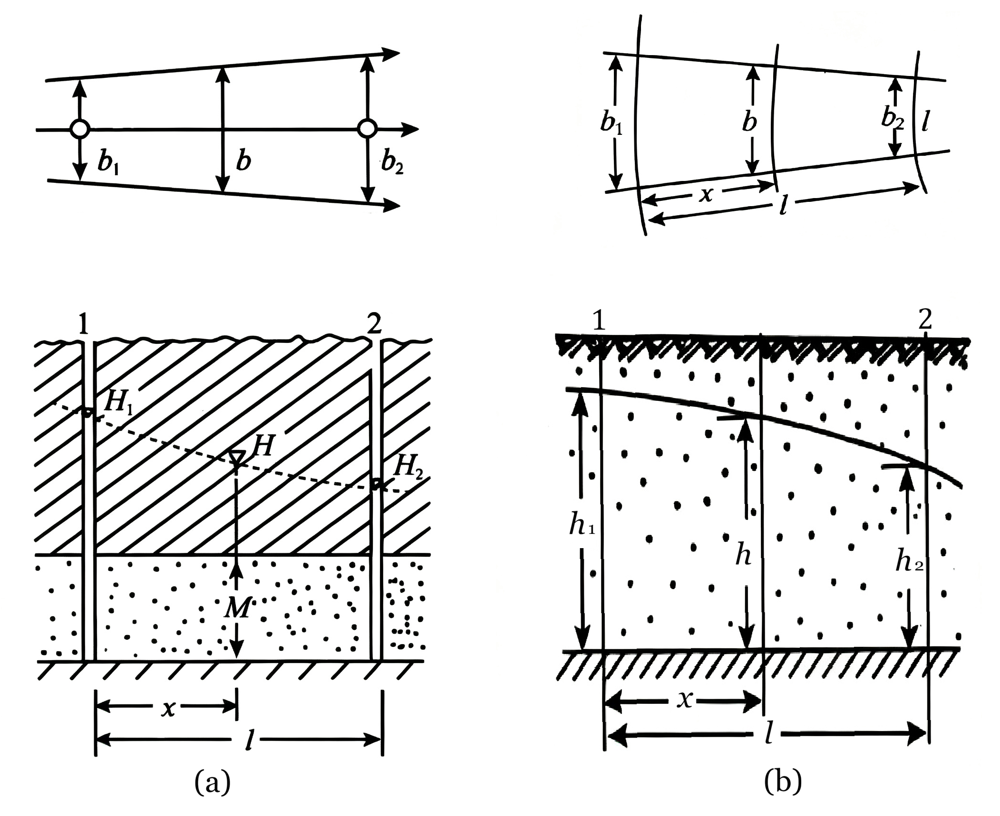
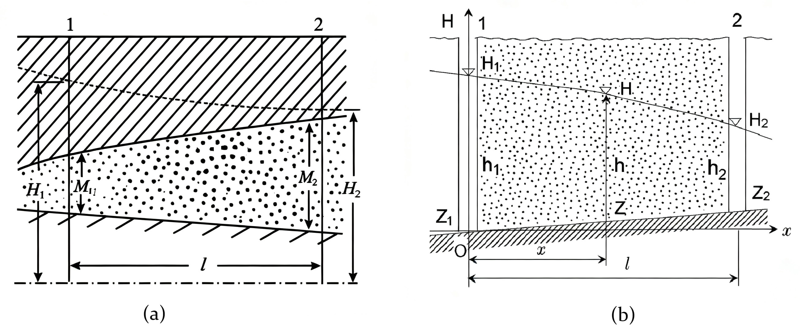

# 3 一维地下水流问题

**本章导引**：

第二章的数学模型包含了偏微分方程，求解起来并不容易。我们先从最简单的情形入手：一维流动。当含水层在一个方向上的尺度远大于其他方向时，水流可近似为一维流。河渠切割含水层造成的侧向渗流，是自然界最常见的一维流问题。本章先讨论稳定流，再扩展到非稳定流。求解过程中，你将遇到平方变换、分离变量法和叠加原理等核心数学工具。这些方法会在后续井流理论中反复使用。

## 3.1 河渠间地下水的稳定运动

当河流、渠道等地表水体切割含水层至一定深度时，地表水与地下水之间便建立起直接或间接的水力联系，二者发生持续的水量交换。此时，含水层的侧向边界受到地表水体水位的控制，边界条件较为明确。对于承压含水层，水流运动规律相对简单；对于潜水含水层，在Dupuit假设下可忽略垂向渗透速度分量，而将降水入渗等垂向水量交换作为源汇项处理。基于上述简化，河渠间承压含水层与潜水含水层中的地下水运动均可概化为一维流。

### 3.1.1 潜水稳定流模型

**假设**

建立河渠间潜水一维稳定流模型时，引入以下假设：

- 含水层均质各向同性，隔水底板水平，渗透系数 $K$ 为常数；
- 两条平行河流之间的地下水流满足Dupuit假设，可简化为一维流；
- 潜水面上方存在均匀分布的垂向入渗补给，入渗强度为 $W$（单位面积单位时间的水量，量纲 $[\mathrm{LT^{-1}}]$），$W>0$ 表示净入渗，$W<0$ 表示净蒸发；
- 地下水流为渐变流，且已趋于稳定状态（水头不随时间变化）。

**数学模型**

在Dupuit假设下，$v_z=0$，等水头面铅直。取 $x$ 轴沿流向，原点位于左河岸水边线，$x=l$ 为右河岸水边线（两河间距为 $l$）。以隔水底板为基准面（$z_b=0$），此时饱和厚度 $h$ 即等于水头 $H$。根据第二章导出的Boussinesq方程，在稳定流条件下（$\partial / \partial t = 0$）并考虑均匀入渗，可得控制方程及边界条件如下：
$$
\left\{
\begin{array}{l}
\frac{\mathrm{d}}{\mathrm{d}x}\left(h\frac{\mathrm{d}h}{\mathrm{d}x}\right) + \frac{W}{K} = 0 \\
\mathrm{BC}:\ \left.h\right|_{x=0} = h_1 \\
\mathrm{BC}:\ \left.h\right|_{x=l} = h_2
\end{array}
\right. \tag{I}
$$
式中，$h_1$、$h_2$ 分别为 $x=0$ 和 $x=l$ 断面上自隔水底板起算的潜水流厚度（亦即边界处的水头）；$h(x)$ 为 $x$ 断面处的潜水流厚度；$K$ 为渗透系数；$W$ 为入渗强度，规定向下为正（入渗补给地下水）。

**控制方程的物理意义**： $\frac{\mathrm{d}}{\mathrm{d}x}(h\frac{\mathrm{d}h}{\mathrm{d}x})$ 为净流入量（汇流项），$\frac{W}{K}$ 为垂向入渗源项。**方程的本质是水量平衡：水平方向上流入与流出的差量，等于垂向上入渗补给的水量。**

**一般解法——浸润曲线方程**

方程左端第一项可改写为二阶导数形式：
$$
\frac{\mathrm{d}}{\mathrm{d}x}\left(h\frac{\mathrm{d}h}{\mathrm{d}x}\right) = \frac{1}{2}\frac{\mathrm{d}^2}{\mathrm{d}x^2}(h^2)
$$
因此控制方程化为：
$$
\frac{1}{2}\frac{\mathrm{d}^2}{\mathrm{d}x^2}(h^2) + \frac{W}{K} = 0
$$
即：
$$
\frac{\mathrm{d}^2}{\mathrm{d}x^2}(h^2) = -\frac{2W}{K}
$$
连续积分两次，得通解：
$$
h^2 = -\frac{W}{K}x^2 + C_1x + C_2
$$
代入左、右边界条件 $h(0)=h_1$ 和 $h(l)=h_2$ 确定积分常数：
$$
C_2 = h_1^2,\qquad C_1 = \frac{h_2^2 - h_1^2}{l} + \frac{W}{K}l
$$
将积分常数代回通解，得：
$$
h^2 = h_1^2 + \frac{h_2^2 - h_1^2}{l}x + \frac{W}{K}\left(lx - x^2\right) \tag{3-1}
$$

该方程称为潜水的**浸润曲线方程**，以 $h^2$ 为 $x$ 的二次函数形式给出河间地块任一断面的潜水流厚度（水头）。

**单宽流量解法——水量守恒**

一维问题亦可从Dupuit单宽流量公式出发，利用水量守恒关系直接推导。该方法物理意义明确、便于扩展到非均质情形。

记 $0$ 断面和 $x$ 断面的单宽流量分别为 $q_1$ 和 $q_x$。由Dupuit假设，$x$ 断面的单宽流量为：
$$
q_x = -Kh\frac{\mathrm{d}h}{\mathrm{d}x}
$$
自 $0$ 断面至 $x$ 断面，间距为 $x$、宽度为单位宽度的条带上，总入渗补给量为 $Wx$。由水量守恒关系，流入 $0$ 断面的流量加条带内的入渗补给量，应等于通过 $x$ 断面的流出量：
$$
q_x - q_1 = Wx
$$
即：
$$
-Kh\frac{\mathrm{d}h}{\mathrm{d}x} - q_1 = Wx
$$
分离变量得：
$$
-Kh\mathrm{d}h = (q_1 + Wx)\mathrm{d}x
$$
分别对 $[0, x]$ 区间和 $[0, l]$ 区间积分：
$$
\begin{aligned}
-K\int_{h_1}^h h\mathrm{d}h = \int_0^x (q_1 + Wx)\mathrm{d}x 
&\implies K\frac{h_1^2 - h^2}{2} = q_1x + \frac{1}{2}Wx^2 \\
-K\int_{h_1}^{h_2} h\mathrm{d}h = \int_0^l (q_1 + Wx)\mathrm{d}x 
&\implies K\frac{h_1^2 - h_2^2}{2} = q_1l + \frac{1}{2}Wl^2
\end{aligned}
$$
由第二式解出 $q_1$：
$$
q_1 = K\frac{h_1^2 - h_2^2}{2l} - \frac{1}{2}Wl
$$
代回第一式，消去 $q_1$，整理后即得到与式 (3-1) 完全一致的浸润曲线方程。两种解法的等价印证了Darcy定律与水量守恒原理的内在统一性。

**浸润曲线的形态本征**

浸润曲线的几何形态受入渗强度 $W$ 的正负控制，本质上由 $h^2$ 对 $x$ 的二阶导数决定：
$$
\frac{\mathrm{d}^2}{\mathrm{d}x^2}(h^2) = -\frac{2W}{K}
$$

根据 $W$ 的取值，浸润曲线呈现三种形态：

- **$W > 0$（有净入渗补给）**：$h^2(x)$ 是开口向下的二次曲线，二阶导数为负。浸润曲线呈上凸拱形，在两河之间存在一个最高点，该处 $\mathrm{d}h/\mathrm{d}x = 0$，即为**地下分水岭**。降水经入渗补给地下水后，自分水岭分别向两侧河流排泄。
- **$W = 0$（无垂向补排）**：$h^2(x)$ 退化为 $x$ 的线性函数，浸润曲线即为经典的Dupuit抛物线。此时地下水仅由高水位一侧向低水位一侧作单向流动，断面单宽流量处处相等。
- **$W < 0$（有净蒸发排泄）**：$h^2(x)$ 是开口向上的二次曲线，二阶导数为正。浸润曲线呈下凹形，在两河之间存在一个最低点，该处 $\mathrm{d}h/\mathrm{d}x = 0$，称为**汇水岭**——两侧地下水向最低点汇集，该处地下水以蒸发形式持续排泄。

从二次曲线分类的角度审视，$h^2$ 与 $x$ 的关系分别对应于椭圆弧段（$W>0$）、直线段（$W=0$，抛物线退化）和双曲线弧段（$W<0$）的上半分支。入渗（蒸发）的效应，可在无入渗的Dupuit抛物线基准上叠加一个对称的二次修正项来理解：入渗使水位全线抬升，蒸发使水位全线降低，抬升或降低的幅度由 $W/K$ 和距边界距离共同决定。

```{python}
#| echo: false
#| fig-align: center
#| fig-cap: 河间地块的地下水位分布曲线
import numpy as np
import matplotlib.pyplot as plt

# 设置字体，优先使用 Times New Roman，兼容中文字体
plt.rcParams['font.family'] = ['Times New Roman', 'KaiTi', 'SimHei', 'FangSong']
plt.rcParams['axes.unicode_minus'] = False

h1, h2, L, K = 10, 5, 100, 10
W = [-0.3, -0.15, 0, 0.15, 0.3]
x = np.linspace(0, L, 1000)

fig, ax = plt.subplots(figsize=(12/2.54, 8/2.54))

for i, W in enumerate(W):
    h_sq = h1**2 + (h2**2 - h1**2)/L * x + W/K * (L*x - x**2)
    h_sq[h_sq < 0] = np.nan
    h = np.sqrt(h_sq)
    ax.plot(x, h, lw=2, label=f"W = {W}")

ax.set(xlim=(0, L), ylim=(0, 14), xlabel="x", ylabel="h(x)")
ax.set_title("河间地块的地下水位分布曲线")
ax.legend(loc="best", framealpha=0.9)
ax.grid(True, ls="--", alpha=0.5)

plt.tight_layout()
plt.show()
```

**任意断面的单宽流量**

由单宽流量解法的推导过程中，可得任一断面 $x$ 的单宽流量表达式：

$$
q_x = -Kh\frac{\partial h}{\partial x} = K\frac{h_1^2 - h_2^2}{2l} - \frac{1}{2}Wl + Wx \tag{3-2}
$$

单宽流量 $q_x$ 随 $x$ 线性变化，其斜率等于 $W$。当 $W>0$ 时，$q_x$ 沿流向递增——入渗补给不断汇入侧向径流；$W<0$ 时，$q_x$ 沿流向递减——蒸发不断消耗侧向径流。在分水岭（或汇水岭）位置处，$q_x = 0$，两侧流量方向相反：分水岭左侧 $q_x < 0$（水流向左侧河流），右侧 $q_x > 0$（水流向右侧河流）。

**无入渗——Dupuit抛物线**

当 $W=0$ 时，浸润曲线方程退化为：
$$
h^2 = h_1^2 + \frac{h_2^2 - h_1^2}{l}x \tag{3-3}
$$

即 $h^2$ 沿程线性变化。此即经典的Dupuit抛物线。单宽流量简化为著名的**Dupuit公式**：
$$
q = K\frac{h_1^2 - h_2^2}{2l} \tag{3-4}
$$

无入渗条件下，任意断面单宽流量处处相等，水流为单向恒定流。

**Dupuit假设的适用性与局限性**

Dupuit假设为潜水渗流计算带来了极大的便利，但其适用边界须明晰把握：

- 在分水岭、河床侧壁以及隔水边界附近，因流线的急剧弯曲，等水头面不再铅直，Dupuit假设的计算水头与实际水头存在偏差。距离上述特殊边界水平距离大于 $1.5\sim2.0$ 倍含水层平均饱和厚度 $M$ 的区域，等水头面方可近似视为垂直面，Dupuit假设具有满意的精度；
- 恰尔奈（Charny, 1951）通过严格的数学证明得出一项重要结论：尽管Dupuit假设在边界附近的水头分布计算上存在偏差，但由Dupuit公式积分计算得到的单宽流量在数值上是准确（精确）的。这一特性极大增强了Dupuit假设的工程实用性——即便水头分布有所误差，流量计算依然可信。

### 3.1.2 承压水稳定流模型

**假设**

对于河渠间承压含水层中的一维稳定流，引入以下假设：

- 承压含水层均质各向同性，隔水底板水平，含水层厚度 $M$ 恒定；
- 地下水流为一维流，上下游断面承压水头分别为 $H_1$ 和 $H_2$；
- 含水层顶底板为完整隔水层，无越流补给；
- 水流已达稳定状态。

**数学模型**

在均质各向同性条件下，承压含水层一维稳定渗流的控制方程为拉普拉斯方程（二维稳定流方程退化形式），结合定水头边界条件：
$$
\left\{
\begin{array}{l}
\frac{\mathrm{d}^2 H}{\mathrm{d}x^2} = 0 \\
\mathrm{BC}:\ \left.H\right|_{x=0} = H_1 \\
\mathrm{BC}:\ \left.H\right|_{x=l} = H_2
\end{array}
\right. \tag{II}
$$

**水头线与单宽流量**

对控制方程连续积分两次，得通解 $H = C_1x + C_2$。代入边界条件确定积分常数后，得到**承压水降落曲线**（水头线）方程：
$$
H = H_1 - \frac{H_1 - H_2}{l}x \tag{3-5}
$$

水头沿程线性下降，水头线为一条倾斜直线。承压含水层过水断面面积（$M \times 1$）是不变的，对比潜水含水层的Dupuit抛物线，潜水含水层的过水断面面积（$h \times 1$）本身是水头的函数，使潜水浸润曲线产生弯曲。

断面单宽流量由Darcy定律给出：
$$
q = KM\frac{H_1 - H_2}{l} \tag{3-6}
$$

单宽流量与水力坡度 $(H_1 - H_2)/l$ 成正比，比例系数为导水系数 $T = KM$。在均质等厚承压含水层中，当无垂向补排时，各断面单宽流量处处相等。应当注意，虽然水头线的斜率与渗透系数 $K$ 无关（仅取决于边界水头差和间距），但断面流量与 $K$ 成正比——水头线相同的两含水层，透水性强者输水更多。

## 3.2 河渠间地下水的非稳定运动

河渠水位的升降变化是控制两岸地下水动态的主要外部力量。河流汛期涨水、水库蓄水运行或渠道输水，均会引起沿岸地下水位的波动响应。这种地表水与地下水的相互作用，在水资源开发利用和水利工程安全评价中具有重要地位。

- **回水**：当河流或水库水位抬升，且地表水与地下水之间存在直接水力联系时，沿岸地下水位随之同步上升的现象称为回水。回水会导致库区周边土地浸没、土壤盐渍化甚至建筑物地基承载力降低。
- **引渗回灌**：利用河渠侧向渗漏补给浅层地下水，将地表水转化为地下水加以调蓄的工程技术，是水资源联合调度和地下水库运行的重要手段。

承压水一维非稳定流模型的求解相对简单，所以我们从承压水模型开始。求解思路是：先求解相对简单的齐次边界定解问题，可用分离变量法获得基本解，然后利用变量变换和叠加原理将解推广至非齐次边界条件乃至一般情形。

### 3.2.1 河渠水位瞬时抬升至定值的承压水非稳定流模型

所谓“瞬时抬升”是数学上的理想化处理——将水位变化简化为在零时间内完成的阶跃函数。实际河流水位的涨落是一个渐进的时间过程。然而，利用数学物理方程中的**叠加原理**，可将连续变化的水位过程线在时间上离散为若干微小时间步长的瞬时阶跃（阶梯函数），分别求解各阶跃的响应后再进行叠加，即可获得连续水位变化下的地下水响应。

**(1) 边界水头为零——齐次边界条件**

首先从最简单的情形入手，为后续复杂边界的处理奠定方法基础。

**假设**

- 含水层均质各向同性、厚度 $M$ 恒定，隔水底板水平；
- 初始水头分布为已知函数 $\varphi(x)$；
- 两侧河渠水位在 $t=0$ 时刻瞬时降至零，并在此后维持不变。

**数学模型的建立**

记 $u(x,t)$ 为含水层的水头（以水位零高程为基准），导压系数 $a = T/S$。控制方程及定解条件为：
$$
\left\{
\begin{array}{rl}
\mathrm{Eq}: & a\frac{\partial^2 u}{\partial x^2} = \frac{\partial u}{\partial t} \\
\mathrm{IC}: & u(x,0) = \varphi(x) \\\mathrm{BC}: & u(0,t) = 0 \\
& u(l,t) = 0
\end{array}
\right. \tag{III}
$$
该定解问题为齐次 Dirichlet 边界条件下一维抛物型偏微分方程（承压含水层一维非稳定渗流）。


**分离变量法**

设解可分离变量，表示为仅含空间坐标的函数 $X(x)$ 与仅含时间的函数 $T(t)$ 的乘积：
$$
u(x,t) = X(x) \cdot T(t)
$$
代入控制方程：
$$
a X''(x) T(t) = X(x) T'(t)
$$
两边同除以 $a X T$，使空间变量与时间变量各居一侧：
$$
\frac{X''(x)}{X(x)} = \frac{T'(t)}{a T(t)} = -\lambda^2
$$

上式左端仅为 $x$ 的函数，右端仅为 $t$ 的函数，而 $x$ 与 $t$ 为独立变量，故等式两端必须同为同一常数。选取该常数为 $-\lambda^2$（取负号以保证解随时间的衰减，具有物理意义——水头扰动随时间消散而非无限增长），由此得到两个独立的常微分方程：

空间方程：
$$
X''(x) + \lambda^2 X(x) = 0
$$

时间方程：
$$
T'(t) + \lambda^2 a T(t) = 0
$$
将分离变量形式代入齐次边界条件 $u(0,t) = X(0)T(t) = 0$ 和 $u(l,t) = X(l)T(t) = 0$，由于 $T(t)$ 不恒为零，必有 $X(0) = X(l) = 0$。得到关于 $X(x)$ 的 Sturm–Liouville 本征值问题：
$$
\left\{
\begin{array}{l}
X''(x) + \lambda^2 X(x) = 0 \\
X(0) = 0,\quad X(l) = 0
\end{array}
\right.
$$
空间函数方程的通解为：
$$
X(x) = A_1\cos(\lambda x) + A_2\sin(\lambda x)
$$
由 $X(0) = 0$ 得 $A_1 = 0$。由 $X(l) = 0$ 得 $A_2\sin(\lambda l) = 0$。为保证非零解（$A_2 \neq 0$），必须满足 $\sin(\lambda l) = 0$，由此确定：
$$
\lambda_n = \frac{n\pi}{l}, \quad n = 1, 2, 3, \dots
$$
对应的本征函数（特征函数）为：
$$
X_n(x) = \sin(\lambda_n x)
$$
时间方程为一阶线性常微分方程，其通解为：
$$
T_n(t) = B_n \mathrm{e}^{-\lambda_n^2 a t}
$$
将各本征函数叠加，得到满足齐次边界条件的一般解：
$$
u(x,t) = \sum_{n=1}^{\infty} c_n \sin(\lambda_n x) \mathrm{e}^{-\lambda_n^2 a t}
$$

上式中，$\lambda_n$ 称为特征波数；$\mu_n=\lambda_n^2$ 称为本征值（特征值），各模态的衰减速率由本征值 $\mu_n$ 控制.

利用初始条件 $u(x,0) = \varphi(x)$ ：
$$
\varphi(x) = \sum_{n=1}^{\infty} c_n \sin(\lambda_n x)
$$

上式即为函数 $\varphi(x)$ 在区间 $[0, l]$ 上的正弦傅里叶级数展开。利用三角函数族的正交性：
$$
\int_{0}^{l} \sin\left(\frac{m\pi}{l}x\right) \sin\left(\frac{n\pi}{l}x\right) \mathrm{d}x =
\begin{cases}
0 & m \neq n \\
\frac{l}{2} & m = n
\end{cases}
$$
等式两侧同乘 $\sin(\lambda_m x)$ 并在 $[0,l]$ 上积分，即得：
$$
c_n = \frac{2}{l}\int_0^l \varphi(x)\sin(\lambda_n x)\,\mathrm{d}x
$$

**齐次边界的解析解**

综上所述，满足齐次边界条件的初边值问题 (III) 的解为：
$$
u(x,t) = \sum_{n=1}^{\infty} c_n \sin(\lambda_n x)\mathrm{e}^{-\lambda_n^2 a t} \tag{3-7}
$$
式中，
$$
c_n = \frac{2}{l}\int_0^l \varphi(x)\sin\frac{n\pi x}{l}\,\mathrm{d}x,\quad
\lambda_n = \frac{n\pi}{l},\quad n = 1, 2, 3, \dots
$$

解的物理意义：初始水头分布 $\varphi(x)$ 经傅里叶正弦分解后，被表示为不同空间频率（波数 $\lambda_n$）的正弦分量的叠加。各分量随时间按 $\exp(-\lambda_n^2 a t)$ 的规律独立衰减——波数越高的分量衰减越快。这是由于高波数（小波长）分量对应的水头梯度大，由Darcy定律驱动的水量调整更为剧烈，因而耗散更快。在足够长的时段后，仅有最低阶模态（$n=1$）留存，水头分布趋于正弦半波的形状，全场水头逐渐趋近于零边界条件。

**(2) 两侧水位同步抬升——非齐次边界条件**

在齐次边界问题解法的基础上，现在考虑两侧河渠水位同时发生变化的非齐次边界。

**假设**

- 含水层均质各向同性、厚度恒定，底板水平；
- 全域初始水头均匀分布，$H(x,0) = h_0$；
- 在 $t=0$ 时刻，左河渠水位瞬时抬升并恒定为 $h_1$，右河渠水位瞬时抬升并恒定为 $h_2$。

**数学模型**
$$
\left\{
\begin{array}{rl}
\mathrm{Eq}: & a\frac{\partial^2 H}{\partial x^2} = \frac{\partial H}{\partial t} \\
\mathrm{IC}: & H(x,0) = h_0 \\
\mathrm{BC}: & H(0,t) = h_1 \\
& H(l,t) = h_2
\end{array}
\right. \tag{IV}
$$

与非齐次边界情形 (III) 相比，此问题的边界条件不再为零。为了能够利用前述齐次边界问题的解，采用**叠加原理**——将解分解为稳态解与齐次边界瞬态解之和：
$$
H(x,t) = H_s(x) + u(x,t)
$$
其中，$H_s(x)$ 为对应于边界条件 $H_s(0) = h_1$、$H_s(l) = h_2$ 的稳态解（满足 $\mathrm{d}^2 H_s/\mathrm{d}x^2 = 0$），即承压水稳定流水头线：
$$
H_s(x) = h_1 + \frac{h_2 - h_1}{l}x = h_0 + \left(1 - \frac{x}{l}\right)\Delta h_1 + \frac{x}{l}\Delta h_2
$$
式中，记边界水位增量 $\Delta h_1 = h_1 - h_0$，$\Delta h_2 = h_2 - h_0$。

将上述分解代入原问题 (IV)，注意到稳态解自动满足控制方程，可得瞬态部分 $u(x,t)$ 应满足如下齐次边界问题：
$$
\begin{cases}
a\frac{\partial^2 u}{\partial x^2} = \frac{\partial u}{\partial t} 
u(0,t) = 0,\quad u(l,t) = 0 \\
u(x,0) = h_0 - H_s(x) \triangleq \varphi(x)
\end{cases}
$$
初始条件为：
$$
\varphi(x) = -\left(1 - \frac{x}{l}\right)\Delta h_1 - \frac{x}{l}\Delta h_2
$$
$u(x,t)$ 的定解问题与模型 (III) 完全一致，可直接套用式 (3-7) 的解，仅需重新计算系数 $c_n$：
$$
c_n = \frac{2}{l}\int_0^l \varphi(x)\sin(\lambda_n x)\,\mathrm{d}x
$$
将 $\varphi(x)$ 的表达式代入积分，分项计算：

第一项（与 $\Delta h_1$ 相关）：
$$
\begin{aligned}
a_n &= -\frac{2\Delta h_1}{l}\int_0^l \left(1 - \frac{x}{l}\right)\sin(\lambda_n x)\,\mathrm{d}x \\
&= \frac{2\Delta h_1}{n\pi}\left[\left(1 - \frac{x}{l}\right)\cos(\lambda_n x)\right]_0^l
   + \frac{2\Delta h_1}{n\pi l}\int_0^l \cos(\lambda_n x)\,\mathrm{d}x \\
&= \frac{2\Delta h_1}{n\pi}(0 - 1) + 0 \\
&= -\frac{2\Delta h_1}{n\pi}
\end{aligned}
$$
第二项（与 $\Delta h_2$ 相关）：
$$
b_n = \frac{2\Delta h_2}{n\pi}(-1)^n = -\frac{2\Delta h_2}{n\pi}(-1)^{n+1}
$$
故傅里叶系数为：
$$
c_n = -\frac{2}{n\pi}\Bigl[\Delta h_1 + (-1)^{n+1}\Delta h_2\Bigr]
$$
将 $c_n$ 代回 $u(x,t)$ 的解，并与稳态解叠加，即得原问题 (IV) 的解析解：
$$
\begin{aligned}
H(x,t) = h_0 &+ \left(1 - \frac{x}{l}\right)\Delta h_1 + \frac{x}{l}\Delta h_2 \\
&- \frac{2}{\pi}\sum_{n=1}^\infty \frac{\Delta h_1 + (-1)^{n+1}\Delta h_2}{n}\sin(\lambda_n x)\,\mathrm{e}^{-\lambda_n^2 a t}
\end{aligned} \tag{3-8}
$$

**无量纲化的水位响应函数**

引入无量纲坐标 $\bar{x} = x/l$（0到1之间）和无量纲时间 $\bar{t} = a t / l^2$，解析解可改写为更加简洁的标准函数形式：
$$
\begin{aligned}
H(x,t) - h_0 =&\,\Delta h_1\left[ 1 - \bar{x} - \frac{2}{\pi}\sum_{n=1}^\infty \frac{1}{n} \sin(n\pi \bar{x})\mathrm{e}^{-(n\pi)^2 \bar{t}}\right] \\
&+ \Delta h_2\left[ \bar{x} - \frac{2}{\pi}\sum_{n=1}^\infty \frac{(-1)^{n+1}}{n} \sin(n\pi \bar{x})\mathrm{e}^{-(n\pi)^2 \bar{t}}\right]
\end{aligned}
$$

定义**水位响应函数** $F(\bar{x}, \bar{t})$ 与**余响应函数** $F'(\bar{x}, \bar{t})$：
$$
\begin{aligned}
F(\bar{x},\bar{t}) &= 1 - \bar{x} - \frac{2}{\pi}\sum_{n=1}^\infty \frac{1}{n} \sin(n\pi \bar{x})\mathrm{e}^{-(n\pi)^2 \bar{t}} \\
F'(\bar{x},\bar{t}) &= \bar{x} - \frac{2}{\pi}\sum_{n=1}^\infty \frac{(-1)^{n+1}}{n} \sin(n\pi \bar{x})\mathrm{e}^{-(n\pi)^2 \bar{t}}
\end{aligned}
$$

$F(\bar{x},\bar{t})$ 的物理意义：表示左河渠水位瞬时上升一个单位时，在无量纲位置 $\bar{x}$ 处、无量纲时刻 $\bar{t}$ 引起的水头增量占边界水位变化量的比例。换言之，它是一个“单位脉冲响应”，反映含水层对边界水位扰动的传递和衰减规律。$F'(\bar{x},\bar{t})$ 则为右侧河渠的单位响应。由对称性易见：$F'(\bar{x},\bar{t}) = F(1-\bar{x}, \bar{t})$。

以水位响应函数表示，水头分布的解析解可简洁地写为：
$$
H(x,t) - h_0 = \Delta h_1 F(\bar{x},\bar{t}) + \Delta h_2 F'(\bar{x},\bar{t}) \tag{3-9}
$$

**任意断面的瞬时单宽流量**

通过Darcy定律计算单宽流量。$x$ 断面在 $t$ 时刻的瞬时单宽流量为：
$$
q_{x,t} = -T\frac{\mathrm{d}H}{\mathrm{d}x} = -T\frac{\mathrm{d}H}{\mathrm{d}\bar{x}}\cdot\frac{\mathrm{d}\bar{x}}{\mathrm{d}x}
= \frac{T}{l}\left[\Delta h_1 G(\bar{x},\bar{t}) - \Delta h_2 G'(\bar{x},\bar{t})\right] \tag{3-10}
$$
式中定义**流量函数** $G(\bar{x},\bar{t})$ 与**流量余函数** $G'(\bar{x},\bar{t})$ 分别为：
$$
\begin{aligned}
G(\bar{x},\bar{t}) &= -\frac{\mathrm{d}F}{\mathrm{d}\bar{x}} = 1 + 2\sum_{n=1}^{\infty}\cos(n\pi\bar{x})\mathrm{e}^{-n^2\pi^2\bar{t}} \\
G'(\bar{x},\bar{t}) &= \frac{\mathrm{d}F'}{\mathrm{d}\bar{x}} = 1 + 2\sum_{n=1}^{\infty}(-1)^n\cos(n\pi\bar{x})\mathrm{e}^{-n^2\pi^2\bar{t}}
\end{aligned}
$$

流量函数 $G$ 和 $G'$ 同样具有对称性：$G'(\bar{x},\bar{t}) = G(1-\bar{x},\bar{t})$。

**级数计算——吉布斯现象与收敛性**

水位响应函数与流量函数的级数表达式中包含正弦与余弦函数项。当 $\bar{t}$ 极小时，指数衰减因子 $\exp(-(n\pi)^2 \bar{t})$ 在低阶项中近似为1，级数的截断会使解的近似在空间上产生虚假的振荡，这在数学上称为**吉布斯现象**。然而，随着 $\bar{t}$ 的增大，高频分量被指数因子迅速抑制，级数收敛加快。实际计算中可参考如下经验：

- 当 $\bar{t} < 0.0001$ 时，需取 $n_{\max} = 100$ 或更多项，以充分捕捉水头传播的陡峭前沿；
- 当 $0.0001 \le \bar{t} \le 0.01$ 时，$n_{\max} = 50$ 左右一般可保证光滑；
- 当 $\bar{t} > 0.01$ 时，$n_{\max} = 10\sim20$ 项即可得到光滑无震荡的曲线。

此外，当 $\bar{t}$ 极小（例如 $\bar{t} < 10^{-5}$）时，压力波尚未传播至对岸，此时用半无限空间的余误差函数解较级数解更为高效且数值稳定。

**水位响应函数的Python程序**

```python
import math
import numpy as np

def FF_scalar(x, t, nmax):
    """
    标量版本，计算水位响应函数 F(x,t) 的值。
    x — 无量纲坐标，0 ≤ x ≤ 1
    t — 无量纲时间
    nmax — 级数截断项数
    """
    if t <= 0:
        return 0.0
    pi = math.pi
    result = 1.0 - x
    for n in range(1, nmax + 1):
        alpha = n * pi
        term = -2.0 * math.sin(alpha * x) * math.exp(-t * alpha * alpha) / alpha
        result += term
    return result

def FF(x, t, nmax):
    """支持标量或数组输入的水位响应函数。"""
    vec = np.vectorize(lambda xi, ti: FF_scalar(xi, ti, nmax), otypes=[float])
    return vec(x, t)
```

**流量函数的Python程序**

```python
import math
import numpy as np

def GG_scalar(x, t, nmax=20):
    """
    标量版本，计算流量函数 G(x,t) 的值。
    """
    if t <= 0:
        return 0.0
    pi = math.pi
    result = 1.0
    for n in range(1, nmax + 1):
        alpha = n * pi
        term = 2.0 * math.cos(alpha * x) * math.exp(-t * alpha * alpha)
        result += term
    return result

def GG(x, t, nmax=20):
    """支持标量或数组输入的流量函数。"""
    vec = np.vectorize(lambda xi, ti: GG_scalar(xi, ti, nmax), otypes=[float])
    return vec(x, t)
```

**水位响应函数的 Python 演示程序**

```{python}
#| echo: false
#| fig-align: center
#| fig-cap: 水位响应函数曲线
import math
import numpy as np
import matplotlib.pyplot as plt

# 全局字体配置
plt.rcParams['font.family'] = ['Times New Roman', 'SimHei']
plt.rcParams["axes.unicode_minus"] = False

def FF_scalar(x, t, nmax):
    """
    标量版本，计算 F(x,t) 的值。
    """
    if t <= 0:
        return 0.0
    pi = math.pi
    result = 1.0 - x
    for n in range(1, nmax + 1):
        alpha = n * pi
        term = -2.0 * math.sin(alpha * x) * math.exp(-t * alpha * alpha) / alpha
        result += term
    return result

def FF(x, t, nmax):
    """
    支持标量或数组，返回对应类型。
    """
    vec = np.vectorize(lambda xi, ti: FF_scalar(xi, ti, nmax), otypes=[float])
    return vec(x, t)

t_fixed = 0.0001
nmax_list = [20, 50, 100]
x_fix_list = [0.1, 0.2, 0.3, 0.4, 0.5]
x_range = np.linspace(0, 1, 300)
t_range = np.linspace(0, 0.6, 300)

fig, (ax1, ax2) = plt.subplots(2, 1, figsize=(12/2.54, 14/2.54))

# t=0.0001，nmax = [20, 50, 100]
for idx, nmax in enumerate(nmax_list):
    F_curve = FF(x_range, t_fixed, nmax)
    ax1.plot(x_range, F_curve, lw=1.2, label=f"n={nmax}")
ax1.set(
    xlim=(0, 1),
    xlabel="x",
    ylabel="F",
    title=f"t={t_fixed}时河间地块水头分布曲线"
)
ax1.legend(loc="best", framealpha=0.9)
ax1.grid(alpha=0.3, ls="--")

# x = [0.1, 0.2, 0.3, 0.4, 0.5]
for idx, x0 in enumerate(x_fix_list):
    F_curve = FF(x0, t_range, 20)
    ax2.plot(t_range, F_curve, lw=1.2, label=f"x={x0}")
ax2.set(
    xlim=(0, 0.6),
    xlabel="t",
    ylabel="F",
    title="n=20时不同断面水头变化曲线"
)
ax2.legend(loc="best", framealpha=0.9)
ax2.grid(alpha=0.3, ls="--")

fig.tight_layout()
plt.show()
```

水位响应函数曲线族直观展示了边界水头扰动向含水层内部传播的时空规律：在 $\bar{t}=0$ 时刻，$F$ 在边界处为1（响应即时完整），内部各处响应为零；随着 $\bar{t}$ 的增大，响应自边界向内部逐渐扩展；当 $\bar{t} \to \infty$ 时，$F(\bar{x}, \infty)$ 趋近于稳态分布 $1-\bar{x}$。$\bar{t}=0.5$ 时，全场水头分布已相当接近稳态。

**均匀入渗水位响应函数的 Python 演示程序**

```{python}
#| echo: false
#| fig-align: center
#| fig-cap: 水位响应函数曲线
import math
import numpy as np
import matplotlib.pyplot as plt

# 全局字体配置
plt.rcParams['font.family'] = ['Times New Roman', 'SimHei']
plt.rcParams["axes.unicode_minus"] = False

def FF_scalar(x, t, nmax):
    """
    标量版本，计算 F(x,t) 的值。
    """
    if t <= 0:
        return 0.0
    pi = math.pi
    result = 1.0 - x
    for n in range(1, nmax + 1):
        alpha = n * pi
        term = -2.0 * math.sin(alpha * x) * math.exp(-t * alpha * alpha) / alpha
        result += term
    return result

def FF(x, t, nmax):
    """
    支持标量或数组，返回对应类型。
    """
    vec = np.vectorize(lambda xi, ti: FF_scalar(xi, ti, nmax), otypes=[float])
    return vec(x, t)

t_fixed = 0.0001
nmax_list = [20, 50, 100]
x_fix_list = [0.1, 0.2, 0.3, 0.4, 0.5]
x_range = np.linspace(0, 1, 300)
t_range = np.linspace(0, 0.6, 300)

fig, (ax1, ax2) = plt.subplots(2, 1, figsize=(12/2.54, 14/2.54))

# t=0.0001，nmax = [20, 50, 100]
for idx, nmax in enumerate(nmax_list):
    F_curve = FF(x_range, t_fixed, nmax)
    ax1.plot(x_range, F_curve, lw=1.2, label=f"n={nmax}")
ax1.set(
    xlim=(0, 1),
    xlabel="x",
    ylabel="F",
    title=f"t={t_fixed}时河间地块水头分布曲线"
)
ax1.legend(loc="best", framealpha=0.9)
ax1.grid(alpha=0.3, ls="--")

# x = [0.1, 0.2, 0.3, 0.4, 0.5]
for idx, x0 in enumerate(x_fix_list):
    F_curve = FF(x0, t_range, 20)
    ax2.plot(t_range, F_curve, lw=1.2, label=f"x={x0}")
ax2.set(
    xlim=(0, 0.6),
    xlabel="t",
    ylabel="F",
    title="n=20时不同断面水头变化曲线"
)
ax2.legend(loc="best", framealpha=0.9)
ax2.grid(alpha=0.3, ls="--")

fig.tight_layout()
plt.show()
```

**恒定源汇项 $W$ 的推广**

若在模型 (IV) 中增加均匀分布的恒定源汇项 $W$，控制方程变为：
$$
a\frac{\partial^2 H}{\partial x^2} + \frac{W}{S} = \frac{\partial H}{\partial t}
$$
作变换 $H = u + \frac{W t}{S}$，代入化简后 $u$ 将满足标准齐次微分方程：
$$
a\frac{\partial^2 u}{\partial x^2} = \frac{\partial u}{\partial t}
$$
相应的边界条件和初始条件亦需同步变换，随后可按前述方法求解 $u$，再回代获得 $H$。

**变换的物理意义**：均匀恒定源汇持续产生水量补给或排泄，引起全场水头随时间整体线性抬升 / 下降；该变换把全场统一的线性增长项剥离出去。剩余扰动分量 u 不再含有源汇项，遵循无源汇渗流齐次方程，可以直接复用前面齐次边界解析解体系。

**河水位连续变化的处理——叠加原理**

自然条件下河流水位的变化是渐进而连续的（如洪水过程线）。对此，可将连续的水位过程线在时间上离散为一系列微小时间间隔内的瞬时阶跃变化（阶梯函数近似），针对每一阶跃调用上述“瞬时抬升”模型的解，然后将各阶跃的响应叠加。由于控制方程是线性的，才使得多个水位抬升事件的响应可以线性叠加。叠加原理在水文地质学中有着广泛应用，第5章（变流量抽水）、第7章（干扰井群）中会再次用到叠加原理。

### 3.2.2 河渠水位瞬时抬升的潜水非稳定流模型

潜水含水层与承压含水层的区别在于，潜水流导水系数 $T = Kh$ 是水头本身（饱和厚度）的函数，导致控制方程呈非线性。本节在Dupuit假设下，通过平方变换将潜水流方程线性化，使之可以借用承压水问题的解法来处理。

**假设与定解模型**

- 含水层均质各向同性，隔水底板水平，无垂向入渗补给（$W=0$）；
- 初始时刻为稳定流状态，初始水头平方呈线性分布（满足无入渗时的Dupuit抛物线规律）：
$$
h_{x,0}^2 = \left(1 - \frac{x}{l}\right)h_{0,0}^2 + \frac{x}{l}h_{l,0}^2
$$
- 在 $t=0$ 时刻，左右河渠水位同步瞬时抬升至 $h_{0,t}$、$h_{l,t}$，并在此后保持恒定。

潜水非稳定流的控制方程为Boussinesq方程。在无入渗条件下，定解问题可写为：
$$
\left\{
\begin{array}{l}
\frac{\partial h}{\partial t} = \frac{K}{\mu}\frac{\partial}{\partial x}\left(h\frac{\partial h}{\partial x}\right) \\
h^2(x,0) = \left(1 - \frac{x}{l}\right)h_{0,0}^2 + \frac{x}{l}h_{l,0}^2 \\h(0,t) = h_{0,t} \\
h(l,t) = h_{l,t}
\end{array}
\right. \tag{V}
$$
此方程为二阶非线性抛物型偏微分方程——方程系数 $h$ 本身为待求函数。获得解析解的关键在于合理的线性化处理。

**Boussinesq方程的线性化**

第二章提到了Boussinesq方程的两种线性化方法，即固定厚度法与平方变换法。此处，用平方变换法线性化Boussinesq方程。

令 $u = h^2/2$，则 $\partial u/\partial t = h\,\partial h/\partial t$，且 $\partial u/\partial x = h\,\partial h/\partial x$。代入原Boussinesq方程得：
$$
\frac{\partial u}{\partial t} = \frac{K}{\mu}h\frac{\partial^2 u}{\partial x^2}
$$
将方程右端中的 $h$ 以空间平均饱和厚度 $h_m$ 近似替代，方程化为标准线性扩散方程：
$$
\frac{\partial u}{\partial t} = a\frac{\partial^2 u}{\partial x^2}, \qquad a = \frac{K h_m}{\mu}
$$
当水位变幅相对于平均厚度较小，且 $\bar{h}$ 与 $h_m$ 取值接近时，两种线性化方法的计算结果差异不大。水位变幅 $s/H_0 \le 0.1$ 时，两种方法的误差均在2%以内；当 $s/H_0 = 0.3$ 时，方法二的误差通常小于方法一（约5% vs 10%）。固定厚度法直接求解水位 $h$；平方变换法直接求解 $h^2$，还需开方换算得到水位 $h$。

**线性化后的定解问题与解析解**

经平方变换线性化后，关于 $u = h^2/2$ 的定解问题为：
$$
\left\{
\begin{array}{l}
\frac{\partial u}{\partial t} = a\frac{\partial^2 u}{\partial x^2} \\
u(x,0) = \left(1 - \frac{x}{l}\right)\frac{h_{0,0}^2}{2} + \frac{x}{l}\frac{h_{l,0}^2}{2} = \frac{h_{x,0}^2}{2} \\
u(0,t) = \frac{h_{0,t}^2}{2},\quad u(l,t) = \frac{h_{l,t}^2}{2}
\end{array}
\right. \tag{VI}
$$
此定解问题在数学形式上与承压水模型 (IV) 完全相同,可直接套用式 (3-8) 的结论。记边界水位平方的增量：
$$
\Delta h_{0,t}^2 = h_{0,t}^2 - h_{0,0}^2, \qquad \Delta h_{l,t}^2 = h_{l,t}^2 - h_{l,0}^2
$$
即得潜水位的平方分布：
$$
\begin{aligned}
h_{x,t}^2 - h_{x,0}^2 &= \left(1 - \frac{x}{l}\right)\Delta h_{0,t}^2 + \frac{x}{l}\Delta h_{l,t}^2 \\
&- \frac{2}{\pi}
\sum_{n=1}^\infty \frac{\Delta h_{0,t}^2 + (-1)^{n+1}\Delta h_{l,t}^2}{n}\sin(\lambda_n x)\,\mathrm{e}^{-\lambda_n^2 a t}
\end{aligned} \tag{3-11}
$$
以无量纲变量和水位响应函数表达，式 (3-11) 可简写为：
$$
h_{x,t}^2 - h_{x,0}^2 = \Delta h_{0,t}^2 F(\bar{x},\bar{t}) + \Delta h_{l,t}^2 F'(\bar{x},\bar{t}) \tag{3-12}
$$

这一形式与承压水的解式 (3-9) 高度相似，唯一的差别在于以 $h^2$ 代替了 $H$。

**断面瞬时单宽流量**

根据Dupuit假设，潜水单宽流量与水头平方的梯度相关：
$$
q_{x,t} = -Kh\frac{\partial h}{\partial x} = -K\frac{\partial}{\partial x}\left(\frac{h^2}{2}\right)
$$
将式 (3-12) 的 $h^2$ 分布代入求导，得：
$$
q_{x,t} = q_{x,0} + \frac{K}{2l}\left(\Delta h_{0,t}^2 G(\bar{x},\bar{t}) - \Delta h_{l,t}^2 G'(\bar{x},\bar{t})\right) \tag{3-13}
$$
式中，$q_{x,0}$ 为初始稳定流单宽流量，$G$ 和 $G'$ 为承压水模型中的流量函数。

### 3.2.3 单侧河渠渗漏半无限空间非稳定流模型（补充）

当含水层在某一方向延伸极远，对岸边界的影响在研究时段内可以忽略时，问题可简化为半无限空间中的渗流。此类模型广泛适用于河岸单侧回水、大型水库初次蓄水或沟渠长期渗漏补给等场景。

**(1) 承压水单侧定降深沟模型**

**假设**

- 承压含水层均质各向同性、厚度 $M$ 恒定，自河渠岸线向陆域侧向无限延伸（$0 < x < \infty$）；
- 初始时刻全场水头均匀，水力梯度为零；
- $t=0$ 时刻河渠水位瞬时下降（或抬升）一定值 $s_c$，并维持不变。$s_c > 0$ 表示水位下降（降深），$s_c < 0$ 表示水位抬升。

**定解模型**

以水位降深 $s(x,t) = H(x,0) - H(x,t)$ 为未知函数，可建立如下定解问题：
$$
\begin{cases}
a\frac{\partial^2 s}{\partial x^2} = \frac{\partial s}{\partial t} & 0 < x < \infty,\ t > 0 \\
s(x,0) = 0 & 0 < x < \infty \\
s(\infty,t) = 0 & t > 0 \\
s(0,t) = s_c & t > 0
\end{cases} \tag{VII}
$$

**解析解**

半无限空间定降深问题的经典解可由拉普拉斯变换法解出，以余误差函数表示：
$$
s(x,t) = s_c\,\mathrm{erfc}(u), \qquad u = \frac{x}{2\sqrt{at}} \tag{3-14}
$$
式中，$\mathrm{erfc}(u)$ 为余误差函数，由误差函数 $\mathrm{erf}(u)$ 定义：
$$
\mathrm{erf}(u) = \frac{2}{\sqrt{\pi}}\int_{0}^{u} \mathrm{e}^{-y^2}\mathrm{d}y, \qquad
\mathrm{erfc}(u) = 1 - \mathrm{erf}(u) = \frac{2}{\sqrt{\pi}}\int_{u}^{\infty} \mathrm{e}^{-y^2}\mathrm{d}y
$$

误差函数和余误差函数是地下水中非稳定流理论中常用的特殊函数之一，$u \ge 0$ 时，$\mathrm{erfc}(u) \in [0,1]$。


**任意断面的单宽流量**

对水头分布求空间导数，根据 Darcy 定律即得断面单宽流量：
$$
q_x = \frac{s_c T}{\sqrt{at}}\cdot\frac{1}{\sqrt{\pi}}\mathrm{e}^{-u^2} \tag{3-15}
$$

边界处（$x=0$，即 $u=0$）的单宽流量为 $q(0,t) = s_c T/\sqrt{\pi a t}$，可见边界流量随 $1/\sqrt{t}$ 而衰减——初期流量极大，随时间推移逐步减小，这是因为随着降深漏斗的扩展，水力坡度趋于平缓。

**(2) 承压水单侧定流量沟模型**

当河渠侧向渗漏补给量可独立量测或估算（如通过水文测流资料）时，边界条件可用给定流量的形式表达。

**定解模型**
$$
\begin{cases}
a\frac{\partial^2 s}{\partial x^2} = \frac{\partial s}{\partial t} & 0 < x < \infty,\ t > 0 \\
s(x,0) = 0 & 0 < x < \infty \\
s(\infty,t) = 0 & t > 0 \\
\left.\frac{\partial s}{\partial x}\right|_{x=0} = -\frac{q}{T} & t > 0
\end{cases} \tag{VIII}
$$
式中，$q$ 为单宽流量，$q>0$ 表示向含水层注入（河渠渗漏补给），$q<0$ 表示从含水层排出（地下水向河渠排泄）。注意，边界条件中导数为负值对应补给——$x$ 轴正方向指向含水层内部，补给时水头沿 $x$ 正向递减。

**解析解**

$$
s(x,t) = \frac{2q\sqrt{at}}{T}\left[\frac{\mathrm{e}^{-u^2}}{\sqrt{\pi}} - u\,\mathrm{erfc}(u)\right], \quad u = \frac{x}{2\sqrt{at}} \tag{3-16}
$$
边界处（$x=0$）的降深为：
$$
s(0,t) = \frac{2q\sqrt{at}}{T} \cdot \frac{1}{\sqrt{\pi}}
$$

可见定流量边界处的水头随时间以 $\sqrt{t}$ 的规律持续上升——这与定降深边界流量以 $1/\sqrt{t}$ 衰减形成鲜明的对偶关系。

**(3) 潜水单侧定降深沟模型**

**假设**

- 均质各向同性潜水含水层，底板水平，无入渗，侧向无限延伸；
- 初始水力梯度为零，全域初始饱水厚度为 $h_0$；
- $t=0$ 时刻单侧河渠水位瞬时变动，边界饱水厚度变为 $h_{0,t}$，此后恒定。

**平方变换与定解模型**

采用平方变换 $u = h^2/2$，线性化压力传导系数 $a = Kh_m/\mu$。记初始状态为 $u(x,0) = h_0^2/2$。以 $u$ 为因变量的定解模型为：
$$
\left\{
\begin{array}{l}
\frac{\partial u}{\partial t} = a\frac{\partial^2 u}{\partial x^2} \\
u(x,0) = \frac{h_0^2}{2} 
u(0,t) = \frac{h_{0,t}^2}{2} 
\lim\limits_{x\to\infty} u(x,t) = \frac{h_0^2}{2}
\end{array}
\right. \tag{IX}
$$

此问题与承压水单侧定降深模型 (VII) 数学同构。记边界水位平方的变化量 $\Delta h_{0,t}^2 = h_{0,t}^2 - h_0^2$，可直接套用余误差函数解：
$$
h_{x,t}^2 = h_0^2 + \Delta h_{0,t}^2\,\mathrm{erfc}(u), \qquad u = \frac{x}{2\sqrt{at}} \tag{3-17}
$$

**断面瞬时单宽流量**

对 $h^2$ 求空间导数，由Dupuit流量公式 $q = -K\,\partial(h^2/2)/\partial x$，得：
$$
q_{x,t} = \frac{K\Delta h_{0,t}^2}{\sqrt{at}}\cdot G(u), \qquad G(u) = \frac{1}{2\sqrt{\pi}}\mathrm{e}^{-u^2} \tag{3-18}
$$
$G(u)$ 即为该情形下的流量函数，其最大值为 $G(0) = 1/(2\sqrt{\pi})$。

半无限模型适用于河渠水位变化影响尚未到达对侧边界的情况，如水库蓄水后库岸浸没范围的快速估算、渠道输水损失评估、傍河水源地开采对河水诱导补给量的计算等。这类解析解以误差函数等特殊函数给出，计算简便，无需级数求和。

## 3.3 地下水流模型的应用

前述一维稳定流和非稳定流模型为理解地下水运动的基本规律提供了理论框架，在解决工程实际问题中也有不可替代的定量分析作用。以下通过典型应用案例，说明模型的运用方法。

### 3.3.1 稳定流模型的应用

**(1) 利用观测孔资料反求水文地质参数**

在两河间潜水含水层中，若在 $x = x_0$ 处布设有观测孔，实测水位为 $h_0$，则可利用浸润曲线方程反推含水层参数或入渗强度。

- 若已知渗透系数 $K$，由式 (3-1) 解出均匀入渗强度：
$$
W = K\left[\frac{h_0^2 - h_1^2}{(l - x_0)x_0} - \frac{h_2^2 - h_1^2}{(l - x_0)l}\right] \tag{3-19}
$$

- 若 $K$ 亦未知，则只能求得 $W$ 与 $K$ 的比值：
$$
\frac{W}{K} = \frac{h_0^2 - h_1^2}{(l - x_0)x_0} - \frac{h_2^2 - h_1^2}{(l - x_0)l} \tag{3-20}
$$

比值 $W/K$ 是一组重要的诊断参数：其符号（正负）直接指示含水层处于净补给（入渗大于蒸发）还是净排泄（蒸发大于入渗）状态；其数值大小反映垂向水量交换相对于侧向导水能力的强弱。至少两个不同位置的观测孔方可独立解出 $K$ 和 $W$。

**(2) 浸润曲线与分水岭位置分析**

浸润曲线的极值点在地下水补给-排泄分析中有着不同的意义：

- 有净入渗（$W>0$）时，水位曲线呈上凸拱形，存在最高水位点——**分水岭**（$h_{\max}$），分水岭两侧地下水分别向两侧河流排泄；
- 有净蒸发（$W<0$）时，水位曲线呈下凹形，存在最低水位点——**汇水岭**（$h_{\min}$），两侧地下水向汇水岭汇集，该处为蒸发排泄集中区。

**(a) 分水岭位置的计算**

分水岭处水力梯度为零（$\mathrm{d}h/\mathrm{d}x = 0$。对式 (3-1) 求导并令为零，解得分水岭距左岸的距离：
$$
a = \frac{l}{2} - \frac{K}{W}\cdot\frac{h_1^2 - h_2^2}{2l} \tag{3-21}
$$

分水岭位置受边界水位差与入渗强度的双重控制：

- 若两河水位相等（$h_1 = h_2$），分水岭恰好居中，$a = l/2$；
- 若左河水位高于右河（$h_1 > h_2$），分水岭向左偏移（$a < l/2$）；
- 若左河水位低于右河（$h_1 < h_2$），分水岭向右偏移（$a > l/2$）；

**思考**：试分析 $a < 0$ 或 $a > l$ 的物理含义（提示：此时左河或右河的单宽流量 $q_1$ 或 $q_2$ 的符号为何？分水岭移至边界之外意味着什么？）。

**(b) 河渠补给-排泄量的快速估算**

引入分水岭概念后，河渠与地下水之间的水量交换关系可大为简化。记左河、右河断面处的单宽流量分别为 $q_1$（在 $x=0$ 处）和 $q_2$（在 $x=l$ 处），约定 $q<0$ 表示河水渗漏补给地下水（水流由河入渗至含水层），$q>0$ 表示地下水排泄补给河水。

- 当分水岭落在区间内部（$0 < a < l$）时：
$$
\begin{cases}
q_1 = -Wa \\
q_2 = W(l - a)
\end{cases} \tag{3-22}
$$
表明：入渗总量 $Wl$ 自分水岭分割为左右两部分，分别向两侧河流排泄。分水岭两侧为两个独立的“补给-排泄”子系统。

- 当分水岭落在边界（$a=0$ 或 $a=l$）上时：
$$
\begin{array}{rll}
a = 0: & q_1 = 0, & q_2 = Wl \quad \text{（单向流向右河）}\\
a = l: & q_1 = -Wl, & q_2 = 0 \quad \text{（单向流向左河）}
\end{array}
$$

- 当分水岭落在域外（$a<0$ 或 $a>l$）时，全域为单向流动：
$$
q_2 - q_1 = Wl \tag{3-23}
$$
此时域内不存在流量为零的分水断面，边界水位差驱动的侧向径流主导了流场方向。

**(c) 排水渠间距设计**

在农田排水或基坑降水工程中，需布设平行排水渠道将地下水位控制在不高于某一设计最高水位 $h_{\max}$ 的水平。设计变量为渠间距 $l$ 和渠水位 $h_1$、$h_2$。联立分水岭位置公式与浸润曲线方程，建立关于 $l$ 和 $a$ 的方程组：
$$
\begin{cases}
a = \frac{l}{2} - \frac{K}{W}\cdot\frac{h_1^2 - h_2^2}{2l} \\
h_{\max}^2 = h_1^2 + \frac{h_2^2 - h_1^2}{l}a + \frac{W}{K}\left(la - a^2\right)
\end{cases}
$$
当两渠水位相等（$h_1 = h_2 = h_w$）时，$a = l/2$，由此得简化公式：
$$
l = 2\sqrt{\frac{K}{W}\left(h_{\max}^2 - h_w^2\right)} \tag{3-24}
$$

此式表明：渗透系数 $K$ 越大（排水越顺畅）、入渗强度 $W$ 越小（需排除的水量越少）、允许最高水位与渠水位之差越大（可用水头差越大），则渠间距可设计得越宽。

**(d) 水库渗漏风险识别**

若水库与邻谷之间存在宽阔河间透水地块，水库蓄水后，库区水位 $h_1$ 大幅抬升，而邻河水位 $h_2$ 仍保持天然状态。由式 (3-2) 可得库岸断面（$x=0$）的单宽流量：
$$
q_1 = K\frac{h_1^2 - h_2^2}{2l} - \frac{1}{2}Wl
$$

$q_1<0$ 表示库水向地下水渗漏补给。蓄水初期 $h_1$ 增加，$q_1$ 的负值程度加剧，渗漏量增大；同时，分水岭向库区方向移动。当分水岭移至库岸（$a=0$）时，库水开始经由地下径流流失至邻河——此为水库是否发生贯穿性渗漏的临界状态的标志。令 $a=0$，由式 (3-21) 解出临界库水位：
$$
h_{\max} = \sqrt{\frac{W}{K}\,l^2 + h_2^2} \tag{3-25}
$$

当库水位超过此临界值时，分水岭消失，库水渗漏至邻河形成贯穿性渗流。

**(e) 水库选址的水文地质依据**

由上述分析可提炼出水库选址的若干水文地质准则：

- $K$ 越大渗漏量越大，应尽可能避开岩溶、断裂带和古河道等强透水性地段；
- 两河间距离 $l$ 越小越易发生贯穿性渗漏，坝址宜避开狭窄分水岭地段；
- 入渗强度 $W$ 越小渗漏风险越高（入渗对地下水的补充不足以抵消库水的外渗），干旱地区应避开隔水覆盖层薄弱的地段；
- 邻河水位 $h_2$ 越低，库-河间水头差越大，渗漏驱动力越强，优先选择邻河水位较高的库址。

**(f) 地下水污染防控**

分水岭的动态调控思路可用于地下水污染防控：

- 通过人工调控河渠水位，维持地下水自分水岭持续向河流的排泄，防止已受污染的河水经由含水层倒灌至饮用水源地；
- 在污染场地修复中，可利用人工沟渠构建排泄分水岭，加速污染含水层中水体的置换与净化。

**(3) 非均质含水层单宽流量计算**

天然含水层极少为完全均质，针对常见的层状非均质或分段突变非均质结构，可采用等效方法计算单宽流量。

**(a) 上下双层含水层（下层承压 + 上层潜水）**

含水层上部为潜水（渗透系数 $K_2$），下部为承压水（渗透系数 $K_1$，厚度 $M$）。上下两层具有相同的边界水头（$h_1, h_2$）和流线长度（$l$），总单宽流量为两层独立流量之和。

承压层单宽流量：
$$
q_1 = K_1 M\frac{h_1 - h_2}{l}
$$

潜水层单宽流量（Dupuit公式）：
$$
q_2 = K_2\frac{h_1^2 - h_2^2}{2l}
$$

总单宽流量：
$$
q = q_1 + q_2 = K_1 M\frac{h_1 - h_2}{l} + K_2\frac{h_1^2 - h_2^2}{2l} \tag{3-26}
$$
此式适用于含水层可明确划分为上下两层的场合，如山间盆地的冲积层上部为砂卵砾石潜水层，下部为半胶结砂砾岩承压含水层。

**(b) 水平分段含水层（沿水流方向渗透性突变）**

含水层沿流向由渗透系数分别为 $K_1$ 和 $K_2$ 的两段串联组成，各段长度分别为 $l_1$ 和 $l_2$（$l_1 + l_2 = l$）。在无垂向补排条件下，串联系统各段通过的单宽流量 $q$ 相等，总水头损失为各段水头损失之和。设段间界面处的水头为 $h_s$（未知），可对两段分别应用Dupuit公式并消去 $h_s$，得到总单宽流量：
$$
q = \frac{h_1^2 - h_2^2}{2\left( \frac{l_1}{K_1} + \frac{l_2}{K_2} \right)} \tag{3-27}
$$

**(4) 承压转无压渗流**

在某些水利工程场景中，含水层在近河地段因水头高于顶板而为承压状态，在远河地带因水头低于顶板而转为无压（潜水）状态。此类承压-无压转换渗流常见于坝下渗流或河间地块水位剧烈变动区。

设底板水平，分界断面 $x = l_0$ 处满足承压水头等于含水层厚度，即 $H(l_0) = M$。在承压段 $(0 \le x \le l_0)$，单宽流量为：
$$
q_1 = KM\frac{H_1 - M}{l_0}
$$
在无压段 $(l_0 \le x \le l)$，右边界水头为 $H_2$（$H_2 < M$），单宽流量为：
$$
q_2 = K\frac{M^2 - H_2^2}{2(l - l_0)}
$$
两段流量连续：$q_1 = q_2 = q$。联立求解得分界位置 $l_0$ 与总流量 $q$：
$$
l_0 = \frac{2l M(H_1 - M)}{M(2H_1 - M) - H_2^2},\quad 
q = K\frac{M(2H_1 - M) - H_2^2}{2l}
\tag{3-28}
$$

该解将承压段与无压段统一在一套公式中，在坝基渗流评价和堤防水力计算中具有实用价值。判断能否使用该模型，标准是：计算纯承压公式下的最小水头是否低于顶板高程。若是，则应使用承压-无压混合模型，否则用纯承压模型。

**(5) 辐射流计算**

**辐射流**是指流线在平面或剖面上的投影互不平行的渗流形态。自然界中，井流（径向汇聚或发散）、河湾处潜水流、洪积扇上部径流、矿坑排水以及厚度变化含水层中的渗流等，均属于典型的辐射流问题。

辐射流可分为两类：

- **平面辐射流**：含水层厚度恒定，但径流宽度沿流程变化（流线在平面上呈辐射状展开或收缩），总流量 $Q$ 沿流程守恒；
- **剖面辐射流**：径流宽度不变，但含水层饱和厚度沿流程变化，单宽流量 $q$ 沿流程守恒。

**(a) 平面辐射流**

设流线在平面上呈辐射状，过水断面宽度 $b(x)$ 沿流程线性变化：
$$
b(x) = b_1 + (b_2 - b_1)\frac{x}{l}
$$

{#fig-fig03-01 width=10cm}

**承压水（@fig-fig03-01 (a)）**

总流量 $Q$ 沿程守恒，$Q$ 与断面宽度、厚度及水力梯度的关系为：
$$
Q = -KM\,b(x)\frac{\mathrm{d}H}{\mathrm{d}x} 
$$
分离变量，在 $[b_1,b_2]$ 区间上积分，得
$$
Q \cdot\frac{l}{b_2-b_1}(\ln b_2-\ln b_1) = -KM(H_2-H_1)
$$
若在 $[b_1,b(x)]$ 区间上积分，则有
$$
Q \cdot\frac{l}{b_2-b_1}[\ln b(x)-\ln b_1] = -KM[H(x)-H_1]
$$

因此，总流量为
$$
Q = -KM\,\frac{b_2-b_1}{\ln b_2-\ln b_1}\frac{H_2-H_1}{l}
$$

水头方程为
$$
H(x) =H_1 +\frac{\ln b(x)-\ln b_1}{\ln b_2-\ln b_1}（H_2-H_1）
$$

水位变化沿程按对数规律分布，而非直线——这是辐射型变宽度渗流与等宽平行流的重要区别。
可以验证，宽度不变时上述两式退化为承压水的Dupuit公式与水头线方程。

**潜水（@fig-fig03-01 (b)）**

总流量 $Q$ 沿程守恒，由Dupuit假设与Darcy定律，总流量 $Q$ 与断面宽度、厚度及水力梯度的关系为：
$$
Q = -K b(x) h\frac{\mathrm{d}h}{\mathrm{d}x}= -\frac{K\,b(x)}{2}\frac{\mathrm{d}h^2}{\mathrm{d}x}
$$

分离变量并分别在区间 $[0,l]$ 与 $[0,x]$ 积分，得：
$$
Q = K\cdot\frac{b_2 - b_1}{\ln b_2 - \ln b_1}\cdot\frac{h_1^2 - h_2^2}{2l} \tag{3-29}
$$
$$
h^2(x) = h_1^2 + (h_2^2 - h_1^2)\frac{\ln b(x) - \ln b_1}{\ln b_2 - \ln b_1} \tag{3-30}
$$

同样可以验证，宽度不变时上述两式退化为潜水的Dupuit公式与浸润曲线方程。

**(b) 剖面辐射流**

{#fig-fig03-02 width=9cm}

**承压水**

承压含水层厚度均匀变化时，比较容易写出单宽流量公式与水头分布方程。

隔水顶、底板倾斜，断面1、断面2承压含水层厚度分别为 $M_1$、$M_2$，上下游水头 $H_1$、$H_2$，渗流路径长度为 $l$。稳定渗流条件下单宽流量为：
$$
q = -K M(x)\frac{\mathrm{d}H}{\mathrm{d}x}
$$
含水层厚度 $M(x)$ 沿流程线性变化。与**变宽度承压渗流微分方程**类似，只需将宽度 $b(x)$ 替换为厚度 $M(x)$，直接得出结果：

总单宽流量
$$
q = -K \frac{M_2-M_1}{\ln M_2-\ln M_1}\cdot\frac{H_2-H_1}{l}
$$

水头分布
$$
H(x) = H_1 + \frac{\ln M(x)-\ln M_1}{\ln M_2-\ln M_1}\big(H_2-H_1\big)
$$

水头沿流程呈对数分布。

**潜水**

底板线性倾斜，坐标原点置于断面1底板处，底板高程 $z(x)=\frac{z_2}{l}x$，断面1底板高程 $z_1=0$；任意位置饱和厚度 $h(x)=H(x)-z(x)$。
依据Dupuit假定，稳定渗流单宽流量：
$$
q = -K\,h(x)\frac{\mathrm{d}H}{\mathrm{d}x}=-K\big(H-z\big)\frac{\mathrm{d}H}{\mathrm{d}x}
$$

由于 $z$ 是 $x$ 的线性函数，方程为非线性常微分方程，**不存在初等函数精确解析解**。实践中，引入断面平均饱和厚度
$$
h_m = \frac{h_1+h_2}{2}=\frac{H_1 + H_2 - z_2}{2}
$$
将 $h_m$ 视作常数代入，得到近似单宽流量公式：
$$
q = K h_m \frac{H_1 - H_2}{l} \tag{3-31}
$$

该方法适用条件：隔水底板倾角平缓、上下游水位差值不大。满足条件时，该近似具备可靠工程精度。

**(6) 坝基与绕坝渗流计算**

水利枢纽的安全运行高度依赖于对坝基和绕坝渗流的准确评估。坝型不同，渗流计算的重点也有所差异：土石坝需核算坝体和坝基的渗漏量及出逸水力梯度（防止渗透破坏）；混凝土重力坝和拱坝则侧重于坝基扬压力及两岸绕坝渗漏评价。

**(a) 坝基渗流解析公式**

设坝底宽度为 $2l$，以坝底中心为坐标原点，$x$ 为距中心点的水平距离。坝上下游水头分别为 $H_1$ 和 $H_2$，水头差 $H_0 = H_1 - H_2$。坝基因其下透水层的相对厚度不同而采用不同的解析公式。

**无限厚透水地基（巴甫洛夫斯基公式）**：

当地基透水层极厚（$M \gg l$）时，坝底可视为在无穷介质中嵌入一有限宽度的不等水头边界。水头分布满足拉普拉斯方程，解得：
$$
H = \frac{H_0}{\pi}\arccos\frac{x}{l}
$$

沿坝底全宽的单宽渗流量为：
$$
q = KH_0\cdot\frac{1}{\pi}\,\mathrm{arcsinh}\left(\frac{M}{l}\right) \tag{3-32}
$$

当 $M/l$ 较大时，$\mathrm{arcsinh}(M/l) \approx \ln(2M/l)$，渗流量随透水层厚度的增加呈对数增长。

**有限厚透水地基（卡明斯基近似公式，$M \le 2l$）**：
$$
q = KM\frac{H_0}{2l + M} \tag{3-33}
$$

总渗漏量 $Q = qL$，其中 $L$ 为坝轴线长度。对于层状各向异性地基，等效渗透系数可取各层水平渗透系数与垂直渗透系数的几何平均值：$K_{\text{cp}} = \sqrt{K_{\max} K_{\min}}$。

式 (3-33) 为半经验近似公式。当 $M/l \to 0$（极薄覆盖层）时，$q \approx KM H_0/(2l)$，量纲合理且数值连续过渡，可用于各类厚度比条件下的工程估算。

**坝基渗流公式的使用范围**： 巴甫洛夫斯基公式适用于地基厚度 $M$ 远大于坝底宽度 $2l$ 的情况（$M/l > 5$）；卡明斯基公式适用于有限厚地基（$M \le 2l$）。当 $2l < M < 5l$ 时，两种方法结果差异较大（可达20%~30%）。


**(b) 绕坝侧向渗流（流网法）**

两岸岩土体中发生的绕坝渗流属于二维问题，常采用流网法求解：

- 根据坝区水文地质边界绘制流线与等水头线流网，将渗流区划分为若干流管；
- 对于任意一等宽流管条带，按一维Darcy定律估算该流管的渗流量；

潜水绕渗（单流管）：
$$
\Delta Q = K \Delta b \frac{(H_1 + H_2)H_0}{2l}
$$

承压绕渗（单流管）：
$$
\Delta Q = K \Delta b M \frac{H_0}{l}
$$

总绕渗流量为各流管流量之和：$Q = \sum \Delta Q_i$。当边界处存在多层弱透水覆盖层时，单流管流量采用等效流阻串联方式计算：
$$
\Delta Q = \Delta b \cdot \frac{H_1^2 - H_2^2}{2\left(\frac{l_1}{K_1} + \frac{l_2}{K_2} + \frac{l_3}{K_3}\right)}
$$

流网法适用于任何边界形状，精度取决于流网绘制的质量。**绘制时应遵循“流线与等势线正交、相邻流线间流量相等、相邻等势线间水头差相等”的原则。** 在急变渗流区（如坝趾、墙角），流线曲率大，应加密流网；在均匀渗流区，流网可适当稀疏。**流网法求出的渗流量精度通常可达10%~20%，在初步设计中可以接受。**

### 3.3.2 非稳定流模型的应用

非稳定流模型用于分析地下水流场随时间演变的动态过程，在水资源评价、浸没预测和排水设计等具有时效性要求的工程问题中不可或缺。

**(1) 单侧渠道回水——傍河水源地补给计算**

当仅有一侧河渠水位发生变动，而对岸距离甚远或水位基本不变时，可利用响应函数的形式给出简化解。设右岸水位不变（$\Delta h_{l,t}^2 = 0$），仅左渠水位变动，则潜水位响应为：
$$
h_{x,t}^2 = h_{x,0}^2 + \Delta h_{0,t}^2 F(\bar{x},\bar{t})
$$

断面瞬时单宽流量：
$$
q_{x,t} = q_{x,0} + \frac{K}{2l}\Delta h_{0,t}^2 G(\bar{x},\bar{t})
$$

傍河平行井群开采地下水时，可利用上述模型计算河渠侧向补给量随时间的动态变化：（1）在河道水位抬升后，距河不同距离处地下水位达到新平衡所需的时间；（2）河道水位变化对井群取水量的影响程度；（3）在河道水位下降时，井群取水造成的地下水降落与河水补给量的关系。这些计算结果是傍河水源地可持续取水评估的重要依据。

**(2) 排灌渠合理间距设计**

两渠水位同时等幅变化时，由对称性 $F = F'$，中点（$\bar{x}=0.5$）水位响应为：
$$
R=\frac{h_{x,t}^2 - h_{x,0}^2}{\Delta h_{0,t}^2} = 2F(0.5,\bar{t})
$$

给定设计排水时间 $t$ 和允许的中间点水位变幅比例 $R$（如要求中间点水位在 $t$ 时刻下降至初始水位的某一分数），查 $F(0.5,\bar{t})$ 函数值表或数值求解可得对应的无量纲时间 $\bar{t}$，再由下式反算所需渠间距 $l$：
$$
l = \sqrt{\frac{a t}{\bar{t}}} = \sqrt{\frac{K h_m \cdot t}{\mu \cdot \bar{t}}} \tag{3-34}
$$

设计规律：渗透系数 $K$ 和平均饱和厚度 $h_m$ 越小、给水度 $\mu$ 越大、允许排水时间 $t$ 越短，所需的渠间距 $l$ 越小。这一规律与物理直觉一致——含水层透水性差、储水能力强、要求快速排水，必然需要加密排水渠道。

在实际设计中，$l$ 与 $\bar{t}$ 互为隐含关系（因 $\bar{t}=at/l^2$），需迭代求解。步骤为：（1）根据土质条件初设 $l$；（2）计算 $\bar{t}=at/l^2$；（3）由 $F(0.5,\bar{t})$ 查得 $R$，判断 $R$ 是否满足设计允许值；（4）若不满足，调整 $l$ 重复计算。通常需要3~5次迭代即可收敛。

**(3) 回水浸没范围预测**

水库蓄水后，库周地下水位壅高，若地表低洼处地下水位抬升至接近或高于地表，即发生浸没灾害。浸没范围与时间的预测是库区移民安置和土地治理的基础。

采用单侧定降深半无限模型。设距库岸 $x_A$ 处的某低洼点地表标高为 $h_A$，浸没发生的临界条件为该点地下水位 $h_{A,t}$ 恰好等于地表标高。由余误差函数解：
$$
\frac{h_{A,t}^2 - h_{A,0}^2}{\Delta h_{0,t}^2} = \mathrm{erfc}(\lambda)
$$
由上式反算出满足浸没临界水位的 $\lambda$ 值，进而得到浸没起始时间：
$$
t = \frac{x_A^2}{4a\lambda^2} \tag{3-35}
$$

浸没时间与距库岸距离的平方成正比——距离翻倍，浸没发生时间约增加至四倍；渗透系数越大（$a$ 越大），给水度越小（$\mu$ 小则 $a$ 大），压力波传播越快，浸没发生愈早。该公式可用于绘制浸没风险分区图和制定搬迁时间计划表。

预测浸没范围流程为：（1）通过地形测量确定库岸各点地表高程 $h_A$；（2）确定水库设计蓄水位及对应的 $h_{0,t}$；（3）利用上述公式计算各点浸没开始时间；（4）绘制浸没范围随时间变化图，评估蓄水后不同年份的浸没影响范围；（5）若浸没范围超出允许值，需考虑设置排水沟或截渗墙等工程措施。

**本章小结**：

潜水稳定流中，入渗强度控制着浸润曲线呈上凸、直线或下凹形态。无入渗时的浸润曲线就是经典的Dupuit抛物线。非稳定流求解的关键在于线性化——对承压水直接求解，对潜水做平方变换后求解。叠加原理允许我们将复杂的水位变化过程分解为若干瞬时阶跃的叠加。半无限模型适用于河渠水位变动尚未影响对岸的早期阶段。一维模型的求解方法为更复杂的二维井流问题奠定了基础。
