# 5 理想条件下的完整井非稳定流模型

**本章导引**：

上一章我们假设抽水达到稳定状态，但这需要边界补给的持续支撑。现实中，许多含水层没有充足的边界补给，水位会持续下降。此时我们必须考虑水流随时间变化的非稳定过程。Theis于1935年将热传导理论引入地下水动力学，开创了非稳定井流理论。本章从Theis模型出发，逐步引入越流补给、弱透水层释水和潜水滞后排水等复杂情形。你会发现，非稳定流模型比稳定流模型更贴近工程实际。

## 5.1 承压水完整井的非稳定流模型

### 5.1.1 Theis 模型

Theis 模型（1935）将热传导理论引入地下水动力学，是非稳定井流理论的起点。分析基于以下基本假设：

- 含水层均质各向同性、等厚，侧向无限延伸，产状水平；
- 抽水前天然状态下水力坡度为零；
- 完整井定流量抽水，井径无限小；
- 含水层中水流服从 Darcy 定律；
- 水头下降引起的地下水从贮存量中的释放是瞬时完成的。

抽水后会形成以井轴为对称轴的降落漏斗。如图4.1建立坐标系，记 $s= H_0-H$。

**数学模型**
$$
\begin{cases}
\frac{\partial^2 s}{\partial r^2}+\frac{1}{r}\frac{\partial s}{\partial r}=
\frac{S}{T}\frac{\partial s}{\partial t}&t>0,\ 0<r<\infty\\
s(r,0)=0&0<r<\infty\\
s(\infty,t)=0,\quad\left.\frac{\partial s}{\partial r}\right|_{r\to\infty}=0&t>0\\
\lim_{r\to0}\left(r\frac{\partial s}{\partial r}\right)=-\frac{Q}{2\pi T} &
\end{cases}\tag{I}
$$
式中，$S$ 为贮水系数，$T=KM$ 为导水系数。控制方程由质量守恒与 Darcy 定律导出，第三式保证无穷远处不受扰动，第四式为井壁处的定流量条件。

**求解方法**：可用 Laplace 变换、Hankel 变换或 Boltzmann 变换法求解（详见附录E）。
$$
s=\frac{Q}{4\pi T}\int_u^\infty\frac{e^{-y}}{y}\mathrm{d}y=\frac{Q}{4\pi T}W(u)
$$
式中，$u=\frac{r^2S}{4Tt}$。

上式称为 Theis 公式，$W(u)$ 称为 Theis 井函数：
$$
W(u)=\int_u^\infty\frac{\mathrm{e}^{-y}}{y}\mathrm{d}y=\mathrm{E}_1(u)=-\mathrm{E}_i(-u)
$$
式中，$\mathrm{E}_i(u)=\int_{-\infty}^u\frac{\mathrm{e}^y}{y}\mathrm{d}y$（当 $u>0$ 时，该积分为柯西主值积分），$\mathrm{E}_i$、$\mathrm{E}_1$ 称为指数积分。

$u$ 是无量纲时间因子，井函数 $W(u)$ 随 $u$ 减小而增大，因此随抽水时间增加或距井越近，降深越大。

地下水向抽水井的运动，用柱坐标表示微分方程时，推荐使用 Laplace 变换法求解，可用 Python 编程计算（[@fig-pde]）：

{#fig-pde width=10cm}

- 做 Laplace 变换，相空间的解包含修正 Bessel 函数，`scipy.special` 模块中有对应函数；
- 做 Laplace 逆变换，`mpmath` 模块中有 `invertlaplace` 函数，包含 talbot、stehfest、dehoog 三种算法；
- 也可直接编程计算。

### 5.1.2 Theis 公式的近似形式

**$W(u)$ 的级数形式**
$$
W(u)=-0.577216-\ln u+u-\sum_{n=2}^{\infty}(-1)^n\frac{u^n}{n\cdot n!}
$$

除前三项外为交错级数；$u$ 很小时，用 $-0.577216-\ln u$ 代替 $W(u)$ 的截断误差不超过 $2u$（[@tbl-theis_error]）：

| $u$       | 井函数相对误差  |
|:-----------:|:---------------:|
| $\le0.1$  | $\le0.05$     |
| $\le0.05$ | $\le0.02$     |
| $\le0.01$ | $\le0.0025$   |
: 级数截断误差 {#tbl-theis_error tbl-colwidths="[30,30]"}

$u$ 很小时 $W(u)\approx-0.577216-\ln u=\ln\frac{2.25Tt}{r^2S}$，有
$$
s=\frac{Q}{4\pi T}\ln\frac{2.25Tt}{r^2S}=\frac{0.183Q}{T}\lg\frac{2.25Tt}{r^2S}
$$
上式称为 Jacob 公式。工程上常以 $u\le0.01$（即 $t\ge25\,\frac{r^2S}{T}$）作为 Jacob 近似可用的判据，此时相对误差已足够小。

**$W(u)$ 的多项式逼近**

- $0<u\le1$ 时
$$
W(u)=-\ln u+a_0+a_1u+a_2u^2+a_3u^3+a_4u^4+a_5u^5
$$
式中
$$
\begin{array}{lrlr}
a_0 =&-0.57721566 & a_3 =& 0.05519968\\
a_1 =& 0.99999193 & a_4 =&-0.00976004\\
a_2 =&-0.24991055 & a_5 =& 0.00107857
\end{array}
$$

- $1 < u < \infty$ 时
$$
W(u)=\frac{b_0+b_1u+b_2u^2+b_3u^3+u^4}{c_0+c_1u+c_2u^2+c_3u^3+ u^4}\cdot
\frac{e^{-u}}{u}
$$
式中 
$$
\begin{array}{lrlr}
b_0 =&  0.2677737343 & c_0 =&  3.9584969228 \\
b_1 =&  8.6347608925 & c_1 =& 21.0996530827 \\
b_2 =& 18.0590169730 & c_2 =& 25.6329561486 \\
b_3 =&  8.5733287401 & c_3 =&  9.5733223454
\end{array}
$$

**求 $W(u)$ 的 Python 程序**

```{python}
import numpy as np
import scipy.special as sps
np.set_printoptions(precision=4)

def theis_poly(u):
    """多项式逼近计算 Theis 井函数，u 可为数组"""
    a = [-0.57721566, 0.99999193, -0.24991055, 
        0.05519968, -0.00976004, 0.00107857]
    b = [0.2677737343, 8.6347608925, 18.059016973, 8.5733287401]
    c = [3.9584969228, 21.0996530827, 25.6329561486, 9.5733223454]
    def w(u):
        if u <= 1:
            return -np.log(u) + a[0] + u*(a[1] + u*(a[2] + u*
            (a[3] + u*(a[4] + u*a[5]))))
        else:
            num = b[0] + u*(b[1] + u*(b[2] + u*(b[3] + u)))
            den = c[0] + u*(c[1] + u*(c[2] + u*(c[3] + u)))
            return num/den * np.exp(-u)/u
    return np.vectorize(w)(u)

# 测试
u_test = np.logspace(-4, 0, 5)
print("   u:", u_test)
print("exp1:", sps.exp1(u_test))
print("poly:", theis_poly(u_test))
```

**井函数标准曲线**（[@fig-wu]，[@fig-wu-1]）

{#fig-wu width=10cm}

{#fig-wu-1 width=10cm}

标准曲线 $W(u)\sim\frac{1}{u}$ 单调性与 $s\sim t$ 一致，比较常用。

由 $\frac{T}{S}=\frac{r^2}{4t}\cdot\frac{1}{u}$ 可知，对于固定的 $r,t$，尽管含水层参数不同，但 $\frac{1}{u}$ 可能相同，因而在标准曲线上对应同一个点。对于固定的 $r,t$，不同的含水层参数可能对应标准曲线上的不同点。如取 $r=100\ \mathrm{m},\ t=10\ \mathrm{min}$，$\frac{T}{S}$ 分别取 $3.6\times10^5\ \mathrm{m^2/d}$、$3.6\times10^7\ \mathrm{m^2/d}$，则 $\frac{1}{u}$ 分别为1、0.001，相差两个对数周期。

### 5.1.3 Theis 公式讨论

**（1）降深变化规律**

- 同一时间观测（$t$ 固定）：$r\uparrow\implies s\downarrow$，$r\to\infty\implies s\to0$。
- 同一柱状断面（$r$ 固定）：$t\uparrow\implies s\uparrow$，$t=0\Rightarrow s=0$。

**（2）$t\to\infty\implies s\to\infty$ 的正确性**

该极限是无限延伸、无补给含水层中非稳定流的固有特征——不存在真正的稳定流。在有限含水层或有补给条件下，Theis 解的长期行为会被边界条件或补给项所修正。

**（3）等水头线方程**

当 $u$ 很小时，由 Jacob 公式 $s=\frac{Q}{4\pi T}\ln\frac{2.25Tt}{r^2S}$，记 $r^2=x^2+y^2$，解出 $r^2$ 即得：
$$
x^2+y^2=\frac{2.25Tt}{S}e^{-\frac{4\pi Ts}{Q}}
$$
给定时刻 $t$，等水头线是以井为圆心的同心圆。

**（4）水头下降速度**

$u<0.01$ 时，
$$
\frac{\partial s}{\partial t}\approx\frac{Q}{4\pi T}\cdot\frac{1}{t}
$$

- 给定时刻 $t$：近处水头降速大，远处降速小；
- 抽水后期：同一时刻不同径向距离处水位下降速率大致相同。

令 $\frac{\partial^2s}{\partial t^2}=0$ 可求出**拐点**：$t_i=\frac{r^2S}{4T}\ (u_i=1)$。

$r$ 处的观测孔：

- $t<t_i$ 时，水头下降速度随 $t$ 逐渐增大；
- $t>t_i$ 时，水头下降速度随 $t$ 逐渐减小； 
- $t=t_i$ 时 $\frac{\partial s}{\partial t}$ 最大。

**拐点处降深**
$$
s_i=\frac{Q}{4\pi T}W(u_i)=\frac{Q}{4\pi T}\times 0.2194=0.0175\frac{Q}{T}
$$

**（5）柱面渗透速度**
$$
v=\frac{Q}{2\pi rM}e^{-\frac{r^2S}{4Tt}}= v'e^{-\frac{r^2S}{4Tt}}
$$
式中，$v'$ 为稳定流渗透速度。$u<0.01$ 时，距抽水井 $r$ 处的观测孔达到似稳定状态。

**距抽水井 $r$ 处柱状过水断面流量**
$$
Q_r= -2\pi rMK\frac{\partial s}{\partial r} = Qe^{-\frac{r^2S}{4Tt}}
$$

- $r\to0$ 时，$Q_r \to Q$；
- $u<0.01$ 时，$e^{-\frac{r^2S}{4Tt}}\approx 1$。

离抽水井越近，柱状过水断面流量越大。抽水时间足够长（$u<0.01$）时，各柱状断面的流量近似相等。

**（6）类似 Thiem 公式的形式**

长时间抽水（$u<0.01$）后 Jacob 公式成立。对于 $r_1$、$r_2$ 处的观测孔
$$
\begin{align*}
s_1&=\frac{Q}{4\pi T}\ln\frac{2.25Tt}{r_1^2S} \\
s_2&=\frac{Q}{4\pi T}\ln\frac{2.25Tt}{r_2^2S}
\end{align*}
$$
相减得
$$
s_1-s_2=\frac{Q}{2\pi T} \ln\frac{r_2}{r_1}
$$

该形式与稳定流 Thiem 公式完全一致，说明在 $u\le0.01$ 区域内，非稳定流在空间分布上已接近似稳态。

**（7）无限小井径假设**

$u_{r_w}<0.01$ 时，$Q_w\approx Q$ 的误差不超过 $1\%$。

**（8）零天然水力坡度假设**

地下水水力坡度一般较小，水力坡度为零的假设对计算结果影响不大；特殊情况下可应用叠加原理处理。

**（9）影响半径**

无限延伸的无越流补给承压含水层中的抽水井，抽水时间越长，降落漏斗范围越大。抽水影响范围可借助“影响半径”进行分析。

将 Jacob 公式改写
$$
s=\frac{Q}{4\pi T}\ln\frac{2.25Tt}{r^2S}=\frac{Q}{2\pi T}\ln\frac{1.5\sqrt{Tt/S}}{r}
$$

比照 Dupuit 公式，形式上可得等效影响半径 $R=1.5\sqrt{Tt/S}$。需注意，Jacob 公式的系数为 $4\pi T$，而稳定流 Dupuit 公式的系数为 $2\pi T$，两者系数相差一倍，$R=1.5\sqrt{Tt/S}$ 仅为一种近似的等效表达，并非严格推导。Cheng, A.H.-D. 以总抽水量99%来自含水层弹性释水为标准，得出 $R=3.49\sqrt{Tt/S}$。两个公式存在差异，但均可用于评估长时间抽水的影响范围。工程中更常用的判据是 $u = r^2S/(4Tt) \le 0.01$（即 $r \le 0.2\sqrt{Tt/S}$）时 Jacob 近似成立，影响范围可参考 $r_{\text{max}} \approx 2\sqrt{Tt/S}$ 级别。

影响半径并非含水层的实际边界，而是在非稳定流中借用稳定流概念的一种等效计算工具。

1. Cheng, A.H.-D., *Multilayered Aquifer Systems-Fundamentals and Applications*, Marcel Dekker, New York/Basel, 384 p., 2000.

### 5.1.4 变流量的计算公式

流量变化时，将流量曲线概化为阶梯曲线；每一个阶梯视为定流量，用叠加原理（时间叠加）求出总降深（[@fig-fig05-01]）：

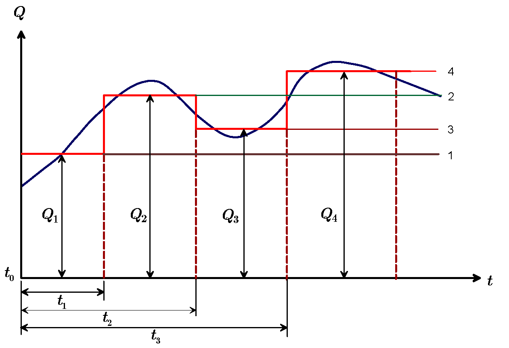{#fig-fig05-01 width=10cm}

如图，概化为4个阶梯，分解成4个问题：

- $t_0\to t$ 以 $Q_1$ 抽水；
- $t_1\to t$ 以 $Q_2-Q_1$ 抽水；
- $t_2\to t$ 以 $Q_3-Q_2$ 注水； 
- $t_3\to t$ 以 $Q_4-Q_3$ 抽水。

各阶梯流量抽水引起的降深：

- $s_1=\frac{Q_1-Q_0}{4\pi T}W\left(\frac{r^2S}{4T(t-t_0)}\right)$
- $s_2=\frac{Q_2-Q_1}{4\pi T}W\left(\frac{r^2S}{4T(t-t_1)}\right)$
- $s_3=\frac{Q_3-Q_2}{4\pi T}W\left(\frac{r^2S}{4T(t-t_2)}\right)$
- $s_4=\frac{Q_4-Q_3}{4\pi T}W\left(\frac{r^2S}{4T(t-t_3)}\right)$

时刻 $t$ 的降深：

- $t_0 < t \le t_1,\ s =s_1$
- $t_1<t\le t_2,\ s=s_1+s_2$
- $t_2<t\le t_3,\ s=s_1+s_2+s_3$
- $t_3<t\le t_4,\ s=s_1+s_2+s_3+s_4$

设共有 $n$ 个时段，且 $t_0 = 0$，$Q_0 = 0$。当 $t_{n-1}<t\le t_n$ 时
$$
s=\frac{1}{4\pi T}\sum_{i = 1}^n(Q_i-Q_{i-1})
W\left[\frac{r^2S}{4T(t-t_{i-1})}\right]
$$
如果每个时段抽水延续时间足够长，
$t-t_i\ge25\frac{r^2S}{T}\ (i=1,2,\cdots, n)$，Jacob 公式成立
$$
s=\frac{0.183}{T}\sum_{i=1}^n(Q_i-Q_{i-1})
\lg\frac{2.25T(t-t_{i-1})}{r^2S}
$$
式中 $t=t_{i-1}$ 时 $u\to\infty$，$W(\infty)=0$，确保分段处降深连续。

## 5.2 有越流补给的完整井非稳定流模型

**越流系统**

自然界中，含水层常通过弱透水层与相邻含水层发生水力联系，这种包含越流含水层、弱透水层和相邻含水层的地下水系统称为越流系统。

**越流系统的类型**

- 第一越流系统：忽略弱透水层弹性释放、忽略补给层水位变化；
- 第二越流系统：考虑弱透水层弹性释放、忽略补给层水位变化；
- 第三越流系统：忽略弱透水层弹性释放、考虑补给层水位变化。

### 5.2.1 Hantush-Jacob 模型

**模型假设条件**：本节主要讨论第一越流系统。

- 每一层均质各向同性，产状水平、等厚，侧向无限延伸；
- 水流服从 Darcy 定律；
- 抽水过程中相邻含水层水头不变；
- 忽略弱透水层弹性释水，弱透水层中水流为垂向一维流；
- 抽水含水层天然水力坡度为零，抽水后形成平面径向流；
- 完整井定流量抽水，井径无限小。

**数学模型**
$$
\begin{cases}
\frac{\partial^2 s}{\partial r^2}+
\frac{1}{r}\frac{\partial s}{\partial r}-\frac{s}{B^2}=
\frac{S}{T}\frac{\partial s}{\partial t}&t>0,\ 0<r<\infty\\
\left.s\right|_{t=0}=0&0<r<\infty\\
\left.s\right|_{r\to\infty}=0&t>0\\
\lim_{r\to0}\left(r\frac{\partial s}{\partial r}\right)=-\frac{Q}{2\pi T} &t>0
\end{cases}\tag{II}
$$

方程中 $-\frac{s}{B^2}$ 为越流补给项，反映弱透水层中的垂向越流补给。$B=\sqrt{\frac{TM'}{K'}}$ 称为越流因素，量纲为长度。

**模型的解**（Hantush-Jacob, 1955）
$$
s=\frac{Q}{4\pi T}W\left(u,\frac{r}{B}\right)
$$
式中，$u=\frac{r^2S}{4Tt}$，$B=\sqrt{\frac{TM'}{K'}}$，$W\left(u,\frac{r}{B}\right)$ 为越流井函数。
$$
W\left(u,\frac{r}{B}\right)
=\int_u^\infty\frac{1}{y}e^{-y-\frac{r^2}{4B^2y}}\mathrm{d}y
$$

越流井函数的计算方法见试验材料。对于不同的 $\frac{r}{B}$ 可以绘出井函数 $W(u,1/u)$ 标准曲线（[@fig-Hantush-Jacob]）：

{#fig-Hantush-Jacob width=10cm}

### 5.2.2 Hantush-Jacob 公式讨论

**（1）$s\sim t$ 曲线的变化规律**

$s\sim t$ 曲线分**早、中、晚**三个阶段。

- 早期：与 Theis 曲线一致，越流尚未进入主含水层，抽水量来自主含水层的弹性释水；$r$ 一定时，$B$ 越大，与 Theis 曲线吻合的时间越长，越流进入含水层的时间越晚。
- 中期：偏离 Theis 曲线，越流已经进入抽水含水层，抽水量来自弹性释水与越流补给两部分。$r$ 一定时，$B$ 越大，开始偏离的时间越晚。
- 晚期：降深趋于定值。$t\to\infty$ 时 $W\left(u,\frac{r}{B}\right)\approx 2K_0\left(\frac{r}{B}\right)$，有
$$
s\approx\frac{Q}{2\pi T}K_0\left(\frac{r}{B}\right)
$$
即有越流补给的完整井流，定流量抽水最终能达到稳定流。

**（2）水头下降速度**
$$
\frac{\partial s}{\partial t}=\frac{Q}{4\pi T}\frac{1}{t}
e^{-\left(\frac{r^2S}{4Tt}+\frac{Tt}{SB^2}\right)}
$$
越流含水层水位下降速度比无越流含水层慢。

**（3）稳定流降深的近似公式及各种流量的关系**

**降深的近似公式**

$x>2$ 时 $K_0(x)$ 快速衰减；$x\ll1$ 时，$K_0(x)\approx\ln\left(\frac{1.123}{x}\right)$。有
$$
s\approx\frac{Q}{2\pi T}\ln\frac{1.123B}{r}
$$
当 $\frac{r}{B}<0.35$ 时，误差小于5%；当 $\frac{r}{B}<0.18$ 时，误差小于1%。

**抽水量与越流量、轴向侧流量的关系**

径向距离 $r$ 处的轴向侧流量
$$
Q_r=-2\pi rT\frac{\partial s}{\partial r}\approx 
Q\frac{r}{B}K_1\left(\frac{r}{B}\right)
$$
由此得到抽水量与轴向侧流量关系
$$
\frac{Q_r}{Q}\approx\frac{r}{B}K_1\left(\frac{r}{B}\right)
$$

在 $r \approx 4B$ 处，$Q_r/Q \approx 0.05$，即通过该断面的水平流量仅占总抽水量的约5%，其余95%已由 $r<4B$ 范围内的越流补给所替代。因此可近似认为越流补给的影响半径约为 $4B$。

## 5.3 有弱透水层弹性释水补给的完整井非稳定流模型

Hantush-Jacob 模型忽略弱透水层的弹性释水与补给含水层水位变化，为第一越流系统。对于多层结构的含水岩组，含水层抽水时会引起弱透水层弹性释水，当弱透水层较厚时，该补给量不可忽略。M. S. Hantush (1960) 提出的三层结构模型属于第二越流系统。

### 5.3.1 Hantush 模型

Hantush 根据弱透水层弹性释水与相邻含水层的关系，给出了三种越流模型（[@fig-Leaky_Aquifer]）：

- 模型1：与两弱透水层相邻的是定水头含水层；
- 模型2：与两弱透水层相邻的是隔水层；
- 模型3：上弱透水层与定水头含水层相邻，下弱透水层与隔水层相邻。

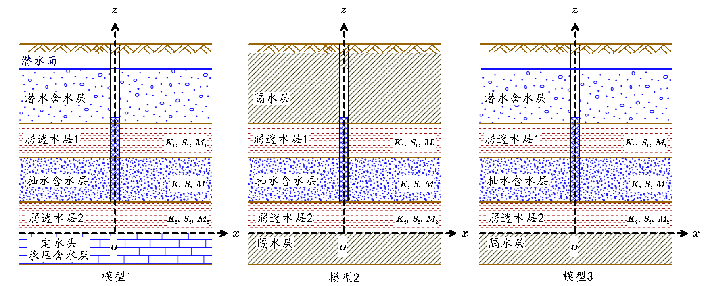{#fig-Leaky_Aquifer width=10cm}

**模型假设条件**

- 含水层和弱透水层均质、各向同性，产状水平、等厚、无限分布；天然水力坡度为零；
- 单井定流量抽水；
- 弱透水层渗透系数远小于抽水含水层；
- 含水层抽水时，能得到弱透水层弹性释水补给；弱透水层中水流为垂向流，抽水含水层中水流为水平径向流，水流服从 Darcy 定律；
- 与弱透水层相邻为定水头含水层或隔水层。

记上、下弱透水层厚度分别为 $m_1$、$m_2$，贮水率分别为 $S_{s_1}$、$S_{s_2}$，渗透系数分别为 $K_1$、$K_2$；主抽水含水层厚度为 $M$，渗透系数为 $K$，导水系数 $T=KM$，贮水系数 $S=S_s M$。

**数学模型**

- 模型1 

抽水含水层 
$$
\begin{cases} 
T\left(\frac{\partial^2 s}{\partial r^2}
+\frac{1}{r}\frac{\partial s}{\partial r} \right)+K_1
\frac{\partial s_1}{\partial z}-K_2 \frac{\partial s_2}{\partial z}
=S\frac{\partial s}{\partial t} \\
s(r,0)=0 \\
s(\infty,t)=0 \\
\lim_{r\to0}r\frac{\partial s}{\partial r} =-\frac{Q}{2\pi T} 
\end{cases}\tag{III-1}
$$

下弱透水层 
$$
\begin{cases}
K_2 \frac{\partial^2 s_2}{\partial z^2}=S_{s_2}\frac{\partial s_2}{\partial t} \\
s_2(r,z,0)=0 \\
s_2(r,0,t)=0 \\
s_2(r,m_2,t)=s(r,t)
\end{cases}\tag{III-2}
$$

上弱透水层 
$$
\begin{cases}
K_1\frac{\partial^2 s_1}{\partial z^2}=S_{s_1}\frac{\partial s_1}{\partial t} \\
s_1(r,z,0)=0 \\
s_1(r,m_2+M+m_1,t)=0 \\
s_1(r,m_2+M,t)=s(r,t)
\end{cases}\tag{III-3}
$$

- 模型2 

抽水含水层 
$$
\begin{cases}
T\left(\frac{\partial^2 s}{\partial r^2}
+\frac{1}{r}\frac{\partial s}{\partial r} \right)+K_1
\frac{\partial s_1}{\partial z}-K_2 \frac{\partial s_2}
{\partial z}=S\frac{\partial s}{\partial t} \\
s(r,0)=0 \\
s(\infty,t)=0 \\
\lim_{r\to0}r\frac{\partial s}{\partial r} =-\frac{Q}{2\pi T} 
\end{cases}\tag{IV-1}
$$

下弱透水层
$$
\begin{cases}
K_2 \frac{\partial^2 s_2}{\partial z^2}=S_{s_2}\frac{\partial s_2}{\partial t} \\
s_2(r,z,0)=0 \\
\frac{\partial}{\partial z}s_2(r,0,t)=0 \\
s_2(r,m_2,t)=s(r,t)
\end{cases}\tag{IV-2}
$$

上弱透水层 
$$
\begin{cases}
K_1\frac{\partial^2 s_1}{\partial z^2}=S_{s_1}\frac{\partial s_1}{\partial t} \\
s_1(r,z,0)=0 \\
\frac{\partial}{\partial z}s_1(r,m_2+M+m_1,t)=0 \\
s_1(r,m_2+M,t)=s(r,t)
\end{cases}\tag{IV-3}
$$

- 模型3 

抽水含水层 
$$
\begin{cases}
T\left(\frac{\partial^2 s}{\partial r^2}
+\frac{1}{r}\frac{\partial s}{\partial r} \right)+K_1
\frac{\partial s_1}{\partial z}-K_2 \frac{\partial s_2}
{\partial z}=S\frac{\partial s}{\partial t} \\
s(r,0)=0 \\
s(\infty,t)=0 \\
\lim_{r\to0}r\frac{\partial s}{\partial r} =-\frac{Q}{2\pi T}
\end{cases}\tag{V-1}
$$

下弱透水层
$$
\begin{cases}  
K_2 \frac{\partial^2 s_2}{\partial z^2}=S_{s_2}\frac{\partial s_2}{\partial t} \\
s_2(r,z,0)=0 \\
\frac{\partial}{\partial z}s_2(r,0,t)=0 \\
s_2(r,m_2,t)=s(r,t)
\end{cases}\tag{V-2}
$$

上弱透水层
$$
\begin{cases} 
K_1\frac{\partial^2 s_1}{\partial z^2}=S_{s_1}\frac{\partial s_1}{\partial t} \\
s_1(r,z,0)=0 \\
s_1(r,m_2+M+m_1,t)=0 \\
s_1(r,m_2+M,t)=s(r,t)
\end{cases}\tag{V-3}
$$

**模型的近似解**

根据 $s\sim t$ 曲线，抽水可分三个阶段。其中，抽水时间足够短及抽水时间足够长时，Hantush 模型有近似解。记 $S_1=m_1S_{s_1}$，$S_2=m_2S_{s_2}$（[@fig-hantush]）：

- 抽水初期的解

  $t<\frac{m_1 S_1}{10K_1}$、$t<\frac{m_2 S_2}{10K_2}$ 时，三种模型具有形式相同的近似解：
$$
s = \frac{Q}{4\pi T} H(u,\beta)
$$
其中
$$
H(u,\beta)=\int_{u}^{\infty}{\frac{e^{-y}}{y}\mathrm{erfc}\left[\frac{\beta\sqrt{u}}{\sqrt{y(y-u)}} \right]}dy
$$
式中，$u = \frac{r^2S}{4Tt},\ B_1=\sqrt{\frac{Tm_1}{K_1}},\ B_2=\sqrt{\frac{Tm_2}{K_2}},\ \beta= \frac{r}{4B_1}\sqrt{\frac{S_1}{S}} + \frac{r}{4B_2}\sqrt{\frac{S_2}{S}}$

此近似解适用于抽水刚开始的很短时段（通常为前几分钟至前几十分钟，取决于弱透水层参数）。在此阶段与 Theis 解出现明显差异之前，此近似解与数值解吻合良好。

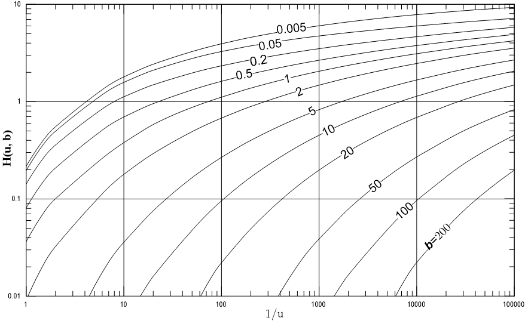{#fig-hantush width=10cm}

- 抽水时间较长的解

  - 模型1：$t>5\frac{m_1S_1}{K_1}$ 且 $t>5\frac{m_2S_2}{K_2}$ 时
$$
s = \frac{Q}{4\pi T}W(u_1,\alpha)
$$
式中
$$
u_1 = \frac{r^2\left(S+\frac{S_1}{3}+\frac{S_2}{3}\right)}{4Tt},\quad \alpha = r\sqrt{\frac{1}{B_1^2} + \frac{1}{B_2^2}}
$$
$W(u_1,\alpha)$ 为忽略弱透水层弹性释水的越流系统井函数（Hantush-Jacob）。

  - 模型2：$t>10\frac{m_1S_1}{K_1}$ 且 $t>10\frac{m_2S_2}{K_2}$ 时
$$
s = \frac{Q}{4\pi T}W(u_2)
$$
式中
$$
u_2 = \frac{r^2(S + S_1+S_2)}{4Tt}
$$
$W(u_2)$ 为无越流含水层井函数（Theis）。

  - 模型3：$t>5\frac{m_1S_1}{K_1}$ 且 $t>10\frac{m_2S_2}{K_2}$ 时
$$
s = \frac{Q}{4\pi T}W\left(u_3,\frac{r}{B_1}\right)
$$
式中
$$
u_3 = \frac{r^2\left(S+\frac{S_1}{3}+S_2\right)}{4Tt}
$$
$W(u_3,\frac{r}{B_1})$ 为忽略弱透水层弹性释水的越流系统井函数（Hantush-Jacob）。

### 5.3.2 公式讨论

- 当 $B_1,\ B_2 \to\infty$ 或 $S_1=S_2=0$ 时，公式简化为 Theis 公式：
$$
s= \frac{Q}{4\pi T}W(u),\quad u = \frac{r^2S}{4Tt}
$$

- 对模型1、模型3（定水头），当 $K_2=0,\,S_1=S_2=0$ 时，
$$
s=\frac{Q}{4\pi T}W\left( u,\frac{r}{B} \right),\quad u=\frac{r^2S}{4Tt}
$$
此为忽略弱透水层弹性释水的越流系统井流公式。

- 由 $H(u,\beta)-\frac{1}{u}$ 标准曲线知，$s$ 随 $\beta$ 增大而减小，当 $\beta=0$ 时为 Theis 曲线：
  - $S_1$、$S_2$ 增大（$\beta$ 增大），$s$ 减小；
  - $r$ 增大（$\frac{1}{u}$ 减小），$s$ 减小；
  - $B$ 减小（$\beta$ 增大），$s$ 减小。

## 5.4 潜水完整井的非稳定流模型

### 5.4.1 潜水井流特征

- 潜水井流上界面是随时间变化的浸润曲面（自由面），承压水井流为含水层顶板；
- 潜水井流导水系数 $T=Kh$ 随距离 $r$ 和时间 $t$ 变化，承压水井流 $T=KM$ 与 $r,t$ 无关；
- 潜水井流降深较大时，垂向分速度不可忽略，井附近为三维流；近水平含水层的承压井流垂向分速度可忽略，可近似处理为二维流；
- 潜水井抽取的地下水主要来自含水层的重力疏干；重力疏干不能瞬时完成，排水过程滞后于水位下降，长时间抽水后给水度趋于定值；承压水井抽取的地下水来自含水层贮存量释放，接近瞬时完成，贮水系数为常数。

潜水井抽水时，观测孔 $s-t$ 曲线有明显的**分阶段变化特征**（[@fig-fig05-02]）：

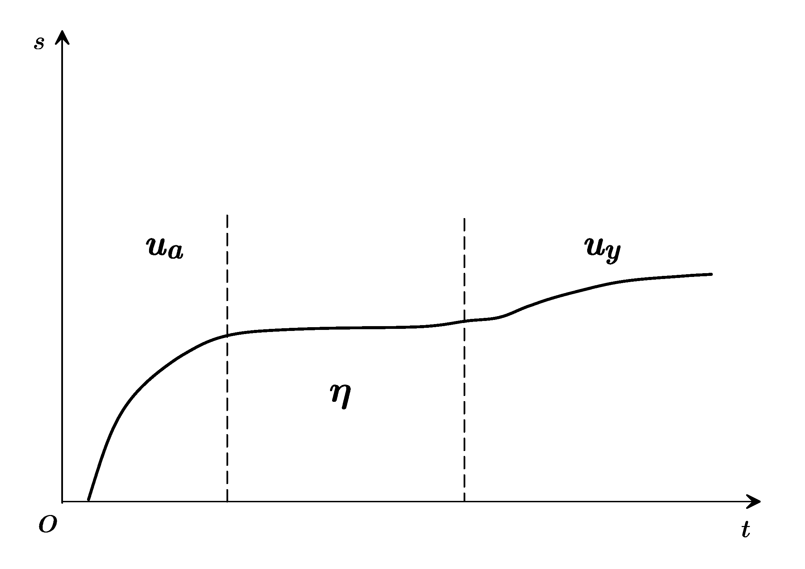{#fig-fig05-02 width=10cm}

- 早期：抽水开始后的早期阶段，水位刚刚下降，重力排水还未起作用，只有压力降低引起的弹性释水起作用，$s-t$ 曲线与 Theis 曲线一致，时间可能仅几分钟。含水层的反应和一个贮水系数小的承压含水层相似；水流主要是水平运动。
- 中期：疏干排水开始起作用，含水层得到补给，水位下降速度变缓，$s-t$ 曲线偏离 Theis 曲线，曲线斜率减小，甚至短时间稳定。含水层的反应类似于一个有越流补给的承压含水层；降落漏斗仍缓慢扩展。
- 后期：滞后排水作用达到压力平衡，影响逐渐减小，重力排水与水位下降同步，抽水量来自重力排水，$s-t$ 曲线又与 Theis 曲线一致。给水度所起的作用相当于承压含水层的贮水系数。

**潜水井流的研究思路**

- 抽水井附近按三维流处理；
- 远离抽水井的潜水井流可近似为二维流。
- 用 $H_m=\frac{1}{2}(H_0+H)$ 近似代替含水层厚度：长时间抽水后，滞后排水现象已不明显；在降深不大的情况下（$s\le0.1H_0$，$H_0$ 为抽水前潜水流厚度），可近似用承压井流公式计算
$$
s=\frac{Q}{4\pi H_mK}W(u),\quad u=\frac{r^2\mu}{4KH_mt}
$$

- 采用修正降深值，直接利用 Theis 公式：
$$
s'=s-\frac{s^2}{2H_0}=\frac{Q}{4\pi T}W(u),\quad u=\frac{r^2\mu}{4Tt}\quad(T=KH_0)
$$
式中，$s'$ 为修正降深；$s$ 为实测降深；$H_0$ 为潜水流初始厚度。

注意，第一种近似以变动的平均厚度 $H_m = \frac{1}{2}(H_0+H)$ 计算导水系数，第二种近似以初始厚度 $H_0$ 计算导水系数并修正降深。两种方法在降深较小（$s \le 0.1 H_0$）时计算结果接近；大降深条件下建议优先使用第二种修正降深法。

**潜水完整井流模型分类**

- 考虑井附近流速垂直分量的第一潜水井流 Boulton 模型；
- 考虑滞后疏干的 Boulton 第二潜水井流模型；
- 既考虑流速垂直分量又考虑含水层弹性释水的 Neuman 模型。

本课程介绍后两种模型。

### 5.4.2 考虑滞后疏干的 Boulton 模型

**Boulton 假设**：

根据抽水过程中降深-时间曲线特征，Boulton 提出了考虑滞后疏干的计算方法。假设 $\tau,\tau+\Delta\tau$ 时间段抽水，潜水面下降了 $\Delta s$。抽出水量由两部分组成：

- 弹性释水放出水量：水位下降 $\Delta s$ 时，单位面积含水层弹性释水为 $S\cdot\Delta s\cdot1$；
- 滞后疏干排出水量：水位下降 $\Delta s$ 时，滞后疏干排出水量假设为
$$
\mu\cdot\Delta s\cdot1\cdot\alpha\cdot e^{-\alpha(t-\tau )}
$$
式中，$\alpha$ 为经验系数。

用负指数处理滞后现象（[@fig-fig05-03]）。

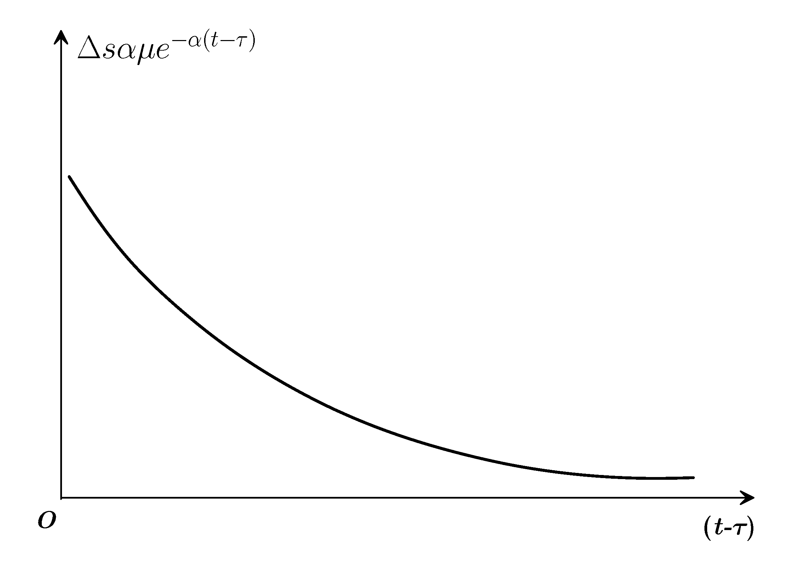{#fig-fig05-03 width=10cm}

**Boulton 假设合理性**

- 单位面积含水层排水量 $\mu\cdot\Delta s\cdot\alpha\cdot e^{-\alpha(t-\tau)}$ 与 $t-\tau$ 的关系符合一般经验，时间间隔越长，排出的水量越小。
- $\tau$ 时刻之后，若 $\Delta s=1$，则重力排水的总体积为
$$
\int_{\tau}^{\infty}{\mu\cdot\alpha\cdot e^{-\alpha(t-\tau)}dt}=\mu
$$
等于含水层的给水度，满足水量均衡条件，符合实际情况；

- $\tau,t$ 时间段的滞后排水总量为
$$
\int_{\tau}^t{\mu\cdot\Delta s\cdot\alpha\cdot e^{-\alpha(t-\tau)}dt}=\mu\cdot\Delta s\cdot[1-e^{-\alpha(t-\tau)}]
$$
当 $t>\tau$ 时，存在滞后效应；若 $\alpha$ 大，则排出水量大，滞后性弱；$1/\alpha$ 称为延迟指数。

**滞后疏干出水量的表示**

抽水过程中从 0 至 $t$ 时刻，水位下降了 $s$。单位面积含水层的疏干水量 $q$ 可表示为 $n$ 个 $\Delta\tau=\tau_i-\tau_{i-1}$ 对应降深为 $\Delta s_i=s_i-s_{i-1}$ 的水量叠加。

当 $n\to\infty$ 时
$$
\begin{split}
q &=\lim_{n\to\infty}\sum_{i=1}^n{\mu\Delta s_i\alpha e^{-\alpha(t-\tau_i)}}\\
 &=\lim_{n\to\infty}\sum_{i=1}^{n}{\mu\frac{\Delta
s_i}{\Delta\tau_i}\alpha e^{-\alpha(t-\tau_i)}\Delta\tau_i}\\
 & =\int_{0}^t{\mu\frac{\partial s}{\partial\tau}\alpha e^{-\alpha(t-\tau)}}d\tau
\end{split}
$$

**Boulton 模型假设**

- 均质各向同性，隔水底板水平、侧向无限延伸的含水层；
- 初始水面水平；
- 完整井，井径无限小，定流量抽水，降深 $s\ll H_0$；
- 水流服从 Darcy 定律；
- 抽水时，含水层中的水不能瞬时排出，存在滞后现象。

**Boulton 模型的数学表示**
$$
\begin{cases}
T\left(\frac{\partial^2 s}{\partial r^2}+
\frac{1}{r}\frac{\partial s}{\partial r}\right) =
S\frac{\partial s}{\partial t}+ \alpha\mu\int_0^t\frac{\partial s}{\partial\tau}e^{- \alpha( t - \tau)}\mathrm{d}\tau & \\
s(r,0)=0 & \\
s(\infty,t)=0 & t > 0 \\ 
\lim_{r \to 0}\left(
r\frac{\partial s}{\partial r}\right) = -\frac{Q}{2\pi T} & t > 0
\end{cases}\tag{VI}
$$

积分项中的被积函数为 $\frac{\partial s}{\partial\tau}$，表示过去时刻 $\tau$ 的降深变化对当前滞后排水的影响。

**Boulton 模型的解**
$$
s=\frac{Q}{4\pi T}\int_{0}^{\infty}\frac{2}{x}\left\{1-e^{-u_1}\left[\cosh(u_2)+\frac{\alpha\eta(1-x^2)t}{2u_2}\sinh(u_2)\right]\right\}J_0\left(\frac{r}{\nu D}x\right)dx
$$
式中，
$$
\begin{array}{lll}
 u_1=\frac{\alpha t\eta (1+x^2)}{2},  & \quad & u_2=\frac{\alpha t\sqrt{\eta^2(1+x^2)^2-4\eta x^2}}{2}\\
\eta =\frac{S+\mu }{S}, && \nu =\sqrt{\frac{\eta-1}{\eta}}=\sqrt{\frac{\mu}{S+\mu}}\\
 D=\sqrt{\frac{T}{\alpha \mu}}&&
\end{array}
$$
$D$ 为疏干因素（量纲为L），$\sinh(u)=\frac{e^u-e^{-u}}{2},\ \cosh(u)=\frac{e^u+e^{-u}}{2}$ 为双曲函数。

**Boulton 模型的简化形式**

当 $\eta\to\infty$ 时，即 $\mu\gg S$ 时，Boulton 解可简化
$$
s =\frac{Q}{4\pi T}\int_0^\infty
\frac{2}{x}
\left\lbrace
1-\frac{1}{1+x^2}e^{-\frac{\alpha tx^2}{1+x^2}}-\frac{x^2}{1+x^2}e^{-\alpha\eta t(1+x^2)}
\right\rbrace J_0\left(\frac{r}{D}x\right)dx 
$$
将 Boulton 解进一步简化：

- 当 $t$ 相当小（抽水初期）：
$$
s = \frac{Q}{4\pi T}\int_{u_a}^\infty\frac{1}{y}\mathrm{e}^{-y-\frac{r^2}{4D^2y}}dy=\frac{Q}{4\pi T}W\left(u_a,\frac{r}{D}\right)
$$

- 当 $t$ 很大（抽水延续时间较长）：
$$
s = \frac{Q}{4\pi T}\int_0^\infty
\frac{2}{x}\left\lbrace
1-\frac{1}{1+x^2}e^{-\frac{x^2}{1+x^2}\frac{1}{u_y}\frac{r^2}{4D^2}}
\right\rbrace J_0\left(\frac{r}{D}x\right)dx =\frac{Q}{4\pi T}W\left(u_y,\frac{r}{D}\right)
$$
式中，$W\left(u_{ay},\frac{r}{D}\right)$ 为潜水含水层中完整井的井函数。抽水早期，$u_{ay}=u_a=\frac{r^2S}{4Tt}$；抽水后期，$u_{ay}=u_y=\frac{r^2\mu}{4Tt}$。

在双对数纸上绘制标准曲线，$W(u_{ay},\frac{r}{D})$ 为纵坐标，$\frac{1}{u_a}$ 为 A 组曲线，$\frac{1}{u_y}$ 为横坐标作 B 组曲线，然后用切线连接 A、B 组曲线（[@fig-Boulton-ua-uy]）：

{#fig-Boulton-ua-uy width=10cm}

- 井函数曲线组反映了滞后排水的影响。抽水初期，以弹性释水为主，水位降深同 A 组 Theis 曲线吻合。
- 持续抽水，滞后重力排水发生影响后偏离 Theis 曲线，下降速度变小，并随 $r/D$ 不同，以不同方式向水平线趋近。
- 抽水后期，滞后重力排水影响减弱，下降速度由小变大，曲线斜率增加。滞后重力排水影响基本结束时又趋向 B 组 Theis 曲线。

**Boulton 模型按抽水过程的近似解**

- 早期：
$$
s=\frac{Q}{4\pi T}W\left(u_a,\frac{r}{D}\right),\quad u_a =\frac{r^2S}{4Tt}
$$
与忽略弱透水层弹性释水的越流系统井函数相同，疏干因素 $D$ 的作用相当于越流因素 $B$ 的作用。$W(u_a,\frac{r}{D})$ 为潜水含水层 A 组井函数。

- 中期：
$$
s =\frac{Q}{2\pi T}K_0\left(\frac{r}{D}\right)
$$
该形式类似于第一越流系统达到稳定时的解（式中疏干因素 $D$ 的作用等价于越流因素 $B$）。在物理上，中期阶段重力排水持续补给含水层，其效果类似于越流补给，故降深可用 $K_0$ 函数近似描述。

- 晚期：
$$
s=\frac{Q}{4\pi T}W\left(u_y,\frac{r}{D}\right),\quad u_y = \frac{r^2\mu}{4Tt}
$$
$W(u_y,\frac{r}{D})$ 为潜水含水层 B 组井函数。

**适用条件提示**：上述 Boulton 解以降深远小于初始潜水流厚度（$s \le 0.1 H_0$）为前提进行线性化处理。大降深条件下（如 $s > 0.1 H_0$），线性化误差显著增大，应考虑使用考虑流速垂直分量的 Neuman 模型或其他数值方法。

**Boulton 模型讨论**

- 早期：当 $t$ 很小时（抽水初期），与 Hantush-Jacob 公式相同，潜水位下降的过程与越流含水层的过程相同；
- 中期：重力排水起作用，开始偏离 Theis 曲线；
- 晚期：当 $t$ 很大时，滞后排水影响基本消除，降深与 Theis 公式形式相同，此时采用给水度 $\mu$，即 $u_y=\frac{r^2\mu}{4Tt}$。

### 5.4.3 考虑流速垂直分量和弹性释水的 Neuman 模型

**Boulton 延迟疏干模型的缺陷**

- 延迟指数 $\frac{1}{\alpha}$ 缺乏明确的物理含义；
- 对确定的潜水含水层，$\alpha$ 不能保证是常数，不属于物性参数；
- 难以解释潜水含水层的释水机制；
- 二维模型，无法解释抽水井附近三维流特征。

**Neuman 模型的改进**

- 三维轴对称模型，包含 $z$ 坐标变化对降深的影响与含水层的各向异性特征；
- 将潜水面作为活动边界，建立了潜水面变动的连续方程；
- 避免了潜水疏干释水所涉及的非饱和带问题；无需物理意义不明的延迟指数 $\alpha$，弥补了 Boulton 延迟疏干模型的不足。

**Neuman 模型的假设条件**

- 含水层均质各向异性，侧向无限延伸，坐标轴和主渗透方向一致，隔水层水平；
- 初始潜水面水平；
- 水流服从 Darcy 定律；
- 完整井，定流量抽水；
- 抽水期间自由面上没有入渗补给或蒸发；潜水面降深和含水层厚度相比小得多。

**Neuman 模型的数学表示**
$$
\begin{cases}
K_r\left[\frac{\partial^2 s}{\partial r^2}+\frac{1}{r}\frac{\partial s}{\partial r}\right]+K_z\frac{\partial^2 s}{\partial z^2}=S_s\frac{\partial s}{\partial t}& t > 0,\ 0 < r < \infty,\ 0 < z < H_0 \\
s(r,z,0)=0 & 0 < r < \infty \\
s(\infty,z,0)=0 & t > 0 \\
K_z\frac{\partial}{\partial z}s(r,H_0,t)=-\mu\frac{\partial}{\partial t}s(r,H_0,t) & t > 0,\ 0 < r<  \infty \\
\lim_{r\to0}\int_0^{H_0}r\frac{\partial s}{\partial r}\mathrm{d}z=-\frac{Q}{2\pi K_r} &
\end{cases}\tag{VII}
$$

**Neuman 模型的解**
$$
s(r,z,t)=\frac{Q}{4\pi T}\int_0^\infty{4y}\ J_0\left(y\beta^{\frac{1}{2}}\right)\left[\omega_0(y)+\sum_{n=1}^\infty\omega_n(y)\right]\mathrm{d}y
$$
式中
$$
\begin{split}
\omega_0(y)&=\frac{\{1-\exp[-t_s\beta(y^2-\gamma_0^2)]\}\cosh(\gamma_0 z_d)}{\{y^2+(1+\sigma)\gamma_0^2-[(y^2-\gamma_0^2)^2/\sigma]\}\cosh(\gamma_0)}\\
\omega_n(y)&=\frac{\{1-\exp[-t_s\beta(y^2+\gamma_n^2)]\}\cosh(\gamma_n z_d)}{\{y^2-(1+\sigma)\gamma_n^2-[(y^2+\gamma_n^2)^2/\sigma]\}\cos(\gamma_n)}
\end{split}
$$
$\gamma_0,\gamma_n$ 分别为下面两方程的根：
$$
\begin{array}{rl}
 \sigma\gamma_0\sinh(\gamma_0)- (y^2-\gamma_0^2)\cosh(\gamma_0)=0, & \gamma_0^2<y^2 \\
 \sigma\gamma_n\sin(\gamma_n)+ (y^2+\gamma_n^2)\cos(\gamma_n)=0, & (2n-1)\frac{\pi}{2}<\gamma_n<n\pi\ (n\ge1)
\end{array}
$$

Neuman 解有4个参数：
$$
t_s=\frac{Tt}{Sr^2}\ (t_y=\frac{Tt}{\mu r^2}),\quad z_d=\frac{z}{H_0},\quad \sigma=\frac{S}{\mu},\quad \beta=\frac{r^2K_z}{H_0^2K_r}
$$
记 $K_d=\frac{K_z}{K_r},\ h_d=\frac{H_0}{r}$，则 $\beta=K_d/h_d^2$。
$z_d$ 为三维流参数。

对完整观测井，降深 $s$ 需用沿 $z$ 的平均降深表示，计算公式形式不变：
$$
s(r,t)=\frac{1}{H_0}\int_{0}^{H_0}{s(r,z,t)dz =}\frac{Q}{4\pi T}\int_{0}^{\infty}{4yJ_0 (y\beta^{\frac{1}{2}})}\left[\omega_0( y)+\sum_{n=1}^{\infty}{\omega_n( y)}\right]dy
$$
其中 $\omega_0,\omega_n$ 为 
$$
\begin{split}
\omega_0(y)& =\frac{\{1-\exp[-t_s\beta(y^2-\gamma_0^2)]\}\tanh(\gamma_0)}{\{y^2+(1+\sigma)\gamma_0^2-[(y^2-\gamma_0^2)^2/\sigma]\}\gamma_0}\\
\omega_n(y)& =\frac{\{1-\exp[-t_s\beta(y^2+\gamma_n^2)]\}\tan(\gamma_n)}{\{y^2-(1+\sigma)\gamma_n^2-[(y^2+\gamma_n^2)^2/\sigma]\}\gamma_n}
\end{split}
$$

解有3个参数（$z$ 方向的降深平均化）：
$$
t_s=\frac{Tt}{Sr^2}\ (t_y=\frac{Tt}{\mu r^2}),\quad \sigma=\frac{S}{\mu},\quad \beta=\frac{r^2K_z}{H_0^2K_r}
$$
式中包含3个独立的无量纲变量，为便于作图，假设 $S$ 远小于 $\mu$，即 $\sigma=0$。Neuman 完整解包含 $\sigma = S/\mu$ 参数，此处取 $\sigma=0$ 仅为简化标准曲线的绘制，使 A 组与 B 组曲线分离便于配线。实际参数反演时应使用包含 $\sigma$ 的完整解进行计算，以提高精度。

- 以 $\beta$ 为参变量，以 $t_s$ 计算无量纲降深 $s_d$ 作出 A 组曲线 $t_s\sim s_d$，坐标 $t_s$ 标在图的上端； 
- 以 $\beta$ 为参变量，$t_y$ 计算无量纲降深 $s_d$，作出 B 组曲线 $t_y\sim s_d$，坐标 $t_y$ 标在图的下端；
- A 组曲线右边部分和 B 组曲线左边部分都趋近于一组水平的渐近线。
- 当 $\sigma=0$ 时，A 组（$t_s$ 坐标）与 B 组（$t_y$ 坐标）的时间尺度相差 $\mu/S$ 倍，在普通双对数纸上间距过大，需采用上下两组不同坐标刻度才能在同一张图上绘制。
- A 组曲线用以分析早期的降深资料；B 组曲线用以分析晚期的降深资料（[@fig-Neuman]）。

{#fig-Neuman width=10cm}

**Neuman 解的特点**

没有重力排水（$\mu=0$，相当于抽水初期），可以证明 Neuman 解具有 Theis 解的形式：
$$
s(r,t)=\frac{Q}{4\pi T}\int_{u_s}^{\infty}\frac{e^{-y}}{y}dy=\frac{Q}{4\pi T}W(u_s)
$$
式中，$u_s=\frac{r^2S}{4Tt}$。 

长时间抽水（$t\to\infty$，相当于弹性释水可忽略），Neuman 解也具有 Theis 解的形式：
$$
s(r,t)=\frac{Q}{4\pi T}\int_{u_y}^{\infty}\frac{e^{-y}}{y}dy=\frac{Q}{4\pi T}W(u_y)
$$
式中，$u_y=\frac{r^2\mu}{4Tt}$。

抽水初期，弹性释水起主要作用（$u_s=\frac{r^2S}{4Tt}$）；抽水后期，重力释水起主要作用（$u_y=\frac{r^2\mu}{4Tt}$）。

**井附近降深分析**

记 $s_d=\frac{4\pi T}{Q}s$ 为无量纲降深。

- 含水层各向同性，观测点位于距抽水井 $H_0$ 的含水层底部（$z_d=0,\,h_d=1,\,K_d=1$）
  $s_d\sim t_{s}$ 曲线（[@fig-fig05-04]）：

  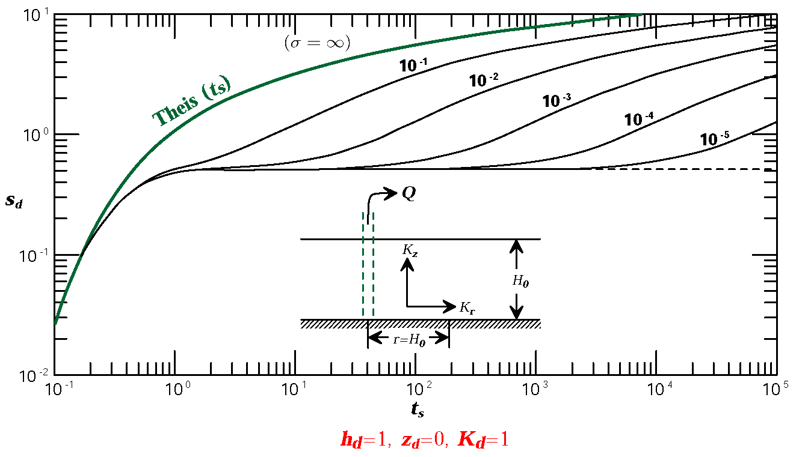{#fig-fig05-04 width=10cm}

  - 第一阶段（早期）：抽水量来自弹性释水；
  - 第二阶段：重力排水起作用，$\sigma$ 越小，该阶段越长；
  - 第三阶段：弹性释水影响消失，曲线再次与 Theis 一致。

- 含水层各向同性，观测点位于距抽水井 $H_0$ 的含水层底部（$z_d=0,\,h_d=1,\,K_d=1$）
  $s_d\sim t_{y}$ 曲线（[@fig-fig05-05]）：

  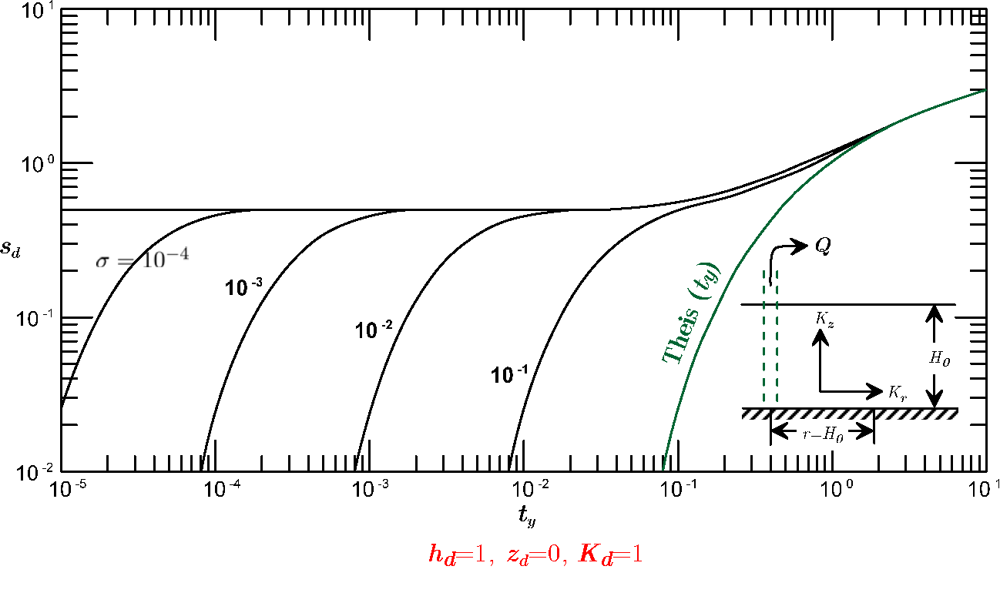{#fig-fig05-05 width=10cm}

  $\sigma$ 越小，第一阶段时间越短。尽管潜水含水层的 $S_s$ 比 $\mu$ 小得多，弹性释水的影响仍不可忽略。

- 含水层各向同性，观测点位于距抽水井 $H_0$ 的含水层断面上（$h_d=1,\,K_d=1$）
  $z_d$ 处降深 $s_d$ 的变化：设 $\sigma=10^{-2}$（[@fig-fig05-06]）。

  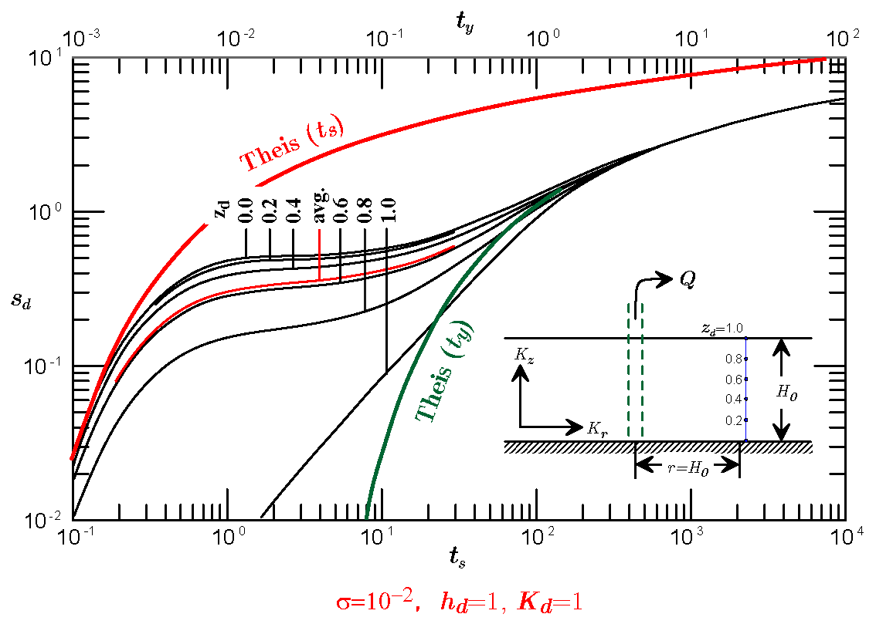{#fig-fig05-06 width=10cm}

  抽水的早、中期，潜水面处的降深小于垂向任意一点的降深，此即滞后排水或潜水面反应滞后的现象。

- 含水层各向同性，观测点位于距抽水井 $H_0$ 的含水层断面上（$h_d=1,\,K_d=1$）
  水流状态的变化：设 $\sigma=10^{-2}$（[@fig-fig05-07]）。

  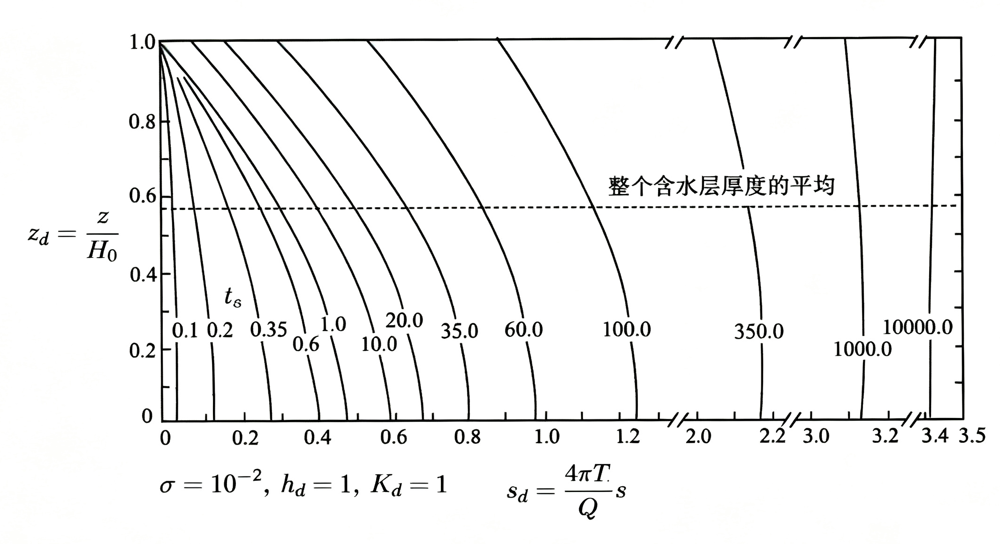{#fig-fig05-07 width=10cm}

  抽水的早、晚期，降深分布曲线基本垂直，与 Dupuit 假设一致。
  抽水中期，含水层上部出现渗透速度的垂直分量。

- 含水层各向同性，观测点位于含水层底部（$z_d=0,\,K_d=1$） 
  $s_d\sim t_{s,y}$ 曲线随 $r$ 的变化：设 $\sigma=10^{-2}$（[@fig-fig05-08]）。

  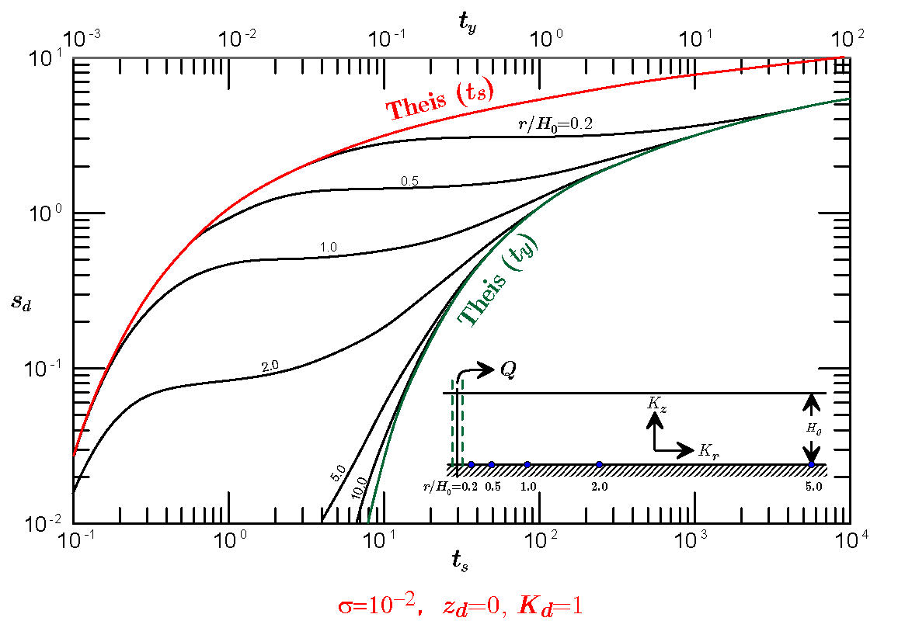{#fig-fig05-08 width=10cm}

  随着 $r$ 增大，弹性释水作用逐渐减弱，$r>10H_0$ 的地段可忽略不计；
  潜水面滞后反应随 $r$ 增大而减弱，降深-时间曲线的三个阶段仅在 $r$ 不大的情况下才会显现。

- 含水层各向异性，观测点位于距抽水井 $H_0$ 的含水层底部（$z_d=0,\,h_d=1$） 
  各向异性影响：设 $\sigma=10^{-2}$（[@fig-fig05-09]）。

  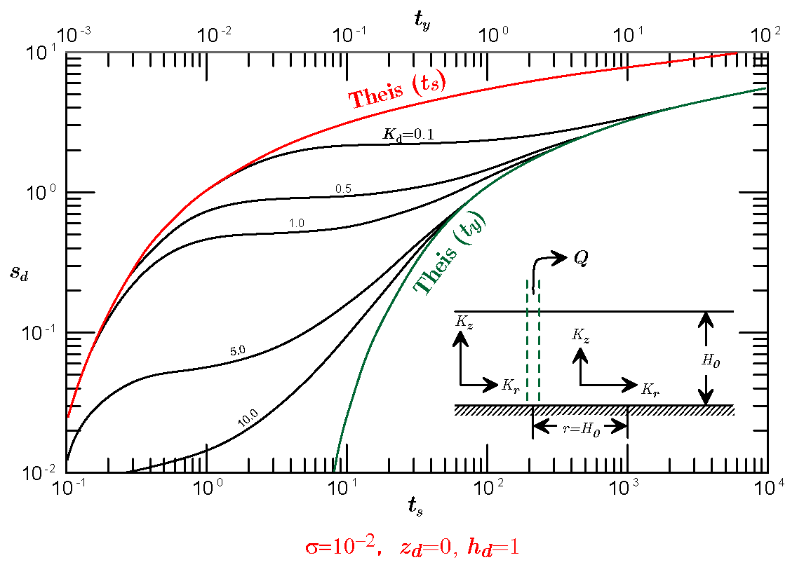{#fig-fig05-09 width=10cm}

  $K_d$ 越小，渗透速度的水平分量相对垂向分量越大，弹性释水和滞后反应越明显。

**本章小结**：

Theis公式描述了无限承压含水层中定流量抽水引起的降深随时间扩展的规律。Jacob公式是Theis公式在长时间抽水后的近似形式，形式简洁、便于求参。有越流补给的含水层抽水最终能达到稳定，降深曲线存在明显的早、中、晚三个阶段。Boulton模型通过延迟指数刻画潜水重力排水的滞后效应。Neuman模型不再依赖经验参数，而是将潜水面作为自由边界来处理垂向流动。非稳定流理论是抽水试验求参和地下水动态预测的核心工具。