# 6 根据抽水试验确定含水层参数

**本章导引**：
 
前两章我们学习了正演问题：已知参数求水头。但工程实践中我们面临的是相反的问题：已知水位响应，反推含水层参数。这就是反演问题，也是水文地质工作的核心任务之一。抽水试验是最常用的获取含水层参数的手段。本章系统介绍利用稳定流和非稳定流抽水试验数据求参的方法。你将学习配线法、直线图解法和拐点法等经典技术。这些方法虽有些“手工感”，但能帮助你深入理解参数识别的物理本质。

## 6.1 基本概念

在掌握了井流模型的理论解之后，本章讨论如何利用抽水试验等现场观测资料获取含水层的水文地质参数。为此首先明确两类问题：

- 正演问题：已知各项参数，依据计算公式或描述地下水运动的微分方程及定解条件，求解渗流区内任意位置、任意时刻的水位或流量；
- 反演问题：根据地下水天然动态或抽水试验观测资料确定含水层的部分水文地质参数，又称含水层参数识别问题。

反演问题是利用历史观测资料研究含水层的激发（如抽水）与响应（如地下水位）关系，确定模型参数值，使模型能够描述地下水动态变化。简单说，正演是“已知参数求响应”，反演是“由响应反推参数”。

**反演问题的分类**

- 单纯求解水文地质参数，包括导水系数、贮水系数等；
- 确定微分方程中的源汇项，包括蒸发量、入渗量、未知开采流量等；
- 确定模型的初始条件；
- 确定模型的边界条件；
- 以上几类问题的组合。

在实际应用中，初始条件和边界条件通常通过水文地质调查确定，较少作为反演目标；但在数据稀缺地区，也可作为待求参数参与反演。

**反演问题的适定性**

数学上，若微分方程反演问题的解存在、唯一且稳定，则称该问题是适定的。依据抽水试验与天然动态观测资料反求水文地质参数时，同样存在参数识别的适定性问题：

- 依据实际资料反求渗流区水文地质参数时，解是否存在，即存在性问题；
- 参数是否唯一，即唯一性问题；
- 当实测资料存在微小误差时，求得的水文地质参数误差是否也微小，即参数是否连续依赖于实测资料，即解的稳定性问题。

解决实际水文地质问题时，正演问题的数学模型通常依据实际地质、水文地质条件建立。转化为反演问题时，解的存在性是确定的；结合实际水文地质条件对解施加约束，可使反演问题获得唯一解；满足解的稳定性条件，需要在计算与勘探技术方面采取相应措施。

**反演问题对水文地质勘探的要求**

- 明确研究区水文地质条件，包括边界条件、含水层结构与分布、地下水类型，避免计算区内未知因素过多，缺少水文地质条件约束。例如需查清含水层系统组成、空间展布、均质性、水力性质、含水层间水力联系、越流补给等，降低参数识别的多解性。
- 计算范围与边界条件同步确定，尽量保持正演模型与反演模型范围一致，保证参数识别所用资料在空间上具有代表性。
- 结合研究区水文地质条件认识，合理设计抽水试验，布置动态观测点：
   - 主井位置：以抽水试验目的为依据确定。若以供水评价或矿山疏水为目的，宜尽量结合未来生产井或矿山疏放孔位置选取；若以查清某地段水文地质条件为目的，应将主井布置在目标地段，使主井附近产生较大降深，暴露该地段水文地质条件。
   - 观测孔：观测孔数量需与待求参数数量匹配，位置分布合理，在参数变化大或水文地质条件复杂地段应有观测孔控制，以提高求参精度。
   - 地下水动态观测有助于查清边界条件和含水层之间的水力联系，因此从勘探初期就应该布置并持续开展。

## 6.2 稳定流抽水试验求参

当抽水试验只获得了相对稳定的降深数据，或含水层在抽水较长时间后达到了近似稳定状态，则可利用稳定流公式近似估算含水层参数。目前，相关规范提倡在稳定流抽水试验过程中同步开展非稳定流观测，以获取可用于非稳定流求参的数据，提升求参可靠性。

承压或潜水含水层的完整井抽水，当抽水时间较长时，抽水井附近水流可达到稳定或近似稳定状态，可依据稳定流Dupuit及Thiem公式求解含水层渗透系数$K$（或导水系数$T$），计算公式 [@tbl-dupuit-multiple]所示。

|       | 承压含水层                                                       | 潜水含水层                                                                     |
| ----- | ----------------------------------------------------------- | ------------------------------------------------------------------------- |
| 1个观测孔 | $K = \frac{0.366Q}{M(s_w - s_1)}\lg\frac{r_1}{r_w}$（Dupuit） | $K = \frac{0.732Q}{(2H_0 - s_w -s_1)(s_w-s_1)}\lg\frac{r_1}{r_w}$（Dupuit） |
| 2个观测孔 | $K = \frac{0.366Q}{M (s_1-s_2)}\lg\frac{r_2}{r_1}$（Thiem）   | $K = \frac{0.732Q}{(2H_0-s_1-s_2)(s_1-s_2)}\lg\frac{r_2}{r_1}$（Thiem）     |
: 观测孔Dupuit及Thiem求参公式 {#tbl-dupuit-multiple  tbl-colwidths="[20,40,40]"}

式中，$r_w$、$s_w$为抽水井半径、降深；$r_1$、$r_2$为观测井（孔）与抽水井的距离；$s_1$、$s_2$为观测井（孔）的降深；$K$为渗透系数；$M$、$H_0$分别为承压含水层、潜水含水层的厚度。

**注意**：单井公式中含有未知影响半径 $R$，一个方程含两个未知数，数学上不可直接求解。需结合经验公式（如吉哈尔特公式或库萨金公式）采用迭代法求解，不可直接计算。

若无观测孔数据，也可直接采用Dupuit公式求参（[@tbl-dupuit-single]）：

|     | 承压含水层                                      | 潜水含水层                                                |
|:---:|:------------------------------------------:|:----------------------------------------------------:|
| 单井  | $K = \frac{0.366Q}{M s_w}\lg\frac{R}{r_w}$ | $K = \frac{0.732Q}{(2H_0 - s_w)s_w}\lg\frac{R}{r_w}$ |
: 无观测孔Dupuit求参公式 {#tbl-dupuit-single tbl-colwidths="[20,40,40]"}

式中，$R$为单次抽水试验的影响半径。

影响半径 $R$ 在公式中以对数形式出现，其误差对计算结果的影响小于 $K$ 或 $s$的测量误差，在精度要求不高的估算中可接受；但高精度求参时仍应重视 $R$ 的确定。若仅作粗略估算，仍可采用经验值。

具备2个观测孔降深数据时，可计算单次抽水的影响半径：

- 承压水
$$
\lg R =\frac{s_1 \lg r_2 - s_2 \lg r_1}{s_1-s_2}
$$

- 潜水
$$
\lg R =\frac{(H_0^2-h_1^2) \lg r_2 - (H_0^2-h_2^2) \lg r_1} {h_2^2-h_1^2}
$$
**排水工程设计常用影响半径经验公式：**

- 吉哈尔特（承压水）
$$
R =10 s_w \sqrt{K}
$$

- 库萨金（潜水）
$$
R =2 s_w \sqrt{KH_0}
$$
式中，$K$为渗透系数，单位$\mathrm{m/d}$；$s$为设计降深，单位$\mathrm{m}$；$H_0$为自底板算起的含水层静止水位（厚度），单位$\mathrm{m}$。

上述经验公式适用于松散孔隙含水层的初步估算，公式中 $K$ 的单位为 $\mathrm{m/d}$。对于裂隙或岩溶介质，应通过多孔抽水试验实测确定 $R$，不宜直接套用。

仅具备抽水井数据时，可构造迭代公式计算$K$及$R$：

- 承压井：
$$
\begin{cases}
K=\frac{Q}{2\pi Ms_w}\ln\frac{R}{r_w}\\
R=10s_w\sqrt{K}
\end{cases}
$$

- 潜水井：
$$
\begin{cases}
K=\frac{Q}{\pi (2H_0-s_w)s_w}\ln\frac{R}{r_w}\\
R=2s_w\sqrt{KH_0}
\end{cases}
$$

采用Dupuit公式估算含水层参数时，若忽略井损值，计算出的渗透系数为“表观值”，通常低于真实渗透系数。工程上若需获取真实渗透系数，应对降深进行井损校正。

**Hantush-Jacob稳态解求参**

有越流补给的含水层长时间抽水后会达到稳定流状态：
$$
s=\frac{Q}{2\pi T}\ln\frac{1.123B}{r}=0.366\frac{Q}{T}\lg\frac{1.123B}{r}
$$

若具备2个以上观测孔的抽水试验数据，也可用该式求参：
$$
T=\frac{0.366Q}{s_1-s_2}\lg\frac{r_2}{r_1},\quad B=0.89r_1\times10^{\frac{s_1T}{0.366Q}}
$$
选择合适的求参方法可获得准确的水文地质参数。

**例：** 某承压含水层抽水井以$480\mathrm{\,m^3/d}$流量进行稳定流抽水，抽水井半径$r_w=0.05\mathrm{\,m}$、降深$s_w=7.65\mathrm{\,m}$。测得距抽水井$r_1=50\mathrm{\,m}$、$r_2=100\mathrm{\,m}$、$r_3=120\mathrm{\,m}$处观测井的降深分别为$s_1=2.38\mathrm{\,m}$、$s_2=1.85\mathrm{\,m}$、$s_3=1.70\mathrm{\,m}$。试求水文地质参数。

Dupuit公式求参

- 1、2号观测孔：$T=99.78\mathrm{\,m^2/d}$
- 2、3号观测孔：$T=92.74\mathrm{\,m^2/d}$
- 1、3号观测孔：$T=98.23\mathrm{\,m^2/d}$

取平均值：$T=96.92\mathrm{\,m^2/d}$。

验证：
$$
s_1=2.21\mathrm{\,m},\quad s_2=1.66\mathrm{\,m},\quad s_3=1.51\mathrm{\,m}
$$
Hantush-Jacob公式求参

- 1、2号观测孔：$T=99.78\mathrm{\,m^2/d}$，$B=1000.36\mathrm{\,m}$
- 2、3号观测孔：$T=92.74\mathrm{\,m^2/d}$，$B=843.25\mathrm{\,m}$
- 1、3号观测孔：$T=98.23\mathrm{\,m^2/d}$，$B=953.01\mathrm{\,m}$

取平均值：$T=96.92\mathrm{\,m^2/d}$，$B=932.21\mathrm{\,m}$。

验证：
$$
s_1=2.39\mathrm{\,m},\quad s_2=1.85\mathrm{\,m},\quad s_3=1.71\mathrm{\,m}
$$

## 6.3 定流量非稳定流抽水试验的配线法求参

配线法，也叫标准曲线法。使用前先把实际水文地质条件概化为合适的井流模型，然后在双对数坐标系中，将实测降深‑时间曲线与该模型的标准曲线进行叠置匹配。量取两条曲线的偏移距离，便可算出含水层参数。该方法以标准曲线为标尺，分析降深时间序列与标准曲线的差异，获取含水层水文地质信息。

### 6.3.1 Theis模型配线法

Theis模型配线法依据所用抽水试验数据的差异，可分为三类：

- 降深—时间（$s\sim t$）配线法（单观测孔数据）
- 降深—时间距离（$s\sim t/r^2$）配线法（多观测孔数据）
- 降深—距离（$s\sim r^2$）配线法（多观测孔某时刻统测数据）

**Theis模型配线法原理**

以$s\sim t$配线法为例。距抽水井距离为$r$的观测孔降深$s$是时间$t$的函数$s=s(r,t)$，根据Theis公式
$$
s=\frac{Q}{4\pi T}W(u),\quad t=\frac{r^2S}{4T}\cdot\frac{1}{u}
$$
两边取对数并整理得
$$
\begin{cases}
\lg s=\lg W(u)+\lg\frac{Q}{4\pi T} \\
\lg t=\lg\frac{1}{u}+\lg\frac{r^2S}{4T}
\end{cases}
$$
双对数坐标下，$s\sim t$曲线与$W(u)\sim\frac{1}{u}$曲线（[@fig-wu-1]）形状相同，位移量为$\left(\lg\frac{r^2S}{4T},\lg\frac{Q}{4\pi T}\right)$。以观测数据绘制$s\sim t$散点图，根据配线平移量可计算$T$与$S$。该方法又称**降深—时间**（$s\sim t$）配线法。

在双对数坐标系中，将实测点沿水平和竖直方向平移，即可与标准曲线重合，平移量直接对应参数。其他配线法原理基本一致。

**配线法说明**

$W(u)\sim\frac{1}{u}$曲线为无量纲标准曲线。不同水文地质条件下，观测孔数据点可能对应标准曲线的不同区段。

例如某次抽水试验，观测孔距抽水井$r=100\mathrm{\,m}$，抽水后第$10\mathrm{min}$进行一次观测。
$$
a=\frac{T}{S}=\frac{r^2}{4t}\cdot\frac{1}{u}
$$
若$a$取
$$
a= \begin{cases} 3.6\times10^5 \mathrm{\,m^2/d}\\ 3.6\times10^7 \mathrm{\,m^2/d}\end{cases}
$$
则对应的$1/u$为
$$
\frac{1}{u}=\begin{cases} 1\\ 100 \end{cases}
$$
对应不同水文地质条件时，数据点可相差两个对数周期。设计抽水试验时应考虑水文地质条件的差异。

配线法使用 $W(u)\sim\frac{1}{u}$ 曲线（[@fig-wu-1]）作为标准曲线，因为 $s$ 随 $t$ 增加而递增，与 $1/u$ 的单调性一致，便于平移匹配。

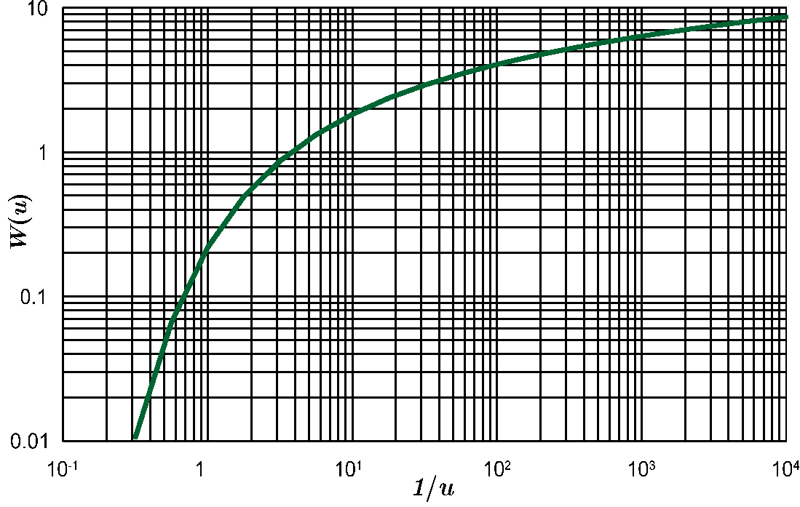{#fig-wu-1 width=361 fig-align="center"}

**$s\sim t$配线法步骤**

- 在双对数坐标纸上绘制$W(u)\sim\frac{1}{u}$标准曲线；
- 在另一张模数相同的透明双对数纸上，用实测数据绘制$s\sim t$散点图；
- 将$s\sim t$散点图叠置于标准曲线上，保持坐标轴平行并平移，直至两组点线最大程度重合；
- 任取一匹配点（可在曲线上或曲线外），读取匹配点在两张图上的坐标$\left[\frac{1}{u}\right]$、$[W(u)]$与$[t]$、$[s]$，代入下式计算参数：
$$
T=\frac{Q}{4\pi[s]}[W(u)],\quad S=\frac{4T}{r^2}\cdot\frac{[t]}{\left[\frac{1}{u}\right]}
$$

**例：** 承压含水层完整井某次抽水试验，$Q=0.032\mathrm{\,m^3/s}$，观测孔距抽水井$r=120\mathrm{\,m}$，观测数据如下图所示。试用配线法求取水文地质参数。

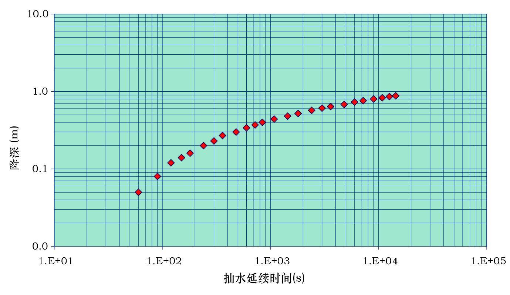{#fig-fig06-01 width=474 fig-align="center"}

配线结果

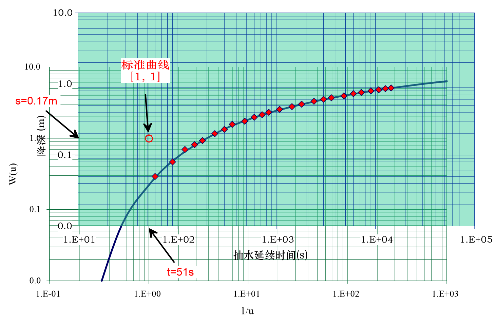{#fig-fig06-02 width=489 fig-align="center"}

参数计算
$$
\begin{split}
T&=\frac{Q}{4\pi[s]}[W(u)]=\frac{0.032}{4\times3.14\times0.17}\\
&=0.015\mathrm{\,m^2/s}=1300\mathrm{\,m^2/d}\\
S&=\frac{4T}{r^2}\cdot\frac{[t]}{\left[\frac{1}{u}\right]}
=\frac{4\times0.015}{120^2}\times51\\
&=2.1\times10^{-4}
\end{split}
$$

**配线法优点**

- 可利用抽水试验的各时段观测资料，局部数据波动或偏差不会对计算结果产生明显影响。

**配线法缺点**

- 抽水初期数据拟合效果通常较差，原因是泰斯公式的部分假定与实际条件不符，因此配线时主要参考抽水中后期数据；非稳定抽水试验持续时间不宜过短。
- 抽水后期曲线趋于平缓时，配线精度难以保证。因此确定抽水延续时间与观测精度时，应保证试验数据能够覆盖$s\sim t$或$s\sim\frac{t}{r^2}$的弯曲段，配线时优先选用中部弯曲线段。
- 若抽水后期数据偏离标准曲线，说明外围边界产生影响、含水层岩性或边界条件发生变化，或存在垂直源汇项，需结合试验数据与具体水文地质条件分析。

### 6.3.2 Hantush-Jacob模型配线法

Hantush-Jacob模型配线法可利用单观测孔的降深时间序列计算水文地质参数。

**原理：**
$$
\lg s=\lg\frac{Q}{4\pi T}+\lg W\left(u,\frac{r}{B}\right),\quad\lg t=\lg\frac{r^2S}{4T}+\lg\frac{1}{u}
$$
$\lg s\sim\lg t$曲线与$\lg W\left(u,\frac{r}{B}\right)\sim\lg \frac{1}{u}$中的某条曲线形状相同，位移为$\left(\lg\frac{r^2S}{4T},\,\lg\frac{Q}{4\pi T}\right)$。以观测数据绘制$s\sim t$散点图，根据匹配的标准曲线（[@fig-Hantush-Jacob]）计算$B$，根据平移量计算$T$与$S$。

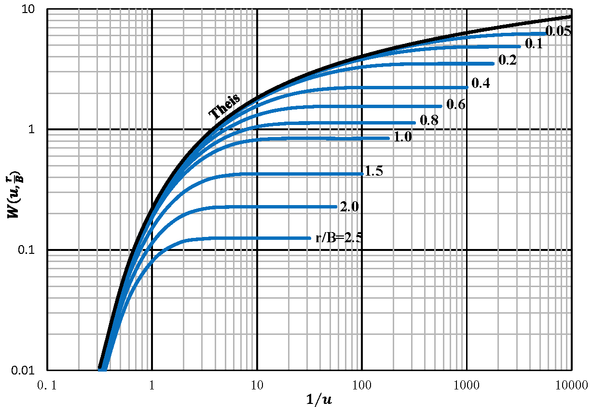{#fig-Hantush-Jacob width=422 fig-align="center"}

**配线法求参步骤**

- 在双对数坐标纸上绘制$W\left(u,\frac{r}{B}\right)\sim\frac{1}{u}$标准曲线族；
- 在模数相同的透明双对数纸上，绘出实测数据$(s_i,t_i)$的散点图；
- 保持对应坐标轴平行，相对移动坐标纸，在标准曲线族中寻找重合度最优的曲线，记下 $\left[\frac{r}{B}\right]$ 值。配线时应优先使用抽水中后期的数据区分不同 $\frac{r}{B}$ 曲线，因早期数据多条曲线几近重合，易造成误判；
- 任选一匹配点，记下对应的四个坐标值：$\left[W\left(u,\frac{r}{B}\right)\right]$、$\left[\frac{1}{u}\right]$、$[s]$、$[t]$，选用特殊匹配点可简化计算。
- 计算参数，匹配点满足：
$$
[s]=\frac{Q}{4\pi T}\left[W\left(u,\frac{r}{B} \right)\right],
\quad [t]=\frac{r^2S}{4T}\left[\frac{1}{u}\right]
$$
计算公式：
$$
T=\frac{Q}{4\pi[s]}\left[W\left(u,\frac{r}{B}\right)\right],\quad S=\frac{4T[t]}{r^2\left[\frac{1}{u}\right]},\quad B=\frac{r}{\left[\frac{r}{B}\right]}
$$

**例：** 某河阶地上部为潜水层，下部为厚2m的亚砂土与厚1.5m的中粗砂承压含水层。以T32号孔抽取承压水开展非稳定抽水试验，$Q=69.1\mathrm{\,m^3/h}$；距T32号孔197m处T31孔的降深观测数据如下图所示。试求水文地质参数。

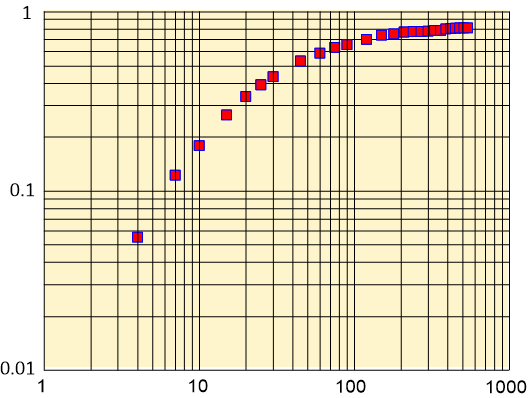{#fig-fig06-03 width=307 fig-align="center"}

配线结果

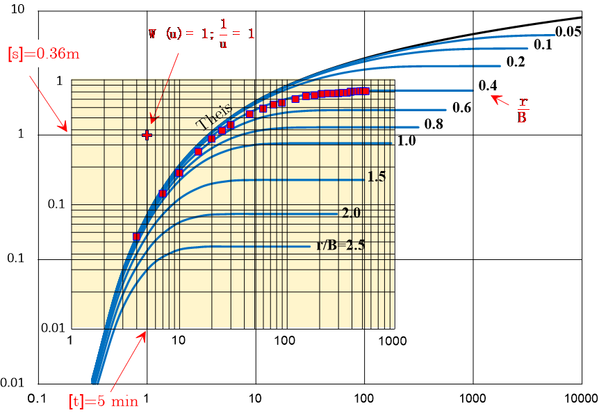{#fig-fig06-04 width=497 fig-align="center"}

参数计算
$$
\begin{split}
T & =\frac{Q}{4\pi[s]}\left[W\left(u,\frac{r}{B}\right)\right]=\frac{1.15}{4\times\pi\times0.36}=0.254 \mathrm{\,m^2/min} =365.76\mathrm{\,m^2/d}\\
S & =\frac{4T[t]}{r^2\left[\frac{1}{u}\right]}=\frac{4\times 0.254 \times 5}{197^2\times 1}=1.31\times 10^{-4}\\
B & =\frac{r}{\left[\frac{r}{B}\right]}=492.5\mathrm{\,m}
\end{split}
$$

**稳定状态配线法**：长时间抽水后，Hantush-Jacob模型存在稳态解$s\approx\frac{Q}{2\pi T}K_0\left(\frac{r}{B}\right)$。若具备多个观测孔的降深数据，也可采用配线法求参（[@fig-fig06-05]）。
$$
\lg s=\lg\frac{Q}{2\pi T}+\lg K_0\left(\frac{r}{B}\right),\quad\lg r=\lg B+\lg\frac{r}{B}
$$
将$\lg s\sim \lg r$曲线与标准曲线$\lg K_0\left(\frac{r}{B}\right)\sim\lg\frac{r}{B}$匹配，读取坐标偏移量即可求取$T$、$B$。

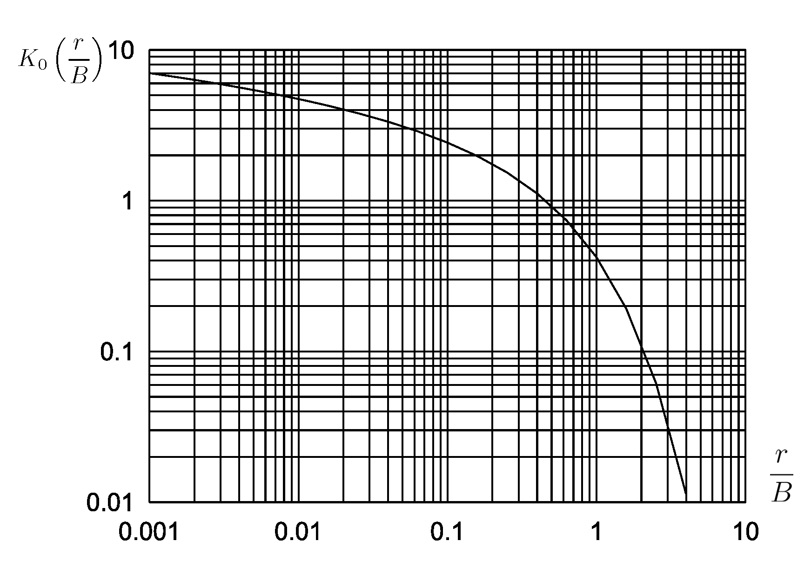{#fig-fig06-05 width=356 fig-align="center"}

### 6.3.3 有越流补给和弱透水层弹性释水的Hantush模型配线法

依据抽水初期与长时间抽水后Hantush模型的近似解，可利用观测孔降深时间序列计算水文地质参数。

**（1）抽水初期**
$$
\lg s=\lg\frac{Q}{4\pi T}+\lg H(u,\beta),\quad\lg t=\lg\frac{r^2S}{4T}+\lg\frac{1}{u}
$$
$\lg s\sim\lg t$曲线与$\lg H(u,\beta)\sim\lg \frac{1}{u}$中的某条曲线形状相同，位移为$\left(\lg\frac{r^2S}{4T},\,\lg\frac{Q}{4\pi T}\right)$。以观测数据绘制$s\sim t$散点图，根据匹配的标准曲线（[@fig-Hantush]）计算$\beta$，根据平移量计算$T$与$S$：
$$
T=\frac{Q}{4\pi[s]}\left[H(u,\beta)\right],\quad S=\frac{4T[t]}{r^2\left[\frac{1}{u}\right]}
$$

{#fig-Hantush width=457 fig-align="center"}

**（2）长时间抽水后**

模型1、3的近似解与Hantush-Jacob公式一致，模型2的近似解与Theis公式一致，可采用相应的配线法求参。

### 6.3.4 考虑迟后疏干的Boulton模型配线法

根据Boulton模型的解，利用观测孔降深时间序列可计算水文地质参数。利用抽水试验初期数据可求出$T$和$S$，利用抽水试验后期数据可求出$T$和$\mu$（[@fig-Boulton-ua-uy]），进一步可计算$\frac{1}{\alpha}$。

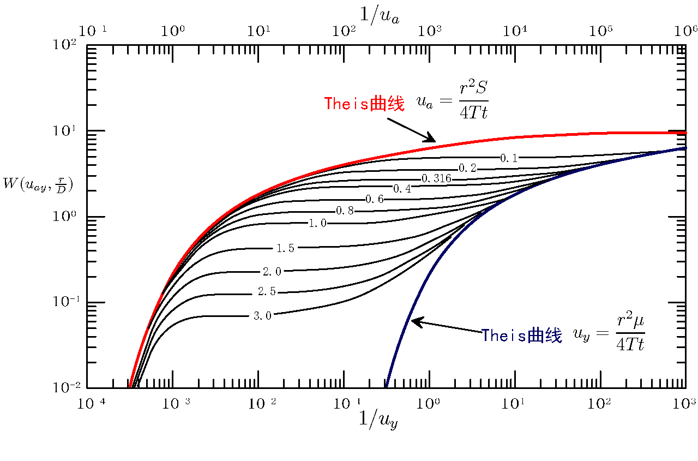{#fig-Boulton-ua-uy width=500 fig-align="center"}

**求参步骤：**

- 在双对数纸上绘制标准曲线：以$W(u_{ay},\frac{r}{D})$为纵坐标，$\frac{1}{u_a}$为横坐标绘制A组曲线，$\frac{1}{u_y}$为横坐标绘制B组曲线，再用切线连接A、B组曲线。
- 根据试验资料，在模数相同的双对数透明纸上绘制$s-t$曲线。
- 两条曲线叠置，保持对应坐标平行，使实测曲线与A组中某条曲线最大程度重合，任选一匹配点，读取坐标$[W(u_a,\frac{r}{D})]$、$\left[\frac{1}{u_a}\right]$、$[s]$和$[t]$，代入下式求参数$T$和$S$。
$$
T=\frac{Q}{4\pi\left[ s\right]}\left[W\left( u_a,\frac{r}{D}\right)\right],\quad S =\frac{4T\left[ t\right] }{r^2}\left[\frac{1}{u_a}\right]
$$
- B组曲线中找到A组的匹配曲线（保持$\frac{r}{D}$值不变），平移$s-t$曲线使其后半段与B组该条曲线最大程度重合，任选匹配点，取坐标值$[W(u_y,\frac{r}{D})]$、$\left[\frac{1}{u_y}\right]$、$[s]$和$[t]$，代入下式求参数$T$和$\mu$。
$$
T =\frac{Q}{4\pi\left[ s\right] }\left[ W\left( u_y,\frac{r}{D}\right)\right],\quad \mu =\frac{4T\left[ t\right]}{r^2\left[\frac{1}{u_y}\right]}
$$
$$
\eta=\frac{S+\mu}{S},\quad\frac{1}{\alpha}=\frac{4t}{\left(\frac{r}{D}\right)^2\left[\frac{1}{u_y}\right]}
$$
- 上述计算假设$s$与含水层厚度$H_0$相比很小，$T$为定值。当$s/H_0$较大时，需对$s$进行修正，利用修正后的$s'$绘制$s'-t$曲线求参。
- 标准曲线显示，随$1/u_y$逐渐增大，B组曲线逐渐向Theis曲线靠拢直至重合，B组曲线变为Theis曲线的时间$t_{w,t}$即为迟后排水对降深影响的结束时间。根据标准曲线可对每个$r/D$确定切入点$1/u_y$，由
$$
\alpha t_{w,t}=\frac{1}{4}\left(\frac{r}{D}\right)^2\frac{1}{u_y}
$$

可绘制$\alpha t_{w,t}\sim r/D$曲线（[@fig-fig06-06]），由曲线确定$t_{w,t}$；根据$r/D$读取$\alpha t_{w,t}$后，可进一步求出$t_{w,t}$。

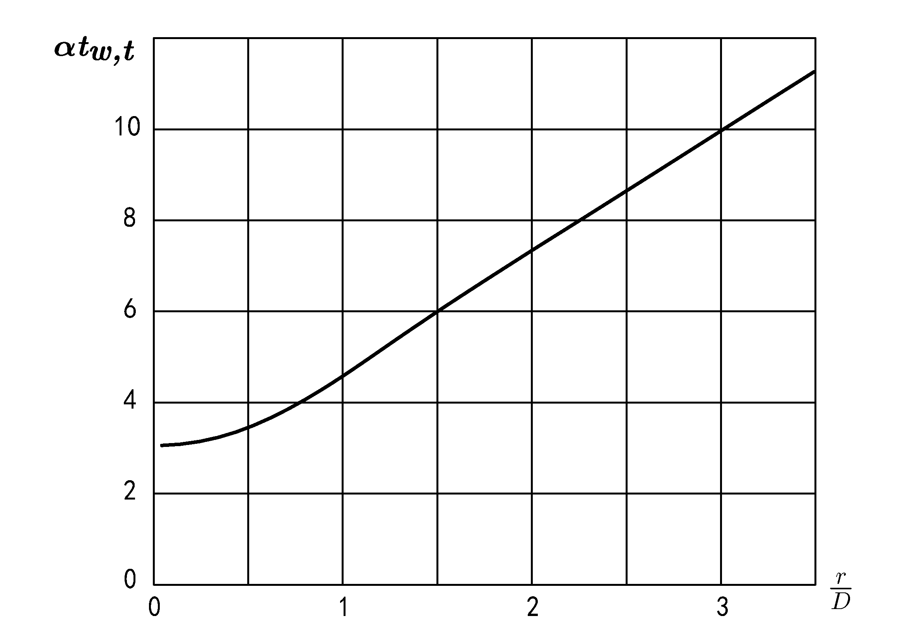{#fig-fig06-06 width=351 fig-align="center"}

### 6.3.5 Neuman模型配线法

抽水井与观测孔均为完整井时，无量纲降深$s_d$与$t_{s,y}$、$\beta=\frac{r^2K_z}{H_0^2K_r}=\frac{K_d}{h_d^2}$及$\sigma =\frac{S}{\mu }$有关。当$S\ll\mu$（$\sigma=0$）时，可对不同$\beta$值绘制标准曲线。Neuman 完整解包含 $\sigma$ 参数，此处取 $\sigma=0$ 仅为简化标准曲线的绘制。实际参数反演时应使用包含 $\sigma$ 的完整解，以提高精度（[@fig-Neuman]）。

{#fig-Neuman width=500 fig-align="center"}   

**求参步骤：**

- 组曲线。A组曲线坐标$t_s$标注在图上端，B组曲线坐标$t_y$标注在图下端；A组曲线右侧与B组曲线左侧均趋近于一组水平渐近线。$\sigma=0$时，两组标准曲线相距较远，需采用不同尺度绘制在同一张图纸上。A组曲线用于分析早期降深资料，B组曲线用于分析晚期降深资料。
- 在模数相同的双对数透明纸上，用完整井抽水观测数据绘制$s-t$曲线；
- 将实测曲线后半部分与B组曲线叠置，保持坐标轴平行并移动，使实测曲线与B组中某一曲线尽量重合，记下对应的$\beta$与匹配点坐标$[s_d]$、$[t_y]$、$[s]$、$[t]$，计算参数：
$$
T =\frac{Q[s_d]}{4\pi[s]},\quad \mu =\frac{T[t]}{r^2[t_y]}
$$
- 与A组曲线配线，保持$\beta$不变，记下匹配点坐标$[s_d]$、$[t_s]$、$[s]$、$[t]$，计算参数：
$$
T =\frac{Q[s_d]}{4\pi[s]},\quad S =\frac{T[t]}{r^2[t_s]}
$$
两次计算的$T$应大致相等。

- 计算其他参数：
$$
K_r=\frac{T}{H_0},\quad K_d=\beta\frac{H_0^2}{r^2},\quad
K_z=K_rK_d,\quad \sigma =\frac{S}{\mu}
$$

## 6.4 Hantush-Jacob模型的拐点法求参

根据Hantush-Jacob模型解的形式，时间变量$t$取对数刻度时，$s\sim \lg t$曲线存在拐点。依据拐点性质可求取水文地质参数（[@fig-fig06-07]）。

求解$s\sim \lg t$曲线拐点坐标：
$$
\frac{\partial s}{\partial(\lg t)} =\frac{\partial s}{\partial t}\cdot\frac{\partial t}{\partial(\lg t)}=2.3 t\frac{\partial s}{\partial t}=\frac{2.3Q}{4\pi T}e^{-\left(\frac{r^2S}{4Tt}+\frac{Tt}{SB^2}\right)}
$$
$$
\begin{split}
\frac{\partial^2s}{\partial(\lg t)^2}&=\frac{\partial}{\partial t}\left[\frac{\partial s}{\partial(\lg t)}\right]\cdot\frac{\partial t}{\partial(\lg t)} \\
&=\frac{2.3Q}{4\pi T}e^{-\left(\frac{r^2S}{4Tt}+\frac{Tt}{SB^2}\right)}\left(\frac{r^2S}{4Tt^2}-\frac{T}{SB^2}\right)\cdot 2.3t
\end{split}
$$
拐点$P$处满足$\frac{\partial^2s}{\partial(\lg t)^2}=0$，有
$$
\frac{r^2S}{4Tt_p^2}-\frac{T}{SB^2}=0
$$
整理得
$$
t_p=\frac{SBr}{2T},\quad u_p =\frac{r}{2B}
$$
$s\sim t$曲线拐点与$s\sim \lg t$曲线拐点位置不同。

拐点$P$处斜率：
$$
i_p=\frac{\partial s}{\partial(\lg t_p)}=\frac{2.3Q}{4\pi T}e^{-\left(\frac{r^2S}{4Tt_p}+\frac{Tt_p}{SB^2}\right)}
$$
将$t_p=\frac{SBr}{2T}$代入得
$$
i_p=\frac{2.3Q}{4\pi T}e^{-\frac{r}{B}}
$$
拐点$P$处降深：
$$
\begin{split}
s_p&=\frac{Q}{4\pi T}\int_{u_p}^{\infty}\frac{1}{y}e^{-y-\frac{r^2}{4B^2y}}dy\\ 
&=\frac{Q}{4\pi T}\int_0^{\infty}\frac{1}{y}e^{-y-\frac{r^2}{4B^2y}}dy-\frac{Q}{4\pi T}\int_{0}^{u_p}\frac{1}{y}e^{-y-\frac{r^2}{4B^2y}}dy
\end{split}
$$
式中第一项为$t\to\infty$时的降深，即最大降深$s_{max}$，由稳定流公式得$s_{max}=\frac{Q}{2\pi T}K_0\left(\frac{r}{B}\right)$。

设$\xi=\frac{r^2}{4B^2y}$，$\mathrm{d}y=-\frac{r^2}{4B^2\xi^2}\mathrm{d}\xi$，式中第二项
$$
\begin{split}
-\frac{Q}{4\pi T}&\int_{0}^{u_p}\frac{1}{y}e^{-y-\frac{r^2}{4B^2y}}dy\\
&=\frac{Q}{4\pi T}\int_{\infty}^{\frac{r}{2B}}\frac{4B^2\xi}{r^2}
e^{-\frac{r^2}{4B^2\xi}-\xi}\cdot\frac{r^2}{4B^2\xi^2}\mathrm{d}\xi\\
& =-\frac{Q}{4\pi T}\int_{\frac{r}{2B}}^\infty\frac{1}{\xi}e^{-\xi-\frac{r^2}{4B^2\xi}}d\xi\\
& =-s_p
\end{split}
$$
代入原式得
$$
s_p=\frac{1}{2}s_{max}
$$

**拐点$P$的性质**：

- 坐标：
$$
t_p=\frac{SBr}{2T}
$$

- 斜率：
$$
i_p=\frac{2.3Q}{4\pi T}e^{-\frac{r}{B}}
$$

- 降深：
$$
s_p=\frac{Q}{4\pi T}K_0\left(\frac{r}{B}\right)=\frac{1}{2}s_{max}
$$

- $s_p$与$i_p$的关系：
$$
2.3\frac{s_p}{i_p}=e^{\frac{r}{B}}K_0\left(\frac{r}{B} \right)
$$

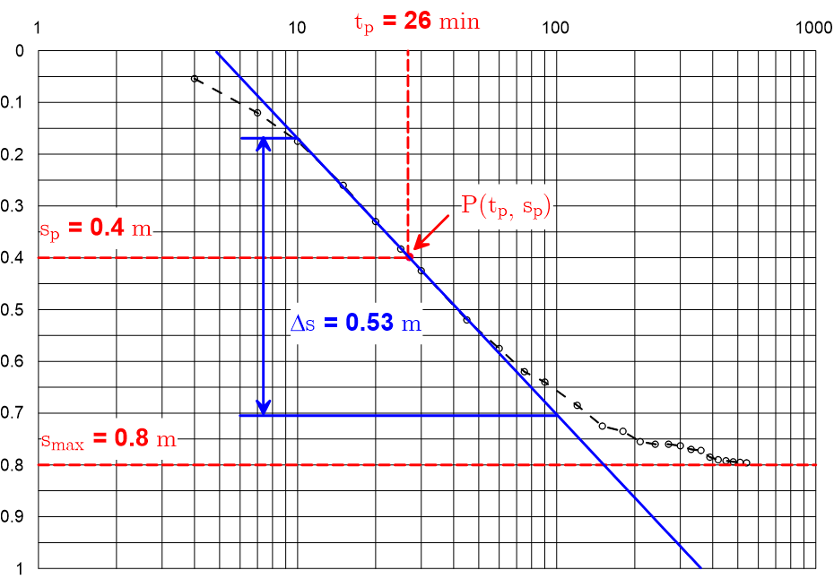{#fig-fig06-07 width=411 fig-align="center"}

**拐点法求参步骤**

- 在单对数坐标纸上绘制$s-\lg t$曲线。
- 用外推法确定最大降深 $s_{max}$，计算拐点处降深$s_p$（应确保抽水试验持续时间足够长，使 $s-\lg t$ 曲线末端明显趋于水平；否则 $s_{max}$ 的外推误差较大，将直接影响后续求参精度）；
- 根据$s_p$确定拐点位置，从图上读出拐点出现时间$t_p$；
- 在拐点处作$s-\lg t$曲线的切线，确定斜率$i_p$；
- 根据$e^{\frac{r}{B}}K_0\left(\frac{r}{B} \right)=2.3\frac{s_p}{i_p}$确定$\frac{r}{B}$和$e^{\frac{r}{B}}$的值；
- 根据$\frac{r}{B}$值求$B$：$B=\frac{r}{\left[\frac{r}{B} \right]}$；
- 计算导水系数$T$与贮水系数$S$：
   $T=\frac{2.3Q}{4\pi i_p}e^{-\frac{r}{B}}$，$S=\frac{2Tt_p}{Br}$；
- 验证：为避免$s_{max}$确定的随意性，需用Hantush-Jacob公式进行验证。

拐点法的核心是利用 $s_p=s_{\max}/2$ 这一性质定位拐点，从而简化参数求解。

## 6.5 定流量抽水试验的直线图解法求参

直线图解法直接利用 Jacob 或类似近似公式在单对数纸上的直线关系求参，前提仍是概化为合适的井流模型。在单对数纸上点绘观测孔的降深‑时间数据（时间取对数），若数据满足该模型的近似解（例如Jacob公式），这些点应大致排成一条直线。通过作图求取直线斜率及横坐标轴截距，依据对应公式可进一步求得水文地质参数。实际上，工程中最常用的是Jacob直线图解法与Theis水位恢复试验法，其它配线法由于数据选取难以把握，生产中很少使用。

### 6.5.1 Jacob直线图解法

当$u<0.01$时，可利用Jacob公式近似计算Theis井函数
$$
s=\frac{0.183Q}{T}\lg\frac{2.25Tt}{r^2S}
$$
单观测孔两个时刻的观测降深，可用Jacob公式求参：
$$
\begin{cases}
s_1=\frac{0.183Q}{T}\lg t_1+\frac{0.183Q}{T}\lg\frac{2.25T}{r^2S} \\
s_2=\frac{0.183Q}{T}\lg{t_2}+\frac{0.183Q}{T}\lg\frac{2.25T}{r^2S} 
\end{cases}
$$
两个观测孔同一时刻的观测降深，或两个观测孔不同时刻的观测降深，也可用Jacob公式求参：
$$
\begin{cases}
s_1=-\frac{0.366Q}{T}\lg{r_1}+\frac{0.183Q}{T}\lg\frac{2.25Tt}{S} \\
s_2=-\frac{0.366Q}{T}\lg{r_2}+\frac{0.183Q}{T}\lg\frac{2.25Tt}{S}
\end{cases}
$$
或
$$
\begin{cases}
s_1=\frac{0.183Q}{T}\lg\frac{t_1}{r_1^2}+\frac{0.183Q}{T}\lg\frac{2.25T}{S} \\
s_2=\frac{0.183Q}{T}\lg\frac{t_2}{r_2^2}+\frac{0.183Q}{T}\lg\frac{2.25T}{S}
\end{cases}
$$

若抽水试验获得多个观测孔、多个时刻的降深，可分别求参数后取平均值。简便方法是通过作图或最小二乘法求得一组综合参数，作图法称为直线图解法。

将Jacob公式写成如下形式
$$
\begin{cases}
s=\frac{0.183Q}{T}\lg t+\frac{0.183Q}{T}\lg\frac{2.25T}{r^2S} \\
s=\frac{0.183Q}{T}\lg\frac{t}{r^2}+\frac{0.183Q}{T}\lg\frac{2.25T}{S} \\
s=-\frac{0.366Q}{T}\lg r+\frac{0.183Q}{T}\lg\frac{2.25Tt}{S}
\end{cases}
$$

可以看出，观测孔降深与$\lg t$、$\lg \frac{t}{r^2}$、$\lg r$呈直线关系，根据直线斜率可求出导水系数，直线在横坐标轴的截距（零降深截距）满足$\frac{2.25Tt}{r^2S}=1$，据此可求出贮水系数。根据所用观测数据的不同，Jacob直线图解法有以下几种形式：

- $s\sim\lg t$适用于单孔长时间观测资料求参；
- $s\sim\lg\frac{t}{r^2}$适用于多孔长时间观测资料求参；
- $s\sim\lg r$适用于三个以上观测孔同一观测时间资料求参。

以$s\sim\lg t$直线图解法为例：

**例：** 某承压含水层完整井某次抽水试验，$Q=0.032\mathrm{\,m^3/s}$，$r=120\mathrm{\,m}$。观测孔数据$(t_i,s_i)$如下图所示，试求含水层水文地质参数。

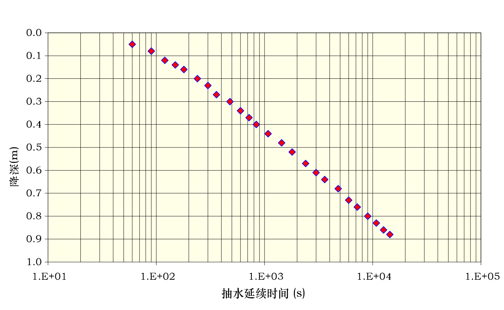{#fig-fig06-08 width=480 fig-align="center"}

求直线斜率（可取1个对数周期的降深变化值）与截距

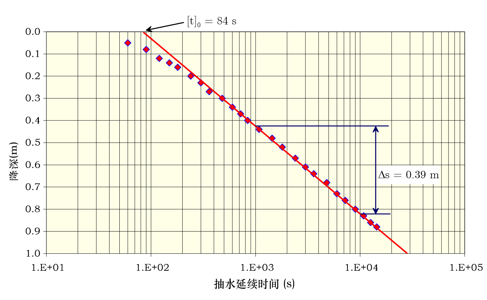{#fig-fig06-09 width=475 fig-align="center"}

参数计算
$$
T=0.183\frac{Q}{i}=0.183\times\frac{0.032}{0.39}=0.015 \mathrm{\,m^2/s}=1300 \mathrm{\,m^2/d}
$$
$$
S=\frac{2.25T}{r^2}[t]_0=\frac{2.25\times 0.015}{120^2}\times84=1.97\times10^{-4}
$$
抽水初期的数据可能不满足$u<0.01$的条件，求出结果后需对所采用的数据进行验证。

**Jacob直线图解法步骤**

- 在单对数坐标纸上用实测数据绘制$s\sim\lg t$、$s\sim\lg\frac{t}{r^2}$或$s\sim\lg r$散点图并作出拟合直线；
- 求直线段斜率，可直接读取一个对数周期纵坐标的变化值作为直线斜率$i$；
- 计算$T$
$$
\begin{cases}
s\sim\lg t: & T=0.183\frac{Q}{i} \\
s\sim\lg\frac{t}{r^2}: & T=0.183\frac{Q}{i}  \\
s\sim\lg r: & T=0.366\frac{Q}{\left|i\right|}
\end{cases}
$$

- 求直线在零降深线上的截距
$$
\begin{cases}
s\sim\lg t: & [t]_0 \\
s\sim\lg\frac{t}{r^2}: & \left[\frac{t}{r^2}\right]_0 \\
s\sim\lg r: & [r]_0
\end{cases}
$$

- 计算$S$
$$
\begin{cases}
s\sim\lg t: & S=2.25T\frac{[t]_0}{r^2} \\
s\sim\lg\frac{t}{r^2}: & S=2.25T\left[\frac{t}{r^2}\right]_0 \\
s\sim\lg r: & S=2.25T\frac{t}{[r]_0^2}
\end{cases}
$$

**Jacob直线图解法优点**

- 可避免配线法的随意性，同时能利用抽水后期的观测资料。

**Jacob直线图解法缺点**

- 需满足$u\le0.01$或$u\le0.05$的条件，即仅在$r$较小、$t$较大时适用。若抽水时间较短，直线斜率偏小、截距偏小，所得$T$值偏大、$S$值偏小。
- 仅当$u\le0.01$或$u\le0.05$时才出现直线段，因此只能利用部分观测数据。较远观测孔的直线段通常较短，若后期受含水层外围非泰斯条件干扰，直线会更模糊。

### 6.5.2 Hantush-Jacob稳态解的直线图解法

有越流补给的含水层长时间抽水后会达到稳定流状态：
$$
s=\frac{Q}{2\pi T}\ln\frac{1.123B}{r}=\frac{2.3Q}{2\pi T}\lg\left(0.89\frac{r}{B}\right)
$$

若具备抽水试验的多个观测孔数据，也可用直线图解法求参。

**求参步骤：**

- 实测降深取十进制坐标、观测孔与抽水井距离取对数坐标作图，并绘制匹配直线；
- 求直线斜率：$i=-\frac{2.3Q}{2\pi T}$；
- 求零降深截距$r_0$：$0.89\frac{r_0}{B}=1$；
- 求导水系数：$T=-\frac{2.3Q}{2\pi i}$；
- 求越流因素：$B=0.89r_0$；
- 越流系数：$\sigma'=\frac{T}{B^2}$。

### 6.5.3 Boulton直线图解法

抽水持续时间足够长后，迟后重力排水的影响消除，$s\sim\lg t$规律与无越流补给的承压完整井类似，可用直线图解法求参（[@fig-fig06-10]）。

$$
s=\frac{0.183Q}{T}\lg t+\frac{0.183Q}{T}\lg\frac{2.25T}{r^2\mu}
$$
求参公式：
$$
T=0.183\frac{Q}{i},\quad \mu=\frac{2.25Tt_0}{r^2}
$$
式中，$i$、$t_0$分别为直线的斜率、零降深截距。

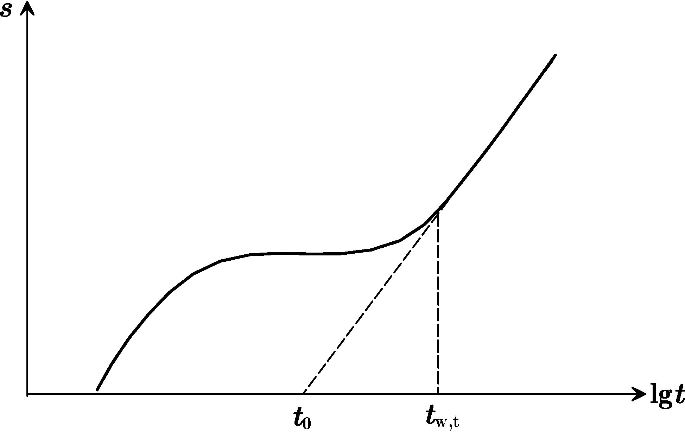{#fig-fig06-10 width=283 fig-align="center"}

### 6.5.4 Neuman直线图解法

Neuman解在抽水初期与抽水后期的近似解均具有Theis解的形式，因此可依照Jacob公式的形式，利用抽水初期与后期的观测孔数据，通过直线图解法求取水文地质参数（[@fig-fig06-11]）。

**直线图解法求参**

- 将实测数据$(s_i,t_i)$点绘在单对数纸上；
- 后期曲线应为直线，直线斜率为$i_L$，延长直线与$t$轴相交，得到零降深时间$t_L$，计算参数：
$$
T =\frac{2.3Q}{4\pi i_L},\quad \mu=\frac{2.25Tt_L}{r^2}
$$
- 将实测曲线中间的水平直线段向右延长，与后期直线相交，得到交点时间$t_{\beta}$，计算对应的$t_{y\beta}$：
$$
t_{y_\beta}=\frac{Tt_{\beta}}{r^2\mu}
$$
若$t_{y\beta}$在$4.0\sim100.0$之间（其他值需从完整观测孔$\frac{1}{\beta}$与$t_{y\beta}$关系曲线图中读取，见教材图4.31），可直接计算$\beta$：$\beta= 0.195 t_{y_\beta}^{-1.1053}$。
- 若实测$s-t$曲线早期部分也出现直线段，且与后期直线段彼此平行，则可求出$T$，否则仍需用配线法确定参数：$i_E$为早期直线段斜率，延长直线与$t$轴相交，得到零降深时间坐标$t_E$，计算参数：
$$
T =\frac{2.3Q}{4\pi i_E},\quad S=\frac{2.25Tt_E}{r^2}
$$
- 计算其他参数：
$$
K_r=\frac{T}{H_0},\quad K_d=\beta\frac{H_0^2}{r^2},\quad K_z=K_rK_d,\quad \sigma =\frac{S}{\mu}
$$

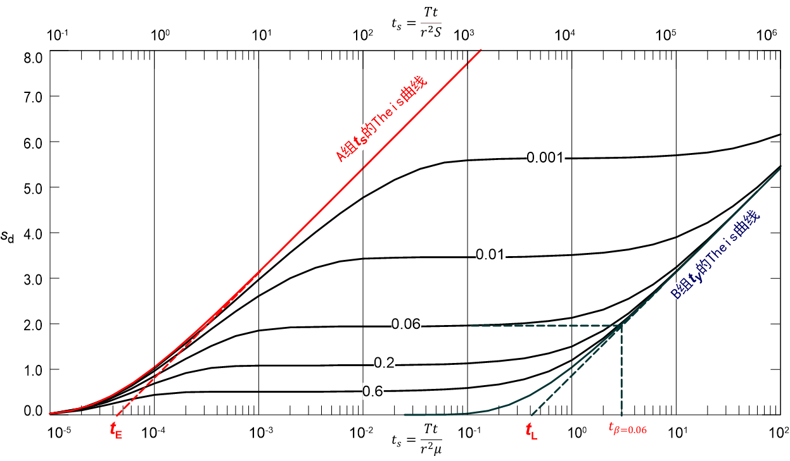{#fig-fig06-11 width=533 fig-align="center"}

## 6.6 水位恢复试验的求参方法

恢复水位监测是抽水试验的重要组成部分，利用水位恢复试验的观测数据也可求出水文地质参数（[@fig-fig06-12]）。

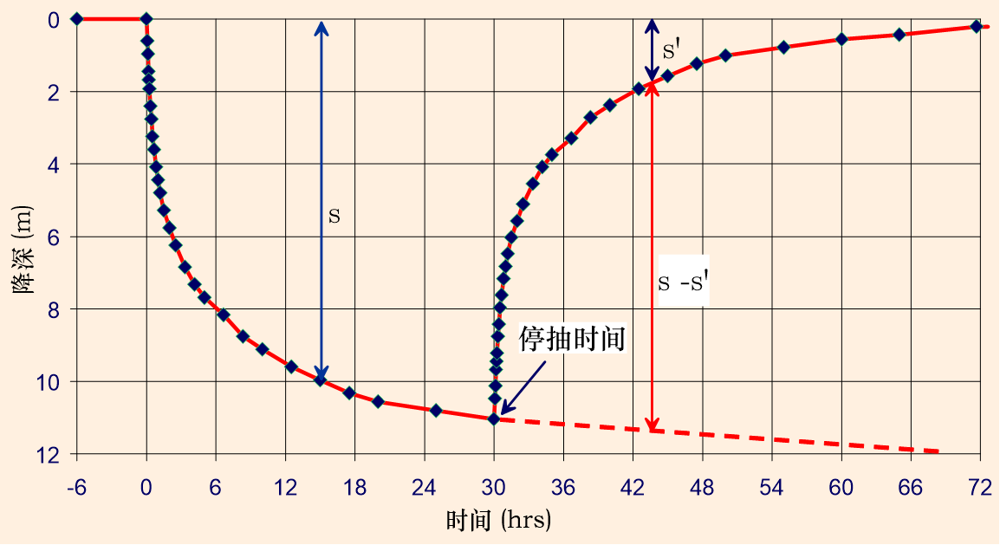{#fig-fig06-12 width=418 fig-align="center"}

**剩余降深$s'$**：原始水位与停抽后某时刻水位的差值。

### 6.6.1 Theis模型的水位恢复试验法

不考虑水头惯性滞后，以流量$Q$持续抽水$t_p$时间后停抽。记$t'=t-t_p$，$t(>t_p)$时刻剩余降深$s'$为持续抽水的降深与$t_p$时刻开始注水的降深叠加：
$$
s'=\frac{Q}{4\pi T}\left[W(u)-W(u')\right]
$$
式中，$u=\frac{r^2S}{4Tt}$，$u'=\frac{r^2S}{4Tt'}$。

当$u,u'\le0.01$时，Jacob公式成立：
$$
s'=\frac{2.3Q}{4\pi T}\lg\frac{t}{t'}
$$
式中，$t=t_p+t'$ 为从抽水开始起算的总时间，$t_p$ 为抽水持续时间，$t'$ 为从停泵起算的恢复时间。该式仅在 $u<0.01$ 且 $u'<0.01$ 时成立。

**水位恢复试验法求参步骤**

- 在单对数坐标纸上用实测数据绘制$s'\sim \lg \frac{t}{t'}$散点图并作出拟合直线；
- 求直线段斜率$i$：可直接读取一个对数周期纵坐标的变化值作为直线斜率$i$；
- 计算导水系数：$T=\frac{0.183Q}{i}$。

**例：** 某承压含水层完整井抽水试验，停抽后观测数据如下图所示。试求含水层水文地质参数。已知$Q=1100\mathrm{\,m^3/d}$。

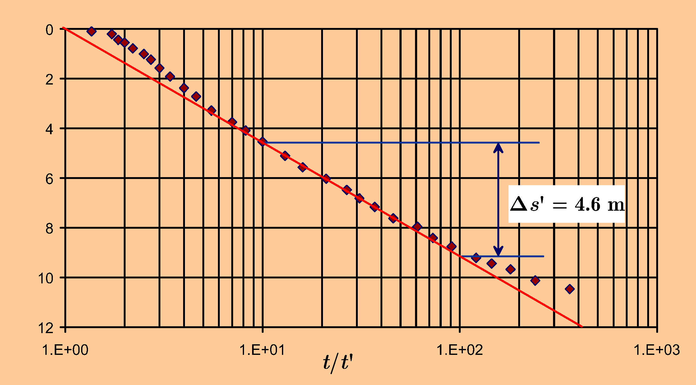{#fig-fig06-13 width=443 fig-align="center"}

由$\Delta s'=4.6\mathrm{\,m}$得$i=4.6$。求导水系数：
$$
T=0.183\frac{Q}{i}=0.183\times\frac{1100}{4.6}=43.76 \mathrm{\,m^2/d}
$$

- 抽水试验初期流量不稳定，水位恢复试验法在该方面优于抽水试验。
- 恢复试验初期不满足$u'<0.01$，恢复时间$t'$过长时抽水效应会消失，因此应避免采用$\frac{t}{t'}$过小或过大的数据求参。
- 恢复试验直线图解法无法直接计算参数$S$。若已知停抽时刻的水位降深$s_p$，可由$s_p=i\lg\frac{2.25Tt_p}{r^2S}$求$S$。

### 6.6.2 Neuman模型的水位恢复试验法

Neuman模型未涉及非饱和带地下水运动，仅将自由面视为可移动边界，因此可依据该模型利用水位恢复资料确定导水系数。

设$t_p$为抽水持续时间，$t'$为停泵后的水位恢复时间，$s'$为剩余降深。绘制$s'\sim \lg\left(1+\frac{t_p}{t'}\right)$曲线，在$1+\frac{t_p}{t'}$较小即恢复时间较长的区段，会出现直线段。

设直线段斜率为$i$，可求出导水系数：
$$
T =\frac{2.3Q}{4\pi i}
$$

## 6.7 求参问题的程序设计

本章介绍的各类求参方法以基本原理和求参步骤为主。随着计算机技术的普及与发展，目前已有专门软件可用于水文地质求参计算，如AquiferTest等。尽管如此，掌握基本原理仍是水文地质工作者的必备基础，手工完成配线法等求参工作是专业技能训练的重要组成部分。借助办公软件（如MS Excel）或采用程序设计语言编程解决水文地质求参问题，有助于提升计算机应用能力。本课程的实验部分介绍了用MS Excel数据表实现配线法求参的内容，本节主要介绍最小二乘法与Jacob、Theis等公式结合的求参方法。

### 6.7.1 应用Jacob公式的最小二乘法求参

将Jacob公式改写
$$
\begin{cases}
s=\frac{0.183Q}{T}\lg\frac{2.25T}{r^2S} +\frac{0.183Q}{T}\lg t\\
s=\frac{0.183Q}{T}\lg\frac{2.25T}{S}+\frac{0.183Q}{T}\lg\frac{t}{r^2} \\
s=\frac{0.183Q}{T}\lg\frac{2.25Tt}{S} -\frac{0.366Q}{T}\lg r
\end{cases}
$$
写成统一形式
$$
y=a+bx
$$
根据观测数据序列，可用最小二乘法求出系数$a,b$，再依据对应公式计算$(T,S)$。

根据观测数据或变换后的数据$\{(x_i,y_i),\,i=1,2,\cdots,n\}$，求解拟合直线。

记$E(a, b)=\sum_{i=1}^n(y_i-a-bx_i)^2$，令$\frac{\partial E}{\partial a}=0$，$\frac{\partial E}{\partial b}=0$，可求得使$E(a, b)$取最小值的$(a,b)$：
$$
\begin{cases}
\frac{\partial E}{\partial a}=\sum_{i=1}^n\left[2(y_i-a-bx_i)\right]=0\\
\frac{\partial E}{\partial b}=\sum_{i=1}^n\left[2(y_i-a-bx_i)x_i\right]=0
\end{cases}
$$
得
$$
\begin{cases}
an+b\sum_{i=1}^{n}x_i=\sum_{i=1}^{n}y_i\\
a\sum_{i=1}^{n}x_i+b\sum_{i=1}^{n}x_i^2 =\sum_{i=1}^{n}x_iy_i
\end{cases}
$$
解得
$$
\begin{cases}
b=\frac{n\sum\limits_{i=1}^{n}x_iy_i-\sum\limits_{i=1}^{n}x_i\sum\limits_{i=1}^{n}y_i}{n\sum\limits_{i=1}^{n}x_i^2-\left(\sum\limits_{i=1}^{n}x_i\right)^2}\\
a=\frac{1}{n}\left(\sum\limits_{i=1}^{n}y_i-b\sum\limits_{i=1}^{n}x_i\right)
\end{cases}
$$

Jacob公式结合最小二乘法求参，属于一步优化方法。

**例：** 某承压含水层抽水试验，含水层顶、底板绝对隔水，抽水时侧向边界尚未产生影响。14号孔为完整抽水井，抽水量为$60\mathrm{\,m^3/h}$。2号观测孔距抽水孔$43\mathrm{\,m}$，15号观测孔距抽水孔$125\mathrm{\,m}$，观测资料如[@tbl-Jacob-line]。试求导水系数和贮水系数。

| 抽水累计时间$t$(min) | 2#降深$s$(m) | 15#降深$s$(m) | 抽水累计时间$t$(min) | 2#降深$s$(m) | 15#降深$s$(m) |
|:------------:|:--------:|:---------:|:------------:|:--------:|:---------:|
| 10           | 0.73     | 0.16      | 210          | 2.77     | 1.55      |
| 20           | 1.28     | 0.48      | 270          | 2.99     | 1.70      |
| 30           | 1.53     | 0.54      | 330          | 3.10     | 1.83      |
| 40           | 1.72     | 0.65      | 400          | 3.20     | 1.89      |
| 60           | 1.96     | 0.75      | 450          | 3.26     | 1.98      |
| 80           | 2.14     | 1.00      | 645          | 3.47     | 2.17      |
| 100          | 2.28     | 1.12      | 870          | 3.68     | 2.38      |
| 120          | 2.39     | 1.22      | 990          | 3.77     | 2.46      |
| 150          | 2.54     | 1.36      | 1185         | 3.85     | 2.54      |
: 完整井非稳定流抽水试验观测数据 {#tbl-Jacob-line tbl-colwidths="[15,15,15,15,15,15]"}

参考值：

2#孔：$T=173 \mathrm{\,m^2/d}$，$S=4.78 \times 10^{-4}$

15#孔：$T=193 \mathrm{\,m^2/d}$，$S=3.14 \times 10^{-4}$

Jacob公式：
$$
s = \frac{0.183Q}{T}\log_{10}\frac{2.25Tt}{r^2S} = a+b\lg t 
$$
**代码：**

```{python}
#| fig-align: center
#| label: Jacob-line
#| fig-cap: Jacob 公式的最小二乘法拟合结果
import time
import numpy as np
import matplotlib.pyplot as plt

plt.rcParams["font.family"] = ["Times New Roman", "KaiTi"]
plt.rcParams["mathtext.fontset"] = "stix"  # 显示数学公式（STIX 字体）
plt.rcParams["axes.unicode_minus"] = False  # 解决中文负号不能正确显示的问题
np.set_printoptions(precision=4)

startTime = time.time()
# 时间--降深
t = np.array([
    10, 20, 30, 40, 60, 80, 100, 120, 150,
    210, 270, 330, 400, 450, 645, 870, 990, 1185
    ])
s = np.array([
    0.73, 1.28, 1.53, 1.72, 1.96, 2.14, 2.28, 2.39, 2.54,
    2.77, 2.99, 3.10, 3.20, 3.26, 3.47, 3.68, 3.77, 3.85
    ])

# 抽水量，观测孔与抽水井距离
Q = 1
r = 43
# 时间对数
log_t = np.log10(t)
# 取数组长度
n = len(log_t)

# 最小二乘系数
st = s * log_t
b = (n * np.sum(st) - np.sum(s) * np.sum(log_t)) / (
    n * np.sum(log_t ** 2) - np.sum(log_t) ** 2
    )
a = (np.sum(s) - b * np.sum(log_t)) / n

# 计算T, S
T = 0.183 * Q / b
S = np.power(10, -a / b) * 2.25 * T / r / r

endTime = time.time()
cost_ms = (endTime - startTime) * 1000

# 生成绘图数据
x = np.linspace(1, np.max(log_t), 10)
y = a + b * x

fig, ax = plt.subplots()
ax.set(xlim=(1, 3.25), ylim=(0.5, 4),xlabel=r"$\lg t$",ylabel=r"$s$")
ax.plot(x, y, "-", linewidth=1.2, label="最小二乘拟合线")
ax.plot(log_t, s, "o", label="实测")
plt.grid(True)
ax.legend(loc="lower right")
# plt.savefig("最小二乘法拟合结果.png",dpi=300,bbox_inches="tight")
fig.tight_layout()
plt.show()
# 显示最终结果
print("运行时间为:%f ms" % cost_ms)
print("T = {:.2f} m^2/d, ".format(T * 60 * 24), "S = {:.2e}".format(S))
u = r ** 2 * S / 4 / T / t
print(u)
```

**注意：** 上述代码中 $T$ 的单位取决于 $Q$ 和 $t$ 的单位，请根据实际统一换算。

### 6.7.2 应用Theis公式的最小二乘法求参

由Theis公式
$$
s=\frac{Q}{4\pi T}W(u)
$$
设初始参数$(T_0,S_0)$，降深$s$在$(T_0,S_0)$处的泰勒级数展开为
$$
s(T,S)=s(T_0,S_0)+\left.\frac{\partial{s}}{\partial{T}}\right|_{T=T_0}\Delta{T}+\left.\frac{\partial{s}}{\partial{S}}\right|_{S=S_0}\Delta{S}+O(\Delta{T}^2+\Delta{S}^2)
$$
式中，$\Delta{T}= T-T_0$，$\Delta{S}=S-S_0$。

忽略高阶无穷小项
$$
s(T,S)\approx s(T_0,S_0)+\left.\frac{\partial{s}}{\partial{T}}\right|_{T=T_0}\Delta{T}+\left.\frac{\partial{s}}{\partial{S}}\right|_{S=S_0}\Delta{S}
$$
简写为
$$
s(T,S)\approx C+A\Delta{T}+B\Delta{S}
\tag{4}
$$
式中
$$
\begin{cases}
A=\left.\frac{\partial{s}}{\partial{T}}\right|_{T=T_0} =\frac{Q}{4\pi T_0^2}\left[-W(u_0)+e^{-u_0}\right] \\
B=\left.\frac{\partial{s}}{\partial{S}}\right|_{S=S_0}=
-\frac{Q}{4\pi T_0}\frac{e^{-u_0}}{S_0}\\
C=s(T_0,S_0)\\
u_0=\frac{r^2S_0}{4T_0t}
\end{cases}
$$

对于给定的初始值$(T_0,S_0)$，以及有观测数据的时间点$t_i(i=1,2,\cdots,n)$，可计算出公式(4)的系数$A_i, B_i, C_i (i=1,2,\cdots,n)$。

设$t_i$时刻的观测降深为$\hat{s}_i$，计算降深为$s_i=C_i+A_i\Delta{T}+B_i\Delta{S}$，误差平方和为
$$
E(\Delta{T},\Delta{S})=\sum_{i=1}^n(C_i+A_i\Delta{T}+B_i\Delta{S}-\hat{s}_i )^2
$$

依据该式用最小二乘法可求出一步优化的参数步长$(\Delta T,\Delta S)$，一步优化后的参数为$(T_0+\Delta T,S_0+\Delta S)$。

**例：** 取自李义昌《地下水动力学》，徐州：中国矿业大学出版社，1995，193-196

某承压含水层水井开展非稳定流抽水试验，抽水量$Q=542.2\mathrm{\,m^3/d}$，对距抽水井$117.85\mathrm{\,m}$处的观测孔进行观测，数据见[@tbl-theis-line]。试求含水层水文地质参数。

| No. | $t$(min) | $s$(m)  | No. | $t$(min) | $s$(m)  |
|:---:|:------:|:-----:| --- |:------:|:-----:|
| 1   | 8      | 0.002 | 13  | 900    | 1.000 |
| 2   | 12     | 0.006 | 14  | 1200   | 1.150 |
| 3   | 30     | 0.020 | 15  | 1500   | 1.220 |
| 4   | 60     | 0.050 | 16  | 1800   | 1.320 |
| 5   | 120    | 0.165 | 17  | 2100   | 1.390 |
| 6   | 180    | 0.270 | 18  | 2400   | 1.450 |
| 7   | 240    | 0.370 | 19  | 3000   | 1.510 |
| 8   | 300    | 0.455 | 20  | 3600   | 1.670 |
| 9   | 360    | 0.530 | 21  | 4200   | 1.710 |
| 10  | 480    | 0.655 | 22  | 4800   | 1.720 |
| 11  | 600    | 0.755 | 23  | 5820   | 1.730 |
| 12  | 720    | 0.880 |     |        |         |
: 完整井非稳定流抽水试验观测数据 {#tbl-theis-line tbl-colwidths="[15,15,15,15,15,15]"}

**代码：**

```{python}
#| label: theis-line
#| fig-cap: Theis 公式的最小二乘法拟合结果  
#| fig-align: center
import numpy as np
import math
from scipy.special import exp1
import matplotlib.pyplot as plt
plt.rcParams['font.family'] = ['Times New Roman','KaiTi']
plt.rcParams['mathtext.fontset'] = 'stix' # 显示数学公式（STIX 字体）
plt.rcParams['axes.unicode_minus'] = False  # 解决中文负号不能正确显示的问题
plt.rcParams['mathtext.fontset'] = 'dejavuserif'
np.set_printoptions(precision=4)

def initial_parameters(t, s, Q, r):
    """基于 Cooper-Jacob 近似法估算 Theis 模型的初始参数 T 和 S"""
    idx = len(t) // 2 - 1
    slope = (s[idx+1] - s[idx]) / np.log10(t[idx+1] / t[idx])
    T = 0.183 * Q / slope
    t0 = t[idx] * 10**(-s[idx] / slope)
    S = 2.25 * T * t0 / r**2
    return T, S

def theis_drawdown(S, T, t, Q, r):
    """计算 Theis 降深 s = (Q / 4πT) * W(u)，其中 W(u) 为指数积分 E1(u)"""
    u = r**2 * S / (4 * T * t)
    return Q / (4 * np.pi * T) * exp1(u)

def theis_gradient(S, T, t, Q, r):
    """计算降深对 S 和 T 的偏导数 (ds/dS, ds/dT)"""
    u = r**2 * S / (4 * T * t)
    exp_neg_u = np.exp(-u)
    dsdS = -Q / (4 * np.pi * T * S) * exp_neg_u
    dsdT = Q / (4 * np.pi * T**2) * (-exp1(u) + exp_neg_u)
    
    return np.array([dsdS, dsdT]).T

def theis_residual(S, T, t, s, Q, r):
    """计算降深残差平方和 (RSS)"""
    return np.sum((s - theis_drawdown(S, T, t, Q, r))**2)

def theis_model_fit(t, s, Q, r, max_iter=1000, tol_S=1e-8, tol_T=1e-6):
    """使用高斯-牛顿法拟合 Theis 模型参数"""
    T, S = initial_parameters(t, s, Q, r)
    print(f'初始参数: S={S:.6e}, T={T:.6f}')
    iteration = 0
    for iteration in range(max_iter):
        Y = s - theis_drawdown(S, T, t, Q, r)
        X = theis_gradient(S, T, t, Q, r)
        beta = np.linalg.solve(X.T @ X, X.T @ Y)
        dS, dT = beta
        while S + dS < 0:
            dS /= 2
        while T + dT < 0:
            dT /= 2
        S += dS
        T += dT
        if abs(dS) < tol_S and abs(dT) < tol_T:
            break
    else:
        print('警告: 循环超过最大迭代次数，请检查程序！')
    return S, T, iteration

def theis_model_plot(t, s, Q, r, S, T):
    """绘制 Theis 模型拟合的双对数图"""
    # 动态计算绘图边界
    xmin = 10**math.floor(math.log10(min(t)))
    xmax = 10**math.ceil(math.log10(max(t)))
    ymin = 10**math.floor(math.log10(min(s)))
    ymax = 10**math.ceil(math.log10(max(s)))
    # 绘制双对数图
    fig, ax = plt.subplots()
    ax.set_yscale('log')
    ax.set_xscale('log')
    ax.set(xlim=(xmin, xmax), ylim=(ymin, ymax),
           xlabel=r'lg t', ylabel=r'lg s', title="最小二乘法-Theis公式拟合")
    ax.grid(True, which="major", linestyle="-", linewidth=0.5)
    ax.grid(True, which="minor", linestyle="-", linewidth=0.2)
    # 生成平滑的拟合曲线
    x_log = np.arange(np.log10(xmin), np.log10(xmax), 0.01)
    x = np.power(10, x_log)
    y = theis_drawdown(S, T, x, Q, r)
    ax.plot(x, y, label='拟合曲线')
    ax.plot(t, s, '*', label='观测值')    
    ax.legend(loc='lower right', title="图例")
    fig.tight_layout()   # 自动调整布局
    plt.draw()
    # plt.savefig("./fig/Theis3.png", dpi=300,bbox_inches='tight')
    plt.show()      # 显示图形

# 原始数据
def single_data():
    r, Q = 117.85, 542.2  # m, m³/d
    t = np.array(
        [8, 12, 30, 60, 120, 180, 240, 300, 360, 480, 600, 720, 
        900, 1200, 1500, 1800, 2100, 2400, 3000, 3600, 4200, 
        4800, 5820])
    # 单位天转分钟
    Q = Q / 1440.0
    s = np.array(
        [0.002, 0.006, 0.020, 0.050, 0.165, 0.270, 0.370, 0.455, 
        0.530, 0.655, 0.755, 0.880, 1.000, 1.150, 1.220, 1.320, 
        1.390, 1.450, 1.510, 1.670, 1.710, 1.720, 1.730])
    return t, s, Q, r

# 主程序
if __name__ == "__main__":
    # 1. 获取数据
    t, s, Q, r = single_data()
    # 2. 拟合模型
    S, T, iterations = theis_model_fit(t, s, Q, r)
    # 3. 绘制拟合结果
    theis_model_plot(t, s, Q, r, S, T)
    # 4. 输出最终结果
    print(f'循环次数 = {iterations}')
    print(f'T = {T*1440.0:.2f} m²/d, S = {S:.4e}')
    print(f'RSS = {theis_residual(S, T, t, s, Q, r):.4e}')

```

- 初值对最终结果有影响。该方法基于高斯-牛顿法的局部线性化思想，收敛结果依赖于初值的选取。当目标函数存在多个局部极小值时，不同初值可能收敛到不同结果。建议采用多组初值对比验证，或结合配线法确定初值的合理范围，必要时可选用全局优化算法（如遗传算法、模拟退火等）进一步求解。参数初值 $(T_0, S_0)$ 一般是凭经验给出的，也可在观测数据中选取质量较好的点 (如 2-3 个), 先用 Jacob 公式计算初始参数；
- 最小二乘法只是一步优化，有可能得出参数为负值的不合理结果，可用二分法对步长 $(\Delta{T},\Delta{S})$ 进行修正; 一次优化结果作为下一优化的初值，重复计算可得到最优参数。

**本章小结**：

稳定流求参主要依靠Dupuit公式和Thiem公式，单井求参需要借助经验公式迭代求解影响半径。非稳定流配线法利用标准曲线与实测曲线的形状相似性，通过平移匹配来求参。直线图解法是配线法的简化版，操作便捷，但需满足Jacob近似的适用条件。拐点法专用于越流含水层，利用s-lg t曲线的拐点性质同时求取T、S和B。水位恢复试验法避免了抽水初期流量不稳定的干扰，是求取T值的可靠手段。最小二乘法可将求参过程程序化，提高计算效率和精度。