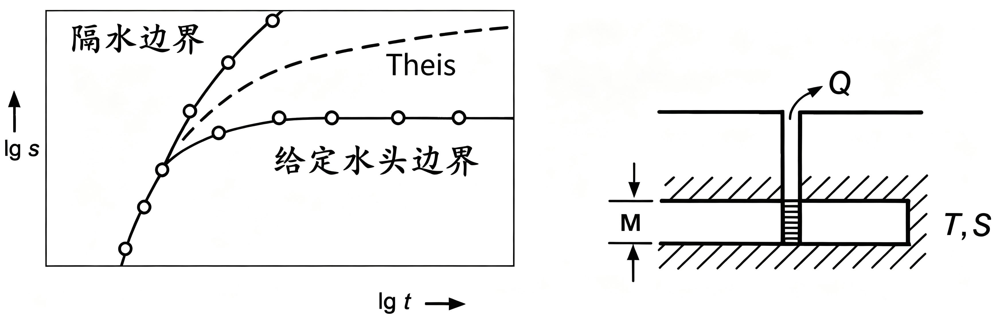
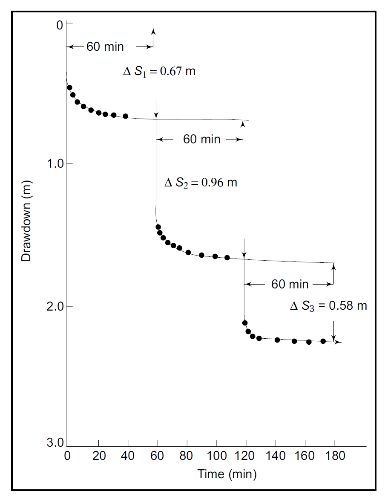
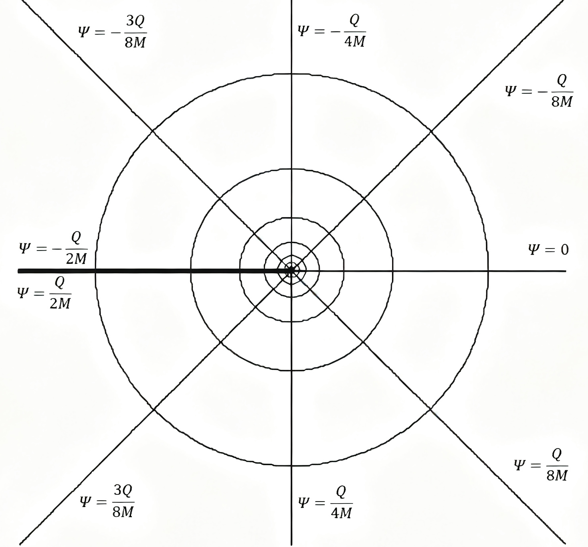
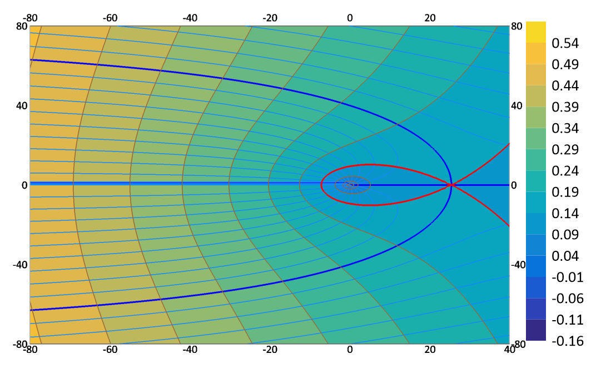
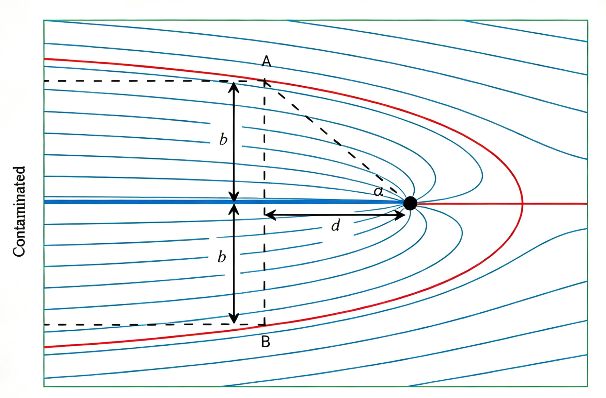

# 7 复杂水文地质条件下的解析法

**本章导引**：

前几章的模型都假设只有一口井、边界无限、含水层均质。真实的含水层远比这复杂：多井同时抽水、边界紧邻井群、岩层各向异性。本章将前面学过的解析工具综合运用起来处理这些复杂场景。叠加原理是处理多井干扰和变流量抽水的核心武器。镜像法则是利用叠加原理处理边界问题的巧妙技巧。我们还将讨论井损、不完整井和均匀流中的井流等问题。最后简要介绍水动力弥散理论，为地下水污染研究铺垫基础。

## 7.1 地下水向干扰井群的运动

### 7.1.1 叠加原理（Superposition Principle）

几种不同原因综合产生的效果，等于这些原因单独产生效果的累加。对于线性系统，两个或多个激励引起的响应，等于每个激励单独引起的响应之和。叠加原理适用于任何线性系统，包括代数方程、线性微分方程等。

例：无限承压含水层中有两眼同时工作的抽水井 $W_1(x_1,y_1)$、$W_2(x_2,y_2)$，抽水量分别为 $Q_1$、$Q_2$，井半径分别为 $r_{w1}$、$r_{w2}$。

**数学模型为**
$$
\begin{cases}
\frac{\partial^2 s}{\partial x^2}+\frac{\partial^2 s}{\partial y^2}
=\frac{S}{T}\frac{\partial s}{\partial t} & t>0,\ 0\le r<\infty\\
s(x,y,0)=0 & 0\le r<\infty\\
s(x,y,t)=0 & t>0,\ r\to\infty\\
\lim\limits_{r_1\to0}\left(r_1\frac{\partial s}{\partial r_1}\right)=-\frac{Q_1}{2\pi T} & t>0\\
\lim\limits_{r_2\to0}\left(r_2\frac{\partial s}{\partial r_2}\right)=-\frac{Q_2}{2\pi T} & t>0
\end{cases}
$$
式中，$r=\sqrt{x^2+y^2}$，$r_i=\sqrt{(x-x_i)^2+(y-y_i)^2}$，$i=1,2$。

单井工作的数学模型为
$$
\begin{cases}
\frac{\partial^2 s_i}{\partial x^2}+\frac{\partial^2 s_i}{\partial y^2}=\frac{S}{T}\frac{\partial s_i}{\partial t} & t>0,\ 0\le r<\infty\\
s_i(x,y,0)=0 & 0\le r<\infty\\
s_i(x,y,t)=0 & t>0,\ r\to\infty\\
\lim\limits_{r_i\to0}\left(r_i\frac{\partial s_i}{\partial r_i}\right)=-\frac{Q_i}{2\pi T} & t>0
\end{cases}
$$
根据叠加原理，两眼井同时工作时某观测点的降深，等于单眼井独立工作产生的降深之和，即 $s=s_1+s_2$。

**验证**：$s$ 满足方程、初始条件与边界条件。

设 $\boldsymbol{L}$ 为线性微分算子，满足 $\boldsymbol{L}\left[c_1u_1+c_2u_2\right]=c_1\boldsymbol{L}\left[u_1\right]+c_2\boldsymbol{L}\left[u_2\right]$，则 $\boldsymbol{L}u=f$ 称为**线性微分方程**；
特别地，当 $\boldsymbol{L}u=0$ 时称为**齐次线性微分方程**。

线性方程中未知函数及其各阶导数都是一次的，齐次方程不含自由项；边界条件也有类似分类。**线性定解问题**指微分方程和定解条件均为线性的定解问题。无源汇的承压水运动方程属于线性偏微分方程。

**叠加原理**：设 $u_i$ 满足线性方程（或线性定解条件）
$$
\boldsymbol{L}u_i=f_i\quad(i=1,2,\cdots,n)
$$
则它们的线性组合 $u=\sum_{i=1}^nc_iu_i$ 必满足方程（或定解条件）
$$
\boldsymbol{L}u=\sum_{i=1}^nc_if_i
$$
**提示**：应用叠加原理可将一个定解问题拆分为一个非齐次定解问题与若干齐次线性定解问题。

叠加原理多用于空间叠加，也可用于时间叠加。以无补给无限承压含水层单井变流量抽水为例，其数学模型为
$$
\begin{cases}
\frac{\partial^2 s}{\partial r^2}+\frac{1}{r}\frac{\partial s}{\partial r}=
\frac{S}{T}\frac{\partial s}{\partial t}&t\ge t_0,\ 0<r<\infty\\
s(r,0)=0&0<r<\infty\\
s(\infty,t)=0 &t>t_0\\
\lim\limits_{r\to0}\left(r\frac{\partial s}{\partial r}\right)=
\begin{cases}
-\frac{Q_1}{2\pi T} & t_1>t \ge t_0\\
-\frac{Q_2}{2\pi T} & t\ge t_1
\end{cases} &
\end{cases}
$$
该定解问题可拆分为两个定解问题：
$$
\begin{cases}
\frac{\partial^2 s_1}{\partial r^2}+\frac{1}{r}\frac{\partial s_1}{\partial r}=
\frac{S}{T}\frac{\partial s_1}{\partial t}&t\ge t_0,\ 0<r<\infty\\
s_1(r,0)=0&0<r<\infty\\
s_1(\infty,t)=0 &t\ge t_0\\
\lim\limits_{r\to0}\left(r\frac{\partial s_1}{\partial r}\right)=
-\frac{Q_1}{2\pi T} & t\ge t_0
\end{cases}
$$
$$
\begin{cases}
\frac{\partial^2 s_2}{\partial r^2}+\frac{1}{r}\frac{\partial s_2}{\partial r}=
\frac{S}{T}\frac{\partial s_2}{\partial t}&t\ge t_1,\ 0<r<\infty\\
s_2(r,0)=0&0<r<\infty\\
s_2(\infty,t)=0 &t\ge t_1\\
\lim\limits_{r\to0}\left(r\frac{\partial s_2}{\partial r}\right)=
-\frac{Q_2-Q_1}{2\pi T} & t\ge t_1
\end{cases}
$$

应用叠加原理，得 $s=s_1+s_2$。

**叠加原理应用条件**：

- 各边界条件的作用彼此独立；
- 各抽水井的作用彼此独立；
- 潜水含水层的微分方程是非线性的，需线性化后，方可使用叠加原理。

### 7.1.2 干扰井群的非稳定流运动

供水或排水工程中多采用井群抽水。当井间距小于抽水影响半径时，井与井之间的降深和流量会产生相互干扰。

- 干扰效应：若保持流量不变，干扰条件下的降深大于无干扰条件下的降深；若保持降深不变，干扰条件下的井流量小于无干扰条件下的流量。
- 影响因素：含水层性质（$K$、$M$ 的大小）、补给与排泄条件，以及井的数量、间距、布置方式等。

以降深 $s$ 表达的 Theis、Hantush-Jacob、Hantush、Boulton、Neuman 模型均可使用叠加原理。若模型解存在近似形式，叠加结果可进一步简化。以下以无限承压含水层的 Theis 模型和无限潜水含水层的 Neuman 模型为例说明。

**（1）Theis 模型**

**任意布置的干扰井群**

假设有 $n$ 口干扰井同时工作，抽水量分别为 $Q_1,Q_2,\cdots,Q_n$，井半径分别为 $r_{w_1},r_{w_2},\cdots,r_{w_n}$。观测点距各抽水井的距离分别为 $r_1,r_2,\cdots,r_n$。由叠加原理，观测点降深为
$$
s = \sum\limits_{i=1}^n\frac{Q_i}{4\pi T}W(u_i)
$$
式中，$u_i=\frac{r_i^2 S}{4Tt}$。当 $u_i<0.01$ 时，有
$$s = \sum\limits_{i=1}^n\frac{Q_i}{4\pi T}\ln\frac{2.25Tt}{r_i^2 S}
$$
将观测位置分别取为各抽水井的井壁，可得方程组
$$
\begin{cases}
s_{w_1} = \frac{Q_1}{4\pi T} \ln\frac{2.25Tt}{r_{w_1}^2 S}
+ \sum\limits_{j=2}^n \frac{Q_j}{4\pi T}\ln\frac{2.25Tt}{r_{1j}^2 S} \\
s_{w_2} =
 \frac{Q_2}{4\pi T} \ln\frac{2.25Tt}{r_{w_2}^2 S}
+\sum\limits_{\substack{j=1 \\ j \ne2}}^n \frac{Q_j}{4\pi T}\ln\frac{2.25Tt}{r_{2j}^2 S} \\
\quad\cdots\\
s_{w_n} =
 \frac{Q_n}{4\pi T} \ln\frac{2.25Tt}{r_{w_n}^2 S}
+\sum\limits_{\substack{j=1}}^{n-1} \frac{Q_j}{4\pi T}\ln\frac{2.25Tt}{r_{nj}^2 S}
\end{cases}
$$
式中，$r_{ij}$ 为第 $i$ 眼抽水井与第 $j$ 眼抽水井的距离。

该方程组在已知各井流量求井壁降深时为线性方程组，可直接求解；在已知各井降深反求流量时，因流量 $Q$ 同时出现在对数项和线性项中，为非线性方程组，需迭代求解。

当各井抽水量与井半径均相等时，各抽水井降深相等，表达式为
$$
s_w = \frac{Q}{4\pi T}\sum\limits_{j = 1}^n \ln
\frac{2.25Tt}{r_{ij}^2 S}
$$
式中，$r_{ij}$ 为第 $i$ 眼抽水井与第 $j$ 眼抽水井的距离，$r_{ii}=r_{w_i}$。

记 $R=\sqrt{2.25Tt/S}$，公式可简写为
$$
s_w=\frac{Q}{2\pi T}\sum\limits_{j=1}^n\ln\frac{R}{r_{ij}}
$$
**相距为 $L$ 的两口井**
$$
\begin{cases}
s_{w_1} = \frac{Q_1}{4\pi T} \ln \frac{2.25Tt}{r_{w_1}^2 S} +
\frac{Q_2}{4\pi T}\ln\frac{2.25Tt}{L^2 S}\\
s_{w_2} = \frac{Q_1}{4\pi T} \ln \frac{2.25Tt}{L^2 S} +
\frac{Q_2}{4\pi T}\ln\frac{2.25Tt}{r_{w_2}^2 S}
\end{cases}
$$
当井半径、流量和影响半径均相等时，抽水井的降深与流量为
$$
s_{w} = \frac{Q}{2\pi T} \ln\frac{R^2}{r_w L},\quad Q = \frac{2\pi T s_w }{\ln \frac{R^2}{r_w L}}
$$
**边长为 $L$ 的正方形布置井群**

各井降深可分别写出表达式。当井半径、流量和影响半径均相等时，抽水井的降深与流量为
$$
s_{w} = \frac{Q}{2\pi T} \ln\frac{R^4}{\sqrt{2}r_w L^3},\quad Q = \frac{2\pi T s_w }{\ln\frac{R^4}{\sqrt{2}r_w L^3}}
$$
**按半径为 $r$ 的圆周均匀布置 $n$ 口井**

由几何关系
$$
r_w \cdot r_{12} \cdot r_{13} \cdots r_{1n}=nr_w \cdot r^{n-1}
$$
当井半径、流量和影响半径均相等时，抽水井的降深与流量为
$$
s_{w} = \frac{Q}{2\pi T} \ln\frac{R^n}{nr_w r^{n-1}},\quad Q = \frac{2\pi T s_w }{\ln\frac{R^n}{nr_w r^{n-1}}}
$$
**（2）Neuman 模型**

对于Neuman模型，抽水时间足够长时
$$
s(r,t)=\frac{Q}{4\pi T}\int\limits_{u_y}^{\infty}\frac{e^{-y}}{y}dy=\frac{Q}{4\pi T}W(u_y)
$$
式中，$u_y=\frac{r^2\mu}{4Tt}$，$T=Kh_m$，$h_m=\frac{H_0+h}{2}$。

近似公式为
$$
s(r,t)=\frac{Q}{4\pi T}\ln\frac{2.25Tt}{r^2\mu}
$$
形式与Theis模型近似结果一致。

### 7.1.3 干扰井群的稳定流运动

严格意义上的稳定流仅存在于有补给来源的含水层中。在无补给无限含水层中，“稳定流”实为“似稳定”近似，影响半径 $R$ 随抽水时间 $t$ 变化（$R \propto \sqrt{Tt/S}$）。以下公式中的 $R$ 均为某抽水时刻的等效影响半径。

**任意布置的干扰井群**

任意观测点的降深

承压水：
$$
s=\frac{Q}{2\pi T}\sum\limits_{i=1}^n\ln\frac{R}{r_{i}}
$$
潜水：

取 $s=H_0-h$，$2h_m=H_0+h$，有
$$
H_0^2-h^2=\frac{Q}{\pi K}\sum\limits_{i=1}^n\ln\frac{R}{r_{i}}
$$
**相距为 $L$ 的两口井**

当井半径、流量和影响半径均相等时，抽水井的降深与流量为

- 承压水
$$
s_{w} = \frac{Q}{2\pi T} \ln\frac{R^2}{r_w L},\quad Q = \frac{2\pi T s_w }{\ln \frac{R^2}{r_w L}}
$$
- 潜水
$$
H_0^2-h_{w}^2 = \frac{Q}{\pi K} \ln \left(\frac{R^2}{r_{w}L}\right),\quad Q = \frac{\pi K \left( H_0^2-h_w^2 \right) }{\ln\left(\frac{R^2}{r_w L} \right)}
$$

**边长为 $L$ 的正方形布置井群**

当井半径、流量和影响半径均相等时，抽水井的降深与流量为

- 承压水
$$
s_{w} = \frac{Q}{2\pi T} \ln\frac{R^4}{\sqrt{2}r_w L^3},\quad Q = \frac{2\pi T s_w }{\ln\frac{R^4}{\sqrt{2}r_w L^3}}
$$
- 潜水
$$
H_0^2-h_w^2 = \frac{Q}{\pi K} \ln\frac{R^4}{\sqrt{2}r_w L^3},\quad Q = \frac{\pi K (H_0^2-h_w^2)}{\ln\frac{R^4}{\sqrt{2}r_w L^3}}
$$
**按半径为 $r$ 的圆周均匀布置 $n$ 口井**

当井半径、流量和影响半径均相等时，抽水井的降深与流量为

- 承压水
$$
s_{w} = \frac{Q}{2\pi T} \ln\frac{R^n}{nr_w r^{n-1}},\quad Q = \frac{2\pi T s_w }{\ln\frac{R^n}{nr_w r^{n-1}}}
$$
- 潜水
$$
H_0^2-h_w^2 = \frac{Q}{\pi K} \ln\frac{R^n}{nr_w r^{n-1}},\quad Q = \frac{\pi K(H_0^2-h_w^2)}{\ln\frac{R^n}{nr_w r^{n-1}}}
$$
存在补给的含水层中，抽水可达到稳定状态，如有越流补给的含水层，或补给边界对称分布的等间距井排等。

**有越流补给的稳定流**

近似计算公式
$$
s = \frac{Q}{2\pi T}K_0\left(\frac{r}{B} \right)
$$
多个抽水井抽水产生的降深
$$
s= \sum\limits_{i = 1}^n \frac{Q_i}{2\pi T}K_0\left(\frac{r_{i}}{B} \right)= \sum\limits_{i = 1}^n
\frac{Q_i}{2\pi T}\ln\left(\frac{1.123B}{r_i}\right)
$$
该近似式要求 $r_i/B<0.35$（误差小于5%）；$r_i/B<0.18$ 时误差可控制在 1% 以内。若 $r_i/B$ 较大，应使用精确表达式 
$$
s= \sum\limits_{i = 1}^n \frac{Q_i}{2\pi T}K_0\left(\frac{r_{i}}{B} \right)
$$
**补给边界对称分布的无限井排**

设井距为 $\sigma$，井排等距分布，且与两侧边界距离相等，边界水头为 $H_0$。当井半径、流量和影响半径均相等时，抽水井的降深与流量为

- 承压水
$$
s=\frac{Q}{2\pi T}\bigg[\ln\frac{\sigma}{\pi r_w}+\ln\Big(\sinh\frac{\pi R}{\sigma}\Big)\bigg],\quad
Q=\frac{2\pi Ts_w}{\ln\frac{\sigma}{\pi r_w}+\ln\Big(\sinh\frac{\pi R}{\sigma}\Big)}
$$
- 潜水
$$
H_0^2-h_w^2=\frac{Q}{\pi K}\bigg[\ln\frac{\sigma}{\pi r_w}+\ln\Big(\sinh\frac{\pi R}{\sigma}\Big)\bigg],\quad
Q=\frac{\pi K(H_0^2-h_w^2)}{\ln\frac{\sigma}{\pi r_w}+\ln\Big(\sinh\frac{\pi R}{\sigma}\Big)}
$$

## 7.2 地下水向边界附近井的运动

### 7.2.1 镜像法原理

从两眼干扰井的流网中可以观察到以下规律：

- 两井抽水量相同时，两眼井连线的垂直平分线上会形成分水线；
- 一井抽水、一井注水且抽（注）水量相同时，两眼井连线的垂直平分线上水头保持不变。

镜像法本质是叠加原理的特殊应用，可简化特定边界条件下的井流计算。

以无限承压含水层为例，两眼同时工作的抽水井 $W_1(x_1,y_1)$、$W_2(x_2,y_2)$，抽水量分别为 $Q_1$、$Q_2$，井半径分别为 $r_{w1}$、$r_{w2}$。

**数学模型为**
$$
\begin{cases}
\frac{\partial^2 s}{\partial x^2}+\frac{\partial^2 s}{\partial y^2}
=\frac{S}{T}\frac{\partial s}{\partial t} & t>0,\ 0\le r<\infty\\
s(x,y,0)=0 & 0\le r<\infty\\
s(x,y,t)=0 & t>0,\ r\to\infty\\
\lim\limits_{r_1\to0}\left(r_1\frac{\partial s}{\partial r_1}\right)=-\frac{Q}{2\pi T} & t>0\\
\lim\limits_{r_2\to0}\left(r_2\frac{\partial s}{\partial r_2}\right)=-\frac{Q}{2\pi T} & t>0
\end{cases}
$$
式中，$r=\sqrt{x^2+y^2}$，$r_i=\sqrt{(x-x_i)^2+(y-y_i)^2}$，$i=1,2$。

应用叠加原理，可分解为两个单井独立工作的定解问题。记观测点距两口抽水井的距离分别为 $r_1$、$r_2$，则观测点降深等于两眼井单独抽水产生的降深之和。

根据 Theis 解，有
$$
s_1=\frac{Q}{4\pi T}W(u_1),\quad s_2=\frac{Q}{4\pi T}W(u_2)
$$
式中 $u_1=\frac{r_1^2 S}{4Tt}$，$u_2=\frac{r_2^2 S}{4Tt}$，总降深 $s=s_1+s_2$。

计算两眼井连线垂直平分线上任一点 $(x,y)$ 处的降深梯度，得
$$
\frac{\partial s}{\partial x} =\frac{\partial s_1}{\partial x}+\frac{\partial s_2}{\partial x}
=-\frac{Q}{4\pi T}\frac{x-x_1}{r_1^2}e^{-u_1}-\frac{Q}{4\pi T}\frac{x-x_2}{r_2^2}e^{-u_2}
$$
因为 $x=(x_1+x_2)/2$，故 $r_1=r_2$，$u_1=u_2$，代入上式得
$$
\frac{\partial s}{\partial x}=0
$$
因此，两眼井连线的垂直平分线上会形成分水线。同理可验证，当 $Q_1=Q$（抽水）、$Q_2=-Q$（注水）时，两眼井连线的垂直平分线上 $s=0$。上述结果可通过叠加原理证明。

镜像法适用于均质各向同性、侧向无限延伸的含水层，要求边界为完全隔水或完全定水头的直线边界，且在整个计算期内边界性质保持不变。

在一定条件下，可通过无限含水层中的两口井模拟隔水边界或定水头边界附近的井流，两口井一实一虚、互为镜像，这种方法称为**镜像法**。镜像法是叠加原理的具体应用形式，可规避直接使用叠加原理的复杂性，便于工程应用。

边界对抽水井降落漏斗形态有明显影响，当井位于边界附近或抽水时间较长时，均需考虑边界的影响。将实测 $\lg s \sim \lg t$ 曲线与标准曲线对比，可分析边界影响下非稳定流抽水的降深变化规律。

{#fig-well-function width="304" fig-align="center"}

**镜像法研究的边界类型**

- 直线补给边界：边界水位保持不变，在镜像位置设置一口同时工作的虚注水井，通过两个无限含水层井流模型的叠加形成水位恒定的直线边界；
- 直线隔水边界：边界处流量为0，在镜像位置设置一口同时工作的虚抽水井，通过两个无限含水层井流模型的叠加形成分水线型隔水边界。

**虚拟井的特征**

- 位置对称：虚井与实井的位置关于边界对称；
- 流量相等：虚井流量与实井相等；
- 性质匹配边界：定水头补给边界对应的虚井性质与实井相反，隔水边界对应的虚井性质与实井相同；
- 工作同步：实井与虚井同时工作。

本章主要讨论非稳定流问题，原因如下：

- 基于Dupuit模型的稳定流对应有限含水层，以圆岛半径 $R$ 为参数，该情况在现实中少见；
- 存在补给边界的含水层中，长时间抽水后可形成稳定流，属于非稳定流的特殊情况；无补给条件下无法形成稳定流。

### 7.2.2 直线边界附近的非稳定井流

**直线补给边界的非稳定井流**

**承压水**

设抽水量为 $Q$，井至边界的垂直距离为 $a$，任意点 $P(x,y)$ 处降深为 $s$；虚井为注水井。任一点降深表达式为
$$
s = \frac{Q}{4\pi T}\left[W(u_1) - W(u_2) \right]
$$
式中 $u_i = \frac{r_i^2 S}{4Tt}$。当 $u_i\le 0.01$ 时，可采用Jacob近似公式
$$
\begin{split}
s & = \frac{Q}{4\pi T}\left[ \ln\frac{2.25Tt}{r_1^2 S} - \ln\frac{2.25Tt}{r_2^2 S} \right] \\
& = \frac{Q}{2\pi T}\ln\frac{r_2}{r_1}
\end{split}
$$
**潜水**

虚井为注水井。若降深较小可忽略三维流影响，对 $\Delta h^2=H_0^2-h^2$ 应用叠加原理
$$
H_0^2-h^2 = \frac{Q}{2\pi K}\left[W(u_1) - W(u_2) \right]
$$
式中 $u_i = \frac{r_i^2 \mu}{4Tt}$，$T=Kh_m$；$h_m$ 为潜水流平均厚度，$\mu$ 为给水度。当 $u_i\le 0.01$ 时，可采用Jacob近似公式
$$
\begin{split}
H_0^2-h^2 & =\frac{Q}{2\pi K}\left[ \ln\frac{2.25Tt}{r_1^2 \mu} - \ln\frac{2.25Tt}{r_2^2 \mu} \right] \\
& = \frac{Q}{\pi K}\ln\frac{r_2}{r_1}
\end{split}
$$
**说明：** 存在补给边界时，定水头边界持续向含水层供水。当抽水降落漏斗扩展至补给边界且补给量与抽水量达到动态平衡后，渗流场达到稳定状态。稳定后的降深可用 $s=\frac{Q}{2\pi T}\ln\frac{r_2}{r_1}$ 计算，与时间无关。

**直线隔水边界的非稳定井流**

**承压水井**

设抽水井流量为 $Q$，井中心至边界的垂直距离为 $a$，任意点 $P(x,y)$ 处降深为 $s$。

虚井为抽水井，任一点降深为
$$
s = \frac{Q}{4\pi T}\left[ W(u_1) + W(u_2) \right]
$$
式中 $u_i = \frac{r_i^2 S}{4Tt}$。当 $u_i\le 0.01$ 时，可采用Jacob近似公式
$$
\begin{split}
s & =\frac{Q}{4\pi T}\left[ \ln\frac{2.25Tt}{r_1^2 S}+\ln\frac{2.25Tt}{r_2^2 S} \right]\\
& =\frac{Q}{2\pi T}\ln\frac{2.25Tt}{r_1 r_2 S}
\end{split}
$$
**潜水井**

虚井为抽水井。若降深较小可忽略三维流影响，对 $\Delta h^2=H_0^2-h^2$ 应用叠加原理
$$
H_0^2-h^2 = \frac{Q}{2\pi K}\left[W(u_1) + W(u_2) \right]
$$
式中 $u_i = \frac{r_i^2 \mu}{4Tt}$，$T=Kh_m$；$h_m$ 为潜水流平均厚度，$\mu$ 为给水度。当 $u_i\le 0.01$ 时，可采用Jacob近似公式
$$
\begin{split}
H_0^2-h^2 & =\frac{Q}{2\pi K}\left[ \ln\frac{2.25Tt}{r_1^2 \mu}+\ln\frac{2.25Tt}{r_2^2 \mu} \right]
\end{split}
$$
**直线边界的求参问题**

**（1）配线法**：通过构造专用井函数，配合配线法求解水文地质参数。

设抽水井距边界为 $a$，观测孔距实井 $r_1$，距虚井 $r_2$。记 $u_i = \frac{r_i^2 S}{4Tt}$，有
$$
\frac{u_2}{u_1} = \frac{r_2^2}{r_1^2} = \left(\frac{r_2}{r_1}\right)^2
$$
记 $\lambda=\left(\frac{r_2}{r_1}\right)^2$，则 $u_2 =\lambda u_1$。定义井函数
$$
\Phi(u_1,\lambda)=W(u_1)+W(\lambda u_1) ,\qquad \Phi ' (u_1,\lambda )=W(u_1)-W(\lambda u_1)
$$
已知 $u_1$ 和 $\lambda$ 即可计算 $\Phi(u_1,\lambda)$ 和 $\Phi'(u_1,\lambda)$。
$$
\begin{array}{ll}
s =\frac{Q}{4\pi T}\Phi( u_1,\lambda) & \text{隔水边界} \\
s = \frac{Q}{4\pi T}\Phi'( u_1,\lambda) & \text{补给边界}  \\
t = \frac{r^2 S}{4T}\cdot\frac{1}{u_1} &
\end{array}
$$
对以上三式两边取对数，得
$$
\begin{array}{l}
\lg s = \lg\frac{Q}{4\pi T} + \lg\Phi(u_1,\lambda) \\
\lg s = \lg\frac{Q}{4\pi T} + \lg\Phi'(u_1,\lambda) \\
\lg t = \lg\frac{r^2 S}{4T} + \lg\frac{1}{u_1}
\end{array}
$$
$\Phi(u_1,\lambda) \sim \frac{1}{u_1}$、$\Phi'(u_1,\lambda) \sim \frac{1}{u_1}$ 标准曲线与实测 $s \sim t$ 曲线形状相似。

**求参步骤**

- 在双对数纸上绘制标准曲线 $\Phi(u_1,\lambda) \sim \frac{1}{u_1}$、$\Phi'(u_1,\lambda) \sim \frac{1}{u_1}$；
- 在另一张模数相同的透明双对数纸上绘制实测 $s \sim t$ 或 $s \sim \frac{t}{r^2}$ 曲线；
- 保持坐标轴平行移动图纸进行配线，读取匹配点坐标 $\left[\Phi(u_1,\lambda)\right]$ 或 $\left[\Phi'(u_1,\lambda)\right]$、$\left[\frac{1}{u_1}\right]$、$[s]$、$[t]$；
- 代入公式计算参数：
   $$
   T=\frac{Q}{4\pi [s]} \left[ \Phi(u_1,\lambda)\right],\quad S=\frac{4T}{r^2}\frac{[t]}{ \left[\frac{1}{u_1}\right]}
   $$

**（2）直线图解法**

**隔水边界**

当 $u_i\leq0.01$ 时，可采用Jacob近似公式。边界影响显现前：
$$
s = \frac{0.183Q}{T}\lg\frac{2.25Tt}{r_1^2 S}
$$
边界影响显现后：
$$
s = \frac{0.366Q}{T}\lg\frac{2.25Tt}{r_1 r_2 S}
$$
设早期直线在横轴上的截距为 $t_1$，斜率为 $i_1$；后期直线在横轴上的截距为 $t_2$，斜率为 $i_2$；两直线交点坐标为 $(t_i,s_i)$。

用抽水早期直线求参数：
$$
T=0.183\frac{Q}{i_1},\quad S=\frac{2.25Tt_1}{r_1^2}
$$
用抽水后期直线求参数：
$$
T=0.366\frac{Q}{i_2},\quad S=\frac{2.25Tt_2}{r_1 r_2}
$$
由此可见，隔水边界影响显现后，$s\sim \lg t$ 直线斜率将由 $0.183\,Q/T$ 增大为 $0.366\,Q/T$（恰为原来的2倍），这是利用单孔抽水试验数据识别隔水边界的重要标志。

**近似确定隔水边界位置**：通过计算观测孔至虚井的距离，可推断隔水边界的位置。

两直线交点坐标为 $(t_i,s_i)$，该点处满足
$$
\frac{0.183Q}{T}\ln\frac{2.25Tt_i}{r_1^2 S} =\frac{0.366Q}{T}\ln\frac{2.25Tt_i}{r_1 r_2 S}
$$
整理得
$$
\frac{2.25Tt_i}{r_2^2 S}=1
$$
由上式可求出 $r_2$。又第一直线段上满足 $\frac{2.25t_1 T}{r_1^2 S}=1$，故
$$
r_2=\sqrt{\frac{t_i}{t_1}}r_1
$$
**近似确定隔水边界位置计算步骤**

- 已知直线边界方向时，仅需一个观测孔即可确定 $a$ 值：
  - 计算 $r_2$；
  - 过主井作直线边界的垂线；
  - 以观测孔为圆心、$r_2$ 为半径作圆弧，圆弧与垂线的交点即为虚井位置，$a$ 等于实井与虚井距离的一半。
- 未知直线边界方向时，需两个观测孔确定 $a$ 值：
  - 计算 $r_{21}$、$r_{22}$；
  - 分别以两个观测孔为圆心，对应 $r_2$ 为半径作弧，两弧的其中一个交点为虚井位置；
  - 实井与虚井连线的中垂线即为直线隔水边界，$a$ 等于实井与虚井距离的一半。

**补给边界**

抽水一定时间后达到稳定状态，单对数坐标上的降深曲线会出现水平段。可利用边界影响显现前的早期直线段求参：
$$
T = \frac{0.183Q}{i},\quad S=\frac{2.25Tt_1}{r_1^2}
$$
**思考**：利用抽水试验资料能否确定补给边界位置？需要满足什么条件？

抽水试验降深曲线偏离泰斯标准曲线的常见类型有三种：

- 曲线后半段向上偏离标准曲线：可能存在隔水边界，也可能由其他因素导致；
- 曲线后半段向下偏离标准曲线，甚至与时间坐标轴平行：可能存在导水边界，也可能由越流等其他因素导致；
- 曲线前半段偏离标准曲线，后半段重合：实际抽水过程中弹性释放并非瞬时完成，与泰斯假定不符，因此初期降深偏大。

**说明**：分析抽水试验 $s\sim t$ 曲线时，应结合具体水文地质条件判断隐伏断层的性质与位置、识别隔水层中的天窗等，进而选择合适的计算方法。

### 7.2.3 扇形含水层中的非稳定井流

两条相交边界构成扇形含水层，满足特定条件时可使用镜像法。

**虚拟井的特征**

- 位置对称；
- 流量相等；
- 虚井性质匹配边界性质（隔水边界虚井性质与实井相同，补给边界虚井性质与实井相反）；
- 工作时间相同；
- 井与边界同步映射：对一条边界映射时，需同时映射井和另一条边界，且边界性质保持不变；

**扇形夹角要求：**

为使映射后覆盖整个平面且不重叠不错位，扇形夹角 $\theta$ 需满足以下条件：

- 两条边界性质相同时（均为隔水或均为补给），$\theta$ 必须满足 $\theta=180^\circ /n$，其中 $n$ 为正整数。此时实井与虚井总数为 $360^\circ/\theta$。
  - 例：$\theta=90^\circ$（$n=2$），$\theta=60^\circ$（$n=3$），$\theta=45^\circ$（$n=4$）均可行。
- 两条边界性质不同时（一隔水一补给），$\theta$ 必须满足 $\theta=90^\circ /n$，其中 $n$ 为正整数。
  - 例：$\theta=45^\circ$（$n=2$），$\theta=30^\circ$（$n=3$）均可行。

**注意：** $\theta=120^\circ$ 不满足上述任何条件（$180/120=1.5,\,90/120=0.75$，均非整数），不能用镜像法精确求解。对于不满足镜像条件的扇形含水层，应采用数值方法求解。

**说明**：实际含水层夹角与上述条件相近时，也可用镜像法进行近似计算。

**象限含水层 (90°)**

**(1) 两条隔水边界**

**承压水**

共映射出3眼虚抽水井。记 $r_1,r_2,r_3,r_4$ 分别为点 $P(x,y)$ 至实井和各虚井的距离，则 $P$ 点降深为
$$
s=\frac{Q}{4\pi T}\left[ W(u_1)+W(u_2)+W(u_3)+W(u_4)\right]
$$
式中 $u_i=\frac{r_i^2 S}{4Tt}\ (i=1,2,3,4)$。当 $u_i<0.01$ 时，可采用Jacob近似公式
$$
s=\frac{Q}{4\pi T}\ln\frac{(2.25Tt)^4}{r_1^2 r_2^2 r_3^2 r_4^2 S^4}=\frac{Q}{\pi T}\ln\frac{2.25Tt}{\sqrt{r_1 r_2 r_3 r_4}S}
$$
**求参**

当 $u_i<0.01$ 时，有
$$
s =0.733\frac{Q}{T}\lg\frac{2.25Tt}{\sqrt{r_1 r_2 r_3 r_4}S}
$$
$s\sim\lg t$ 直线斜率为
$$
i=0.733\frac{Q}{\pi T}=4\times 0.183\frac{Q}{T}
$$
**说明**：抽水时间足够长、两条隔水边界的影响均充分显现后，$s\sim\lg t$ 直线的斜率为无限含水层条件下的4倍。

**潜水**

若降深较小可忽略三维流影响，对 $\Delta h^2=H_0^2-h^2$ 应用叠加原理。

共映射出3眼虚抽水井。记 $r_1,r_2,r_3,r_4$ 分别为点 $P(x,y)$ 至实井和各虚井的距离，则 $P$ 点降深为
$$
H_0^2-h^2=\frac{Q}{2\pi K}\left[ W(u_1)+W(u_2)+W(u_3)+W(u_4)\right]
$$
式中 $u_i=\frac{r_i^2 \mu}{4Tt}\ (i=1,2,3,4)$，$T=Kh_m$；$h_m$ 为潜水流平均厚度，$\mu$ 为给水度。当 $u_i<0.01$ 时，可采用Jacob近似公式
$$
H_0^2-h^2=\frac{Q}{2\pi K}\ln\frac{(2.25Tt)^4}{r_1^2 r_2^2 r_3^2 r_4^2 \mu^4}=\frac{2Q}{\pi K}\ln\frac{2.25Tt}{\sqrt{r_1 r_2 r_3 r_4}\mu}
$$
**(2) 两条补给边界**

**承压水**

$W_1$、$W_4$ 为抽水井，$W_2$、$W_3$ 为注水井。记 $r_1,r_2,r_3,r_4$ 分别为点 $P(x,y)$ 至实井和各虚井的距离，则 $P$ 点降深为
$$
s=\frac{Q}{4\pi T}\left[ W(u_1)-W(u_2)-W(u_3)+W(u_4)\right]
$$
式中 $u_i=\frac{r_i^2 S}{4Tt}\ (i=1,2,3,4)$。当 $u_i<0.01$ 时，可采用Jacob近似公式
$$
s=\frac{Q}{4\pi T}\ln\frac{r_2^2 r_3^2}{r_1^2 r_4^2}=\frac{Q}{2\pi T}\ln\frac{r_2 r_3}{r_1 r_4}
$$
**说明**：存在补给边界时，抽水一定时间后可达到稳定状态。

**潜水**

若降深较小可忽略三维流影响，对 $\Delta h^2=H_0^2-h^2$ 应用叠加原理。

$W_1$、$W_4$ 为抽水井，$W_2$、$W_3$ 为注水井。记 $r_1,r_2,r_3,r_4$ 分别为点 $P(x,y)$ 至实井和各虚井的距离，则 $P$ 点降深为
$$
H_0^2-h^2=\frac{Q}{2\pi K}\left[ W(u_1)-W(u_2)-W(u_3)+W(u_4)\right]
$$
式中 $u_i=\frac{r_i^2 \mu}{4Tt}\ (i=1,2,3,4)$，$T=Kh_m$；$h_m$ 为潜水流平均厚度，$\mu$ 为给水度。当 $u_i<0.01$ 时，可采用Jacob近似公式
$$
H_0^2-h^2=\frac{Q}{2\pi K}\ln\frac{r_2^2 r_3^2}{r_1^2 r_4^2}=\frac{Q}{\pi K}\ln\frac{r_2 r_3}{r_1 r_4}
$$
**(3) 一条补给边界，一条隔水边界**

**承压水**

$W_1$、$W_3$ 为抽水井，$W_2$、$W_4$ 为注水井。记 $r_1,r_2,r_3,r_4$ 分别为点 $P(x,y)$ 至实井和各虚井的距离，则 $P$ 点降深为
$$
s=\frac{Q}{4\pi T}\left[ W(u_1)-W(u_2)+W(u_3)-W(u_4)\right]
$$
式中 $u_i=\frac{r_i^2 S}{4Tt}\ (i=1,2,3,4)$。当 $u_i<0.01$ 时，可采用Jacob近似公式
$$
s=\frac{Q}{4\pi T}\ln\frac{r_2^2 r_4^2}{r_1^2 r_3^2}=\frac{Q}{2\pi T}\ln\frac{r_2 r_4}{r_1 r_3}
$$
**潜水**

若降深较小可忽略三维流影响，对 $\Delta h^2=H_0^2-h^2$ 应用叠加原理。
$$
H_0^2-h^2 = \frac{Q}{2\pi K}\left[ W(u_1)-W(u_2)+W(u_3)-W(u_4)\right]
$$
式中 $u_i = \frac{r_i^2 \mu}{4Tt}$，$T=Kh_m$；$h_m$ 为潜水流平均厚度，$\mu$ 为给水度。当 $u_i\le 0.01$ 时，可采用Jacob近似公式
$$
H_0^2-h^2=\frac{Q}{2\pi K}\ln\frac{r_2^2 r_4^2}{r_1^2 r_3^2}=\frac{Q}{\pi K}\ln\frac{r_2 r_4}{r_1 r_3}
$$
**其他角度的扇形含水层**

以下讨论 $\theta=60^\circ$、井位于夹角平分线上的情形。

**(1) 两边界都是补给边界**

**承压水**

$W_1,W_3,W_5$ 为抽水井，$W_2,W_4,W_6$ 为注水井。
$$
\begin{split}
s=\frac{Q}{4\pi T}\left[ W(u_1)-W(u_2)+W(u_3) \right. \\
\left. -W(u_4)+W(u_5)-W(u_6)\right]
\end{split}
$$
式中 $u_i=\frac{r_i^2 S}{4Tt}\ (i=1,2,\dots,6)$。当 $u_i<0.01$ 时，可采用Jacob近似公式
$$
s = \frac{Q}{2\pi T}\ln\frac{r_2 r_4 r_6}{r_1 r_3 r_5}
$$
**潜水**

若降深较小可忽略三维流影响，对 $\Delta h^2=H_0^2-h^2$ 应用叠加原理。$W_1,W_3,W_5$ 为抽水井，$W_2,W_4,W_6$ 为注水井。
$$
\begin{split}
H_0^2-h^2=\frac{Q}{4\pi K}\left[ W(u_1)-W(u_2)+W(u_3) \right. \\
\left. -W(u_4)+W(u_5)-W(u_6)\right]
\end{split}
$$
式中 $u_i = \frac{r_i^2 \mu}{4Tt}$，$T=Kh_m$；$h_m$ 为潜水流平均厚度，$\mu$ 为给水度。当 $u_i\le 0.01$ 时，可采用Jacob近似公式
$$
H_0^2-h^2 =\frac{Q}{\pi K}\ln\frac{r_2 r_4 r_6}{r_1 r_3 r_5}
$$
**(2) 两边界都是隔水边界**

**承压水**

$W_1\sim W_6$ 均为抽水井
$$
\begin{split}
s=\frac{Q}{4\pi T}\left[ W(u_1)+ W(u_2)+W(u_3) \right. \\
\left. +W(u_4)+W(u_5)+W(u_6)\right]
\end{split}
$$
式中 $u_i=\frac{r_i^2 S}{4Tt}\ (i=1,2,\dots,6)$。当 $u_i<0.01$ 时，可采用Jacob近似公式
$$
\begin{split}
s & = \frac{Q}{4\pi T}\ln \frac{(2.25Tt)^6}{(r_1 r_2 r_3 r_4 r_5 r_6)^2 S^6}\\
&=\frac{6Q}{4\pi T}\ln \frac{2.25Tt}{\sqrt[3]{r_1 r_2 r_3 r_4 r_5 r_6}S}
\end{split}
$$
**潜水**

若降深较小可忽略三维流影响，对 $\Delta h^2=H_0^2-h^2$ 应用叠加原理。$W_1\sim W_6$ 均为抽水井
$$
\begin{split}
H_0^2-h^2=\frac{Q}{2\pi K}\left[ W(u_1)+ W(u_2)+W(u_3) \right. \\
\left. +W(u_4)+W(u_5)+W(u_6)\right]
\end{split}
$$
式中 $u_i = \frac{r_i^2 \mu}{4Tt}$，$T=Kh_m$；$h_m$ 为潜水流平均厚度，$\mu$ 为给水度。当 $u_i\le 0.01$ 时，可采用Jacob近似公式
$$
H_0^2-h^2 =\frac{6Q}{2\pi K}\ln \frac{2.25Tt}{\sqrt[3]{r_1 r_2 r_3 r_4 r_5 r_6}\mu}
$$
**课堂练习**：写出 $\theta=45^\circ$ 扇形含水层的非稳定流公式（提示：$\theta=45^\circ$ 扇形为一条隔水边界与一条补给边界相交（$90/2=45$），需映射 7 口虚井。实井和虚井的抽/注性质沿圆周交替变化（抽-注-抽-注-抽-注-抽-注）。

### 7.2.4 条形含水层中的井流

记 $l$ 为条形含水层宽度（两平行边界之间的水平距离）。 两条平行边界之间的条形含水层应用镜像法时，需对两条边界反复映射，最终条形含水层中的单井会映射为无限含水层中的无穷井排。实际应用中一般仅需映射3~5次，结合叠加原理即可通过非稳定流公式进行近似计算。

**(1) 两条平行补给边界**

设条形含水层宽度为 $l$，左边界为 $x=0$（补给边界），右边界为 $x=l$（补给边界）。抽水主井位于 $(a,0)$，流量为 $Q$。利用镜像法，在复平面 $z = x + iy$ 上，该物理模型被映射为两列无穷井排，其中：

- 抽水井排（$+Q$）：位于 $z_n = a + 2nl$，其中 $n \in \mathbb{Z}$；
- 注水井排（$-Q$）：位于 $w_n = -a + 2nl$，其中 $n \in \mathbb{Z}$。

当抽水时间足够长，各实井和虚井的 $u_i$ 均满足 $u_i \le 0.01$ 时，可用 Jacob 公式近似。

观测点 $P(x,y)$ 的总降深为所有实井与虚井的叠加：
$$
s = \frac{Q}{4\pi T} \left[ \sum_{n=-\infty}^{\infty} \ln\frac{2.25Tt}{|z - z_n|^2 S} - \sum_{n=-\infty}^{\infty} \ln\frac{2.25Tt}{|z - w_n|^2 S} \right]
$$
利用对数性质 $\ln A - \ln B = \ln(A/B)$ 合并求和项，与时间 $t$ 和储水系数 $S$ 相关的常数项在两列井排中完全抵消，得到：
$$
s = \frac{Q}{4\pi T} \sum_{n=-\infty}^{\infty} \ln \frac{|z - w_n|^2}{|z - z_n|^2} = \frac{Q}{4\pi T} \ln \left[ \prod_{n=-\infty}^{\infty} \frac{(z - w_n)(\bar{z} - \bar{w}_n)}{(z - z_n)(\bar{z} - \bar{z}_n)} \right]
$$
将 $z_n = a + 2nl$ 和 $w_n = -a + 2nl$ 代入，提取公因子 $2l$，可将无穷乘积转化为标准形式：
$$
\prod_{n=-\infty}^{\infty} \frac{z - w_n}{z - z_n} = \prod_{n=-\infty}^{\infty} \frac{\frac{z+a}{2l} - n}{\frac{z-a}{2l} - n}
$$
根据复变函数中的余切函数无穷乘积展开（由 $\sin$ 的乘积求导或直接利用 $\Gamma$ 函数性质）：
$$
\prod_{n=-\infty}^{\infty} \left(1 - \frac{u}{n - v}\right) \propto \frac{\sin(\pi v)}{\sin(\pi u)}
$$
将其应用于上述表达式，并考虑到复共轭项 $\bar{z} = x - iy$ 的对称性，经过代数整理，分子和分母分别化为
$$
\prod_{n=-\infty}^{\infty} |z - w_n|^2 \propto \cosh\left(\frac{\pi y}{l}\right) - \cos\left(\frac{\pi(x+a)}{l}\right)
$$
$$
\prod_{n=-\infty}^{\infty} |z - z_n|^2 \propto \cosh\left(\frac{\pi y}{l}\right) - \cos\left(\frac{\pi(x-a)}{l}\right)
$$
将上述结果代回降深表达式，即得到两条平行补给边界的精确解析解：
$$
s=\frac{Q}{4\pi T}\ln \left[ \frac{\cosh\frac{\pi y}{l}-\cos \frac{\pi (x+a)}{l}}{\cosh\frac{\pi y}{l}-\cos \frac{\pi (x-a)}{l}} \right]
$$
式中
$$
\begin{split}
\sinh x & =\frac{\mathrm{e}^x-\mathrm{e}^{-x}}{2}\\
\cosh x & = \frac{\mathrm{e}^x+\mathrm{e}^{-x}}{2}
\end{split}
$$
$l$ 为条形含水层宽度，$a$ 为实井至左边界（纵轴）的距离。

**井壁降深**：取 $y=0$，$x+a=2a$，$x-a=r_w$，可得：

**承压井**
$$
s_w=\frac{Q}{2\pi KM}\ln \left(\frac{2l}{\pi r_w}\sin\frac{\pi a}{l}\right)
$$
**潜水井**
$$
H_0^2-h_w^2=\frac{Q}{\pi K}\ln \left(\frac{2l}{\pi r_w}\sin\frac{\pi a}{l}\right)
$$
推导中利用了如下公式
$$
1-\cos(2x)=2\sin^2(x),\quad 1-\cos(x)\approx \frac{x^2}{2}\quad(x\to0)
$$
**(2) 一为隔水边界，一为补给边界**

一补给边界与一隔水边界混合情况，也可得出解析解。取实井与虚井连线和左侧边界的交点为坐标原点，含水层内任一点 $(x,y)$ 的降深为
$$
s=\frac{Q}{4\pi T}\ln\frac{\left(\cosh\frac{\pi y}{2l}+\cos\frac{\pi(x+a)}{2l}\right)\left(\cosh\frac{\pi y}{2l}+\cos\frac{\pi(x-a)}{2l}\right)}
{\left(\cosh\frac{\pi y}{2l}-\cos\frac{\pi(x+a)}{2l}\right)\left(\cosh\frac{\pi y}{2l}-\cos\frac{\pi(x-a)}{2l}\right)}
$$
**井壁降深**：取 $y=0$，$x+a=2a$，$x-a=r_w$，得
$$
s_w=\frac{Q}{2\pi T}\ln\left[\frac{4l}{\pi r_w}\cot\frac{\pi a}{2l}\right]
$$
**(3) 两条平行隔水边界**

两条隔水边界均映射为抽水井（性质与实井相同），形成全部抽水的无穷井排。

无穷叠加为
$$
s = \frac{Q}{4\pi T}\sum_{n=-\infty}^{\infty}\left[ W(u_n) + W(u_n') \right]
$$
其中 $u_n$、$u_n'$ 分别对应两组对称的镜像井排。

当 $u_i\le0.01$ 时，用Jacob近似替换。但与补给边界不同，这里与时间有关的常数项无法抵消（因为没有注水井来消去它们），因此结果中含有随时间增长的 $\sqrt{Tt}$ 项：
$$
s=\frac{Q}{4\pi T}\left\{ \frac{4\pi}{l}\sqrt{\frac{Tt}{S}}\,f(\lambda) + \ln\left( \frac{e^{\frac{2\pi y}{l}}}{4\left[\cosh\frac{\pi y}{l}-\cos\frac{\pi(x+a)}{l}\right]\left[\cosh\frac{\pi y}{l}-\cos\frac{\pi(x-a)}{l}\right]} \right) \right\}
$$
式中 $f(\lambda)=\mathrm{ierfc}(\lambda)=\frac{e^{-\lambda^2}}{\sqrt{\pi}}-\lambda\,\mathrm{erfc}(\lambda)$，$\lambda=\sqrt{\frac{y^2 S}{4Tt}}$。

**井壁降深**（$y=0$）简化为
$$
s_w=\frac{Q}{4\pi T}\left[ 4\sqrt{\frac{Tt}{\pi l^2 S}} - 2\ln\left( \frac{2\pi r_w}{l}\sin\frac{\pi a}{l} \right) \right]
$$

## 7.3 井损与有效半径的确定方法

### 7.3.1 基本概念

**井损产生原因**

- 水流穿过过滤器时产生的水头损失；
- 水流穿过过滤器后由水平流转为垂向流的水头损失，以及向上运动过程中流量和流速持续增加引起的水头损失；
- 水流在井管内向上运动至水泵吸水口的沿程水头损失。

**井损与抽水量的关系**

- 流量较小时，满足Jacob公式：
  $$
  \Delta h = C Q^2
  $$
- 流量较大时，井附近及井内可能出现紊流，满足Rorabaugh公式：
  $$
  \Delta h = C Q^n
  $$
  式中 $C$ 为井损系数。
  
**说明**：承压井Dupuit公式为无井损的理想形式：
$$
s_w=\frac{\ln\frac{R}{r_w}}{2\pi T}Q = BQ ,\quad B = \frac{\ln\frac{R}{r_w}}{2\pi T}
$$

### 7.3.2 承压稳定流的井损与有效井半径

记 $s_w$ 为井壁水位降深，$s_{t,w}$ 为井内水位降深。

**Jacob公式**：
$$
s_{t,w}=s_w+CQ^2=BQ+CQ^2
$$
**Rorabaugh公式**：
$$
s_{t,w}=s_w+CQ^n=BQ+CQ^n
$$
式中 $s_w$ 为井壁水位降深，$s_{t,w}$ 为井内水位降深。

**说明**：井损系数 $C$ 随井筒直径增大而减小，随水流至水泵吸水管口的距离增大而增大。

**确定井损值和有效半径**

**多次降深法**：需具备三次及以上降深的抽水观测资料。

Jacob 公式变形为
$$
\frac{s_{t,w}}{Q} = B + CQ
$$
该方法要求各次降深试验的抽水历时足够长，使渗流达到稳定或似稳定状态，以确保 $B = \frac{\ln\frac{R}{r_w}}{2\pi T}$ 中的 $R$ 为常数，否则直线关系不严格成立。

以 $\frac{s_{t,w}}{Q}$ 为纵坐标、$Q$ 为横坐标绘制散点图并拟合直线，直线斜率为 $C$，纵轴截距为 $B$。

- 井损：$\Delta h = CQ^2$；
- 有效半径：结合抽水试验求得的 $T$ 与 $R$，按下式计算
  $$
  r_w = R \mathrm{e}^{-2\pi T B}
  $$
式中 $R$ 为稳定流抽水试验确定的影响半径，可通过 Thiem 公式或经验公式（如吉哈尔特公式）估算。若抽水为非稳定流且尚未达到似稳定状态，可令 $R=\sqrt{2.25Tt/S}$ 近似计算。

**适用于大流量的 Rorabaugh 公式**

公式变形为
$$
\frac{s_{t,w}}{Q} - B = CQ^{n - 1}
$$
两边取对数：
$$
\lg\left(\frac{s_{t,w}}{Q}-B\right)=\left(n-1\right)\lg Q+\lg C
$$
**试算法**

- 假设一个 $B$ 值，在双对数纸上绘制 $\left(Q,\frac{s_{t,w}}{Q}-B\right)$ 散点图；
- 调整 $B$ 值，直到各点近似分布在一条直线上；
- 直线斜率为 $n-1$，纵轴截距为 $C$；
- 最终计算井损与有效井半径。

### 7.3.3 阶梯流量抽水确定井损的 Jacob 方法

采用阶梯流量抽水试验，抽水起始时刻 $t_0=0$，初始流量 $Q_0$ 对应的降深 $s_0=0$。设 $t_n$ 为第 $n$ 阶段结束时刻，抽水量为 $Q_n$，抽水井降深为 $s_n$，阶段延续时间 $\Delta t_n=t_n-t_{n-1}$。根据Jacob公式与叠加原理，有
$$
s_n=\sum\limits_{i=1}^n B_i\Delta Q_i+CQ_n^2
$$
式中，$\Delta Q_i=Q_i-Q_{i-1}$；$B_i$ 为第 $i$ 阶段的抽水系数；$C$ 为井损常数。

{#fig-well-loss width="271" fig-align="center"}

第 $n$ 时段抽水引起的降深增量
$$
\begin{align*}
\Delta s_n&=s_n-s_{n-1}\\
& =B_n\Delta Q_n+C(Q_n^2-Q_{n-1}^2)
\end{align*}
$$
其中
$$
\begin{align*}
Q_n^2-Q_{n-1}^2&=(Q_n-Q_{n-1})(Q_n+Q_{n-1})\\
& =\Delta Q_n(Q_n+Q_{n-1})
\end{align*}
$$
代入并整理得
$$
\frac{\Delta s_n}{\Delta Q_n}=B_n+C(Q_n+Q_{n-1})
$$
取相邻两个时段 $(t_{n},t_{n+1})$，可得
$$
\frac{\Delta s_{n+1}}{\Delta Q_{n+1}}-
\frac{\Delta s_n}{\Delta Q_n}= (B_{n+1}-B_n)+C(Q_{n+1}-Q_{n-1})
$$
**抽水系数分析**

当各时段延续时间未达到稳定流要求时，可通过Theis公式或Jacob公式计算抽水系数 $B_n$。以Jacob公式为例：
$$
B_n=\frac{1}{4\pi T}\ln\frac{2.25a(t-t_n)}{r_w^2}
$$
式中 $a=\frac{T}{S}$ 为压力传导系数，$\Delta t_n=t_n-t_{n-1}$ 为第 $n$ 时段的延续时间。若试验设计使得各时段的 $B_n$ 相差较小，可近似取 $B_n=B$ 为常数。

因为
$$
Q_{n+1}-Q_{n-1}=\Delta Q_{n+1}+\Delta Q_n
$$
故有
$$
\frac{\Delta s_{n+1}}{\Delta Q_{n+1}}-
\frac{\Delta s_n}{\Delta Q_n}=C(\Delta Q_{n+1}+\Delta Q_n)
$$
可得
$$
C=\frac{\Delta s_{n+1}/\Delta Q_{n+1}-
\Delta s_n/\Delta Q_n}
{\Delta Q_{n+1}+\Delta Q_n}
$$
上式可用于计算井损系数（Jacob, 1946、1953）。

**注意：** 该式推导基于“各时段的 $B_n$ 近似相等”的假设，这要求各流量阶段的设计延续时间相同且足够长。若各阶段持续时间差异较大，$B_n$ 不再相等，应先用 Jacob 公式分别计算各阶段的 $B_n$ ，再代入下式联立求解：
$$
\frac{\Delta s_{n+1}}{\Delta Q_{n+1}}-
\frac{\Delta s_n}{\Delta Q_n}= (B_{n+1}-B_n)+C(Q_{n+1}-Q_{n-1})
$$
井损系数判别抽水井状况的标准（Walton, 1962）

| $C\ (\mathrm{sec^2/m^5})$ | 井况         |
|:-----------------------:|:------------:|
| $<1900$                  | 设计与开发合理 |
| $1900 \sim 3800$         | 状况恶化     |
| $>3800$                  | 堵塞严重     |
: 井损系数判别抽水井状况的标准（Walton, 1962） {tbl-colwidths="[30,30]"}

注：表中阈值是 Walton（1962）基于特定地区松散孔隙含水层经验总结，仅供参考。不同含水层（特别是裂隙或岩溶介质）的井损系数正常范围差异较大，建议结合区域经验或同类型含水层的抽水试验数据进行综合判断。

由
$$
\sum\limits_{i=1}^n\Delta Q_n=Q_n
$$
可得
$$
\frac{s_n}{Q_n}=B+CQ_n
$$
采用最小二乘法或直线图解法可求得 $C$ 与 $B$，进而计算压力传导系数
$$
a=\frac{r_w^2}{2.25(\Delta t)_0}\exp(4\pi TB)
$$
**例**：采用Jacob方法，计算流量为 $0.002\ \mathrm{m^3/s}$ 时的井损。

| No. | $\Delta s\ (\mathrm{m})$ | $\Delta Q\ (\mathrm{m^3/s})$ |
|:---:|:-----------------------:|:---------------------------:|
| 1   | 0.67                    | 0.01                        |
| 2   | 0.96                    | 0.01                        |
| 3   | 0.58                    | 0.005                       |
: 井损计算数据 {tbl-colwidths="[10,30,30]"}

计算得
$$
\begin{align*}
C_1=1450\ \mathrm{sec^2/m^5}\\
C_2=1334\ \mathrm{sec^2/m^5}
\end{align*}
$$
取平均值
$$
\overline{C}=1292\ \mathrm{sec^2/m^5}
$$

## 7.4 均匀流中的井

如果水力坡度、渗透速度在整个 $x-y$ 平面上为常数，地下水流称为**均匀流**。对于均匀流，水头面是平面。

大范围含水层的水头面通常不是平面，但当研究范围较小时，水头分布可近似为平面。均匀流中的井流问题可通过均匀流水头与抽水井降深的叠加求解，该方法可用于设计污染羽捕获抽水井。

**均匀流的水头方程、流函数**

在均质各向同性、厚度为 $M$ 的承压含水层中，地下水沿 $x$ 方向均匀流动，渗透速度为 $v_0$；设置一口抽水井，抽水量为 $Q$。记天然水力坡度为 $J_0$（$J_0>0$ 表示沿 $+x$ 方向水头降低），天然渗透速度 $v_0=K\,J_0$。取井位为坐标原点、$x$ 轴正向指向地下水流向，均匀流水头方程为
$$
H_0(x,y)=-\frac{v_0}{K}x+h_0
$$
设 $\Psi$ 为均匀流的流函数，满足
$$
\frac{\partial \Psi}{\partial x}=-v_y,\quad\frac{\partial \Psi}{\partial y}=v_x
$$
积分得
$$
\Psi=v_0 y+f(x)
$$
特别地，取 $f(x)=0$ 得 $\Psi=v_0 y$。

**轴对称井流的水头方程、流函数**

设完整井以定流量进行稳定流抽水，记 $h$、$s$ 为距抽水井距离 $r$ 处的水头与降深，$h_w$、$s_w$ 为抽水井的水头与降深。

取柱坐标系，以抽水井为坐标原点，由 Thiem 公式
$$
h-h_w=s_w-s=\frac{Q}{2\pi KM} \ln \frac{r}{r_w}
$$
又
$$
r\frac{\partial h}{\partial r}=\frac{Q}{2\pi KM},\quad\frac{\partial h}{\partial \theta}=0
$$
设 $\Psi$ 为轴对称井流的流函数，取逆时针方向（即 $\theta$ 增加方向）为正。转换为柱坐标有
$$
\frac{\partial \Psi}{\partial \theta} = -\frac{Q}{2\pi M},\quad \frac{\partial \Psi}{\partial r}=0
$$
积分并取积分常数为0，得
$$
\Psi = -\frac{Q}{2\pi M}\theta
$$
或直角坐标形式
$$
\Psi = -\frac{Q}{2\pi M}\arctan\frac{y}{x}
$$
均匀流 $\Psi_{\text{均}} = v_0 y$ 与井流叠加后的总流函数为
$$
\Psi = v_0 y - \frac{Q}{2\pi M}\arctan\frac{y}{x}
$$
驻点处流速为零，解得驻点坐标为 $x_s = \frac{Q}{2\pi M v_0},\ y_s = 0$（位于井下游）。分水线方程为 $\Psi = \Psi(x_s, y_s)$。

{#fig-streamfunction width="380" fig-align="center"}

**均匀流中的井**

假设抽水已持续足够长时间，井附近已达到似稳定状态，可采用 Thiem 公式 $s=\frac{Q}{2\pi T}\ln\frac{R}{r}$ 描述抽水降深。将其叠加至均匀流水头上，含抽水井的均匀流水头分布为
$$
H=H_0-s=-\frac{v_0}{K}x+\frac{Q}{2\pi KM} \ln r + C
$$
式中 $C=h_0-s_w-\frac{Q}{2\pi KM}\ln r_w$ 为常数。

**流函数**
$$
\Psi=v_0 y-\frac{Q}{2\pi M}\arctan\frac{y}{x}
$$
**驻点**：流速为0的点。

**驻点坐标**：
$$
x_s =\frac{Q}{2\pi Mv_0} ,\quad y_s = 0
$$
**分水线方程**（过驻点的流线，即 $\Psi=0$ 的流线）：
$$
\begin{split}
y & =\frac{Q }{2\pi Mv_0 }\arctan\frac{y}{x}\\
&=x_s\arctan\frac{y}{x}
\end{split}
$$
**渐近线方程**：
$$
y = \pm\frac{Q}{2Mv_0}
$$
**捕获区宽度**：
$$
B=\frac{Q}{Mv_0}
$$
- 分水线以内的地下水流向抽水井，分水线以外的地下水流向下游；
- 均匀流井流模型可用于设计污染羽捕获抽水井。

**应用**

例1：某承压含水层厚度 $25\ \mathrm{m}$，渗透系数 $500\ \mathrm{m/d}$，地下水天然水力坡度 $0.0025$，渗透速度 $v_0=1.25\ \mathrm{m/d}$，抽水井流量 $5000\ \mathrm{m^3/d}$，试确定捕获区形态。

**解**：

- 计算捕获区的最大宽度
$$
\begin{split}
y_{\text{max}}&=\pm \frac{Q}{2Mv_0}\\
&=\pm\frac{5000\ \mathrm{m^3/d}}{2\times25\ \mathrm{m}\times1.25\ \mathrm{m/d}}\\
&=\pm80\ \mathrm{m}\\
B&=160\ \mathrm{m}
\end{split}
$$
- 求驻点
$$
\begin{split}
x_s &=\frac{Q}{2\pi Mv_0}\\
&=\frac{5000\ \mathrm{m^3/d}}{2\times \pi\times 25\ \mathrm{m}\times1.25\ \mathrm{m/d}}\\
&=25.46\ \mathrm{m}
\end{split}
$$
- 求分水线方程
$$
x=\frac{y}{\tan\left(\frac{y}{x_s}\right)}=\frac{y}{\tan\left(\frac{y}{25.46}\right)}
$$
- 计算曲线坐标

| No. | $y$     | $x$      | No. | $y$     | $x$        |
|:---:|:-------:|:--------:|:---:|:-------:|:----------:|
| 1   | 1.00    | 25.45    | 10  | 46.00   | -11.06     |
| 2   | 6.00    | 24.99    | 11  | 51.00   | -23.53     |
| 3   | 11.00   | 23.86    | 12  | 56.00   | -40.72     |
| 4   | 16.00   | 22.02    | 13  | 61.00   | -66.05     |
| 5   | 21.00   | 19.41    | 14  | 66.00   | -107.82    |
| 6   | 26.00   | 15.93    | 15  | 71.00   | -192.77    |
| 7   | 31.00   | 11.43    | 16  | 76.00   | -481.60    |
| 8   | 36.00   | 5.69     | 17  | 78.00   | -998.44    |
| 9   | 41.00   | -1.62    |     |         |            |
: 曲线坐标 {tbl-colwidths="[5,10,10,5,10,10]"}

- 绘制图形

{#fig-capture1 width="444" fig-align="center"}

例2：某承压含水层厚度 $25\ \mathrm{m}$，渗透系数 $500\ \mathrm{m/d}$，地下水天然水力坡度 $0.0025$，渗透速度 $v_0=1.25\ \mathrm{m/d}$。已知垂直地下水流向的污染断面宽度为 $2b$，在断面下游距离 $d$ 处设计一口抽水井，抽取污染地下水并处理后达标排放，试计算设计抽水量。

{#fig-capture2 width="421" fig-align="center"}

**解**：

A点流函数值
$$
\Psi_A=v_0 b-\frac{Q}{2\pi M}(\pi-\alpha)=v_0 b-\frac{Q}{2\pi M}\left(\pi-\arctan\frac{b}{d}\right)
$$
B点流函数值
$$
\Psi_B=-v_0 b
+\frac{Q}{2\pi M}\left(\pi-\arctan\frac{b}{d}\right)
$$
根据流函数性质，两点的流函数差值等于两点之间的单宽流量。由于流函数沿负 $x$ 轴存在跳跃，不能直接计算A、B两点的流函数差值。

以负 $x$ 轴为切割线，流量平衡关系为
$$
-\frac{Q}{M}=\left(-\frac{Q}{2M}-\Psi_A\right)+\left(\Psi_B-\frac{Q}{2M}\right)
$$
式中符号表示流向与径向方向相反。将 $\Psi_A$、$\Psi_B$ 代入上式，整理得
$$
\frac{Q}{\pi M}\left(\pi-\arctan\frac{b}{d}\right)=2v_0 b
$$
解出 $Q$：

$$
Q=\frac{2Mv_0 b}{1-\frac{1}{\pi}\arctan(b/d)}
$$
若 $b=56\ \mathrm{m}$，$d=40\ \mathrm{m}$，代入得 $Q=5018.41\ \mathrm{m^3/d}$。

## 7.5 承压完整井的定降深模型

井内水位或降深保持恒定时，随着放水时间延续，降深漏斗不断扩展，井流量逐渐减小。

**数学模型**
$$
\begin{cases}
\frac{\partial^2 s}{\partial r^2}+\frac{1}{r}\frac{\partial s}{\partial r}=\frac{S}{T}\frac{\partial s}{\partial t} & t>0,\ 0<r<\infty\\
s(r,0)=0 & 0<r<\infty\\
s(\infty,t)=0 & t>0 \\
s(0,t)= s_w & t>0
\end{cases}
$$
**模型的解**
$$
s=s_w A(\lambda,\overline{r})
$$
其中
$$
A(\lambda,\overline{r})
=1-\frac{2}{\pi}\int_{0}^{\infty}
\frac{J_0(u)Y_0(\overline{r}u)-Y_0(u)J_0(\overline{r}u)}{J_0^2
(u)+Y_0^2(u)}\cdot \frac{e^{-\lambda u^2}}{u}\mathrm{d}u
$$
式中 $\lambda=\frac{Tt}{r_w^2 S}$ 为无量纲时间，$\overline r = \frac{r}{r_w}$ 为无量纲距离，$J_0(x)$、$Y_0(x)$ 分别为零阶第一类、第二类贝塞尔函数。

$A(\lambda,\overline r)$ 为承压含水层无越流定降深井的**降深函数**。

$A(\lambda,\bar{r})$ 为无量纲降深，取值范围为 $0 < A < 1$，表示观测点降深与井壁降深之比。$A$ 随无量纲时间 $\lambda$ 增大而增大（越靠近井、抽水越久，该比值越接近1）；随无量纲距离 $\bar{r}$ 增大而减小。

当 $\lambda>500$ 时，$A(\lambda,\bar{r})\approx\frac{W\left(\frac{\bar{r}^2}{4\lambda}\right)}{\ln 2.25\lambda}$。

**降深变化规律**

- $A(\lambda,\overline r)$ 为小于1的函数；
- 同一时刻，各点降深随距井距离增大而减小；
- 同一断面处，降深随时间增加而增大。

**井的流量**
$$
Q=2\pi Ts_w G(\lambda)
$$
其中
$$
G(\lambda)=
\frac{4\lambda}{\pi}
\int_{0}^{\infty}
xe^{-\lambda x^2}
\left\{\frac{\pi}{2}+\arctan\left[ \frac{Y_0(x)}{J_0(x)} \right]\right\}
\mathrm{d}x
$$
式中 $\lambda=\frac{Tt}{r_w^2 S}$ 为无量纲时间，$J_0(x)$、$Y_0(x)$ 分别为零阶第一类、第二类贝塞尔函数。$G(\lambda)$ 为承压含水层无越流定降深井的**流量函数**。

$G(\lambda)$ 为无量纲流量函数，随 $\lambda$ 增大而单调递减。抽水初期流量较大，随时间延续流量逐渐减小并趋于零。

**流量函数近似公式**

当 $\lambda=\frac{Tt}{r_w^2 S}>500$ 时
$$
G(\lambda)\approx\frac{2}{W\left(\frac{1}{4\lambda}\right)}\approx\frac{2}{\ln 2.25\lambda}
$$
**求参**

利用自流井放水试验确定水文地质参数，方法简便且成本较低，求参原理与定流量抽水试验类似。

**配线法**
$$
Q= 2\pi Ts_w G(\lambda),\quad t=\frac{r_w^2 S}{T}\lambda
$$
两边取对数
$$
\lg Q=\lg G(\lambda)+\lg(2\pi Ts_w),\quad \lg t=\lg\lambda+\lg\frac{r_w^2 S}{T}
$$
双对数坐标下，$Q \sim t$ 实测曲线与 $G(\lambda) \sim \lambda$ 标准曲线形状相同。读取匹配点坐标 $[G(\lambda)]$、$[\lambda]$、$[Q]$、$[t]$，按下式计算 $T$ 和 $S$：
$$
T=\frac{[Q]}{2\pi s_w [G(\lambda)]},\quad S=\frac{T[t]}{r_w^2 [\lambda]}
$$
**直线图解法**

当 $\lambda=\frac{Tt}{r_w^2 S}>500$ 时
$$
\begin{split}
Q &=\frac{4\pi Ts_w}{\ln\frac{2.25Tt}{r_w^2 S}}\\
\frac{1}{Q} &=\frac{2.3}{4\pi Ts_w}\lg\frac{2.25T}{r_w^2 S}+
\frac{2.3}{4\pi Ts_w}\lg t
\end{split}
$$
- 由直线斜率求 $T$
  $$
  i=\frac{2.3}{4\pi Ts_w}\implies T=\frac{2.3}{4\pi s_w i}=\frac{0.183}{s_w i}
  $$
- 延长 $1/Q \sim \lg t$ 拟合直线至横轴（$1/Q = 0$ 处），设交点对应的时间为 $t_0$，则由 $1/Q=0$ 可得
  $$
  \frac{2.25Tt_0}{r_w^2 S}=1,\quad S=\frac{2.25Tt_0}{r_w^2}
  $$

## 7.6 地下水向不完整井的运动

### 7.6.1 地下水向不完整井运动的特点

**不完整井分类**

- 井底进水
- 井壁进水
- 井壁和井底进水

**不完整抽水井附近的井流特征**

- 不完整井为三维流，完整井近似二维流
  - $r/M<1.5-2.0$时，离井越近流线弯曲越明显，为三维流；
  - $r/M>1.5-2.0$时，流线趋于层状，为平面径向流。
- 不完整井的流量小于完整井的流量
  - 设$l$为过滤器长度，$M$为含水层厚度，则$l/M$越大流量越大；$l/M=1$时为完整井，流量最大。
- 需考虑过滤器位置和顶、底板对水流状态的影响
  - 含水层很厚时，可忽略隔水底板对水流的影响（按半无限含水层处理）；
  - 其它情况需考虑顶底板影响（按有限含水层处理）。

不完整井的研究重点为井附近的三维流区。

### 7.6.2 地下水向不完整井的稳定运动

**7.6.2.1 半无限厚含水层中的不完整井**

如果井底刚好揭穿含水层的顶板，则构成井底进水的不完整井。

- 含水层厚度很大时，可以忽略底板对井流的影响；
- 如果井底为半球形，则流线为径向直线，等水头面为半个同心球面，在球坐标系中为一维流。

**汇点与源点**

均质含水层中，如果渗流以一定强度从各个方向汇聚一点并被该点吸收，则该点称为汇点；反之，若渗流由一点沿径向流出，则称该点为源点。

空间汇点可理解为直径无限小的球形过滤器，渗流沿径向流入并被吸收。

**空间汇点**

设离汇点距离为$\rho$处降深为$s$，流向汇点的流量为$Q'$，球形过水断面的流量
$$
Q'=-K\frac{\mathrm{d}s}{\mathrm{d}\rho}\cdot4\pi\rho^2
$$
分离变量，从$\rho$至$R$积分得
$$
s=\frac{Q'}{4\pi K}\left(\frac{1}{\rho}-\frac{1}{R}\right)
$$
如果$R\gg\rho$，则
$$
s=\frac{Q'}{4\pi K\rho}
$$
此为球面进水空间汇点作用下任意一点降深；$Q'=4\pi K\rho s$。

**井底进水的承压不完整井**

将半球形不完整井看成半球形空间汇点。设井半径为$r_w$，流量$Q$，降深$s_w$，则
$$
\begin{split}
Q_w &=\frac{Q'}{2}=2\pi Kr_w s_w\\
s_w &=\frac{Q}{2\pi K r_w}
\end{split}
$$
**井壁进水的承压不完整井**

圆柱状过滤器可看成由无数个汇点组成的汇线。设过滤器长度$l$，流量$Q$沿汇线均匀分布。取微元$\Delta\eta_i$，流向微元的流量
$$
\Delta Q_i=\frac{Q}{z_2-z_1}\Delta\eta_i
$$
微元$\Delta\eta_i$作用下$\rho_1$处点A的降深
$$
\Delta s_i=\frac{\Delta Q_i}{4\pi K\rho_1}=\frac{Q}{4\pi K\rho_1(z_2-z_1)}\Delta\eta_i
$$
考虑隔水顶板对汇点的影响，用镜像法在顶板上方对称位置映出同等强度的虚汇点。含水层任意一点A的降深等于实汇点和虚汇点产生降深之和
$$
\begin{split}
\Delta s_i &=\frac{Q}{4\pi K\rho_1(z_2-z_1)}\Delta\eta_i \\
&\quad+\frac{Q}{4\pi K\rho_2(z_2-z_1)}\Delta\eta_i \\
&=\frac{Q}{4\pi K(z_2-z_1)}\left(\frac{1}{\rho_1}+\frac{1}{\rho_2}\right)\Delta\eta_i
\end{split}
$$
用柱坐标表示为
$$
\Delta s_i=\frac{Q}{4\pi K(z_2-z_1)}\left(\frac{1}{\sqrt{(z-\eta)^2+r^2}}+\frac{1}{\sqrt{(z+\eta)^2+r^2}}\right)\Delta\eta_i
$$
汇线对A点产生的总降深
$$
s=\frac{Q}{4\pi K(z_2-z_1)}\int_{z_1}^{z_2}\left(\frac{1}{\sqrt{(z-\eta)^2+r^2}}+\frac{1}{\sqrt{(z+\eta)^2+r^2}}\right)\mathrm{d}\eta
$$
过滤器与隔水顶板相接时（$z_1=0,z_2=l$）
$$
s=\frac{Q}{4\pi Kl}\left(\mathrm{arsinh}\frac{l-z}{r}+\mathrm{arsinh}\frac{l+z}{r}\right)
$$
式中
$$
\mathrm{arsinh}x=\ln\left(x+\sqrt{x^2+1}\right)
$$
井壁进水非完整井的等降深面是关于$z$轴对称的半旋转椭球面。

若选择形状为半旋转椭球面的等降深面为假想过滤器，使其水头与井壁动水位相等。将假想过滤器与实际过滤器套合，交点为$(r_w,z_0)$，则有
$$
s_w=\frac{Q}{4\pi Kl}\left(\mathrm{arsinh}\frac{l-z_0}{r_w}+\mathrm{arsinh}\frac{l+z_0}{r_w}\right)
$$
式中，$s_w$为真实井壁降深；$r_w$为过滤器半径；$z_0$为待定坐标。

**巴布什金公式**（1955）

试验得出，$z_0=0.75l$时计算流量与真实流量相等
$$
Q=\frac{2\pi Kl s_w}{\ln\frac{1.32l}{r_w}}
$$
巴布什金公式适用条件：$l/r_w>5$。$l<0.3M$的有限厚含水层中，$R\le(5\sim8)M$时，公式误差约10%。

**吉林斯基公式**（1950）

根据假想过滤器与真实过滤器表面积相等的条件，将半椭球面换算成圆柱面，得
$$
Q=\frac{2\pi Kl s_w}{\ln\frac{1.6l}{r_w}}
$$
**井壁进水的潜水不完整井**

巴布什金在砂槽中研究过潜水向不完整井的运动，发现流线弯曲具有对称性：过滤器上下两端流线弯曲程度较大，过滤器中线N-N处流线几乎水平，流面也几乎是水平面。N-N流面可看做不透水面，将潜水不完整井分成上下两段，上段为潜水完整井，下段为半无限厚含水层承压水不完整井。

- 上段潜水完整井
$$
Q_1=\frac{\pi K(s_w+l)s_w}{\ln\frac{R}{r_w}}
$$
- 下段半无限厚承压水不完整井

记$m_0$为N-N中线到隔水底板的距离，$m_0 = H_0 - (s_w + l/2)$，即初始潜水流厚度减去过滤器中线处的降深。当 $l/2 < 0.3 m_0$ 时，可忽略隔水底板对下段井流的影响，按半无限厚含水层处理。

巴布什金公式适用
$$
Q_2=\frac{\pi Kl s_w}{\ln\frac{0.66l}{r_w}}
$$
当$l/2<0.3m_0$时，潜水不完整井流量为
$$
Q=Q_1+Q_2=\pi Ks_w\left[\frac{l+s_w}{\ln\frac{R}{r_w}}+\frac{l}{\ln\frac{0.66l}{r_w}}\right]
$$
**7.6.2.2 有限厚度含水层中的不完整井**

含水层厚度有限时，需同时考虑含水层顶板、底板对水流的影响。

分三种情形：

- 过滤器与顶板接触
- 过滤器与底板接触
- 过滤器与隔水顶部不接触

**过滤器与顶板接触**

麦斯盖特（Muskat）承压水不完整井公式
$$
Q=\frac{2\pi KMs_w}{\frac{1}{2\alpha}\left[2\ln\frac{4M}{r_w}-2.3A\right]-\ln\frac{4M}{R}}
$$
式中，$\alpha=l/M$称为不完整程度；
$$
A=f(\alpha)=\lg\frac{\Gamma(0.875\alpha)\Gamma(0.125\alpha)}{\Gamma(1-0.875\alpha)\Gamma(1-0.125\alpha)}
$$
$R$为影响半径。

$\Gamma(x)$ 为伽马函数，可通过数值积分或数学软件（如 Python 的 `scipy.special.gamma`）计算。工程中也可查阅 Muskat（1937）原始文献中的 $A \sim \alpha$ 数值表进行插值。

$\alpha=1$时$A=0$，Muskat公式退化为完整井公式；$\alpha$很小时不适用Muskat公式。$l/r_w>5$时，Muskat公式计算结果误差不超过10%。

**过滤器与隔水顶部不接触**

- 承压水井

以过滤器饱水部分中线将过滤器分为上下两部分，形成两个分别与隔水顶、底板接触的不完整井
$$
Q=2\pi Ks_w(B+D)
$$
式中
$$
\begin{align}
B&=\frac{m_1}{\frac{1}{2\alpha_1}\left[2\ln\frac{4m_1}{r_w}-2.3A_1\right]-\ln\frac{4m_1}{R}} \\
D&=\frac{m_2}{\frac{1}{2\alpha_2}\left[2\ln\frac{4m_2}{r_w}-2.3A_2\right]-\ln\frac{4m_2}{R}}
\end{align}
$$
$A_1=f\left(\frac{0.5l}{m_1}\right),\;A_2=f\left(\frac{0.5l}{m_2}\right)$，$m_1,m_2$分别为过滤器中部至隔水顶、底板距离。

- 潜水井
  - 过滤器埋藏较浅（$l/2<0.3m_0$），适用巴布什金公式
$$
Q=\pi Ks_w\left[\frac{l+s_w}{\ln\frac{R}{r_w}}+\frac{2l}{\ln\frac{0.66l}{r_w}}\right]
$$
  - 过滤器埋藏较深（$l/2>0.3m_0$），适用Muskat公式
$$
Q=\frac{\pi K(l+s_w)s_w}{\ln\frac{R}{r_w}}+\frac{2\pi Km_0 s_w}{\frac{1}{2\alpha}\left(2\ln\frac{4m_0}{r_w}-2.3A\right)-\ln\frac{4m_0}{R}}
$$
式中，$m_0$为过滤器中部至隔水底板的距离。

### 7.6.3 地下水向承压不完整井的非稳定运动

**7.6.3.1 数学模型与解**

有越流承压含水层中的不完整井（坐标如图）。忽略弱透水层的弹性释水，将越流补给量看作含水层内部随坐标变化的垂向补给量，弱透水层视为隔水层。

**微分方程**
$$
\frac{\partial^2s}{\partial r^2}+\frac{1}{r}\frac{\partial s}{\partial r}+\frac{\partial^2s}{\partial z^2}-\frac{s}{B^2}=\frac{S_s}{K}\frac{\partial s}{\partial t}
$$
**定解条件**
$$
\begin{cases}
s(r,z,0)=0 \\
\left.\frac{\partial s}{\partial z}\right|_{z=0}=0\\
\left.\frac{\partial s}{\partial z}\right|_{z=M}=0\\
s(r,\infty,t)=0\\
\lim\limits_{r\to 0}\left(r\frac{\partial s}{\partial r}\right)=
\begin{cases}
0 & 0<z<d  \\
-\frac{Q}{2\pi K} & d<z<l+d  \\
0 & l+d<z<M 
\end{cases}
\end{cases}
$$
式中，$B$为越流因素；$l$为过滤器长度；$d$为含水层顶板至过滤器顶部的距离。

**解的形式**
$$
s(r,z,t)=\frac{Q}{4\pi T}W\left(u,\frac{r}{B}\right)+\frac{Q}{4\pi T}\xi\left(u,\frac{l}{M},\frac{d}{M},\frac{r}{M},\frac{r}{B},\frac{z}{M}\right)
$$
表达式第1项为完整井降深，第2项为不完整井的附加降深；$\xi$称为不完整井的阻力系数。
$$
u=\frac{r^2S}{4Tt},\quad W\left(u,\frac{r}{B}\right)=\int_u^\infty\frac{1}{y}e^{-y-\frac{r^2}{4B^2y}}dy
$$
$$
\begin{split}
\xi&\left(u,\frac{l}{M},\frac{d}{M},\frac{r}{M},\frac{r}{B},\frac{z}{M}\right)\\
=&\frac{2M}{\pi l}\sum_{n=1}^\infty\frac{1}{n}\left\{\sin\left[\frac{n\pi(l+d)}{M}\right]-\sin\left[\frac{n\pi d}{M}\right]\right\}
\cos\left(\frac{n\pi z}{M}\right)W_n(u,\lambda)
\end{split}
$$
$$
W_n(u,\lambda)=\int_u^\infty\frac{1}{y}e^{-y-\frac{\lambda^2}{4y}}dy,\quad \lambda^2=\left(\frac{n\pi r}{M}\right)^2+\left(\frac{r}{B}\right)^2
$$
附加降深是$z$的函数，与井流量$Q$、导水系数$T$、含水层厚度$M$、过滤器长度$l$、过滤器位置$d$、不完整程度$\frac{l}{M}$、计算断面到抽水井相对距离$\frac{r}{M}$有关。

**平均降深**
$$
\begin{align}
\bar{s}&=\frac{1}{l}\int_0^l s\mathrm{d}z \\
\bar{s}(r,t)&=\frac{Q}{4\pi T}\left[ W\left(u,\frac{r}{B}\right)+\xi_0\left(u,\frac{l}{M},\frac{d}{M},\frac{r}{M},\frac{r}{B}\right)\right]
\end{align}
$$
式中
$$
\begin{split}
\xi_0&\left(u,\frac{l}{M},\frac{d}{M},\frac{r}{M},\frac{r}{B}\right)\\
&=\frac{2M^2}{(\pi l)^2}\sum_{n=1}^\infty\frac{1}{n^2}\left\{\sin\left[\frac{n\pi(l+d)}{M}\right]-\sin\left[\frac{n\pi d}{M}\right]\right\}
\sin\left(\frac{n\pi l}{M}\right)W_n(u,\lambda)
\end{split}
$$
**过滤器与顶板相接（$d=0$）的解（Hantush）**

- 越流含水层中的非稳定流
$$
s(r,t)=\frac{Q}{4\pi T}\left[ W\left(u,\frac{r}{B}\right)+\xi_a\left(u,\frac{l}{M},\frac{r}{M},\frac{r}{B}\right)\right]
$$
式中
$$
\xi_a\left(u,\frac{l}{M},\frac{r}{M},\frac{r}{B}\right)=\frac{2M^2}{\pi^2l^2}\sum_{n=1}^\infty\frac{1}{n^2}\sin^2\left(\frac{n\pi l}{M}\right)W_n(u,\lambda)
$$
- 承压含水层中的非稳定流（$B\to\infty$）
$$
s(r,t)=\frac{Q}{4\pi T}\left[ W(u)+\xi_b\left(u,\frac{l}{M},\frac{r}{M}\right)\right]
$$
式中
$$
\xi_b\left(u,\frac{l}{M},\frac{r}{M}\right)=\frac{2M^2}{\pi^2l^2}\sum_{n=1}^\infty\frac{1}{n^2}\sin^2\left(\frac{n\pi l}{M}\right)W_n\left(u,\frac{n\pi r}{M}\right)
$$
上式适用于无越流承压含水层（$B \to \infty$）。此时 $W_n(u, \frac{n\pi r}{M})$ 即为 Hantush 越流井函数在无越流时的退化形式，$\lambda = \frac{n\pi r}{M}$。若存在越流，需将 $\lambda$ 替换为 $\lambda = \sqrt{(\frac{n\pi r}{M})^2 + (\frac{r}{B})^2}$。

- 越流含水层中的稳定流

当抽水时间很长时有
$$
W\left(u,\frac{r}{B}\right)\approx2K_0\left(\frac{r}{B}\right),\quad W_n(u,\lambda)\approx2K_0(\lambda)
$$
$$
s(r,t)=\frac{Q}{2\pi T}\left[ K_0\left(\frac{r}{B}\right)+\xi_c\left(\frac{l}{M},\frac{r}{M},\frac{r}{B}\right)\right]
$$
式中
$$
\xi_c\left(\frac{l}{M},\frac{r}{M},\frac{r}{B}\right)=\frac{2M^2}{\pi^2l^2}\sum_{n=1}^\infty\frac{1}{n^2}\sin^2\left(\frac{n\pi l}{M}\right)K_0(\lambda)
$$
从实用角度看，当$r\ge1.5M$时可忽略阻力系数，简化为完整井公式。
各向异性含水层按$r\ge1.5M\sqrt{K_z/K_r}$确定。

实际计算中，该级数的收敛速度与 $r/M$ 有关。当 $r/M < 0.1$ 时需取 $n$ 至 100 项以上以保证精度；当 $r/M >1$ 时取 $n = 10$ 即可满足工程要求。

**7.6.3.2 根据抽水试验资料确定水文地质参数**

观测孔在$r<1.5M$范围以内须按不完整井公式计算。

以无越流补给的不完整井为例
$$
s=\frac{Q}{4\pi T}W\left(u,\frac{r}{M},\frac{l}{M}\right)
$$
在双对数纸上，$W\left(u,\frac{r}{M},\frac{l}{M}\right)$曲线与$s-t$或$s-\frac{t}{r^2}$形状相似。

假设已给定不完整系数$\frac{l}{M}$，对不同的$\frac{r}{M}$绘制标准曲线，将实测曲线与相应的$\frac{r}{M}$标准曲线拟合，任选一匹配点，记下该点坐标，按下式计算参数：
$$
\begin{align}
T&=\frac{Q}{4\pi[s]}\left[ W\left(u,\frac{r}{M},\frac{l}{M}\right) \right] \\
S&=\frac{4T[t]}{r^2\left[\frac{1}{u}\right]}
\end{align}
$$

## 7.7 水动力弥散理论

**溶质运移机理**

溶质在水中的运动包含两种现象：

- 对流：溶质随水流运移的运动。
- 水动力弥散：流体在多孔介质中运动时，由于速度不均一或浓度不均一所引起的溶质运移现象。

**水动力弥散**

- 机械弥散：由速度不均一引起
- 分子扩散：由浓度不均一引起

**水动力弥散方向性**

- 沿水流方向的弥散称为纵向弥散；
- 垂直水流方向的弥散称为横向弥散。

机械弥散和分子扩散同时出现，流速较大时机械弥散为主，流速很小时分子扩散为主。

**分子扩散Fick定律**
$$
\mathbf{I}''=-\mathbf{D}''\cdot\nabla c
$$
式中，$\mathbf{I}''$为分子扩散产生的单位时间通过单位面积的溶质质量；$\mathbf{D}''$为分子扩散系数；$c$为溶质浓度；$\nabla$为梯度算子：
$$
\nabla=\frac{\partial}{\partial x}\mathbf{i}+\frac{\partial}{\partial y}\mathbf{j}+\frac{\partial}{\partial z}\mathbf{k}
$$
**机械弥散Fick定律**
$$
\mathbf{I}'=-\mathbf{D}'\cdot\nabla c
$$
式中，$\mathbf{I}'$为机械弥散产生的单位时间通过单位面积的溶质质量；$\mathbf{D}'$为机械弥散系数；$c$为溶质浓度。

水动力弥散是分子扩散和机械弥散共同作用的结果。

- 水动力弥散系数
$$
\mathbf{D}=\mathbf{D}'+\mathbf{D}''
$$
- 水动力弥散Fick定律
$$
\mathbf{I}=\mathbf{I}'+\mathbf{I}''=-\mathbf{D}\cdot\nabla c
$$
式中，$\mathbf{I}$为单位时间内通过单位面积的溶质质量。

**水动力弥散系数特点**

- 二阶对称张量
- 一个主方向与速度矢量一致
- 弥散系数的大小与流速密切相关。纵向弥散系数 $D_L = \alpha_L u + D^*$，横向弥散系数 $D_T = \alpha_T u + D^*$，式中 $\alpha_L$、$\alpha_T$ 分别为纵、横向弥散度（量纲为 L），是多孔介质的特征参数；$D^*$ 为多孔介质中的分子扩散系数。流速较大时，机械弥散项 $\alpha u$ 占主导。

如果取$x$方向与流速方向一致，$y$轴和$z$轴与流速方向垂直，有
$$
\begin{bmatrix} I_x\\I_y\\I_z\end{bmatrix}=-\begin{bmatrix}
D_{xx} & 0 & 0\\ 0 & D_{yy} & 0\\0& 0& D_{zz}
\end{bmatrix}\begin{bmatrix}\frac{\partial c}{\partial x}\\\frac{\partial c}{\partial y}\\\frac{\partial c}{\partial z}\end{bmatrix}
$$
水动力弥散系数张量：
$$
\mathbf{D}=\begin{bmatrix}
D_{xx} & 0 & 0\\ 0 & D_{yy} & 0\\0& 0& D_{zz}
\end{bmatrix}=\begin{bmatrix}D_{L} & 0 & 0\\ 0 & D_{T} & 0\\0& 0& D_{T}\end{bmatrix}
$$
式中，$D_L$为纵向弥散系数；$D_T$为横向弥散系数。

**对流—弥散方程及其定解条件**

以渗流区内任一点为中心，取一无限小的六面体单元，各边长为$\Delta x$、$\Delta y$、$\Delta z$，选择$x$轴与$P$点处的平均流速方向一致。

水动力弥散引起的物质运移：$\Delta t$时间内$x,y,z$方向流入、流出单元体的溶质质量差
$$
\frac{\partial I_x}{\partial x}n\Delta x\Delta y\Delta z\Delta t,\quad\frac{\partial I_y}{\partial y}n\Delta x\Delta y\Delta z\Delta t,\quad\frac{\partial I_z}{\partial z}n\Delta x\Delta y\Delta z\Delta t
$$
$\Delta t$时间内弥散引起单元体溶质质量的变化
$$
-\left(\frac{\partial I_x}{\partial x}+\frac{\partial I_y}{\partial y}+\frac{\partial I_z}{\partial z}\right)n\Delta x\Delta y\Delta z\Delta t
$$
对流引起的物质运移：$\Delta t$时间内对流引起单元体溶质质量的变化（$u$为实际平均流速，$u=v/n$）
$$
-\left(\frac{\partial(u_x c)}{\partial x}+\frac{\partial(u_y c)}{\partial y}+\frac{\partial(u_z c)}{\partial z}\right)n\Delta x\Delta y\Delta z\Delta t
$$
设单元体内溶质浓度随时间的变化率为$\frac{\partial c}{\partial t}$，$\Delta t$时间内单元体溶质质量变化量
$$
\frac{\partial c}{\partial t}n\Delta x\Delta y\Delta z\Delta t
$$
如果不考虑化学反应、吸附、抽水等因素，质量守恒关系为
$$
\begin{split}
-\left[ n\left(\frac{\partial I_x}{\partial x}+\frac{\partial I_y}{\partial y}+\frac{\partial I_z}{\partial z}\right) +
n\left(\frac{\partial(u_x c)}{\partial x}+\frac{\partial(u_y c)}{\partial y}+\frac{\partial(u_z c)}{\partial z}\right)\right]&\Delta x\Delta y\Delta z\Delta t\\
=& n\frac{\partial c}{\partial t}\Delta x\Delta y\Delta z\Delta t
\end{split}
$$
两边约去$n$，并应用Fick定律，得
$$
\frac{\partial}{\partial x}\left(D_{xx}\frac{\partial c}{\partial x}\right)+\frac{\partial}{\partial y}\left(D_{yy}\frac{\partial c}{\partial y}\right)+\frac{\partial}{\partial z}\left(D_{zz}\frac{\partial c}{\partial z}\right)-\frac{\partial(u_x c)}{\partial x}-\frac{\partial(u_y c)}{\partial y}-\frac{\partial(u_z c)}{\partial z}=\frac{\partial c}{\partial t}
$$
式中，$u$为水流的实际平均流速，与达西流速$v$的关系为$u=v/n$，$n$为有效孔隙度。

假设因其它原因（化学反应、吸附、抽水等），单位时间单位体积含水层内溶质质量变化为$f$，则
$$
\frac{\partial}{\partial x}\left(D_{xx}\frac{\partial c}{\partial x}\right)+\frac{\partial}{\partial y}\left(D_{yy}\frac{\partial c}{\partial y}\right)+\frac{\partial}{\partial z}\left(D_{zz}\frac{\partial c}{\partial z}\right)-\frac{\partial(u_x c)}{\partial x}-\frac{\partial(u_y c)}{\partial y}-\frac{\partial(u_z c)}{\partial z} +f=\frac{\partial c}{\partial t}
$$
**初始条件**：初始时刻的浓度分布。
$$
c(x,y,z,0)=c_0(x,y,z)
$$
**边界条件**：

- 第一类边界：已知边界处的浓度
$$
\left. c(x,y,z,t)\right|_{\Gamma_1}=\varphi_1(x,y,z,t)
$$
- 第二类边界：已知单位时间通过单位边界面积的溶质质量
$$
\left.\left(uc-D_L\frac{\partial c}{\partial s}\right)\right|_{\Gamma_2}=\varphi_2(t)
$$
隔水边界满足$\left.\frac{\partial c}{\partial s}\right|_{\Gamma_2}=0$。

**构建水动力弥散模型需要的信息**

- 微分方程；
- 研究的空间区域和时间区间；
- 研究区水头场的分布；
- 有关参数；
- 定解条件。

**一维弥散问题的解**

流速与$x$方向一致的半无限一维均匀流问题。

投放示踪剂前，含水层中示踪剂浓度为0，然后在河渠一侧连续注入浓度为$c_0$的示踪剂。均匀流情况下，$u_x=u$为常数。

**数学模型**
$$
\begin{cases}
\frac{\partial}{\partial x}\left(D_{L}\frac{\partial c}{\partial x}\right)-u\frac{\partial c}{\partial x}=\frac{\partial c}{\partial t} & t > 0,\ 0\le x <\infty\\
c(x,0)=0 &0\le x < \infty\\
c(0,t)=c_0 &t > 0\\
c(\infty,t)=0 &t > 0
\end{cases}
$$
**定解问题的解**
$$
c(x,t)=\frac{c_0}{2}\left\{\mathrm{erfc}\left(\frac{x-ut}{2\sqrt{D_Lt}}\right)+\exp\left(\frac{ux}{D_L}\right)\mathrm{erfc}\left(\frac{x+ut}{2\sqrt{D_Lt}}\right)\right\}
$$
当 Péclet 数 $Pe = \frac{xu}{D_L}$ 足够大时，第二项可忽略，近似为
$$c(x,t) \approx \frac{c_0}{2}\,\mathrm{erfc}\left[\frac{x-ut}{2\sqrt{D_L t}}\right]$$
当 $Pe \ge 500$ 时，该近似的相对误差小于 3%。

**本章小结**：

叠加原理是线性系统最强大的工具，它将多源问题分解为若干单源问题的叠加。镜像法将边界附近的井流转化为无限空间中的实井与虚井叠加，极大地简化了计算。干扰井群中，各井的降落漏斗相互叠加，同等降深下总出水量小于各井独立出水量之和。井损使井内水位低于含水层实际水位，需通过多次降深试验加以识别和校正。不完整井在井附近产生三维流，同等条件下出水量低于完整井。均匀流中的井流模型可用于设计污染羽捕获抽水系统。