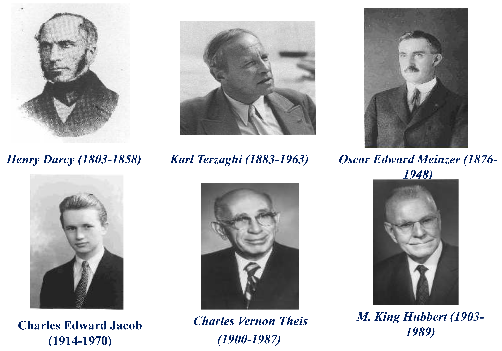

# 绪论

## 1. 研究对象

**地下水动力学**（Groundwater Dynamics/Hydraulics of Groundwater）是研究地下水在岩石空隙中运动规律的科学，以饱和带地下水运动规律为研究对象，渗流力学（Mechanics of Flow through Porous Media）是其理论基础，但二者范畴存在区分：渗流力学面向通用多孔介质流体，地下水动力学结合真实的水文地质条件（含水层的空间分布、边界性质、补给排泄条件等），是具有鲜明地球科学特色的学科分支。

**课程任务**： 从**水量**与**水质**两方面对地下水系统进行定量分析，为合理开发利用地下水、防治地下水灾害、保护地下水环境提供科学依据。具体而言，包括：

- **水量问题**：地下水资源评价、开采量预测、疏干排水设计、水库渗漏评估等；
- **水质问题**：污染物运移预测、海水入侵防治、地下水水质保护等；
- **耦合问题**：地下水开采引发的地面沉降、岩溶塌陷、生态退化等。

**研究方法**： 以**质量守恒**、**能量守恒与转化**的物理定律为基础，分析含水层中地下水在静态与动态条件下的运动规律及其影响因素，结合数学、物理、流体力学、地质学等多学科交叉为手段，从**流体（水）** 与**介质（含水层）** 两方面入手——流体物理性质（密度、粘滞性、压缩性）与介质结构性质（孔隙性、渗透性、压缩性）共同决定了地下水运动的宏观行为。

与相邻学科的关系：

- **水文学（Hydrology）**：水文学关注水循环的整体（降水→径流→蒸发→入渗），地下水动力学专注于地下水在饱和带中的运动环节；
- **流体力学（Fluid Mechanics）**：流体力学研究流体在管道或明渠中的运动，核心方程为 Navier-Stokes方程；地下水动力学研究水在多孔介质中的运动，以达西定律描述多孔介质阻力；
- **水文地质学（Hydrogeology）**：水文地质学定性描述含水层的分布、结构和形成条件，地下水动力学定量描述地下水在其中运动的速度、方向和水量等。

## 2. 课程内容

本课程共七章，从基本概念、简单模型逐步过渡到复杂的工程应用：

- 第1章 地下水运动的基本概念与基本定律：建立描述地下水运动的物理和数学工具（水头、水力坡度、渗透系数、达西定律）；
- 第2章 地下水运动的数学模型及定解条件：从质量守恒定律出发，推导不同类型含水层的控制方程，并讨论获得唯一解所需的定解条件；
- 第3章 一维地下水流问题：在一维条件下求解地下水运动方程，从稳定流过度到非稳定渗流
模型，兼顾工程上的应用；
- 第4章 理想条件下的完整井稳定流模型：研究地下水向水井的稳定汇流（Dupuit公式、Thiem公式），理解井流模型的建模方法。
- 第5章 理想条件下的完整井非稳定流模型：研究地下水向水井的非稳定汇流（Theis、Hantush、Boulton、Neuman 模型），讨论了不同条件的无限含水层完整井抽水时降深变化规律；
- 第6章 根据抽水试验确定含水层参数：根据观测数据反求含水层水文地质参数（逆问题），并通过抽水试验数据解释水文地质条件；
- 第7章 复杂水文地质条件下的解析法：将基本模型推广至干扰井群、边界效应、越流、不完整井等更复杂的实际条件。

**学习主线**： 基础物理量定义与定律（第1章）→ 守恒方程推导（第2章）→ 简单条件下的解析解（第3-5章）→ 野外参数反演（第6章）→ 复杂条件推广（第7章）。建议读者始终将“是什么、学什么、怎么用”三个基本问题贯彻到整个学习过程中，保持对“我在学什么、它处于全书的哪个位置”的清晰认识。

## 3. 学习建议

**团队协作**

- 自由组成学习小组（建议3～5人一组）；
- 组内民主测评，贡献大的成员获得较高的平时成绩（5分制，期末按比例折算计入总成绩）；
- 考评内容包括课堂考查、课后作业、上机实验报告及其他项目；
- 小组设组长，负责汇总学习问题，及时向老师反馈同学们的意见。

**学习建议**

- **关注专业课程之间的内在联系**：地下水动力学以水文地质学为基础，同时也是其他课程，如地下水数值模拟、地下水污染与防治等课程的理论基础，学习时应主动建立知识关联；
- **建议阅读一本英文教材**：如 Bear（1979）或 Fetter（2001），有助于拓宽国际视野、熟悉专业术语；
- **阅读课外材料**：建议课后阅读与课程内容相关的中英文论文或经典教材章节，深化理解；
- **有问题及时求助**：鼓励向老师、助教和同学请教，不要让疑问积累；
- **善用网络资源**：USGS、IAH、AGU等网站有大量免费学习资源；
- **尝试编程解决问题**：Python、MATLAB或Excel均可用于数值计算和结果可视化，编程过程本身也是深化理论理解的途径；
- **积极思考，理论联系实践**：每学一个公式，想一想它在工程中能解决什么问题、有什么局限；
- **了解学科前沿**：关注本学科的最新研究进展（如裂隙介质、非均质性、随机理论等）。

## 4. 发展历程

按研究者对地下水运动规律的认识过程与研究手段的演进，可划分为以下五个阶段：

**（1）稳定流建立和发展阶段（1856–1935）**

- **1856年**，法国水力学家**H. Darcy**（1803–1858）通过砂柱渗流实验，提出了著名的**达西定律（Darcy's Law）**——$Q = K A (H_1-H_2)/L$。这一定律成为地下水运动的理论基础，标志着地下水动力学作为一门定量科学的诞生。**值得指出的是，达西当时的原始研究动机是解决第戎市（Dijon）的供水问题——他的实验装置是应市政供水需求而设计的，这充分体现了“工程需求驱动理论创新”的学科发展规律。**
- **1863年**，**J. Dupuit**在研究一维稳定流和向水井的二维稳定流时，提出了著名的**Dupuit假设**（忽略垂向流速，将空间三维流场简化为平面二维流）及相应的**Dupuit公式**。**Dupuit假设虽然牺牲了井壁附近的精度，却使工程问题首次获得了可解析求解的数学表达式，在工程上得到了广泛的应用。**
- **1901年**，**P. Forchheimer**等学者进一步研究了更复杂的渗流问题，奠定了地下水稳定流的理论基础。
- **1906年**，提出了**Thiem公式**（基于两个观测孔的稳定流求参公式），至今仍在工程中广泛应用。
- **1928年**，**O.E. Meinzer**（1876–1948）研究了地下水运动的**不稳定性**和承压含水层的**贮水性质**，首次明确指出承压含水层具有弹性释水能力，打破了此前“承压水不可压缩”的片面认识。

**（2）非稳定流建立和发展阶段（1935–1969）**

- **1935年**，美国数学家兼水文地质学家**C.V. Theis**（1900–1987）受热传导理论的启发，提出了地下水流向承压水井的**非稳定流的Theis公式**，开创了现代地下水运动理论的新纪元。**Theis公式的提出标志着地下水动力学从“稳定流时代”进入了“非稳定流时代”——这一跨越的意义，堪比物理学中从静力学到动力学的突破。**
- 20世纪40年代末至50年代，**M.S. Hantush**和**C.E. Jacob**（1914–1970）系统建立了**越流理论**（Leaky Aquifer Theory），将承压含水层与相邻含水层通过弱透水层的水量交换纳入了理论框架。
- **1954年和1963年**，**N.S. Boulton**基于大量抽水试验观测，提出了考虑**滞后重力排水**的潜水非稳定流模型；
- **1972年**，**S.P. Neuman**从更严格的三维渗流方程出发，建立了同时考虑**流速垂向分量**和**含水层弹性释水**的潜水非稳定流模型，弥补了Boulton模型中经验参数$\alpha$缺乏明确物理含义的不足。

**（3）实验—电网络模拟技术阶段（1950–1980）**

- 1950–1965年间，研究者发展了**大范围含水层系统的电网络模拟技术**（Electric Analog Models），利用电阻-电容网络模拟含水层的导水和贮水特性，在计算机普及之前是解决复杂渗流问题的重要手段。**到20世纪80年代，随着数字计算机的普及，电模拟技术在我国也逐步退出了历史舞台，但它在学科发展史上留下了独特的印记。**

**（4）计算机数值模拟技术阶段（1965–至今）**

- 自1965年以来，**计算机数值模拟技术**（有限差分法、有限单元法、有限体积法）得到广泛应用，并逐步形成了**商业化软件**（如MODFLOW、FEFLOW、HYDRUS等）。**数值方法突破了解析法在处理复杂边界、非均质和各向异性方面的局限，使大规模、高精度的地下水资源评价和污染预测成为可能。**

**（5）现代发展新趋势（1990–至今）**

- **多场耦合问题**：地下水渗流与温度场、化学场、应力场的耦合（如地热系统、深部核废料处置、CO₂地质封存）；
- **多尺度问题**：从孔隙尺度（微观）到流域尺度（宏观）的跨尺度模拟与参数升尺度方法；
- **不确定性量化**：由于含水层非均质性的认知局限性，随机方法和贝叶斯反演日益受到重视；
- **大数据与人工智能**：机器学习在水文地质参数反演和地下水动态预测中的应用正成为前沿方向。

{#fig0-01 width=10cm fig-align=center}

## 5. 研究方向

当前地下水动力学领域的前沿研究方向包括：

- 地下水在**裂隙介质、岩溶介质**中的运动机制与基本运动规律；
- **非饱和带**水分及溶质运移理论；
- 地下水中**溶质**（污染物）的运动机制和运移理论；
- 地下水中的**热量运移**（地热系统、能源地下储存）；
- 地下水系统的**最优管理**问题（多目标优化、可持续开采）；
- **介质非均质性**对渗流和溶质运移的控制机制；
- 各种实际渗流问题的**数值模拟方法**（高精度算法、并行计算、自适应网格）；
- **随机理论**在水流和溶质运移研究中的应用（Monte Carlo方法、地质统计学）；
- 含**多组分溶质**水流的Darcy定律形式（密度驱动流、化学-渗流耦合）。

## 6. 应用领域

地下水动力学的理论方法在以下工程领域具有广泛应用：

- **城市、工矿企业和农业供水**：确定水文地质参数，论证开采方案和预计开采量，预报开采动态，正确评价地下水资源，科学管理和保护地下水资源。**典型问题：城市应急水源地的可开采量评估。**

- **矿山开采、建筑基坑和沼泽化、盐渍化区的疏干**：设计疏干量、疏干水平，预测疏干范围、疏干过程，合理选择疏干设备。**典型问题：深基坑开挖中的降水设计与周边沉降控制。**

- **水工建筑（水利工程）**：解决库周、坝（堤）基及坝（堤）体的渗漏量、地下水位壅高产生的浸没范围预测等问题，为正确选择坝址、坝体结构提供依据。**典型问题：水库蓄水后库岸浸没范围的预测。**

- **农业工程**：农田灌溉中确定灌排沟渠的合理间距、排灌水量和时间，以及地下水动态预报。**典型问题：干旱区灌区次生盐渍化的防治。**

- **环境地质**：水质污染及净化趋势的预报、地面沉降预测与控制、岩溶塌陷、边坡稳定、海水入侵防治、地下水储能以及人工补给。**典型问题：海岸带地下水开采引起的海水入侵模拟与防控。**

- **新能源与深部地质工程**：地热资源评价与开采、深部核废料地质处置中的渗流-应力-温度耦合分析、CO₂地质封存中的多相渗流。**这些是近年来快速发展的新应用领域。**

## 7. 教材及参考书

**推荐教材**

- 薛禹群. 地下水动力学[M]. 北京：地质出版社.

**参考书**

- 陈崇希. 地下水动力学[M]. 北京：地质出版社；
- 李义昌. 地下水动力学[M]. 徐州：中国矿业大学出版社；
- 周志芳，王锦国. 地下水动力学[M]. 北京：科学出版社；
- 迟宝明. 地下水动力学习题集[M]. 北京：科学出版社；
- Bear, J. Hydraulics of Groundwater. McGraw Hill, 1979.（**经典英文教材**）
- Fetter, C.W. Applied Hydrogeology. Prentice Hall.（**应用导向的经典教材，案例丰富**）
- Domenico, P.A. & Schwartz, F.W. Physical and Chemical Hydrogeology. Wiley.（**侧重物理-化学耦合**）

## 8. 数学预备知识

地下水动力学的数学推导需要以下高等数学知识作为基础。建议在开始学习第1章之前，先复习或预习以下内容：

**数学要点（对应同济大学《高等数学》第七版）**

- **微分在近似计算中的应用**：（上册 P116）——用于理解线性化方法（如Boussinesq方程的线性化）；
- **Taylor公式**：一元（上册 P138）、二元（下册 P122）——用于函数逼近和误差估计（如井函数的级数展开）；
- **多元复合函数求导**：（下册 P78）——用于坐标系变换（如直角坐标与柱坐标的转换）；
- **方向导数与梯度**：（下册 P101）——水头梯度$\nabla H$是达西定律和地下水运动方程中的核心概念；
- **最小二乘法**：（下册 P127）——用于抽水试验数据的曲线拟合和参数反演。

**微分与近似计算**

**微分**：设函数 $y=f(x)$ 在某区间内有定义，区间内的点 $x_0$ 及 $x_0+\Delta x$，如果函数值增量
$$
\Delta y = f(x_0 + \Delta x) - f(x_0)
$$
可表示为
$$
\Delta y = A\Delta x + o(\Delta x)
$$
其中 $A$ 为不依赖于 $\Delta x$ 的常数，称 $y=f(x)$ 在 $x_0$ 点可微，$A\Delta x$ 为函数在 $x_0$ 点的微分，记为
$$
\mathrm{d}y=A\Delta x
$$
式中，$A=f'(x_0)$.

**近似计算**
$$
f(x_0+\Delta x) \approx f(x_0)+f'(x_0)\Delta x
$$
进一步了解如何估算误差。

**Taylor公式**

- 一元形式

设函数 $f(x)$ 在含有 $x_0$ 的某开区间 $(a,b)$ 内存在 $(n+1)$ 阶导数，则对任一 $x\in(a,b)$ 有
$$
\begin{align*}
f(x)&=f(x_0)+f'(x_0)(x-x_0)+\frac{f''(x_0)}{2!}(x-x_0)^2+ \cdots \\
&\quad + \frac{f^{(n)}(x_0)}{n!}(x-x_0)^n+R_n(x)
\end{align*}
$$
式中
$$
R_n(x)=\frac{f^{(n+1)}(\xi)}{(n+1)!}(x-x_0)^{n+1}
$$
$\xi$ 为 $x_0$ 与 $x$ 间的某个值。$n=1$ 时
$$
f(x) \approx f(x_0)+f'(x_0)(x-x_0)
$$
误差 $\frac{f''(\xi)}{2!}(x-x_0)^2$.

- 二元形式

设函数 $z=f(x,y)$ 在含有 $(x_0,y_0)$ 的某邻域内连续且有直到 $(n+1)$ 阶连续偏导数，$(x_0+h,y_0+k)$ 为邻域内任一点，则
$$
\begin{align*}
f(x_0+h,y_0+k) &= f(x_0,y_0) + \left(h\frac{\partial}{\partial x}+k\frac{\partial}{\partial y}\right) f(x_0,y_0) \\
&\quad +\frac{1}{2!}\left(h\frac{\partial}{\partial x}+k\frac{\partial}{\partial y}\right)^2 f(x_0,y_0)+ \cdots \\
&\quad + \frac{1}{n!}\left(h\frac{\partial}{\partial x}+k\frac{\partial}{\partial y}\right)^n f(x_0,y_0) \\
&\quad +\frac{1}{(n+1)!}\left(h\frac{\partial}{\partial x}+k\frac{\partial}{\partial y}\right)^{n+1} f(x_0+\theta h,y_0+\theta k)
\end{align*}
$$
式中，$0 < \theta < 1$.

如果 $h$ 或 $k$ 有一个为 0，则公式与一元公式相似。

**多元复合函数求导**

设 $u=\varphi (x,y)$ 及 $v=\psi (x,y)$ 在点 $(x,y)$ 有对 $x$ 及对 $y$ 的偏导数，函数 $z=f(u,v)$ 在对应点 $(u,v)$ 有连续偏导数，则复合函数 $z=f(\varphi,\psi)$ 在点 $(x,y)$ 的两个偏导数都存在，且
$$
\begin{align*}
\frac{\partial z}{\partial x}&=\frac{\partial z}{\partial u}\frac{\partial u}{\partial x} +\frac{\partial z}{\partial v}\frac{\partial v}{\partial x} \\
\frac{\partial z}{\partial y}&=\frac{\partial z}{\partial u}\frac{\partial u}{\partial y} +\frac{\partial z}{\partial v}\frac{\partial v}{\partial y}
\end{align*}
$$

**例**：将 $\frac{\partial^2u}{\partial x^2}+\frac{\partial^2u}{\partial y^2}$ 转换成极坐标系中的形式。

极坐标
$$
\begin{align*}
\rho &=\sqrt{x^2+y^2} \\
\theta&=\arctan \frac{y}{x}
\end{align*}
$$
一阶偏导
$$
\begin{align*}
\frac{\partial u}{\partial x}&=\frac{\partial u}{\partial \rho}\frac{\partial \rho}{\partial x}+\frac{\partial u}{\partial \theta}\frac{\partial \theta}{\partial x}\\
\frac{\partial u}{\partial y}&=\frac{\partial u}{\partial \rho}\frac{\partial \rho}{\partial y}+\frac{\partial u}{\partial \theta}\frac{\partial \theta}{\partial y}
\end{align*}
$$
二阶偏导
$$
\begin{align*}
\frac{\partial^2u}{\partial x^2}&=\frac{\partial}{\partial \rho}\left(\frac{\partial u}{\partial x}\right)\frac{\partial \rho}{\partial x}+\frac{\partial}{\partial \theta}\left(\frac{\partial u}{\partial x}\right)\frac{\partial \theta}{\partial x}\\
\frac{\partial^2u}{\partial y^2}&=\frac{\partial}{\partial \rho}\left(\frac{\partial u}{\partial y}\right)\frac{\partial \rho}{\partial y}+\frac{\partial}{\partial \theta}\left(\frac{\partial u}{\partial y}\right)\frac{\partial \theta}{\partial y}
\end{align*}
$$
计算后整理得
$$
\frac{\partial^2u}{\partial x^2}+\frac{\partial^2u}{\partial y^2} =\frac{\partial^2u}{\partial \rho^2}+\frac{1}{\rho}\frac{\partial u}{\partial \rho}+\frac{1}{\rho^2}\frac{\partial^2 u}{\partial \theta^2} = \frac{1}{\rho^2}\left[\rho\frac{\partial}{\partial \rho}\left(\rho\frac{\partial u}{\partial\rho}\right)+\frac{\partial^2u}{\partial \theta^2}\right]
$$
该形式便于处理径向对称问题（即 ${\partial u}/{\partial \theta} = 0$）。**这一变换是推导第5章井流理论中Theis公式和Hantush-Jacob公式的关键数学步骤。**

**方向导数与梯度**

**方向导数**

设 $f(x,y)$ 在 $(x_0,y_0)$ 处可微，则沿 $\vec{L}$ 的方向导数存在，且
$$
\left.\frac{\partial f}{\partial l}\right|_{(x_0,y_0)}=f_x(x_0,y_0)\cos\alpha+f_y(x_0,y_0)\cos\beta
$$
式中，$\cos\alpha$ 与 $\cos \beta$ 为 $\vec{L}$ 的方向余弦。

**梯度**
$$
\mathbf{grad} f(x_0,y_0)=\nabla f(x_0,y_0)=f_x(x_0,y_0)\vec{i}+f_y(x_0,y_0) \vec{j}
$$
梯度与方向导数的关系：

设 $\vec{n}$ 为等值线 $f(x,y)=c$ 上 $P_0(x_0,y_0)$ 点的单位法向量，则
$$
\nabla f(x_0,y_0)=\frac{\partial f}{\partial n}\vec{n}
$$

**梯度概念在地下水动力学中的地位**： 水头 $H(x,y,z)$ 的梯度 $\nabla H$ 是达西定律 $\mathbf{v}=-K\nabla H$ 中的重要变量——它既是地下水的驱动力（水力坡度），也是水头场空间变化率的数学表达。理解“梯度是标量场变化最快的方向”这一几何含义，有助于理解地下水为何沿最陡的水头下降方向流动。

**最小二乘法**

假设一组试验数据 $(x_i,y_i)$ 符合经验公式 $y=ax+b$，$\hat{y_i}$ 为对应于 $x_i$ 的经验值，则误差为 $\hat{y}_i-y_i$。

求误差平方和最小时的系数 $a$ 和 $b$
$$
\min_{a,b} M(a,b)=\sum_i (y_i-\hat{y}_i)^2=\sum_i \left[y_i-(ax_i+b)\right]^2
$$
也可以看作优化问题的求解。

若通过数据转换，公式可以写成 $y=ax+b$ 的形式，可直接套用公式计算，如 $y=a\mathrm{e}^{bx}$，若以对数误差为评价标准可近似转换。

多个变量，如 $(x_{1i},x_{2i},\cdots,x_{ki},y_i)$ 有公式 $y=a_1x_1+a_2x_2+\cdots+a_kx_k$，也可使用最小二乘法，所得公式与多元线性回归方法相同。

**最小二乘法在地下水动力学中的应用**： 主要应用于**Q--s曲线类型判断、抽水试验数据的拟合**，掌握最小二乘法的原理和计算步骤，是水文地质计算的基本功。

**特殊函数**

在本课程第5-7章中，将会频繁出现以下特殊函数，建议提前了解其定义和基本性质：

- **指数积分函数 $\mathrm{E}_1(u)$ 或 $W(u)$**：$W(u)=\int_u^\infty \frac{e^{-y}}{y}\mathrm{d}y$，出现在Theis井函数中；
- **误差函数 $\mathrm{erf}(x)$ 与余误差函数 $\mathrm{erfc}(x)$**：$\mathrm{erf}(x)=\frac{2}{\sqrt{\pi}}\int_0^x e^{-t^2}\mathrm{d}t$，$\mathrm{erfc}(x)=1-\mathrm{erf}(x)$，出现在一维非稳定流（第3章）和半无限含水层井流中；
- **Bessel函数 $K_0(x)$、$K_1(x)$**：出现在越流井流（第5章 Hantush-Jacob公式）和稳定越流公式中；
- **Gamma函数 $\Gamma(x)$**：$\Gamma(x)=\int_0^\infty t^{x-1}e^{-t}\mathrm{d}t$，出现在Muskat不完整井公式（第7章）中。


在初步了解地下水动力学的发展历程和应用领域后，我们将正式步入第1章的学习——从基本概念与基本定律出发，建立描述地下水运动的完整理论体系。

```{mermaid}
flowchart LR
    subgraph L0["🔵 基础理论"]
        direction LR
        CH1["第1章"]
        CH2["第2章"]
    end

    subgraph L1["🟢 简单模型解析解"]
        direction LR
        CH3["第3章"]
        CH4["第4章"]
    end

    subgraph L2["🟠 典型非稳定井流解析解"]
        CH5["第5章"]
    end

    subgraph L3["🔴 参数反演与复杂问题推广"]
        direction LR
        CH6["第6章"]
        CH7["第7章"]
    end

    %% 主线顺序
    CH1 --> CH2
    CH2 --> CH3
    CH3 --> CH4
    CH4 --> CH5
    CH5 --> CH6
    CH6 --> CH7

    %% 跨章节虚线关联
    CH1 -.-> CH4
    CH1 -.-> CH7
    CH2 -.-> CH7
    CH4 -.-> CH6
    CH4 -.-> CH7
    CH5 -.-> CH7

    %% 子图圆角+配色
    style L0 fill:#e3f2fd,stroke:#1565c0,stroke-width:2px,rx:12,ry:12
    style L1 fill:#e8f5e9,stroke:#2e7d32,stroke-width:2px,rx:12,ry:12
    style L2 fill:#fff3e0,stroke:#e65100,stroke-width:3px,rx:12,ry:12
    style L3 fill:#ffebee,stroke:#c62828,stroke-width:2px,rx:12,ry:12

    %% 章节节点 圆角+填充边框（旧Mermaid仅支持style单独定义，无::类）
    style CH1 fill:#bbdefb,stroke:#1565c0,stroke-width:2px,rx:12,ry:12
    style CH2 fill:#bbdefb,stroke:#1565c0,stroke-width:2px,rx:12,ry:12
    style CH3 fill:#c8e6c9,stroke:#2e7d32,stroke-width:2px,rx:12,ry:12
    style CH4 fill:#c8e6c9,stroke:#2e7d32,stroke-width:2px,rx:12,ry:12
    style CH5 fill:#ffcc80,stroke:#e65100,stroke-width:3px,rx:12,ry:12
    style CH6 fill:#ef9a9a,stroke:#c62828,stroke-width:2px,rx:12,ry:12
    style CH7 fill:#ef9a9a,stroke:#c62828,stroke-width:2px,rx:12
```